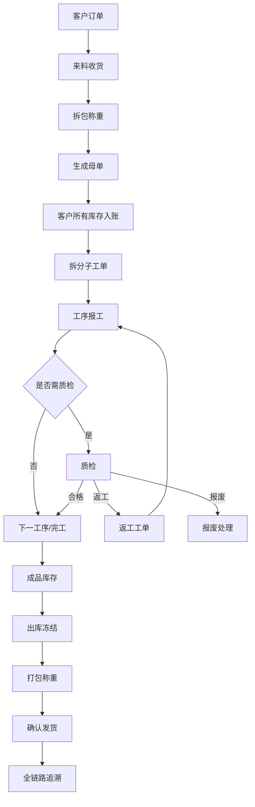

# 来料加工进销存与生产管理系统 业务流程与规则设计

**文档版本**：V1.2（2026-10-25 修正已落地规则的说明）
**文档定位**：按需查阅的业务规则专题；当前范围、状态和阻断统一见项目核心
**关联文档**：[项目核心](./00_项目核心.md)、[API 契约](./16_字段字典与API契约.md)

---

## 1. 设计原则

本文保留完整目标流程和状态机，不代表所有动作均已实现或纳入本次试用。已采用的现场规则集中在各节「现行」说明，以及第 14、15 节；与早期目标描述冲突时，现行规则优先。实现、验收及待完善项统一见 [项目核心](./00_项目核心.md)，字段与授权以 [API 契约](./16_字段字典与API契约.md) 为准。历史方案和测试记录不作为当前验收证明，未确认规则不因整理文档而自动生效。

- 单据驱动库存：任何库存变化必须来自业务单据或审批后的调整单。
- 批次贯穿全链路：母单编码是客户来料追溯核心。
- 数量和重量并行：贵重物料必须同时记录数量、重量和单位。
- 损耗按工序计算：不得简单用母单总进料和最终出货倒推。
- 交接必须留痕：关键节点记录交出人、接收人、时间、重量和证据。
- 现场登记来源必须留痕：从纸质表或 Excel 转录/导入的数据必须保存来源登记表、原表行号和纸质序号，出货快递合并栏还要保留原文。
- 异常不阻断全部业务：异常进入待审批或待处理，但正常链路尽量可继续。
- 一期轻流程：审批只做固定场景轻量审批，不引入完整工作流引擎。

---

## 2. 总体业务闭环



---

## 3. 客户订单流程

### 3.1 正常路径

1. 业务员创建客户订单。
2. 录入客户、预计来料、预计交期、加工要求、备注。
3. 提交订单，状态从 `draft` 变为 `confirmed`。
4. 后续母单、工单、出库单反向关联订单。

### 3.2 异常路径

| 异常 | 处理 |
|---|---|
| 客户取消 | 未入库可作废；已入库需走退料或取消生产处理 |
| 订单信息错误 | 未生产前允许修改，生产后关键字段修改需留日志 |
| 多批来料对应同一订单 | 支持一个订单关联多个母单 |
| 无订单来料 | 允许先建临时订单，后续补充业务信息 |

### 3.3 状态机

| 状态 | 说明 | 可执行动作 |
|---|---|---|
| draft | 草稿 | 编辑、提交、删除 |
| confirmed | 已确认 | 关联来料、取消 |
| partial_inbound | 部分来料 | 继续入库、查看进度 |
| processing | 生产中 | 查看工单和库存 |
| partial_shipped | 部分发货 | 继续发货 |
| completed | 已完成 | 查询、归档 |
| voided | 已作废 | 查询 |

---

## 4. 来料收货与拆包流程

### 4.1 正常路径

1. 收货员扫描或录入入库快递单号。
2. 系统校验快递单号是否重复。
3. 选择客户和客户订单。
4. 点击“开始拆包”，记录开始时间、操作人、摄像头或工位。
5. 拆包后录入物料、数量、毛重、净重、包装重量、照片和备注。
6. 点击“确认入库”，记录结束时间。
7. 系统生成母单编码和母单标签。
8. 系统生成库存台账：客户所有物料进入待加工仓。
9. 现场用手机拍摄拆包照片或短视频并上传到该母单。录像机按时间截取不进入当前作业路径，采集规则见本文第 14 节，HTTPS 和上传部署见 [部署说明](./19_Docker一键部署与离线交付.md)。

### 4.2 异常路径

现行收货先识别快递面单的运单号，已有母单则打开原单，不重复新建。手机和桌面使用同一套来料建单。创建母单时加工要求和完成期限必填，连同客户、物料、数量、重量保存。带 `requestId` 的来料建单和入库确认进入同一次提交：母单、来料事实、适用入库流水和成功结果一起成功或一起撤销。同账号、同请求、同规范化内容回放原结果；内容、目标或客户变化必须换新请求编号，也不能跨账号重放。非空运单只能对应一张母单。未带 `requestId` 的旧调用和登记导入仍各自提交，不回放。建单前可以先选照片或视频，上传或关联失败只补文件，不重新建单、不重新入库。提交超时先按运单核对已有母单。

| 异常 | 处理 |
|---|---|
| 快递单号重复 | 阻止新建，提示已关联母单 |
| 客户不明确 | 允许标记为待确认，不允许拆分工单 |
| 来料数量或重量异常 | 创建来料异常审批 |
| 拆包照片或短视频未上传 | 手机补拍后上传；录像机截取不作为试运行补救 |
| 标签打印失败 | 允许补打，补打必须记录日志 |
| 来料包含多种物料 | 同一母单下记录多条物料明细 |

### 4.3 数据影响

- 创建客户订单关联关系。
- 创建母单和母单物料明细。
- 创建库存台账。
- 更新库存余额。
- 保存手机采集的拆包照片或短视频。录像机截取任务不在试运行路径上。
- 若来自现场登记表，保存 `sourceRegisterType/sourceRegisterLineNo/sourceRegisterSequence`；这些字段只用于审计和导入复核，不参与库存状态机。
- 生成标签打印记录。

---

## 5. 母单与子工单拆分流程

### 5.1 正常路径

1. 车间组长打开母单详情。
2. 查看母单可分配数量和重量。
3. 按数量、重量或组合方式拆分子工单。
4. 为子工单选择工序模板。
5. 系统校验拆分总量不得超过母单可用余额。
6. 系统生成子工单编码、子工单物料明细和工序实例。
7. 子工单带出工序单价快照、标准损耗率快照、质检配置快照。
8. 打印子工单标签。
9. 分配给员工、班组或工位。
10. 库存从待加工仓转入在制仓。

### 5.2 异常路径

现行拆单由人工选择「不拆」或「拆成多张」。不拆打印一张母单贴纸；拆分时数量、重量均不得超过母单剩余，生成子单并通过库存台账将待加工转在制。拆成子单后，周转盒上的母单标签仍可预览和打印，子单另打流转贴纸。报工、质检和发货仍须选择具体子单。每张子单继承客户、加工要求、完成期限并保存所选工序。是否要求数量、重量完全拆平仍按业务待确认项处理。

母单／子单贴纸明文显示验证码、客户、加工要求、期限和单号。验证码是随单号生成、供人眼核对的短码，各子单不同；它不替代登录或数据授权。打印模板的字段和脚注来源可以选择“客户首字母暗记”，取值是该单客户名称的拼音首字母。模板里若仍保留“客户”来源，中文名会继续印出。子单的所属母单号按模板字段或脚注的位置打印；模板没有这项时，仍默认排在第二行。二维码沿用第 14 节协议，标签黑白按毫米纸张打印，丢失补打留日志。工序进度扫码后查询，不印在标签上。

| 异常 | 处理 |
|---|---|
| 拆分数量超出可用余额 | 阻止保存 |
| 拆分重量误差超阈值 | 提示并要求权限确认或重新录入 |
| 已开工子工单需要调整 | 生成调整记录，不允许直接覆盖 |
| 子工单标签丢失 | 允许补打并写日志 |
| 工序模板选错 | 未开工前允许调整；开工后需审批或作废重建 |

### 5.3 状态机

| 状态 | 说明 | 可执行动作 |
|---|---|---|
| draft | 已创建未提交 | 编辑、删除 |
| pending_assign | 待分配 | 分配、打印标签 |
| assigned | 已分配 | 开工、改派 |
| processing | 加工中 | 报工、质检、异常 |
| waiting_qc | 待质检 | 质检 |
| reworking | 返工中 | 返工报工、复检 |
| finished | 已完工 | 入成品库存、出库 |
| voided | 已作废 | 查询 |

---

## 6. 工序报工与称重交接流程

**现行岗位交工（V73）：**同单允许分批，每批登记数量，下道只办理上道已到达的数量；末道统一登记总重量，数量交齐后可零数量补重量，未称重不进入质检。部分批次不等于整道工序完成，中间批次不额外生成库存流水，工序计费仍消费一次完成事实。批次、必要库存变化和请求回执同事务，超时以原请求编号回放，并发累计不得超交；五档百分比只记进度，100% 不自动交工。下文目标流程中的逐次称重、损耗计算和撤回等描述不能据此视为岗位入口均已开放。

### 6.1 正常路径

1. 操作工打开 PWA 移动网页。
2. 扫描子工单二维码。
3. 系统校验当前用户是否有权限、是否轮到当前工序。
4. 显示工单、物料、上一工序产出重量、标准损耗率。
5. 操作工录入完成数量、产出重量、损耗重量、备注。
6. 关键工序需录入交接记录：交出人、接收人、投入重量、产出重量、称重时间。
7. 系统计算损耗和是否超标。
8. 报工提交后更新工序状态。
9. 若需要质检，进入待质检；否则进入下一工序或完工。
10. 生成库存台账：在制状态或工序状态发生转移。

### 6.2 异常路径

现行岗位工序为雕刻、镶嵌、抛光，默认按该顺序，拆单时可取消不需要的工序。账号绑定其中一道或多道，扫子单或不拆的母单后只展示本人可做工序的要求和动作；未绑定不能报工，上道未交到的数量不能提前办理。首次实际交工进入在制，中间批次保持在制且不额外生成台账；末道交齐数量并登记总重量才转半成品、开放质检。普通岗位路径不因目标流程中的「授权跳过」描述而开放跳工序按钮。

带 `requestId` 的岗位交付把不拆母单首次转在制、本工序库存流水、交付事实和请求成功结果放在同一次提交。同账号、同请求、同规范化内容回放原结果，不第二次交付，也不第二次改库存。换工序、换单据、换客户或换账号必须使用新的请求编号。已有「这道工序已经交过」只说明另一次交付被拒绝，不能代替结果回放。过程说明仍只追加记录，不产生库存、工资或工序完成。正式交付成功后才能把证据绑到返回的台账号；上传或绑定失败只补文件或引用。超时先按原请求回放，不盲目再交。现行岗位 HTTP 必须带 `requestId`；无请求号的历史兼容方法不能作为现场提交入口。

| 异常 | 处理 |
|---|---|
| 扫描非本人任务 | 提示无权限 |
| 跳工序报工 | 阻止提交，管理员可授权跳过 |
| 数量或重量为空 | 阻止提交 |
| 产出重量大于投入重量且超误差 | 阻止或要求说明 |
| 损耗超标 | 自动生成损耗记录和审批 |
| 网络中断 | PWA 保留表单草稿，恢复后重提 |
| 报工录入错误 | 未质检前可撤回；已流转后走更正记录 |

### 6.3 损耗计算规则

```text
本工序投入重量 = 上一交接产出重量或本工序领用重量
本工序产出重量 = 本次报工产出重量
合理转移重量 = 经业务规则确认不计为损耗的转移重量
本工序损耗重量 = 本工序投入重量 - 本工序产出重量 - 合理转移重量
允许损耗重量 = 本工序投入重量 × 标准损耗率快照
超标损耗重量 = max(0, 本工序损耗重量 - 允许损耗重量)
```

### 6.4 称重交接规则

- 关键工序必须记录称重交接。
- 称重记录不可物理删除。
- 允许人工录入重量，一期不强制电子秤自动采集。
- 重量修改必须记录修改前值、修改后值、修改人、原因。
- 称重交接可关联照片、视频片段或附件。

---

## 7. 质检、返工与报废流程

### 7.1 正常路径

1. 需要质检的工序报工后进入待质检列表。
2. 质检员扫码或从列表进入质检页面。
3. 录入质检结果、合格数量、不合格数量、原因、照片。
4. 选择处理方式：合格、返工、报废、让步通过。
5. 合格则进入下一工序或成品库存。
6. 返工则生成返工类型工单，关联原工单、原工序、质检记录。
7. 报废则生成报废记录和库存台账。
8. 让步通过需要权限或审批。

### 7.2 返工规则

现行质检对照母单或子单加工要求逐条判定：按换行拆条款，忽略空行，无换行整段为一条；每条必须填写合格、不合格或让步，不合格和让步必须说明原因。质检员取当前登录账号的操作人，另传姓名不能替代。最后一道工序未交付或库存未处于半成品时不能提交。

任一条不合格即调用既有冻结命令，将半成品转冻结并记台账，可开关联原单及本次质检的返工单。合格、让步不转冻结，让步保留核对记录。不能仅修改页面状态代替库存命令。

初检写入质检轮次，轮次号从 1 开始，类型为初检。原不合格条款、原因、冻结标志和返工号保留，不能改写成合格来代替复检。返工报工会留下报工事实并把返工库存转回半成品。只有这一事实存在、库存回到半成品、且没有未处理冻结时，才允许提交一轮复检。复检另记轮次，类型为复检，关联返工单和报工台账。复检不合格再次冻结。复检合格或让步才是放行依据。放行看最新轮次、半成品余额和是否还有冻结库存，不把初检的冻结标志改成未冻结。没有单独轮次行的旧初检，读取时当作历史首轮，不补写虚构复检。带请求编号的上述命令同内容回放；不带请求编号时库存和质检事实仍各自提交。

- 返工不另建一套独立状态机，而是作为特殊工单类型处理。
- 返工工单必须关联原工单、原工序、原质检记录。
- 返工报工默认不计工资。
- 返工完成后必须复检。
- 返工次数超过配置上限，自动生成审批。

### 7.3 报废规则

- 报废必须记录原因、责任归因、数量、重量、照片或附件。
- 报废影响库存，生成报废状态库存或报废损耗记录。
- 贵重物料报废默认需要审批。

### 7.4 状态影响

| 质检结果 | 工序状态 | 工单状态 | 库存影响 |
|---|---|---|---|
| 合格 | completed | 下一工序/完工 | 在制转下一状态或成品 |
| 返工 | rework_required | reworking | 转返工状态 |
| 报废 | scrapped | 部分/全部异常 | 转报废状态或损耗 |
| 让步通过 | completed_with_concession | 下一工序/完工 | 正常流转，留异常标记 |

---

## 8. 库存流程

### 8.1 库存状态

| 状态 | 说明 |
|---|---|
| raw_waiting | 待加工来料 |
| wip | 在制 |
| semi_finished | 半成品 |
| finished | 成品 |
| frozen | 出库冻结 |
| rework | 返工品 |
| scrap | 报废品 |
| shipped | 已发货 |

### 8.2 库存业务动作

| 动作 | 台账影响 |
|---|---|
| 来料入库 | 外部进入待加工仓 |
| 拆分子工单 | 待加工转在制 |
| 工序流转 | 在制状态或工序位置变更 |
| 完工入库 | 在制转成品 |
| 创建出库单 | 成品可用转冻结 |
| 确认发货 | 冻结转已发货 |
| 返工 | 成品或在制转返工 |
| 报废 | 对应库存转报废或损耗 |
| 退货 | 已发货回退至成品、返工、报废或退客户 |
| 库存调整 | 审批后生成调整台账 |

### 8.3 所有权规则

- 客户来料默认 `owner_type = customer`。
- 系统库存余额必须能区分客户所有物料和企业自有物料。
- 当前采用基础经营核算，客户来料仍仅作为受托实物库存管理，不能计为公司资产、收入或利润；规则见第 15 节。
- 禁止把客户所有物料混入企业自有库存余额。

---

## 9. 出库流程

### 9.1 正常路径

1. 库管员按客户、订单、母单、子工单选择成品。
2. 系统校验成品可用库存。
3. 创建出库单并冻结库存。
4. 打包时用手机拍摄成品照片或短视频，挂到出货单。
5. 录入包装数量、重量、箱数、快递公司、快递单号；如来自纸质出货登记表，同时保存原始 `快递` 栏为 `paperExpressText`。
6. 点击确认发货。
7. 确认该出货单已有手机采集的成品照片或短视频。录像机截取不进入试运行。
8. 库存从冻结转为已发货。
9. 更新订单和母单发货进度。

### 9.2 异常路径

| 异常 | 处理 |
|---|---|
| 出库数量超过可用库存 | 阻止创建 |
| 冻结后取消出库 | 释放冻结库存，记录原因 |
| 快递单号重复 | 阻止保存或提示关联单据 |
| 成品照片或短视频未上传 | 手机补拍后上传；录像机截取不作为试运行补救 |
| 发货后发现错误 | 通过退货、红冲或更正流程处理，不直接回滚 |

### 9.3 数据影响

- 创建或更新出库单、出库明细和库存台账。
- 成品库存转为已发货库存，客户所有权维度保持不变。
- 若来自 `交货情况登记表`，保存 `sourceRegisterType/sourceRegisterLineNo/sourceRegisterSequence` 和 `paperExpressText`，用于追溯纸质原始记录。

---

## 10. 审批流程

一期采用固定场景轻量审批：

| 审批类型 | 触发条件 | 默认审批人 |
|---|---|---|
| 来料异常 | 数量、重量、客户、物料异常 | 业务负责人 |
| 损耗超标 | 超过标准损耗率 | 车间负责人/总经理 |
| 返工超次数 | 超过配置上限 | 车间负责人 |
| 报废 | 贵重物料报废 | 总经理 |
| 库存调整 | 手工调整库存 | 库管负责人/总经理 |
| 单据作废 | 关键单据作废 | 部门负责人 |

审批状态：

| 状态 | 说明 |
|---|---|
| pending | 待审批 |
| approved | 已通过 |
| rejected | 已驳回 |
| canceled | 已取消 |

---

## 11. 退货流程

一期先做退货入库和售后复核分流，不做复杂售后结算、客户门户和自动财务冲销。

### 11.1 正常路径

1. 客户退回成品。
2. 扫描出库快递单号或成品标签。
3. 建立退货记录，关联原出库单和母单。
4. 录入退回数量、重量、原因、照片。
5. 退货先进入 `RETURN-CHECK` 退货复核区，保留客户所有权、原出库单、退回物流和入库证据。
6. 售后/质检复核退回实物，记录复核单、缺陷发现、照片/视频和责任人。
7. 按复核结论分流：放行回成品、转返工、转报废或冻结待审批。
8. 生成对应库存台账，所有分流必须保留同一客户、母单、工单和物料维度。

### 11.2 一期限制

- 不做复杂售后结算。
- 不做客户门户退货申请。
- 不做自动财务冲销。
- 售后复核只处理实物库存分流，不处理赔付、折价、补发和应收应付。

---

## 12. 现场登记表补强流程

### 12.1 入库签收补强

现场 `签收入库登记表` 不是简单的快递单号录入，系统需要在来料收货节点补充：

| 字段 | 规则 |
|---|---|
| 入库日期 | 默认当前业务日期，允许有权限人员修正，修正留日志 |
| 快递名称 | 快递公司或物流方式，和快递单号分开保存 |
| 快递单号 | 保持唯一校验，可作为追溯入口 |
| 寄货人姓名 | 保存寄件人快照，用于客户/外协来料责任追溯 |
| 收货人姓名 | 保存实际签收人快照 |
| 拆箱签字 | 一期保存拆箱确认人姓名，二期支持签名图片附件 |
| 货品名称 | 先保存来料货品名称快照，再匹配物料档案 |
| 数量/单位 | 写入母单明细；数量必须带 `quantityUnit`，默认 `件`，可按物料配置为 `颗/条/批` |
| 备注 | 写入入库备注，不得替代关键结构化字段 |

异常补充：

- 寄货人或客户不明确时，母单状态进入 `待确认客户/物料`，不得拆分工单。
- 拆箱签字缺失时允许暂存，但确认入库前必须补齐或由主管审批放行。
- 快递名称缺失不阻止入库，但追溯链显示字段缺口。
- 后续若做 Excel/纸质表导入，必须保留原表类型、sheet、行号和导入批次；`序号` 只作展示，不参与母单编码。

### 12.2 抛光工作项目日报补强

现场 `抛光登记表` 说明抛光工序需要支持按员工、日期、工作项目记录，而不是只记录最终报工数量。

| 字段 | 规则 |
|---|---|
| 姓名 | 绑定报工员工 |
| 日期 | 工序日记录日期，属于表头级上下文，导入时继承到每条工作项目明细 |
| 工作项目 | 绑定工序下的具体作业项目，例如粗抛、精抛、返工抛光 |
| 开始时间/完成时间 | 用于统计工时和异常停滞 |
| 完成情况 | 完成、部分完成、异常、返工中等 |
| 交单审核 | 车间组长或下一工序接收人审核 |
| 备注 | 保存异常说明 |

状态建议：

| 状态 | 说明 | 可执行动作 |
|---|---|---|
| draft | 草稿 | 修改、删除 |
| submitted | 已提交 | 等待交单审核 |
| accepted | 已审核接收 | 可进入下一工序或质检 |
| rejected | 审核退回 | 操作工修正 |
| corrected | 已更正 | 保留原记录和更正记录 |

补充规则：

- `姓名` 是实际作业员工，不等于系统登录录入人；登录人只进入审计字段。
- `完成情况` 不直接推动工序状态，工序流转仍由报工提交、交单审核、质检规则和库存台账共同决定。
- 抛光日报的每条工作项目都要保留原始 Excel 行号；纸质 `序号` 未填时也必须进入预检，方便对照纸质记录和后续批量导入纠错。

### 12.3 雕刻机统计补强

现场 `雕刻登记表` 说明 `雕刻` 是独立生产节点，并且天然带设备产量统计。系统需要把 `雕刻` 纳入工序模板。

| 字段 | 规则 |
|---|---|
| 日期 | 设备产量日期，导入时可从本序号组记录继承 |
| 客户 | 客户快照，导入时可从本序号组记录继承 |
| 品类 | 产品/货品品类快照，导入时可从本序号组记录继承 |
| 机器编号 | 关联设备档案，可先用文本编号 |
| 雕刻数量/单位 | 本机器本客户本品类的产出数量，默认单位 `件` |
| 操机签字 | 一期保存操机人姓名，二期支持签名附件 |
| 备注 | 保存异常、停机、补录说明 |

异常补充：

- 机器编号不存在于设备档案时，允许暂存为 `待匹配设备`，但产能报表标记缺口。
- 同一天同客户同品类同机器允许多条记录，但必须保留录入时间和操机人。
- 雕刻数量进入工序产量统计；是否写库存台账取决于是否绑定工单。
- 纸质表中同一序号组下多台机器逐行登记，空白日期/客户/品类行不能视为无效行，必须继承本组上下文；进入新序号组后必须重置上下文。

### 12.4 出货登记补强

现场 `交货情况登记表` 要求出货节点补充交货类目和经办人。

| 字段 | 规则 |
|---|---|
| 日期 | 交货/发货日期 |
| 客户 | 客户快照 |
| 交货类目 | 成品、返修件、补发件、样品等 |
| 交货数量/单位 | 与出库明细数量和单位保持一致 |
| 快递 | 快递公司/物流方式，快递单号作为扩展字段保存 |
| 经办人 | 实际办理出货的人 |
| 备注 | 出货备注 |

异常补充：

- 交货数量不得超过已冻结可发库存。
- 经办人缺失不得确认出货。
- 快递信息不完整时允许先出货登记草稿，不允许转 `shipped`。
- 出货登记中的 `经办人` 是实际办理人，不等于系统操作人；两者都要进入审计链。

---

## 13. 业务规则待确认清单

- 关键工序清单和是否必须称重交接。
- 数量、重量允许误差。
- 标准损耗率维护责任人。
- 损耗责任按个人、班组还是工位归因。
- 返工次数上限。
- 报废审批阈值。
- 视频保存周期。
- 标签尺寸和打印机兼容方式。

## 14. 现行手机扫码与证据采集

### 14.1 识别与作业入口

- 系统贴纸格式为 `JG|mother|编码`、`JG|work_order|编码`、`JG|outbound|编码`、`JG|rework|编码`，分别识别母单、子工单、出货单和返工单。旧编码兼容不改变新贴纸协议。
- 快递面单另按纯运单号识别，不要求 `JG|` 前缀；识别失败可手工输入，摄像头不可用可用现有照片识别回退。
- `POST /api/scan/resolve` 只解析格式，`allowed` 固定为真，不查单据也不代表授权，目前不要求登录。
- `POST /api/scan/context` 在登录后查询真实单据。意图和客户端动作码都不能扩大权限。已拆母单必须先选择子单。发货意图扫描运单只识别物流号，不打开来料母单，也不建单。`progress.progressRecords` 返回该单据已经保存的过程说明，没有记录时为空，不编造。原不合格质检继续保留。已有合格或让步的复检轮次时，`progress.reinspection.available` 为真，同时说明原记录仍保留；还没有这种复检结论时为假。该查询不写库存。
- `POST /api/scan/progress-records` 追加一条过程说明。阶段只使用 `PRODUCTION`（生产过程）、`QUALITY`（质检过程）、`SHIPPING`（发货准备）。发货准备不是出货单，不能写成 `outbound_shipment`，也不表示已经发货。已拆母单必须记到选中的子单；不拆母单可以记在母单上。相同请求编号、同一操作者、同一目标和同一规范化内容重试时返回原记录。操作人只取当前会话。保存不写工序交付、质检结论、工资、库存或出货单。已完成的正式业务只允许补记，记录标为补充记录，不把状态改回进行中。
- 收货、岗位报工、质检贴纸和现场贴纸共用同一套输入。相机、照片、扫码枪和手输只提交原始内容；手输业务编码不能靠长度当成运单，类型不明或需要选择时由操作者点选。提交使用本次成功查询返回的规范单号。扫到新内容、切换页面或查询失败后，不能沿用上一张单或页面上的默认单据。
- 扫码、拍摄和上传不替代报工、质检或库存命令。手机与电脑查询同一业务单据，不维护两份业务状态。

### 14.2 采集范围与校验

| 场景 | scene | 业务对象与用途 |
|---|---|---|
| 拆包 | `UNPACK` | 母单，开箱和货品外观 |
| 称重 | `WEIGH` | 母单或工单，秤面读数 |
| 缺陷 | `DEFECT` | 工单或返工单，瑕疵证据 |
| 成品 | `FINISH` | 出货单或工单，装箱前外观 |
| 加工过程 | `PROCESS` | 已交付工序的过程照片或短视频 |
| 检查过程 | `CHECK` | 质检或检查过程，可按条款号分开 |
| 打包 | `PACK` | 出货前打包 |
| 面单 | `WAYBILL` | 物流面单 |

`stage` 是业务阶段，只使用 `INTAKE`、`PRODUCTION`、`QUALITY`、`SHIPPING`、`REWORK`。`scene` 是证据内容，和阶段分开保存。接口与引用保存这些稳定代码，中文只在展示时映射。同一文件的不同引用可以有不同 scene，不以附件第一次的场景覆盖后来的引用。

`POST /api/documents/captures` 仍使用 multipart 提交 `objectType`、`businessCode`、`scene` 和文件；按单号查询采集元数据，预览继续使用附件短期签名内容接口。旧的单个 `evidenceCode` 字段继续只是命令上的字符串，不自动变成证据引用。

`POST /api/documents/evidence-files` 在单据能够唯一确认后上传文件，并写入附件来源类型。`POST /api/documents/evidence-links` 把已上传附件绑到一次已经存在的服务端操作。`GET /api/documents/evidence-links` 既能按单据查看，也能按阶段和操作查看。多张附件用引用列表返回，不拼逗号字符串。完整字段见 API 契约。

- 服务端验证登录、角色和客户范围；手机采集权限授予相应操作工、收货、库管、质检和车间主管。绑定还要同时具备该操作的权限。只能处理自己范围内的单据，不能借此改库存、完成工序或删除他人附件。
- 图片允许 JPEG、PNG，单张上限 8MB；视频允许 MP4、WebM，单个上限 50MB。手机提示短视频不超过 30 秒，服务端按文件大小限制，不把提示时长当作已实现的时长检测。单次上传请求上限 55MB。
- 无证据包时按单号建立 `DOC-<businessCode>`，记录场景、来源「手机采集」和当前登录操作人；文件流式写入现有本地存储并计算 SHA-256。同一单据上相同校验和的重复上传不存第二份文件。跨场景、跨工序、跨条款仍保留新的证据引用。
- 引用唯一键包含目标类型、目标编号、阶段、场景、操作类型、操作编号、工序、条款号和附件编号。工序和条款号空着时按空字符串保存，不依赖数据库对 NULL 的唯一性。操作编号必须是已经落库的台账、质检案件、返工号、出货单号或过程记录编号。过程说明使用 `progress_note`。不能使用可能为空的交接编号，也不能由前端编一个编号。
- 首期只允许绑到附件所属的同一张真实单据。母单和子单即使客户相同也不能互相复用。只知道附件编号不能跨客户或跨单绑定。
- 新上传在服务端能唯一判定单据时写入 `objectType`。旧附件没有来源类型时只作为历史单据证据回看，不补造工序关联，也不能新绑定。已下线附件不能预览，也不能再绑定；已经记下的引用保留。
- 新来料还没有母单、发货还没有正式出货单时，文件先留在当前表单。取得正式单号后再上传和绑定。业务已经成功但上传或绑定失败时，只补失败的文件或引用，不重新建单、交工序或扣库存。证据上传不承担业务建单、发货或超时后的业务结果回放。过程说明保存成功后，用该记录编号作为 `operationCode`、`progress_note` 作为操作类型绑定证据。上传或绑定失败时保留记录编号和待补文件，显示「过程已保存，证据待补」，不重新保存过程说明，也不报工、判定质检或扣库存。
- 上传失败保留当前文件并可重试；落盘后元数据保存失败时撤回本次新文件，已有文件不删。当前不承诺完整离线队列、自动补账或连续监控。正式命令的请求回放使用 `BusinessWorkUnit`。同一次确认保持同一个 `requestId`；目标或内容变化必须换新编号。同账号、同编号、同规范化内容回放已保存的成功结果，不再执行业务写入。同编号但内容不一致，或其他账号拿这个编号重放，都拒绝。带请求编号的来料、岗位交付、质检及发货使用命令工作单元，统一提交本次库存、业务事实和请求结果。未带请求编号的兼容路径仍可能分别提交，不具备相同的事务与回放保证，启用边界见项目核心。

### 14.3 存储与部署边界

当前文件落在 `zhubao.documents.storage.local-root` 的本地目录，默认 `target/zhubao-evidence`；照片／视频限制使用 `zhubao.documents.capture` 配置。证据目录需纳入现场备份，HTTPS、手机访问与请求上限部署见 [部署说明](./19_Docker一键部署与离线交付.md)。录像机截取原型已归档，不参与当前运行；手机上传失败时保留待补文件，不改走截取任务。

## 15. 现行基础经营核算

### 15.1 客户加工费与收款

| 事项 | 已采用规则 |
|---|---|
| 客户报价 | 每个客户协议选择按克（Gram）、按件（Piece）或雕刻／镶嵌／抛光分项（Process）计价 |
| 报价快照 | 账单保留协议与单价快照，之后改价不改变已入账账单 |
| 入账时机 | 按克、按件在来料确认后，由财务生成本月账单；按工序在该工序交付后计费 |
| 返工 | 不重复计加工费，保留与原单及质检的关联 |
| 客户账 | 分别查询加工费应收、已收、未收，账单行可追到母单或子单；库存页管理实物，账单页管理金额 |

进度一览按客户、工序、期限和状态筛选，遵守客户范围，打开来料、生产或质检原单；无数据为空，不回退样例。进度和库存仍来自同一批业务单据，前端不另存进度账或用数量推算金额。

### 15.2 公司成本与应付

- 公司基础应付包括工资、消耗品采购和外协；工资支持试算、确认与确认后限制修改，记录应付和付款，不产生银行代发或正式损耗扣发。
- 消耗品采购与领用分开，领用进入经营成本；固定资产原值不当作当月成本，折旧只进公司月度经营。
- 客户库存与公司自有资产分离；公司折旧及未归集到客户的费用不能自动平摊给客户。客户结余合计不承诺等于公司结余。
- 加工收入与实收、成本与实付、月份发生额与当前余额分别表达；经营结余为加工收入减已记录成本，保留成本缺项，不称净利润。
- 当前范围为基础经营核算，不建设会计凭证、总账、银行账户核算、完整成本会计或正式工资扣发。实际查询期间、核销和读取授权边界见 API 契约。

## 16. 系统级订单变更与追溯规则

改单已有草稿、财务逐次确认、生效版本、执行轮次及差额／红字主路径。客户中途修改要求、工序或交期时，保留原单关联、旧版本、原因与证据，财务明确确认金额不变或收费／工费差额后才生效；历史交付、质检、库存和账单不得直接覆盖。在途分批交工会阻止改变路线的改单生效。数量录错冲正、实物退料、生产损耗与业务金额差额分别处理，不能用同一原单覆盖代替。

新版 `JG|类型|单号|版本|实例` 区分标签版本与实例，三段旧码版本未知；同版补打、客户换版与质检返工分别留痕。状态与账务规则见[改单追溯设计](./订单变更与全链路追溯设计.md)，接口见 API 契约，实际交付与换贴验收边界见项目核心。母单完整证据聚合和现场核纸仍需按实际链路验证，不能因文档列出目标而视为通过。
