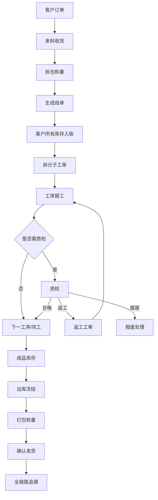

# 来料加工进销存与生产管理系统 业务流程与规则设计

**文档版本**：V1.0  
**文档定位**：业务评审、流程评审、规则确认  
**关联文档**：[01_PRD_产品需求文档](./01_PRD_产品需求文档.md)

---

## 1. 设计原则

- 单据驱动库存：任何库存变化必须来自业务单据或审批后的调整单。
- 批次贯穿全链路：母单编码是客户来料追溯核心。
- 数量和重量并行：贵重物料必须同时记录数量、重量和单位。
- 损耗按工序计算：不得简单用母单总进料和最终出货倒推。
- 交接必须留痕：关键节点记录交出人、接收人、时间、重量和证据。
- 现场登记来源必须留痕：从纸质表或 Excel 转录/导入的数据必须保存来源登记表、原表行号和纸质序号，出货快递合并栏还要保留原文。
- 异常不阻断全部业务：异常进入待审批或待处理，但正常链路尽量可继续。
- 一期轻流程：审批只做固定场景轻量审批，不引入完整工作流引擎。

---

## 2. 总体业务闭环



---

## 3. 客户订单流程

### 3.1 正常路径

1. 业务员创建客户订单。
2. 录入客户、预计来料、预计交期、加工要求、备注。
3. 提交订单，状态从 `draft` 变为 `confirmed`。
4. 后续母单、工单、出库单反向关联订单。

### 3.2 异常路径

| 异常 | 处理 |
|---|---|
| 客户取消 | 未入库可作废；已入库需走退料或取消生产处理 |
| 订单信息错误 | 未生产前允许修改，生产后关键字段修改需留日志 |
| 多批来料对应同一订单 | 支持一个订单关联多个母单 |
| 无订单来料 | 允许先建临时订单，后续补充业务信息 |

### 3.3 状态机

| 状态 | 说明 | 可执行动作 |
|---|---|---|
| draft | 草稿 | 编辑、提交、删除 |
| confirmed | 已确认 | 关联来料、取消 |
| partial_inbound | 部分来料 | 继续入库、查看进度 |
| processing | 生产中 | 查看工单和库存 |
| partial_shipped | 部分发货 | 继续发货 |
| completed | 已完成 | 查询、归档 |
| voided | 已作废 | 查询 |

---

## 4. 来料收货与拆包流程

### 4.1 正常路径

1. 收货员扫描或录入入库快递单号。
2. 系统校验快递单号是否重复。
3. 选择客户和客户订单。
4. 点击“开始拆包”，记录开始时间、操作人、摄像头或工位。
5. 拆包后录入物料、数量、毛重、净重、包装重量、照片和备注。
6. 点击“确认入库”，记录结束时间。
7. 系统生成母单编码和母单标签。
8. 系统生成库存台账：客户所有物料进入待加工仓。
9. 后台创建视频截取任务，按开始/结束时间截取拆包视频。

### 4.2 异常路径

| 异常 | 处理 |
|---|---|
| 快递单号重复 | 阻止新建，提示已关联母单 |
| 客户不明确 | 允许标记为待确认，不允许拆分工单 |
| 来料数量或重量异常 | 创建来料异常审批 |
| 拆包视频截取失败 | 自动重试，失败后允许人工上传 |
| 标签打印失败 | 允许补打，补打必须记录日志 |
| 来料包含多种物料 | 同一母单下记录多条物料明细 |

### 4.3 数据影响

- 创建客户订单关联关系。
- 创建母单和母单物料明细。
- 创建库存台账。
- 更新库存余额。
- 创建视频截取任务。
- 若来自现场登记表，保存 `sourceRegisterType/sourceRegisterLineNo/sourceRegisterSequence`；这些字段只用于审计和导入复核，不参与库存状态机。
- 生成标签打印记录。

---

## 5. 母单与子工单拆分流程

### 5.1 正常路径

1. 车间组长打开母单详情。
2. 查看母单可分配数量和重量。
3. 按数量、重量或组合方式拆分子工单。
4. 为子工单选择工序模板。
5. 系统校验拆分总量不得超过母单可用余额。
6. 系统生成子工单编码、子工单物料明细和工序实例。
7. 子工单带出工序单价快照、标准损耗率快照、质检配置快照。
8. 打印子工单标签。
9. 分配给员工、班组或工位。
10. 库存从待加工仓转入在制仓。

### 5.2 异常路径

| 异常 | 处理 |
|---|---|
| 拆分数量超出可用余额 | 阻止保存 |
| 拆分重量误差超阈值 | 提示并要求权限确认或重新录入 |
| 已开工子工单需要调整 | 生成调整记录，不允许直接覆盖 |
| 子工单标签丢失 | 允许补打并写日志 |
| 工序模板选错 | 未开工前允许调整；开工后需审批或作废重建 |

### 5.3 状态机

| 状态 | 说明 | 可执行动作 |
|---|---|---|
| draft | 已创建未提交 | 编辑、删除 |
| pending_assign | 待分配 | 分配、打印标签 |
| assigned | 已分配 | 开工、改派 |
| processing | 加工中 | 报工、质检、异常 |
| waiting_qc | 待质检 | 质检 |
| reworking | 返工中 | 返工报工、复检 |
| finished | 已完工 | 入成品库存、出库 |
| voided | 已作废 | 查询 |

---

## 6. 工序报工与称重交接流程

### 6.1 正常路径

1. 操作工打开 PWA 移动网页。
2. 扫描子工单二维码。
3. 系统校验当前用户是否有权限、是否轮到当前工序。
4. 显示工单、物料、上一工序产出重量、标准损耗率。
5. 操作工录入完成数量、产出重量、损耗重量、备注。
6. 关键工序需录入交接记录：交出人、接收人、投入重量、产出重量、称重时间。
7. 系统计算损耗和是否超标。
8. 报工提交后更新工序状态。
9. 若需要质检，进入待质检；否则进入下一工序或完工。
10. 生成库存台账：在制状态或工序状态发生转移。

### 6.2 异常路径

| 异常 | 处理 |
|---|---|
| 扫描非本人任务 | 提示无权限 |
| 跳工序报工 | 阻止提交，管理员可授权跳过 |
| 数量或重量为空 | 阻止提交 |
| 产出重量大于投入重量且超误差 | 阻止或要求说明 |
| 损耗超标 | 自动生成损耗记录和审批 |
| 网络中断 | PWA 保留表单草稿，恢复后重提 |
| 报工录入错误 | 未质检前可撤回；已流转后走更正记录 |

### 6.3 损耗计算规则

```text
本工序投入重量 = 上一交接产出重量或本工序领用重量
本工序产出重量 = 本次报工产出重量
合理转移重量 = 经业务规则确认不计为损耗的转移重量
本工序损耗重量 = 本工序投入重量 - 本工序产出重量 - 合理转移重量
允许损耗重量 = 本工序投入重量 × 标准损耗率快照
超标损耗重量 = max(0, 本工序损耗重量 - 允许损耗重量)
```

### 6.4 称重交接规则

- 关键工序必须记录称重交接。
- 称重记录不可物理删除。
- 允许人工录入重量，一期不强制电子秤自动采集。
- 重量修改必须记录修改前值、修改后值、修改人、原因。
- 称重交接可关联照片、视频片段或附件。

---

## 7. 质检、返工与报废流程

### 7.1 正常路径

1. 需要质检的工序报工后进入待质检列表。
2. 质检员扫码或从列表进入质检页面。
3. 录入质检结果、合格数量、不合格数量、原因、照片。
4. 选择处理方式：合格、返工、报废、让步通过。
5. 合格则进入下一工序或成品库存。
6. 返工则生成返工类型工单，关联原工单、原工序、质检记录。
7. 报废则生成报废记录和库存台账。
8. 让步通过需要权限或审批。

### 7.2 返工规则

- 返工不另建一套独立状态机，而是作为特殊工单类型处理。
- 返工工单必须关联原工单、原工序、原质检记录。
- 返工报工默认不计工资。
- 返工完成后必须复检。
- 返工次数超过配置上限，自动生成审批。

### 7.3 报废规则

- 报废必须记录原因、责任归因、数量、重量、照片或附件。
- 报废影响库存，生成报废状态库存或报废损耗记录。
- 贵重物料报废默认需要审批。

### 7.4 状态影响

| 质检结果 | 工序状态 | 工单状态 | 库存影响 |
|---|---|---|---|
| 合格 | completed | 下一工序/完工 | 在制转下一状态或成品 |
| 返工 | rework_required | reworking | 转返工状态 |
| 报废 | scrapped | 部分/全部异常 | 转报废状态或损耗 |
| 让步通过 | completed_with_concession | 下一工序/完工 | 正常流转，留异常标记 |

---

## 8. 库存流程

### 8.1 库存状态

| 状态 | 说明 |
|---|---|
| raw_waiting | 待加工来料 |
| wip | 在制 |
| semi_finished | 半成品 |
| finished | 成品 |
| frozen | 出库冻结 |
| rework | 返工品 |
| scrap | 报废品 |
| shipped | 已发货 |

### 8.2 库存业务动作

| 动作 | 台账影响 |
|---|---|
| 来料入库 | 外部进入待加工仓 |
| 拆分子工单 | 待加工转在制 |
| 工序流转 | 在制状态或工序位置变更 |
| 完工入库 | 在制转成品 |
| 创建出库单 | 成品可用转冻结 |
| 确认发货 | 冻结转已发货 |
| 返工 | 成品或在制转返工 |
| 报废 | 对应库存转报废或损耗 |
| 退货 | 已发货回退至成品、返工、报废或退客户 |
| 库存调整 | 审批后生成调整台账 |

### 8.3 所有权规则

- 客户来料默认 `owner_type = customer`。
- 系统库存余额必须能区分客户所有物料和企业自有物料。
- 一期不做完整财务核算，客户来料仅作为业务库存管理。
- 禁止把客户所有物料混入企业自有库存余额。

---

## 9. 出库流程

### 9.1 正常路径

1. 库管员按客户、订单、母单、子工单选择成品。
2. 系统校验成品可用库存。
3. 创建出库单并冻结库存。
4. 开始打包，记录视频开始时间。
5. 录入包装数量、重量、箱数、快递公司、快递单号；如来自纸质出货登记表，同时保存原始 `快递` 栏为 `paperExpressText`。
6. 点击确认发货，记录视频结束时间。
7. 生成视频截取任务。
8. 库存从冻结转为已发货。
9. 更新订单和母单发货进度。

### 9.2 异常路径

| 异常 | 处理 |
|---|---|
| 出库数量超过可用库存 | 阻止创建 |
| 冻结后取消出库 | 释放冻结库存，记录原因 |
| 快递单号重复 | 阻止保存或提示关联单据 |
| 打包视频失败 | 自动重试，失败后人工上传 |
| 发货后发现错误 | 通过退货、红冲或更正流程处理，不直接回滚 |

### 9.3 数据影响

- 创建或更新出库单、出库明细和库存台账。
- 成品库存转为已发货库存，客户所有权维度保持不变。
- 若来自 `交货情况登记表`，保存 `sourceRegisterType/sourceRegisterLineNo/sourceRegisterSequence` 和 `paperExpressText`，用于追溯纸质原始记录。

---

## 10. 审批流程

一期采用固定场景轻量审批：

| 审批类型 | 触发条件 | 默认审批人 |
|---|---|---|
| 来料异常 | 数量、重量、客户、物料异常 | 业务负责人 |
| 损耗超标 | 超过标准损耗率 | 车间负责人/总经理 |
| 返工超次数 | 超过配置上限 | 车间负责人 |
| 报废 | 贵重物料报废 | 总经理 |
| 库存调整 | 手工调整库存 | 库管负责人/总经理 |
| 单据作废 | 关键单据作废 | 部门负责人 |

审批状态：

| 状态 | 说明 |
|---|---|
| pending | 待审批 |
| approved | 已通过 |
| rejected | 已驳回 |
| canceled | 已取消 |

---

## 11. 退货流程

一期先做退货入库和售后复核分流，不做复杂售后结算、客户门户和自动财务冲销。

### 11.1 正常路径

1. 客户退回成品。
2. 扫描出库快递单号或成品标签。
3. 建立退货记录，关联原出库单和母单。
4. 录入退回数量、重量、原因、照片。
5. 退货先进入 `RETURN-CHECK` 退货复核区，保留客户所有权、原出库单、退回物流和入库证据。
6. 售后/质检复核退回实物，记录复核单、缺陷发现、照片/视频和责任人。
7. 按复核结论分流：放行回成品、转返工、转报废或冻结待审批。
8. 生成对应库存台账，所有分流必须保留同一客户、母单、工单和物料维度。

### 11.2 一期限制

- 不做复杂售后结算。
- 不做客户门户退货申请。
- 不做自动财务冲销。
- 售后复核只处理实物库存分流，不处理赔付、折价、补发和应收应付。

---

## 12. 现场登记表补强流程

### 12.1 入库签收补强

现场 `签收入库登记表` 不是简单的快递单号录入，系统需要在来料收货节点补充：

| 字段 | 规则 |
|---|---|
| 入库日期 | 默认当前业务日期，允许有权限人员修正，修正留日志 |
| 快递名称 | 快递公司或物流方式，和快递单号分开保存 |
| 快递单号 | 保持唯一校验，可作为追溯入口 |
| 寄货人姓名 | 保存寄件人快照，用于客户/外协来料责任追溯 |
| 收货人姓名 | 保存实际签收人快照 |
| 拆箱签字 | 一期保存拆箱确认人姓名，二期支持签名图片附件 |
| 货品名称 | 先保存来料货品名称快照，再匹配物料档案 |
| 数量/单位 | 写入母单明细；数量必须带 `quantityUnit`，默认 `件`，可按物料配置为 `颗/条/批` |
| 备注 | 写入入库备注，不得替代关键结构化字段 |

异常补充：

- 寄货人或客户不明确时，母单状态进入 `待确认客户/物料`，不得拆分工单。
- 拆箱签字缺失时允许暂存，但确认入库前必须补齐或由主管审批放行。
- 快递名称缺失不阻止入库，但追溯链显示字段缺口。
- 后续若做 Excel/纸质表导入，必须保留原表类型、sheet、行号和导入批次；`序号` 只作展示，不参与母单编码。

### 12.2 抛光工作项目日报补强

现场 `抛光登记表` 说明抛光工序需要支持按员工、日期、工作项目记录，而不是只记录最终报工数量。

| 字段 | 规则 |
|---|---|
| 姓名 | 绑定报工员工 |
| 日期 | 工序日记录日期，属于表头级上下文，导入时继承到每条工作项目明细 |
| 工作项目 | 绑定工序下的具体作业项目，例如粗抛、精抛、返工抛光 |
| 开始时间/完成时间 | 用于统计工时和异常停滞 |
| 完成情况 | 完成、部分完成、异常、返工中等 |
| 交单审核 | 车间组长或下一工序接收人审核 |
| 备注 | 保存异常说明 |

状态建议：

| 状态 | 说明 | 可执行动作 |
|---|---|---|
| draft | 草稿 | 修改、删除 |
| submitted | 已提交 | 等待交单审核 |
| accepted | 已审核接收 | 可进入下一工序或质检 |
| rejected | 审核退回 | 操作工修正 |
| corrected | 已更正 | 保留原记录和更正记录 |

补充规则：

- `姓名` 是实际作业员工，不等于系统登录录入人；登录人只进入审计字段。
- `完成情况` 不直接推动工序状态，工序流转仍由报工提交、交单审核、质检规则和库存台账共同决定。
- 抛光日报的每条工作项目都要保留日内行号，方便对照纸质记录和后续批量导入纠错。

### 12.3 雕刻机统计补强

现场 `雕刻登记表` 说明 `雕刻` 是独立生产节点，并且天然带设备产量统计。系统需要把 `雕刻` 纳入工序模板。

| 字段 | 规则 |
|---|---|
| 日期 | 设备产量日期，导入时可从上一组记录继承 |
| 客户 | 客户快照，导入时可从上一组记录继承 |
| 品类 | 产品/货品品类快照，导入时可从上一组记录继承 |
| 机器编号 | 关联设备档案，可先用文本编号 |
| 雕刻数量/单位 | 本机器本客户本品类的产出数量，默认单位 `件` |
| 操机签字 | 一期保存操机人姓名，二期支持签名附件 |
| 备注 | 保存异常、停机、补录说明 |

异常补充：

- 机器编号不存在于设备档案时，允许暂存为 `待匹配设备`，但产能报表标记缺口。
- 同一天同客户同品类同机器允许多条记录，但必须保留录入时间和操机人。
- 雕刻数量进入工序产量统计；是否写库存台账取决于是否绑定工单。
- 纸质表中同一组客户/品类下多台机器逐行登记，空白日期/客户/品类行不能视为无效行，必须继承上一组上下文。

### 12.4 出货登记补强

现场 `交货情况登记表` 要求出货节点补充交货类目和经办人。

| 字段 | 规则 |
|---|---|
| 日期 | 交货/发货日期 |
| 客户 | 客户快照 |
| 交货类目 | 成品、返修件、补发件、样品等 |
| 交货数量/单位 | 与出库明细数量和单位保持一致 |
| 快递 | 快递公司/物流方式，快递单号作为扩展字段保存 |
| 经办人 | 实际办理出货的人 |
| 备注 | 出货备注 |

异常补充：

- 交货数量不得超过已冻结可发库存。
- 经办人缺失不得确认出货。
- 快递信息不完整时允许先出货登记草稿，不允许转 `shipped`。
- 出货登记中的 `经办人` 是实际办理人，不等于系统操作人；两者都要进入审计链。

---

## 13. 业务规则待确认清单

- 关键工序清单和是否必须称重交接。
- 数量、重量允许误差。
- 标准损耗率维护责任人。
- 损耗责任按个人、班组还是工位归因。
- 返工次数上限。
- 报废审批阈值。
- 视频保存周期。
- 标签尺寸和打印机兼容方式。
