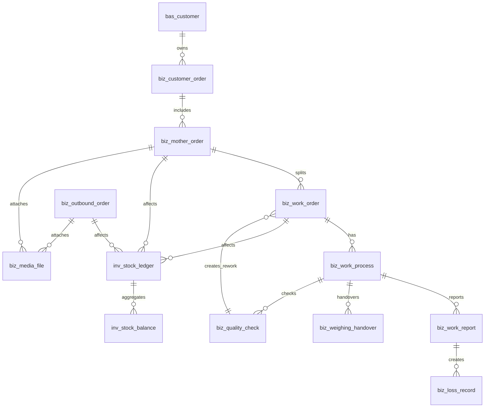

# 来料加工进销存与生产管理系统 领域模型与数据库设计

**文档版本**：V2.0  
**文档定位**：领域建模、数据库评审、后端设计依据  
**关联文档**：[02_业务流程与规则设计](./02_业务流程与规则设计.md)

---

## 1. 设计原则

- 业务对象优先于页面字段，避免把系统设计成表单堆砌。
- 库存余额只允许由库存台账汇总或同步更新，不允许直接手工修改。
- 客户所有物料必须和企业自有物料区分。
- 数量、重量、金额、损耗率、单价必须有明确单位和快照。
- 返工不使用两套状态机，作为特殊工单类型建模。
- 称重交接是损耗责任和物料追溯的核心证据。
- 所有关键单据支持操作日志、附件和审批关联。

---

## 2. 领域对象总览



---

## 3. 核心领域模型

### 3.1 客户订单 `biz_customer_order`

客户订单是业务来源，不直接代表库存。

关键字段：

| 字段 | 类型 | 说明 |
|---|---|---|
| id | bigint | 主键 |
| code | varchar(50) | 订单编号 |
| customer_id | bigint | 客户 |
| status | varchar(30) | 订单状态 |
| expected_delivery_date | date | 预计交期 |
| remark | text | 加工要求和备注 |

状态：`draft`、`confirmed`、`partial_inbound`、`processing`、`partial_shipped`、`completed`、`voided`。

### 3.2 母单 `biz_mother_order`

母单代表一批客户来料，是全链路追溯核心。

关键字段：

| 字段 | 类型 | 说明 |
|---|---|---|
| id | bigint | 主键 |
| code | varchar(80) | 母单编码 |
| customer_order_id | bigint | 客户订单 |
| customer_id | bigint | 客户 |
| inbound_express_no | varchar(80) | 入库快递单号 |
| owner_type | varchar(20) | customer/company |
| owner_customer_id | bigint | 物料所有客户 |
| is_customer_owned | boolean | 是否客户所有 |
| status | varchar(30) | 母单状态 |
| unpack_started_at | datetime | 拆包开始时间 |
| unpack_finished_at | datetime | 拆包结束时间 |
| unpack_video_status | varchar(30) | 视频状态 |

规则：

- 客户来料默认 `owner_type = customer`。
- 未确认客户和物料前不得拆分工单。
- 母单作废必须通过审批或权限控制。

### 3.3 母单物料明细 `biz_mother_order_item`

| 字段 | 类型 | 说明 |
|---|---|---|
| mother_order_id | bigint | 母单 |
| material_id | bigint | 物料 |
| quantity | decimal(18,3) | 数量 |
| net_weight | decimal(18,3) | 净重 |
| gross_weight | decimal(18,3) | 毛重 |
| unit | varchar(20) | 数量单位 |
| weight_unit | varchar(20) | 重量单位 |
| material_price_snapshot | decimal(18,4) | 物料单价快照 |

### 3.4 工单 `biz_work_order`

子工单、返工工单统一使用该表，通过 `work_order_type` 区分。

| 字段 | 类型 | 说明 |
|---|---|---|
| id | bigint | 主键 |
| code | varchar(90) | 工单编码 |
| mother_order_id | bigint | 母单 |
| parent_work_order_id | bigint | 来源工单，返工时必填 |
| source_quality_check_id | bigint | 来源质检记录 |
| work_order_type | varchar(30) | normal/rework |
| rework_count | int | 第几次返工 |
| assigned_employee_id | bigint | 分配员工 |
| assigned_team_id | bigint | 分配班组 |
| status | varchar(30) | 工单状态 |
| planned_quantity | decimal(18,3) | 计划数量 |
| planned_weight | decimal(18,3) | 计划重量 |

规则：

- 禁止再单独建立独立 `biz_rework_order` 状态机。
- 返工工单必须关联原工单、原工序或质检记录。
- 返工报工默认不计工资。

### 3.5 工单物料 `biz_work_order_item`

记录子工单分配到的物料数量和重量。

| 字段 | 类型 | 说明 |
|---|---|---|
| work_order_id | bigint | 工单 |
| material_id | bigint | 物料 |
| quantity | decimal(18,3) | 分配数量 |
| weight | decimal(18,3) | 分配重量 |
| source_mother_item_id | bigint | 来源母单明细 |

### 3.6 工序实例 `biz_work_process`

工序实例在子工单创建时由工序模板生成，并保存业务快照。

| 字段 | 类型 | 说明 |
|---|---|---|
| work_order_id | bigint | 工单 |
| process_id | bigint | 工序 |
| sequence_no | int | 工序顺序 |
| status | varchar(30) | 工序状态 |
| need_loss_record | boolean | 是否记录损耗快照 |
| standard_loss_rate_snapshot | decimal(9,6) | 标准损耗率快照 |
| need_quality_check | boolean | 是否质检快照 |
| piecework_price_snapshot | decimal(18,4) | 计件单价快照 |
| started_at | datetime | 开始时间 |
| finished_at | datetime | 完成时间 |

### 3.7 报工记录 `biz_work_report`

报工是产量、损耗、工资试算的数据来源。

| 字段 | 类型 | 说明 |
|---|---|---|
| work_order_id | bigint | 工单 |
| work_process_id | bigint | 工序实例 |
| employee_id | bigint | 报工员工 |
| completed_quantity | decimal(18,3) | 完成数量 |
| input_weight | decimal(18,3) | 投入重量 |
| output_weight | decimal(18,3) | 产出重量 |
| loss_weight | decimal(18,3) | 损耗重量 |
| is_rework_report | boolean | 是否返工报工 |
| reported_at | datetime | 报工时间 |

规则：

- 已进入质检或下一工序后，报工更正必须生成更正记录。
- 报工不可物理删除。

### 3.8 称重交接 `biz_weighing_handover`

称重交接是本版新增核心对象。

| 字段 | 类型 | 说明 |
|---|---|---|
| code | varchar(60) | 交接编号 |
| mother_order_id | bigint | 母单 |
| work_order_id | bigint | 工单 |
| work_process_id | bigint | 工序 |
| material_id | bigint | 物料 |
| handover_type | varchar(30) | inbound/process/outbound/return |
| from_employee_id | bigint | 交出人 |
| to_employee_id | bigint | 接收人 |
| input_weight | decimal(18,3) | 投入重量 |
| output_weight | decimal(18,3) | 产出重量 |
| package_weight | decimal(18,3) | 包装重量 |
| weight_unit | varchar(20) | 重量单位 |
| source_type | varchar(30) | manual/scale/import |
| device_id | bigint | 设备，一期可空 |
| evidence_media_id | bigint | 证据附件 |
| handed_over_at | datetime | 交接时间 |

规则：

- 关键工序必须有交接记录。
- 交接记录修改必须留痕。
- 一期允许人工录入，二期对接电子秤。

### 3.9 质检记录 `biz_quality_check`

| 字段 | 类型 | 说明 |
|---|---|---|
| code | varchar(60) | 质检编号 |
| work_order_id | bigint | 工单 |
| work_process_id | bigint | 工序 |
| check_type | varchar(30) | process/final/recheck |
| result | varchar(30) | pass/rework/scrap/concession |
| checked_quantity | decimal(18,3) | 检验数量 |
| failed_quantity | decimal(18,3) | 不合格数量 |
| reason_type | varchar(50) | 原因 |
| checker_employee_id | bigint | 质检员 |
| checked_at | datetime | 质检时间 |

### 3.10 损耗记录 `biz_loss_record`

| 字段 | 类型 | 说明 |
|---|---|---|
| code | varchar(60) | 损耗编号 |
| mother_order_id | bigint | 母单 |
| work_order_id | bigint | 工单 |
| work_process_id | bigint | 工序 |
| work_report_id | bigint | 报工 |
| weighing_handover_id | bigint | 称重交接 |
| material_id | bigint | 物料 |
| input_weight | decimal(18,3) | 投入重量 |
| output_weight | decimal(18,3) | 产出重量 |
| loss_weight | decimal(18,3) | 实际损耗 |
| standard_loss_rate | decimal(9,6) | 损耗率快照 |
| allowed_loss_weight | decimal(18,3) | 允许损耗 |
| excess_loss_weight | decimal(18,3) | 超标损耗 |
| material_price_snapshot | decimal(18,4) | 物料单价快照 |
| theoretical_deduction_amount | decimal(18,2) | 理论扣减 |
| responsibility_type | varchar(30) | employee/team/material/customer/unknown |
| approval_status | varchar(30) | 审批状态 |

---

## 4. 库存模型

### 4.1 库存台账 `inv_stock_ledger`

库存台账采用转移模型，而不是简单入库/出库方向。

| 字段 | 类型 | 说明 |
|---|---|---|
| code | varchar(60) | 台账编号 |
| biz_time | datetime | 业务时间 |
| document_type | varchar(50) | 来源单据类型 |
| document_id | bigint | 来源单据 ID |
| document_code | varchar(80) | 来源单据编号 |
| owner_type | varchar(20) | customer/company |
| owner_customer_id | bigint | 所有客户 |
| customer_id | bigint | 业务客户 |
| mother_order_id | bigint | 母单 |
| work_order_id | bigint | 工单 |
| material_id | bigint | 物料 |
| quantity | decimal(18,3) | 数量 |
| weight | decimal(18,3) | 重量 |
| from_warehouse_id | bigint | 来源仓库 |
| to_warehouse_id | bigint | 目标仓库 |
| from_stock_status | varchar(30) | 来源状态 |
| to_stock_status | varchar(30) | 目标状态 |
| unit | varchar(20) | 数量单位 |
| weight_unit | varchar(20) | 重量单位 |
| remark | text | 备注 |

规则：

- 外部入库时 `from_warehouse_id` 可为空。
- 发货出库时 `to_stock_status = shipped`。
- 调整单必须关联审批。
- 余额不得直接修改，只能由台账影响。

### 4.2 库存余额 `inv_stock_balance`

| 字段 | 类型 | 说明 |
|---|---|---|
| owner_type | varchar(20) | 所有权 |
| owner_customer_id | bigint | 所有客户 |
| customer_id | bigint | 业务客户 |
| mother_order_id | bigint | 母单 |
| work_order_id | bigint | 工单 |
| material_id | bigint | 物料 |
| warehouse_id | bigint | 仓库 |
| stock_status | varchar(30) | 库存状态 |
| available_quantity | decimal(18,3) | 可用数量 |
| frozen_quantity | decimal(18,3) | 冻结数量 |
| available_weight | decimal(18,3) | 可用重量 |
| frozen_weight | decimal(18,3) | 冻结重量 |
| last_ledger_id | bigint | 最后台账 |

唯一维度：

```text
owner_type + owner_customer_id + customer_id + mother_order_id + work_order_id
+ material_id + warehouse_id + stock_status
```

### 4.3 库存调整 `inv_stock_adjustment`

| 字段 | 类型 | 说明 |
|---|---|---|
| code | varchar(60) | 调整单号 |
| adjustment_type | varchar(30) | increase/decrease/status_transfer |
| reason_type | varchar(50) | 调整原因 |
| approval_id | bigint | 审批单 |
| status | varchar(30) | 状态 |

---

## 5. 出库模型

### 5.1 出库单 `biz_outbound_order`

| 字段 | 类型 | 说明 |
|---|---|---|
| code | varchar(60) | 出库单号 |
| customer_id | bigint | 客户 |
| customer_order_id | bigint | 客户订单 |
| status | varchar(30) | 状态 |
| express_company | varchar(50) | 快递公司 |
| express_no | varchar(80) | 快递单号 |
| package_weight | decimal(18,3) | 包装重量 |
| started_pack_at | datetime | 打包开始时间 |
| finished_pack_at | datetime | 打包结束时间 |
| pack_video_status | varchar(30) | 视频状态 |

状态：`draft`、`frozen`、`packing`、`shipped`、`canceled`。

### 5.2 出库明细 `biz_outbound_order_item`

| 字段 | 类型 | 说明 |
|---|---|---|
| outbound_order_id | bigint | 出库单 |
| mother_order_id | bigint | 母单 |
| work_order_id | bigint | 工单 |
| material_id | bigint | 物料 |
| quantity | decimal(18,3) | 数量 |
| weight | decimal(18,3) | 重量 |

---

## 6. 媒体、审批、工资

### 6.1 媒体文件 `biz_media_file`

| 字段 | 类型 | 说明 |
|---|---|---|
| file_type | varchar(30) | video/image/file |
| biz_type | varchar(50) | inbound_unpack/outbound_pack/qc/loss |
| biz_id | bigint | 业务对象 ID |
| storage_type | varchar(30) | local/nas/s3/minio |
| storage_key | varchar(255) | 存储路径 |
| status | varchar(30) | pending/processing/success/failed |
| checksum | varchar(128) | 文件校验值 |

### 6.2 视频任务 `biz_video_clip_task`

| 字段 | 类型 | 说明 |
|---|---|---|
| biz_type | varchar(50) | 业务类型 |
| biz_id | bigint | 业务对象 |
| camera_id | bigint | 摄像头 |
| start_at | datetime | 开始时间 |
| end_at | datetime | 结束时间 |
| buffer_seconds | int | 前后缓冲秒数 |
| retry_count | int | 重试次数 |
| status | varchar(30) | pending/processing/success/failed |
| media_file_id | bigint | 生成媒体 |

### 6.3 审批 `biz_approval`

审批类型：`inbound_abnormal`、`loss_excess`、`rework_limit`、`scrap`、`stock_adjustment`、`document_void`、`wage_deduction_reserved`。

### 6.4 工资试算 `pay_piecework_trial_detail`

| 字段 | 类型 | 说明 |
|---|---|---|
| employee_id | bigint | 员工 |
| work_report_id | bigint | 报工 |
| work_process_id | bigint | 工序 |
| qualified_quantity | decimal(18,3) | 合格数量 |
| piecework_price_snapshot | decimal(18,4) | 单价快照 |
| piecework_amount | decimal(18,2) | 计件金额 |
| is_rework | boolean | 是否返工 |
| theoretical_deduction_amount | decimal(18,2) | 理论扣减 |
| trial_period | varchar(20) | 试算周期 |

---

## 7. 基础档案与配置

基础表：

- `bas_customer`：客户。
- `bas_material`：物料。
- `bas_material_price_history`：物料价格历史。
- `bas_process`：工序。
- `bas_process_price_history`：工序计件单价历史。
- `bas_process_template`：工序模板。
- `bas_process_template_item`：工序模板明细。
- `bas_employee`：员工。
- `bas_team`：班组。
- `bas_warehouse`：仓库。
- `bas_device`：设备，包含摄像头、NVR、打印机、扫码枪、电子秤。

系统表：

- `sys_user`、`sys_role`、`sys_user_role`、`sys_menu`。
- `sys_dict_type`、`sys_dict_data`。
- `sys_config`。
- `sys_operation_log`。

---

## 8. 关键枚举

### 8.1 所有权

| 值 | 说明 |
|---|---|
| customer | 客户所有 |
| company | 企业自有 |

### 8.2 工单类型

| 值 | 说明 |
|---|---|
| normal | 正常工单 |
| rework | 返工工单 |

### 8.3 库存状态

`raw_waiting`、`wip`、`semi_finished`、`finished`、`frozen`、`rework`、`scrap`、`shipped`。

### 8.4 媒体状态

`pending`、`processing`、`success`、`failed`、`manual_uploaded`。

---

## 9. 一致性约束

1. 母单未确认前不得拆分子工单。
2. 子工单拆分数量和重量不得超过母单可分配余额。
3. 工序报工必须按顺序执行，跳工序必须有权限和日志。
4. 需要质检的工序未通过质检不得进入下一工序。
5. 返工工单必须关联来源工单和来源质检。
6. 所有库存变化必须生成库存台账。
7. 出库单确认发货前必须冻结足够成品库存。
8. 报工、损耗、库存、视频、审批记录不可物理删除。
9. 单价、损耗率必须使用快照，不得受后续配置变更影响历史单据。
10. 客户所有库存不得和企业自有库存合并计算。

---

## 10. 索引建议

- `biz_mother_order(code)` 唯一。
- `biz_work_order(code)` 唯一。
- `biz_customer_order(customer_id, status)`。
- `biz_work_order(mother_order_id, status)`。
- `biz_work_process(work_order_id, sequence_no)`。
- `biz_work_report(employee_id, reported_at)`。
- `biz_weighing_handover(mother_order_id, work_order_id, handed_over_at)`。
- `biz_loss_record(work_order_id, work_process_id)`。
- `inv_stock_ledger(mother_order_id, biz_time)`。
- `inv_stock_ledger(document_type, document_id)`。
- `inv_stock_balance(owner_type, owner_customer_id, material_id, warehouse_id, stock_status)`。
- `biz_media_file(biz_type, biz_id)`。

---

## 11. 待技术确认

- 库存余额采用同步更新还是异步汇总。
- 金额和重量的小数精度。
- 是否需要软删除字段统一为 `deleted_at`。
- 多组织字段使用 `org_id` 还是 `tenant_id`。
- 视频文件使用本地、NAS、MinIO 还是 S3 兼容对象存储。
- 实施前按 Java/Vue + RuoYi-Vue + MyBatis 约定确认表名、字段命名和 ORM 映射。
