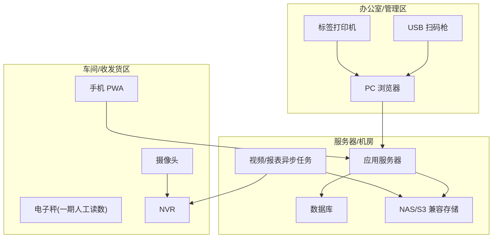

# 来料加工进销存与生产管理系统 硬件与部署架构设计

**文档版本**：V1.0  
**文档定位**：硬件选型、部署评审、现场实施依据  
**关联文档**：[05_系统架构设计](./05_系统架构设计.md)

---

## 1. 设计目标

- 一期按兼容方案设计，不绑定具体型号。
- 硬件集成不阻塞核心业务上线。
- 所有硬件能力都必须有人工兜底。
- 视频、标签、扫码、称重的业务证据能进入系统追溯链路。
- 后续可升级到更自动化的 NVR SDK、电子秤、PDA 和设备管理。

---

## 2. 硬件范围

| 硬件 | 一期定位 | 二期增强 |
|---|---|---|
| NVR/摄像头 | 拆包、打包视频半自动截取 | 厂商 SDK、ONVIF、自动工位绑定 |
| 标签打印机 | 母单、子工单、出库标签打印 | 批量打印、打印状态回传 |
| USB 扫码枪 | PC 端扫码输入 | 工业扫码枪/PDA |
| 手机摄像头 | PWA 扫码报工和质检 | 原生 App 或专用 PDA |
| 电子秤 | 一期人工录入重量 | 串口/蓝牙/USB 自动采集 |
| 服务器 | 应用、数据库、任务服务 | 主备、容灾、分离部署 |
| NAS/S3 兼容存储 | 视频、照片、附件存储 | 生命周期、归档、冷热分层 |

---

## 3. 现场部署拓扑



---

## 4. NVR 与摄像头

### 4.1 一期方案

- 系统记录拆包、打包、异常处理的开始时间和结束时间。
- 后台异步任务按时间段请求 NVR 或摄像头录像。
- 视频截取默认前后增加缓冲秒数，例如 5 秒。
- 截取成功后生成 MP4 文件并关联业务单据。
- 截取失败自动重试，超过次数后允许人工上传视频。

参考能力：

- FFmpeg 视频截取与转码。
- ONVIF 设备发现和基础控制。
- 厂商 SDK，例如海康、大华等，具体型号需 POC。

### 4.2 摄像头布点原则

| 位置 | 目标 |
|---|---|
| 收货/拆包台 | 拆包过程、来料状态、称重过程 |
| 打包/发货台 | 打包过程、成品复核、快递面单 |
| 异常处理台 | 质检异常、报废、争议处理 |

要求：

- 摄像头画面必须能看清操作台、物料和称重动作。
- 摄像头时间必须和服务器时间同步。
- NVR 保留原始录像，系统保存业务视频片段。
- 视频保存周期由业务确认。

### 4.3 视频任务状态

| 状态 | 说明 |
|---|---|
| pending | 待截取 |
| processing | 截取中 |
| success | 成功 |
| failed | 失败 |
| manual_uploaded | 人工上传 |

### 4.4 兜底方案

- NVR 无法截取：允许人工上传本地视频。
- 摄像头离线：记录离线状态，业务可继续，但追溯显示缺失证据。
- 时间段不准：允许管理员重新指定时间段截取。
- 视频过大：后台转码压缩，保留原文件或记录原始来源。

---

## 5. 标签打印机

### 5.1 一期范围

打印标签：

- 母单标签。
- 子工单标签。
- 出库标签。

标签内容：

| 标签 | 必须包含 |
|---|---|
| 母单标签 | 母单编码、客户简称、物料、数量、重量、二维码 |
| 子工单标签 | 子工单编码、母单编码、工序模板、数量、重量、二维码 |
| 出库标签 | 出库单号、客户、快递单号、二维码 |

### 5.2 兼容方式

优先级：

1. 浏览器打印标签模板。
2. 打印机 Windows 驱动。
3. LODOP 或本地打印代理。
4. 厂商 SDK。

### 5.3 标签规则

- 二维码内容不直接放敏感业务数据，只放类型和编码。
- 标签补打必须记录操作日志。
- 标签尺寸和字体需通过现场打印 POC 确认。

---

## 6. 扫码设备

### 6.1 USB 扫码枪

一期 PC 端优先支持 USB HID 键盘模式：

- 扫码后相当于键盘输入编码。
- 不依赖专用驱动。
- 适用于收货、查询、PC 端快速定位。

要求：

- 支持 QR Code。
- 支持自动回车或配置后缀。
- 扫码内容不能被输入法干扰。

### 6.2 手机 PWA 扫码

用于：

- 操作工扫码报工。
- 质检员扫码质检。
- 库管员扫码库存查询。

兼容策略：

- 优先使用浏览器 BarcodeDetector。
- 不支持时使用 ZXing 前端识别。
- 扫码失败时允许手工输入编码。

---

## 7. 电子秤

### 7.1 一期方案

一期不强制集成电子秤，采用人工读数录入。

原因：

- 不同电子秤接口差异大。
- 串口、USB、蓝牙、网络协议需要现场 POC。
- 过早强集成容易阻塞核心闭环。

一期要求：

- 录入重量时显示单位和精度。
- 允许配置重量误差阈值。
- 重量修改必须填写原因并留日志。
- 关键工序称重交接可上传照片作为证据。

### 7.2 二期集成方向

候选方式：

- RS232 串口读取。
- USB 虚拟串口。
- 蓝牙电子秤。
- TCP/IP 网络秤。
- 厂商 SDK。

POC 内容：

- 稳定读取重量。
- 去皮、归零、稳定值判断。
- 设备编号绑定工位。
- 读取失败兜底为人工录入。

---

## 8. 服务器与存储

### 8.1 一期最小部署

| 组件 | 建议 |
|---|---|
| 应用服务 | 1 台，部署 Web/API/后台任务 |
| 数据库 | MySQL 8.4 LTS |
| 文件存储 | NAS 优先；S3 兼容商业/云服务备选 |
| 缓存 | Redis 可选 |
| 备份 | 数据库全量 + binlog 增量，文件定期快照 |

### 8.2 推荐配置

试点阶段：

- CPU：4 核以上。
- 内存：16 GB 以上。
- 系统盘：200 GB SSD。
- 数据盘：按视频保存周期评估。
- 网络：千兆内网。

正式阶段：

- 应用、数据库、存储可分离。
- 视频文件不建议长期存数据库。
- 数据库和文件存储必须纳入备份，正式环境需要恢复演练。

### 8.3 存储容量估算

公式：

```text
每日视频容量 = 单次视频平均大小 × 每日视频数量
总容量 = 每日视频容量 × 保存天数 × 安全系数
```

示例：

```text
单次视频 50 MB，每日 100 次，保存 180 天，安全系数 1.3
容量 = 50 MB × 100 × 180 × 1.3 ≈ 1.17 TB
```

实际容量需按摄像头码率、视频时长、压缩策略和保存周期重新估算。

---

## 9. 网络与时间同步

要求：

- 服务器、NVR、摄像头、PC 时间必须同步。
- 建议部署内网 NTP 或统一使用可靠时间源。
- 车间 Wi-Fi 需要覆盖扫码报工区域。
- PWA 移动端应能访问应用服务器和必要的文件服务。
- 文件服务不应直接暴露公网。

---

## 10. 硬件 POC 清单

M0 必须验证：

| 项目 | 验证标准 |
|---|---|
| NVR 视频截取 | 能按开始/结束时间导出 MP4 |
| 视频缓冲 | 能前后多取配置秒数 |
| 视频播放 | PC 端可播放，权限可控 |
| 标签打印 | 母单和子工单标签可清晰打印 |
| PC 扫码枪 | 扫码后能定位单据 |
| PWA 扫码 | 手机能识别子工单二维码 |
| 人工称重录入 | 重量、单位、误差提示可用 |
| 文件上传 | 截取失败后可人工上传视频 |
| 存储备份 | 视频和附件可存储、下载、备份 |

---

## 11. 现场实施注意事项

- 先画现场工位图，再决定摄像头位置。
- 标签尺寸必须拿真实工单内容试打。
- 摄像头画面要避免逆光、遮挡和只拍到人不拍到物料。
- 打包台和拆包台建议固定操作区域。
- NVR 通道号、摄像头位置和业务工位要建立映射。
- 硬件故障不能阻止业务提交，但必须在追溯中标记证据缺失。

---

## 12. 待确认事项

- 现有 NVR 品牌、型号、通道数、录像保存周期。
- 摄像头数量、位置、清晰度和是否支持夜间/补光。
- 标签打印机型号、标签纸尺寸。
- USB 扫码枪型号和是否支持二维码。
- 电子秤型号、接口方式、精度。
- 服务器部署位置和网络访问方式。
- 视频保存周期和容量预算。
- 是否需要外网访问或仅内网使用。
