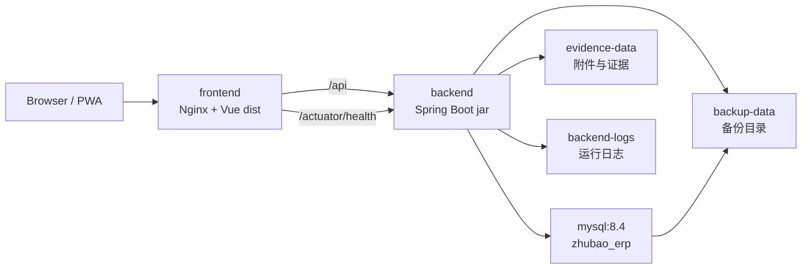

# Docker 一键部署与离线交付

**文档版本**：V1.0  
**更新日期**：2026-07-07  
**适用阶段**：M3.60 Docker 无源码交付、备份和恢复演练可见性基线

---

## 1. 目标

本方案用于降低现场部署和运维成本，并避免向客户交付源码。

腾讯云 CVM + COS、本地电脑、本地服务器三类部署运维细节见 [20_腾讯云与本地部署运维方案](./20_腾讯云与本地部署运维方案.md)。

交付原则：

- 构建机保留源码、依赖缓存和构建脚本。
- 客户服务器只接收运行包，不接收 `backend/src`、`frontend/src`、`.git`、测试代码和开发文档全集。
- 运行包包含 Docker Compose、环境变量模板、启动脚本、数据库初始化 SQL 和已构建镜像 tar。
- 一期先支持单机 Docker Compose 部署，后续再扩展到多机、Kubernetes 或托管数据库。

---

## 2. 交付包结构

通过 `scripts/docker-build-package.ps1` 生成：

```text
.deploy-artifacts/
  zhubao-erp-runtime-<version>/
    docker-compose.yml
    .env.example
    .env
    start.ps1
    start.sh
    backup-mysql.ps1
    backup-mysql.sh
    verify-restore.ps1
    verify-restore.sh
    README_DOCKER.md
    MANIFEST.sha256
    images/
      zhubao-erp-images-<version>.tar
    mysql-init/
      V1__m0_foundation.sql
      ...
      V11__m3_lightweight_approval_contract.sql
  zhubao-erp-runtime-<version>.zip
  zhubao-erp-runtime-<version>.zip.sha256
```

运行包不应包含：

- `backend/src/`
- `frontend/src/`
- `.git/`
- `node_modules/`
- `.pnpm-store/`
- Maven 本地仓库
- 开发测试报告和临时输出

---

## 3. 构建机流程

在开发或交付构建机器上执行：

```powershell
powershell -ExecutionPolicy Bypass -File scripts\docker-build-package.ps1 -Version m3.60.0
```

脚本执行内容：

1. 构建后端 jar。
2. 构建前端 `dist/`。
3. 使用 `docker/backend.Dockerfile` 构建后端运行镜像。
4. 使用 `docker/frontend.Dockerfile` 构建 Nginx 前端镜像。
5. 将两个镜像导出为 `images/zhubao-erp-images-<version>.tar`。
6. 复制部署脚本、环境变量模板和 MySQL 初始化 SQL。
7. 生成 `MANIFEST.sha256` 文件级校验清单。
8. 生成 zip 运行包和 `.zip.sha256` 校验文件。

首次构建需要构建机能访问 Docker Hub 或企业镜像仓库，以拉取 `eclipse-temurin:17-jre-alpine`、`nginx:1.27-alpine` 和 `mysql:8.4`。如果现场网络无法访问外部仓库，需要提前配置镜像加速、企业仓库或预加载基础镜像。

只验证包结构、不构建镜像时可执行：

```powershell
powershell -ExecutionPolicy Bypass -File scripts\docker-build-package.ps1 -Version m3.60-layout -NoDockerBuild -SkipTests
```

### 3.1 交付包验收门禁

M3.57 起，`scripts/docker-build-package.ps1` 会在生成 `MANIFEST.sha256` 后自动调用 `scripts/verify-runtime-package.ps1`，分别验证运行包目录和 zip。该脚本也可以单独执行：

```powershell
powershell -ExecutionPolicy Bypass -File scripts\verify-runtime-package.ps1 -PackagePath .deploy-artifacts\zhubao-erp-runtime-m3.60.0.zip
```

只验证 `-NoDockerBuild` 生成的布局包时允许缺少镜像 tar：

```powershell
powershell -ExecutionPolicy Bypass -File scripts\verify-runtime-package.ps1 -PackagePath .deploy-artifacts\zhubao-erp-runtime-m3.60-layout.zip -AllowMissingImages
```

验收内容：

| 检查项 | 规则 |
|---|---|
| 必需文件 | 必须包含 `docker-compose.yml`、`.env.example`、`start.ps1`、`start.sh`、`backup-mysql.ps1`、`backup-mysql.sh`、`verify-restore.ps1`、`verify-restore.sh`、`README_DOCKER.md`、`MANIFEST.sha256` |
| 数据库初始化 | `mysql-init/` 必须包含 SQL 初始化文件 |
| 镜像 tar | 正式交付包必须包含 `images/*.tar`；仅布局检查可用 `-AllowMissingImages` |
| manifest | `MANIFEST.sha256` 必须覆盖除 `.env` 和自身以外的所有文件，且 hash 必须匹配 |
| zip checksum | 如存在 `.zip.sha256`，文件名和 hash 必须匹配 zip |
| 源码泄漏 | 禁止出现 `.git`、`backend/src`、`frontend/src`、`node_modules`、`.pnpm-store`、`.npm-cache`、`.tools`、`backend/target`、`frontend/dist` |
| Compose 运行态 | 运行包内 `docker-compose.yml` 禁止出现 `build:`、父目录引用或源码路径 |

`.deploy-artifacts/` 是构建输出目录，已加入 `.gitignore`，不进入版本库。

---

## 4. 客户服务器部署流程

客户服务器前置条件：

- Docker Engine
- Docker Compose v2
- 可用端口：默认 `80`、`8080`
- 至少 4 GB 内存，建议 8 GB 以上
- 可持久化磁盘目录

部署步骤：

1. 解压 `zhubao-erp-runtime-<version>.zip`。
2. 进入解压目录。
3. 修改 `.env` 中数据库密码、端口和访问地址。
4. 执行启动脚本。

Windows：

```powershell
powershell -ExecutionPolicy Bypass -File .\start.ps1
```

Linux：

```bash
chmod +x ./start.sh
./start.sh
```

启动脚本会自动执行：

1. 如果存在 `MANIFEST.sha256`，先校验运行包文件完整性。
2. 如果 `.env` 不存在，从 `.env.example` 创建。
3. 如果 `images/*.tar` 存在，执行 `docker load`。
4. 执行 `docker compose --env-file .env -f docker-compose.yml up -d`。
5. 输出容器状态。

`.env` 是客户现场配置文件，允许修改密码、端口和访问地址，因此不纳入 `MANIFEST.sha256`。`.env.example`、启动脚本、Compose 文件、SQL 初始化脚本、README 和镜像 tar 会纳入校验。

---

## 5. 服务拓扑



Compose 服务：

| 服务 | 作用 | 默认端口 |
|---|---|---|
| `mysql` | 业务数据库 | 仅容器内访问 |
| `backend` | Spring Boot API、业务服务、运维中心 API | `8080` |
| `frontend` | Nginx 静态站点和 API 反向代理 | `80` |

---

## 6. 环境变量

| 变量 | 默认值 | 说明 |
|---|---|---|
| `ZHUBAO_IMAGE_TAG` | `local` | 后端和前端镜像 tag |
| `ZHUBAO_BACKEND_IMAGE` | `zhubao-erp-backend` | 后端镜像名 |
| `ZHUBAO_FRONTEND_IMAGE` | `zhubao-erp-frontend` | 前端镜像名 |
| `ZHUBAO_MYSQL_IMAGE` | `mysql:8.4` | MySQL 镜像名 |
| `ZHUBAO_HTTP_PORT` | `80` | 前端访问端口 |
| `ZHUBAO_BACKEND_PORT` | `8080` | 后端直连端口 |
| `ZHUBAO_PUBLIC_URL` | `http://localhost/` | 运维中心展示的前端地址 |
| `ZHUBAO_FRONTEND_PROBE_URL` | `http://frontend/` | 后端容器内部探测前端 Nginx 的地址 |
| `ZHUBAO_FRONTEND_PROBE_TIMEOUT_MS` | `800` | 前端探活超时时间，单位毫秒 |
| `ZHUBAO_DB_NAME` | `zhubao_erp` | 数据库名 |
| `ZHUBAO_DB_USERNAME` | `zhubao` | 数据库用户 |
| `ZHUBAO_DB_PASSWORD` | `change-me` | 数据库密码，生产必须修改 |
| `ZHUBAO_DB_ROOT_PASSWORD` | `change-root-me` | MySQL root 密码，生产必须修改 |
| `ZHUBAO_BUSINESS_REPOSITORY` | `jdbc` | 业务工作台仓储 |
| `ZHUBAO_APPROVAL_REPOSITORY` | `jdbc` | 审批任务仓储 |
| `ZHUBAO_DOCUMENTS_REPOSITORY` | `jdbc` | 文档附件元数据仓储 |
| `ZHUBAO_LOG_FILE` | `/logs/zhubao-erp.log` | 运维中心只读日志来源；Compose 同步设置 `LOGGING_FILE_NAME` |

---

## 7. 持久化与备份

Compose 卷：

| 卷 | 挂载点 | 内容 |
|---|---|---|
| `mysql-data` | `/var/lib/mysql` | MySQL 数据文件 |
| `evidence-data` | `/app/evidence` | 附件、证据文件、本地对象存储 |
| `backend-logs` | `/logs` | 后端日志文件，运维中心从 `ZHUBAO_LOG_FILE` 只读展示近期日志和 WARN/ERROR 汇总 |
| `backup-data` | `/backups` | 备份目录和运维中心备份检查目录 |

M3.58 起，运行包内提供受控数据库备份脚本，可用于人工执行或纳入 Windows 任务计划/Linux cron：

Windows：

```powershell
powershell -ExecutionPolicy Bypass -File .\backup-mysql.ps1
```

Linux：

```bash
chmod +x ./backup-mysql.sh
./backup-mysql.sh
```

脚本会在 Docker `backup-data` 卷内生成 `/backups/zhubao_erp_mysql_<timestamp>.sql` 和 `.sha256`，同时导出到运行包目录下的 `runtime-backups/`，并校验导出文件 SHA-256。需要上传腾讯云 COS 时显式执行：

```powershell
powershell -ExecutionPolicy Bypass -File .\backup-mysql.ps1 -UploadCos -CosPrefix prod/mysql/
```

```bash
./backup-mysql.sh --upload-cos --cos-prefix prod/mysql/
```

COS 上传依赖服务器已安装并配置 `coscmd`，脚本不保存 SecretId/SecretKey。

备份恢复演练使用非破坏性临时库校验，不覆盖生产数据库：

Windows：

```powershell
powershell -ExecutionPolicy Bypass -File .\verify-restore.ps1 -BackupFile .\runtime-backups\zhubao_erp_mysql_20260707-090000.sql
```

Linux：

```bash
./verify-restore.sh --backup-file ./runtime-backups/zhubao_erp_mysql_20260707-090000.sql
```

脚本会先校验旁路 `.sha256`，再把备份导入 `zhubao_restore_check_<timestamp>` 临时数据库，检查至少恢复出 1 张表，默认删除临时库。需要人工查看恢复结果时可使用 `-KeepDatabase` 或 `--keep-database`。

M3.60 起，运维中心会只读扫描 `ZHUBAO_BACKUP_ROOT` / `/backups` 下的恢复演练标记文件，并在 `数据库备份情况` 中显示 `RESTORE-DRILL-*` 状态，在运维清单中显示 `OPS-CHK-008`。`verify-restore.ps1` / `verify-restore.sh` 校验成功后会自动在备份文件同目录写入 `verify-restore-<timestamp>.log` 和 `.sha256`，并复制到 MySQL 容器 `/backups`，后端通过共享 `backup-data` 卷可读取该标记。

识别规则包括 `verify-restore-*`、`restore-*.log/json/ok` 和 `*.restore-ok`。该状态只证明演练记录存在，正式上线仍要保留恢复库表数量、业务抽样和人工验收结果。

正式生产仍需要补充：

- 将 `backup-mysql.ps1` 或 `backup-mysql.sh` 纳入任务计划/cron。
- 恢复演练记录结构化入库和告警通知；M3.60 已完成运维中心目录标记展示。
- 备份保留周期和清理策略。
- 附件证据目录的 NAS/S3/COS 增量备份。

---

## 8. 数据库初始化与升级

`mysql-init/*.sql` 会挂载到 `/docker-entrypoint-initdb.d`，MySQL 官方镜像只会在首次初始化空数据目录时执行这些 SQL。

这意味着：

- 第一次部署会自动建表并加载当前合同 SQL。
- 已有数据库升级不会自动重复执行 `mysql-init`。
- 后续生产升级必须引入明确的迁移流程，例如 Flyway/Liquibase 或受控 SQL 升级脚本。

当前 M3.41 只解决首次部署初始化，不代表已经完成生产级数据库版本迁移体系。

---

## 9. 更新与回滚

更新流程：

1. 在构建机生成新版本运行包。
2. 上传 zip 到客户服务器。
3. 解压到新目录。
4. 复制或重新配置 `.env`。
5. 执行 `start.ps1` 或 `start.sh`。
6. 检查 `docker compose ps`、前端页面、`/api/operations/center` 和 `/actuator/health`。
7. 在运维中心确认 `前端 PWA` 和 `PWA 静态资源` 不再是 `NOT_CONFIGURED`，Docker 默认应通过 `http://frontend/` 探活，并能读取 `manifest.webmanifest` 与 `sw.js`。

回滚流程：

1. 保留上一版本运行包和镜像 tar。
2. 停止当前版本容器。
3. 在上一版本目录执行启动脚本。
4. 如果数据库结构已升级，必须按数据库备份恢复方案处理；仅回滚镜像不保证数据库兼容。

---

## 10. 验收检查

客户现场部署后至少检查：

- `docker compose ps` 三个服务均运行。
- 浏览器可打开 `http://<server>:<ZHUBAO_HTTP_PORT>/`。
- 前端可访问后端 API。
- `GET /actuator/health` 返回可用。
- `GET /api/operations/center` 返回数据库、后端、日志和备份信息。
- 运维中心能看到后端日志路径和备份目录状态。
- `backup-mysql.ps1` 或 `backup-mysql.sh` 至少成功生成一次 `.sql` 和 `.sha256`，并在运维中心看到最新备份状态。
- `verify-restore.ps1` 或 `verify-restore.sh` 至少对最新备份完成一次非破坏性恢复校验。
- 关闭并重启容器后数据不丢失。
- 不向客户目录交付源码目录和 `.git`。
- `scripts/verify-runtime-package.ps1` 对最终 zip 验收通过。

---

## 11. 当前边界

M3.60 Docker 基线已覆盖：

- 后端 jar 镜像。
- 前端 dist + Nginx 镜像。
- MySQL 8.4 容器。
- Compose 一键启动。
- 镜像 tar 离线加载。
- 运行包 zip。
- 客户无源码交付结构。
- 运行包 `MANIFEST.sha256` 文件级校验。
- zip 上传包 `.sha256` 校验文件。
- 独立发布包验收脚本，覆盖必需文件、manifest、zip checksum、源码泄漏和 Compose 运行态检查。
- MySQL 备份脚本，生成 `.sql` 和 `.sha256`，导出到 `runtime-backups/`，可选通过 `coscmd upload` 上传腾讯云 COS。
- 非破坏性恢复演练脚本，导入临时数据库、检查恢复表数量，并默认删除临时库。

尚未完成：

- 生产级数据库迁移工具。
- 将 MySQL 备份脚本纳入任务计划/cron 和失败告警。
- 备份恢复演练记录入库、运维中心展示和失败告警。
- HTTPS 证书自动配置。
- 多租户或多客户隔离部署。
- NAS/S3 正式对象存储。
- 容器日志采集到集中日志平台。
