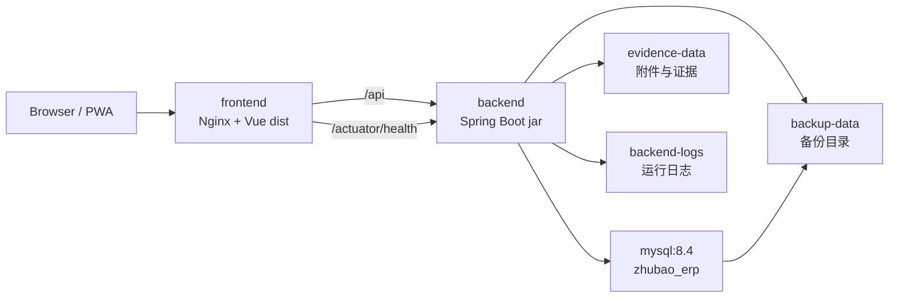

# Docker 一键部署与离线交付

**文档版本**：V1.3
**更新日期**：2026-10-10
**文档定位**：当前唯一运行部署与备份操作依据，覆盖 Docker 无源码交付、局域网 HTTPS、现场附件存储与恢复边界

---

## 1. 目标

本方案用于降低现场部署和运维成本，并避免向客户交付源码。

一期已确认安装在厂内电脑，仅在局域网使用，不需要外网或域名；手机扫码和拍摄仍需 HTTPS。当前另外准备腾讯云测试环境，采用同一套 Docker Compose 装配；测试部署不代表正式客户交付。本文的 HTTPS 与上传代理配置已纳入部署源码，实际镜像启动、手机证书信任与上传回看仍需部署后核验。客户确认来源见[归档确认清单](./archive/customer/26_客户确认清单汇总表.md)，当前参数、待确认事项和验收状态统一在[项目核心](./00_项目核心.md)维护。

本文件是当前唯一运行部署手册。[历史云端与本地方案](./archive/design/20_腾讯云与本地部署运维方案.md)仅保留选型背景，不作为第二套操作流程；云服务器和独立本地服务器可按后续需要使用同一运行包。

交付原则：

- 构建机保留源码、依赖缓存和构建脚本。
- 客户服务器只接收运行包，不接收 `backend/src`、`frontend/src`、`.git`、测试代码和开发文档全集。
- 运行包包含 Docker Compose、环境变量模板、启动脚本、数据库初始化 SQL 和已构建镜像 tar。
- 一期先支持单机 Docker Compose 部署，后续再扩展到多机、Kubernetes 或托管数据库。

---

## 2. 交付包结构

通过 `scripts/docker-build-package.ps1` 生成：

```text
.deploy-artifacts/
  zhubao-erp-runtime-<version>/
    docker-compose.yml
    .env.example
    .env
    start.ps1
    start.sh
    backup-mysql.ps1
    backup-mysql.sh
    verify-restore.ps1
    verify-restore.sh
    README_DOCKER.md
    MANIFEST.sha256
    images/
      zhubao-erp-images-<version>.tar
    mysql-init/
      V0001__m0_foundation.sql
      ...
      V0011__m3_lightweight_approval_contract.sql
  zhubao-erp-runtime-<version>.zip
  zhubao-erp-runtime-<version>.zip.sha256
```

运行包不应包含：

- `backend/src/`
- `frontend/src/`
- `.git/`
- `node_modules/`
- `.pnpm-store/`
- Maven 本地仓库
- 开发测试报告和临时输出

---

## 3. 构建机流程

在开发或交付构建机器上执行：

```powershell
powershell -ExecutionPolicy Bypass -File scripts\docker-build-package.ps1 -Version m3.62.0
```

脚本执行内容：

1. 构建后端 jar。
2. 构建前端 `dist/`。
3. 使用 `docker/backend.Dockerfile` 构建后端运行镜像。
4. 使用 `docker/frontend.Dockerfile` 构建 Nginx 前端镜像。
5. 将两个镜像导出为 `images/zhubao-erp-images-<version>.tar`。
6. 复制部署脚本、环境变量模板和 MySQL 初始化 SQL。
7. 生成 `MANIFEST.sha256` 文件级校验清单。
8. 生成 zip 运行包和 `.zip.sha256` 校验文件。

首次构建需要构建机能访问 Docker Hub 或企业镜像仓库，以拉取 `eclipse-temurin:17-jre-alpine`、`nginx:1.27-alpine` 和 `mysql:8.4`。如果现场网络无法访问外部仓库，需要提前配置镜像加速、企业仓库或预加载基础镜像。

只验证包结构、不构建镜像时可执行：

```powershell
powershell -ExecutionPolicy Bypass -File scripts\docker-build-package.ps1 -Version m3.62-layout -NoDockerBuild -SkipTests
```

### 3.1 交付包验收门禁

M3.57 起，`scripts/docker-build-package.ps1` 会在生成 `MANIFEST.sha256` 后自动调用 `scripts/verify-runtime-package.ps1`，分别验证运行包目录和 zip。该脚本也可以单独执行：

```powershell
powershell -ExecutionPolicy Bypass -File scripts\verify-runtime-package.ps1 -PackagePath .deploy-artifacts\zhubao-erp-runtime-m3.62.0.zip
```

只验证 `-NoDockerBuild` 生成的布局包时允许缺少镜像 tar：

```powershell
powershell -ExecutionPolicy Bypass -File scripts\verify-runtime-package.ps1 -PackagePath .deploy-artifacts\zhubao-erp-runtime-m3.62-layout.zip -AllowMissingImages
```

验收内容：

| 检查项 | 规则 |
|---|---|
| 必需文件 | 必须包含 `docker-compose.yml`、`.env.example`、`start.ps1`、`start.sh`、`backup-mysql.ps1`、`backup-mysql.sh`、`verify-restore.ps1`、`verify-restore.sh`、`README_DOCKER.md`、`MANIFEST.sha256` |
| 数据库初始化 | `mysql-init/` 必须包含 SQL 初始化文件 |
| 镜像 tar | 正式交付包必须包含 `images/*.tar`；仅布局检查可用 `-AllowMissingImages` |
| manifest | `MANIFEST.sha256` 必须覆盖除 `.env` 和自身以外的所有文件，且 hash 必须匹配 |
| zip checksum | 如存在 `.zip.sha256`，文件名和 hash 必须匹配 zip |
| 源码泄漏 | 禁止出现 `.git`、`backend/src`、`frontend/src`、`node_modules`、`.pnpm-store`、`.npm-cache`、`.tools`、`backend/target`、`frontend/dist` |
| Compose 运行态 | 运行包内 `docker-compose.yml` 禁止出现 `build:`、父目录引用或源码路径 |

`.deploy-artifacts/` 是构建输出目录，已加入 `.gitignore`，不进入版本库。

---

## 4. 客户服务器部署流程

客户服务器前置条件：

- Docker Engine
- Docker Compose v2
- 可用端口：默认 `80`、`443`、`8080`
- 至少 4 GB 内存，建议 8 GB 以上
- 可持久化磁盘目录

部署步骤：

1. 解压 `zhubao-erp-runtime-<version>.zip`。
2. 进入解压目录。
3. 修改 `.env` 中数据库密码、端口和访问地址。
4. 执行启动脚本。

Windows：

```powershell
powershell -ExecutionPolicy Bypass -File .\start.ps1
```

Linux：

```bash
chmod +x ./start.sh
./start.sh
```

启动脚本会自动执行：

1. 如果存在 `MANIFEST.sha256`，先校验运行包文件完整性。
2. 如果 `.env` 不存在，从 `.env.example` 创建。
3. 如果 `images/*.tar` 存在，执行 `docker load`。
4. 执行 `docker compose --env-file .env -f docker-compose.yml up -d`。
5. 输出容器状态。

`.env` 是客户现场配置文件，允许修改密码、端口和访问地址，因此不纳入 `MANIFEST.sha256`。`.env.example`、启动脚本、Compose 文件、SQL 初始化脚本、README 和镜像 tar 会纳入校验。

---

## 5. 服务拓扑



Compose 服务：

| 服务 | 作用 | 默认端口 |
|---|---|---|
| `mysql` | 业务数据库 | 仅容器内访问 |
| `backend` | Spring Boot API、业务服务、运维中心 API | `8080` |
| `frontend` | Nginx 静态站点和 API 反向代理 | `80`、`443` |

---

## 6. 环境变量

| 变量 | 默认值 | 说明 |
|---|---|---|
| `ZHUBAO_IMAGE_TAG` | `local` | 后端和前端镜像 tag |
| `ZHUBAO_BACKEND_IMAGE` | `zhubao-erp-backend` | 后端镜像名 |
| `ZHUBAO_FRONTEND_IMAGE` | `zhubao-erp-frontend` | 前端镜像名 |
| `ZHUBAO_MYSQL_IMAGE` | `mysql:8.4` | MySQL 镜像名 |
| `ZHUBAO_HTTP_PORT` | `80` | 前端 HTTP 端口。电脑可以继续用。手机摄像头不要走这个端口 |
| `ZHUBAO_HTTPS_PORT` | `443` | 前端 HTTPS 端口。手机扫码和打开摄像头用这个地址 |
| `ZHUBAO_TLS_SAN` | 空 | 手机访问时用的 IP 或域名，多个用英文逗号。空着时自签证书只包含 localhost |
| `ZHUBAO_BACKEND_PORT` | `8080` | 后端直连端口 |
| `ZHUBAO_PUBLIC_URL` | `http://localhost/` | 运维中心展示的前端地址 |
| `ZHUBAO_FRONTEND_PROBE_URL` | `http://frontend/` | 后端容器内部探测前端 Nginx 的地址 |
| `ZHUBAO_FRONTEND_PROBE_TIMEOUT_MS` | `800` | 前端探活超时时间，单位毫秒 |
| `ZHUBAO_DB_NAME` | `zhubao_erp` | 数据库名 |
| `ZHUBAO_DB_USERNAME` | `zhubao` | 数据库用户 |
| `ZHUBAO_DB_PASSWORD` | `change-me` | 数据库密码，生产必须修改 |
| `ZHUBAO_DB_ROOT_PASSWORD` | `change-root-me` | MySQL root 密码，生产必须修改 |
| `ZHUBAO_BUSINESS_REPOSITORY` | `jdbc` | 业务工作台仓储 |
| `ZHUBAO_APPROVAL_REPOSITORY` | `jdbc` | 审批任务仓储 |
| `ZHUBAO_DOCUMENTS_REPOSITORY` | `jdbc` | 文档附件元数据仓储 |
| `ZHUBAO_AUTH_USERS_REPOSITORY` | `jdbc` | 登录账号仓储；Compose 默认写入 `auth_user_account` |
| `ZHUBAO_AUTH_AUDIT_REPOSITORY` | `jdbc` | 登录审计仓储；Compose 默认写入 `auth_audit_event` |
| `ZHUBAO_DOCUMENT_PREVIEW_SECRET` | 空 | 附件短期预览签名密钥；MySQL 模式必须显式配置至少 32 字符随机值，空值、开发默认值或过短值将阻止后端启动 |
| `ZHUBAO_LOG_FILE` | `/logs/zhubao-erp.log` | 运维中心只读日志来源；Compose 同步设置 `LOGGING_FILE_NAME` |

---

## 7. 持久化与备份

Compose 卷：

| 卷 | 挂载点 | 内容 |
|---|---|---|
| `mysql-data` | `/var/lib/mysql` | MySQL 数据文件 |
| `evidence-data` | `/app/evidence` | 附件、证据文件、本地对象存储 |
| `backend-logs` | `/logs` | 后端日志文件，运维中心从 `ZHUBAO_LOG_FILE` 只读展示近期日志和 WARN/ERROR 汇总 |
| `backup-data` | `/backups` | 备份目录和运维中心备份检查目录 |
| `frontend-certs` | `/etc/nginx/certs` | 前端 HTTPS 证书 |

### 7.1 手机现场采集与附件目录

试运行以手机拍照和短视频为主，按母单、工单、返工单或出货单关联证据；NVR 截取原型已归档，不参与当前运行。无需为试运行采购录像设备，手机证据失败时只补传文件。

- 手机上传使用 `POST /api/documents/captures`，按单查询使用 `GET /api/documents/captures`；权限、请求字段与短期签名预览以[16 现行契约](./16_字段字典与API契约.md)为准。
- 图片允许 JPEG/PNG，单张不超过 8MB；视频允许 MP4/WebM，单个不超过 50MB。30 秒是前端提示，服务器按文件大小校验，当前不校验视频时长。
- 网页入口单次请求不超过 55MB，上传等待 300 秒；请求上限不放宽图片和视频各自的文件限额。
- 采集文件流式写入本地目录，保留 SHA-256，重复校验和返回已有附件。Docker 使用 `evidence-data` 卷的 `/app/evidence`；本地开发由 `zhubao.documents.storage.local-root` 指定，默认 `target/zhubao-evidence`。
- 试运行不切换 NAS/S3/COS 对象存储。弱网支持保留本次文件并重试，当前不提供完整离线采集队列。

数据库备份只覆盖业务表与附件元数据，不包含上述照片和视频文件。现场需另外确认 `evidence-data` 或本机附件目录的拷贝范围、保存位置、保留周期与责任人，并在试运行结束前完成附件恢复样例验证。NAS/S3/COS 增量附件备份尚未落地，不能用数据库恢复成功代替附件恢复验收。

### 7.2 数据库备份与 COS 目标

M3.58 起，运行包内提供受控数据库备份脚本，可用于人工执行或纳入 Windows 任务计划/Linux cron：

Windows：

```powershell
powershell -ExecutionPolicy Bypass -File .\backup-mysql.ps1
```

Linux：

```bash
chmod +x ./backup-mysql.sh
./backup-mysql.sh
```

脚本会在 Docker `backup-data` 卷内生成 `/backups/zhubao_erp_mysql_<timestamp>.sql` 和 `.sha256`，同时导出到运行包目录下的 `runtime-backups/`，并校验导出文件 SHA-256。需要上传腾讯云 COS 时显式执行：

```powershell
powershell -ExecutionPolicy Bypass -File .\backup-mysql.ps1 -UploadCos -CosPrefix prod/mysql/
```

```bash
./backup-mysql.sh --upload-cos --cos-prefix prod/mysql/
```

COS 上传依赖服务器已安装并配置 `coscmd`，脚本不保存 SecretId/SecretKey。

每日自动备份至 COS 是已确认目标，现有包提供手动备份与显式上传命令，尚未自动创建任务计划/cron。COS Bucket、Region、Prefix、访问凭据及保留策略仍待提供或确认；配置完成后需验证一次实际上传与恢复，不能以 readiness 配置齐全视为上传已成功。

备份恢复演练使用非破坏性临时库校验，不覆盖生产数据库：

Windows：

```powershell
powershell -ExecutionPolicy Bypass -File .\verify-restore.ps1 -BackupFile .\runtime-backups\zhubao_erp_mysql_20260707-090000.sql -Operator ops-user
```

Linux：

```bash
./verify-restore.sh --backup-file ./runtime-backups/zhubao_erp_mysql_20260707-090000.sql --operator ops-user
```

脚本会先校验旁路 `.sha256`，再把备份导入 `zhubao_restore_check_<timestamp>` 临时数据库，检查至少恢复出 1 张表，默认删除临时库。需要人工查看恢复结果时可使用 `-KeepDatabase` 或 `--keep-database`。

M3.60 起，运维中心会只读扫描 `ZHUBAO_BACKUP_ROOT` / `/backups` 下的恢复演练标记文件，并在 `数据库备份情况` 中显示 `RESTORE-DRILL-*` 状态，在运维清单中显示 `OPS-CHK-008`。M3.61 起，`verify-restore.ps1` / `verify-restore.sh` 校验成功后会在备份文件同目录写入 `verify-restore-<timestamp>.log`、`verify-restore-<timestamp>.json` 及各自 `.sha256`，并复制到 MySQL 容器 `/backups`；后端通过共享 `backup-data` 卷优先读取 JSON 结构化记录。

识别规则包括 `verify-restore-*`、`restore-*.log/json/ok` 和 `*.restore-ok`。JSON 记录会展示备份文件、备份 SHA-256、恢复库、恢复表数量、操作者、耗时和检查项；正式上线仍要补充业务抽样、附件恢复和人工验收结论。

正式生产仍需要补充：

- 将 `backup-mysql.ps1` 或 `backup-mysql.sh` 纳入任务计划/cron。
- 恢复演练记录入库归档、告警持久化及确认/关闭流程。当前已支持 JSON 证据展示和系统内快照告警；一期不接企业微信、短信或电话，外部通知后续按需决定。
- 备份保留周期和清理策略。
- 附件证据目录的 NAS/S3/COS 增量备份。

---

## 8. 数据库初始化与升级

`mysql-init/*.sql` 仍只挂到 `/docker-entrypoint-initdb.d`。MySQL 官方镜像只在数据目录第一次初始化时执行这些 SQL。打包脚本按数字版本生成 `V0001__...sql` 等等宽副本，历史迁移原文件不改。`start.ps1` / `start.sh` 只执行 `docker compose up`，不会升级已有库，也不会重跑初始化目录。

已有库使用显式入口：

- 开发机：`scripts/upgrade-database.ps1 -Command plan|adopt|upgrade -Url <jdbc> -Username <用户> -Password <密码> -BackupConfirmed`
- 运行包：先 `backup-mysql.ps1` 或 `backup-mysql.sh`，再 `upgrade-database.ps1 -Command plan`，确认后续版本后执行 `-Command upgrade -BackupConfirmed`。容器内入口不会随普通启动运行。

版本记在 `schema_migration`：版本、脚本名、SHA-256 校验和、状态（`APPLYING` / `SUCCESS` / `FAILED`）、开始和结束时间、错误信息。校验和按迁移文件原始字节计算。

规则：

- 空库从 V1 按顺序执行到当前最大版本。当前脚本最大版本以目录中的连续编号为准，不能写死在 V38。
- 已有库如果没有版本表，先 `plan`。它只报告结构探针能连续证明的版本，不写版本表，也不把库标成最新。
- `adopt` 只登记这段连续已存在的结构，不重放脚本。探针中间断开时拒绝登记。
- 已成功版本的文件校验和若与记录不一致，拒绝继续，不改记录、不跳过。
- 遇到 `FAILED` 或 `APPLYING` 立即停止。MySQL 的 DDL 不能整段回滚；半成品可能已经留下。恢复方法是用升级前的完整备份还原数据库。不要在未确认结构的情况下删除失败记录后重跑。
- 重复执行只跳过校验和相同且状态为 `SUCCESS` 的版本，不再次执行其 SQL。
- 历史 `V*.sql` 保持 append-only，升级程序不改写它们。

升级顺序：备份、`plan`、必要时 `adopt`、`upgrade`、抽查关键表和 `schema_migration`、失败则按备份恢复。结构门禁和 H2 测试不能代替真实 MySQL 演练。

2026-10-10 在独立临时 MySQL 8.4 上，空库执行到 V36 失败：未加引号的 `year_month` 被服务器判为语法错误。V35 之前已成功，`fin_price_agreement` 和 `fin_price_line` 已留下，后续版本没有执行。历史脚本未改。细节见[开发进度](./archive/history/2026-10-13_14_开发进度跟踪.md)。

## 9. 更新与回滚

更新流程：

1. 在构建机生成新版本运行包。
2. 上传 zip 到客户服务器。
3. 解压到新目录。
4. 复制或重新配置 `.env`。
5. 执行 `start.ps1` 或 `start.sh`。
6. 检查 `docker compose ps`、前端页面、`/api/operations/center` 和 `/actuator/health`。
7. 在运维中心确认 `前端 PWA` 和 `PWA 静态资源` 不再是 `NOT_CONFIGURED`，Docker 默认应通过 `http://frontend/` 探活，并能读取 `manifest.webmanifest` 与 `sw.js`。

回滚流程：

1. 保留上一版本运行包和镜像 tar。
2. 停止当前版本容器。
3. 在上一版本目录执行启动脚本。
4. 如果数据库结构已升级，只回滚镜像不够。用升级前备份恢复数据库；不要指望失败的 DDL 自动撤销。

---

## 10. 验收检查

客户现场部署后至少检查：

- `docker compose ps` 三个服务均运行。
- 浏览器可打开 `http://<server>:<ZHUBAO_HTTP_PORT>/`。
- 手机摄像头打开 `https://<server>:<ZHUBAO_HTTPS_PORT>/`。自签证书需在手机端完成信任配置，并真机核验摄像头权限；只跳过网页证书警告不能保证摄像头可用。`ZHUBAO_TLS_SAN` 要写成手机实际访问的 IP 或域名。
- 经过网页入口上传拆包视频时，请求体上限为 55MB，上传等待 300 秒。视频文件本身仍不超过 50MB。
- 前端可访问后端 API。
- `GET /actuator/health` 返回可用。
- `GET /api/operations/center` 返回数据库、后端、日志和备份信息。
- 运维中心能看到后端日志路径和备份目录状态。
- `backup-mysql.ps1` 或 `backup-mysql.sh` 至少成功生成一次 `.sql` 和 `.sha256`，并在运维中心看到最新备份状态。
- `verify-restore.ps1` 或 `verify-restore.sh` 至少对最新备份完成一次非破坏性恢复校验。
- 关闭并重启容器后数据不丢失。
- 不向客户目录交付源码目录和 `.git`。
- `scripts/verify-runtime-package.ps1` 对最终 zip 验收通过。

---

## 11. 当前边界

当前运行包已覆盖：

- 后端 jar 镜像。
- 前端 dist + Nginx 镜像。
- MySQL 8.4 容器。
- Compose 一键启动。
- 镜像 tar 离线加载。
- 运行包 zip。
- 客户无源码交付结构。
- 运行包 `MANIFEST.sha256` 文件级校验。
- zip 上传包 `.sha256` 校验文件。
- 独立发布包验收脚本，覆盖必需文件、manifest、zip checksum、源码泄漏和 Compose 运行态检查。
- MySQL 备份脚本，生成 `.sql` 和 `.sha256`，导出到 `runtime-backups/`，可选通过 `coscmd upload` 上传腾讯云 COS。
- 非破坏性恢复演练脚本，导入临时数据库、检查恢复表数量，并默认删除临时库。
- 恢复演练 JSON 结构化证据，运维中心只读展示 `restoreDrillRecords`。
- 运维告警汇总，运维中心只读展示 `alerts` 和 summary 告警数量。
- 显式数据库升级入口 `upgrade-database`。启动脚本不升级已有库，也不重跑 `mysql-init`。

尚未完成：

- 历史迁移 V36 在 MySQL 8.4 上因未加引号的 `year_month` 不能执行。空库因此停在失败版本，本批没有改写该历史脚本。
- 将 MySQL 备份脚本纳入任务计划/cron 和失败告警。
- 备份恢复演练记录入库归档、系统内告警持久化及确认/关闭流程。外部通知不是一期必选项。
- 公网证书自动申请。试运行配置使用容器内自签证书，手机完成证书信任后以 HTTPS 核验摄像头；正式域名证书仍需自行替换 `/etc/nginx/certs` 里的证书文件。
- 多租户或多客户隔离部署。
- 照片和视频的独立附件备份与恢复闭环，以及后续按需切换的 NAS/S3/COS 对象存储。
- 容器日志采集到集中日志平台。
