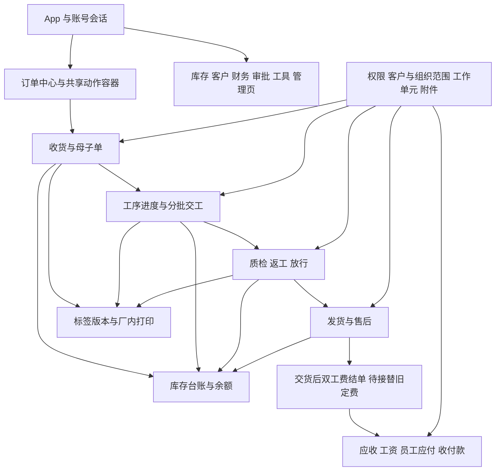

# 现行代码功能与依赖评估

**调查日期：2026-10-27。阶段源码调查快照，不是执行指令或功能验收记录。**

现行状态、未关闭事项仍以[项目核心](../../00_项目核心.md)为准。本次只增加调查资料，没有实施下述业务改造、删除源码、修改数据库或部署服务器。

## 1. 结论与覆盖边界

当前系统的主体可以继续使用。应当保留来料加工事实、库存台账、账务事实和运行保障，在现有模块化单体内按能力替换。没有证据支持把整个 `m1`、财务、设备或旧页面目录一次删除，也没有发现需要整体推倒重写的依据。

最先处理三件事：

1. **按已确认的业务规则，建设交货后双工费结单，再退出提前定价、月度生成加工费、整月重算工资、改单直接记账与损耗试算工资。** 这是业务规则调整，优先级高于目录整理。
2. **收口并行写入口和真实性边界。** 旧备料写接口、通用库存转移、导入与设备读数的多步提交需要分别核对；设备固定样例和导入本地映射不得被误认为实时状态或后端认可的执行结果。
3. **在消费者迁移后拆分查询、聚合和大文件。** 订单中心已存在，但原工作台、扫码上下文、财务和库存仍各自组装读取模型。先统一规则与事实来源，再裁剪重复入口。

### 1.1 本次实际读取与分析方式

- 全文静态扫描现行源码、测试、SQL、脚本和配置，建立文件、导入、公开符号、接口映射与条件装配索引；重点人工追踪页面入口、命令服务、工作单元、库存、财务、鉴权、附件、打印、导入与运维链路。
- 最后一次索引快照截止 **2026-10-27 19:48:23（北京时间）**，覆盖 **1,132 个文本文件、154,627 行**，其中 **246 个测试文件**。行数包括空行、注释、测试和配置，不是业务有效代码量。
- 前端 `src` 有 146 个非测试文件和 96 个测试文件；从 `main.ts → App.vue` 出发，连同动态导入与类型导入可到达 **144 个非测试文件**。余下是编译声明 `vite-env.d.ts` 和被多项测试消费的 `scanContextFixture.ts`，不能视作两个可直接删除的文件。
- 后端有 **585 个生产 Java 文件、147 个测试 Java 文件、16 个领域模块、31 个 REST 控制器**；另有安卓、C#／Java 打印程序与运维脚本。数据库包含 **V1—V78 共 78 份迁移源码**；测试服留档仍是 V77，不能把 V78 源码存在当作数据库已升级。
- 没有把“文件全文已扫描”写成“15 万行全部逐行人工审计通过”；这次不是全量正确性、安全或性能验收。没有执行业务测试、构建、真机或目标数据库验证。
- 排除依赖库、构建输出、日志、锁文件、图片／字体／EXE／JAR 等二进制；历史 `docs/archive/`、`archive/code/` 和设计原型不作为当前运行源码或需求。二进制的使用关系通过源码、脚本和配置核对，没有反编译。

### 1.2 快照与共享工作区

扫描基准 HEAD 为 `f385dcca3181def385e57168046212091e211bdb`，**实际读取的是含未提交改动的共享工作区，不能直接等同测试服版本**。逐文件索引记录 SHA-256，供后续定位当时文件字节。

开始时工作区已有前端样式、表单及附件等 13 个未提交文件。调查期间又观察到结单读取、模型、仓储、V78 和测试等持续新增，最后一轮已补入索引；这些不是本次评估写入的改动。收尾时它们已由并行工作提交为 `fd1e250`（D1：交货完成判定与结单草稿），本次不覆盖或重复提交业务源码。其存在不等于确认入账、旧计费退出、收款核销与界面全链已完成；详见第 5.3 节，后续按最新提交复核。

截止时间之后的字节复核又发现 `Payable.java`、`PayrollLine.java`、`JdbcFinanceRepository.java` 继续变化。这些后续修改不在本快照的新状态复核范围内；保留各文件的截止时摘要，不反复重刷索引或将并行开发混入本次评估。尤其第 5.2 节的金额一致性判断应在实施时重新核对最新代码。

### 1.3 可复查索引

| 文件 | 内容与使用限制 |
|---|---|
| [逐文件源码索引](./逐文件源码索引.csv) | 每个文件的模块、行数、导出或公开方法、直接依赖、生产／测试引用、条件装配、建议和字节摘要。通用“保留”是本轮分类，不是逐方法验收结论 |
| [源码直接依赖](./源码直接依赖.csv) | 5,031 条前端相对导入、Java 显式／通配导入及同包词法类型引用，含测试；不是完整运行时调用图 |
| [后端领域依赖](./后端领域依赖.csv) | 58 条跨领域生产导入关系及证据文件；领域之间有导入环，不等于 Spring Bean 一定存在循环注入 |
| [后端接口索引](./后端接口索引.csv) | 244 条方法映射记录及控制器注解行号；不包括 Actuator 等框架接口，不代表每个接口都被当前前端使用 |

Java 反射、Spring 注入、SQL、同名符号、脚本字符串、类型擦除及外部客户端不能靠一个导入图完全识别。零静态引用只产生调查候选；删除仍须查运行时、类型、测试、脚本和条件装配。`DatabaseUpgradeMain` 正是生产 Java 很少直接引用、却被升级脚本调用的保留实例。

关键证据可直接从 [App.vue](../../../frontend/src/App.vue)、[财务定费服务](../../../backend/src/main/java/com/zhubao/erp/finance/app/FinanceBillingService.java)、[工资服务](../../../backend/src/main/java/com/zhubao/erp/finance/app/FinancePayrollService.java)、[财务 JDBC 仓储](../../../backend/src/main/java/com/zhubao/erp/finance/infra/JdbcFinanceRepository.java)、[固定设备与任务](../../../backend/src/main/java/com/zhubao/erp/hardware/app/HardwareIntegrationService.java)、[登记导入页](../../../frontend/src/features/m1/SampleLibraryWorkspace.vue)、[旧备料控制器](../../../backend/src/main/java/com/zhubao/erp/inventory/web/PrepStockController.java)和[新库存单据控制器](../../../backend/src/main/java/com/zhubao/erp/inventory/web/MaterialStockController.java)复查。

## 2. 全部功能入口与建议

下表以 `frontend/src/` 为前端根；后端包均在 `com.zhubao.erp`。17 个原菜单之外，订单中心和共享动作容器也是正式功能入口。

| 功能 | 实际入口和直接调用链 | 处理建议 |
|---|---|---|
| 工作台／轻任务 | `m1/M1Dashboard.vue`、`workspace/DeskInbox.vue` → `businessWorkspaceApi`、`deskTaskApi` → `BusinessWorkspaceService/DeskTaskService` | 保留。待办、轻任务与生产事实分开，不能把完成轻任务当成报工或交工 |
| 订单中心 | `orders/OrderWorkspace.vue` → `orderWorkspaceApi` → `OrderWorkspaceQueryService`；详情用 `OrderDetail/useScanContext` | 作为订单、生产、质量统一读取入口继续改造；补交货与结单状态，不能复用一次出货就等同结单资格 |
| 来料／收货／母单 | `m1/InboundWorkspace.vue`、`intake/IntakePanel.vue` → `mobileIntakeApi/businessOperationApi` → `MobileIntakeService/BusinessOperationService` | 保留。加工要求、材质行、单位、证据、原请求恢复都在实际链路中；迁移旧外壳前保留这些能力 |
| 整单生产／拆单／撤销整单生产 | `m1/MotherSplitPanel.vue` → `motherSplitApi` → `MotherOrderSplitService` | 保留。依赖收货来源分配、库存、工序进度、改单、财务下游存在性及标签失效规则 |
| 生产作业 | `m1/ProductionWorkspace.vue`、`production/ProductionPanel.vue` → `processStationApi` → `ProcessStationService`；旧外壳还读取设备产量与绑定建议 | 保留分批交工与岗位校验。旧生产外壳不能在设备产量能力尚未接续时直接归档 |
| 五档进度／在制查询 | `m1/ProgressWorkspace.vue`、`m1/ProcessProgressPanel.vue` → `progressApi/processProgressApi` → `ProgressBoardService/ProcessProgressService` | 保留事实记录；合并查询口径。100% 进度仍不等于交工、末道称重或工资确认 |
| 质检／返工／放行／损耗 | `m1/QualityWorkspace.vue`、`quality/QualityPanel.vue` → `qualityCheckApi/businessOperationApi` → `QualityRequirementService/BusinessOperationService/ApprovalService` | 保留物理事实及责任审批；裁剪前期工价和工资试算。旧质量外壳还有损耗申请入口，不能只看到新质检面板就删除 |
| 加工库存／出货／售后 | `m1/InventoryTraceWorkspace.vue`、`shipping/ShippingPanel.vue`、`inventory/InventoryAftercarePanel.vue` → 业务操作、台账接口 | 保留。发货、客户退回、售后判定、冻结与实物流转须有原单及账务接续 |
| 公司料／客户寄存备料 | `m1/PrepStockPanel.vue` → `/api/inventory/material-stock/*` → `MaterialStockService` → 库存单据、台账、主数据、加工建单 | 新单据链路为当前界面主路径；收口旧 `/prep-stock/*` 写入口，继续区分待核、入账、领用和成本 |
| 客户档案／材质／要求模板 | `m1/CustomerArchiveWorkspace.vue`、`RequirementTemplatePanel.vue`、收货选择器 → `MasterDataService` | 保留稳定客户 ID、材质与要求文本模板。财务删除价目写入后，应由这里和原账事实提供客户身份 |
| 财务客户账／收付款／经营 | `m1/FinanceWorkspace.vue`、`finance/CustomerBillPanel.vue` → `financeApi` → 各财务服务 | 保留应收、红字、收款、应付付款、耗材、资产、折旧和外协；替换定费及工资生成来源，详见第 5 节 |
| 审批 | `m1/ApprovalWorkspace.vue`、`approvals/approvalDecisionAccess.ts` → `ApprovalService` | 保留损耗、账号及其他审批与历史决定；不能因取消前期定价而删除整个审批领域 |
| 标签／模板／打印／换贴 | `m1/LabelWorkspace.vue`、`labels/OrderLabelPanel.vue`、`PrintJobPanel.vue` → `LabelService/PrintJobService/PrintBatchService` → 厂内程序 | 保留版本、实例、冻结快照、纸张核对、工位队列和领取租约；旧协议与程序实现另核，详见第 7 节 |
| 附件／现场证据 | `m1/DocumentManagementWorkspace.vue`、`evidence/EvidenceCapture.vue`、`OrderEvidence.vue` → `DocumentCaptureService/BusinessEvidenceService/DocumentManagementService` | 保留原件、元数据、引用、分页和签名读取；财务结单证据须新增用途与授权边界，不能直接向生产详情开放 |
| 登记导入 | `m1/SampleLibraryWorkspace.vue` → 预览、确认、修正、计划、显式入账 → `register` → 收货／岗位交工／发货／设备产量 | 是运行中的 Excel 入账功能，不是可删“样品库”。模板与映射应以后端为准；多行恢复和跨服务步骤需改造 |
| 用户／权限／账号审批与审计 | `m1/UserManagementWorkspace.vue`、`authApi` → `AuthSessionService/AuthUserAccountManagementService`、审批、客户授权、附件 | 保留。拆分大服务时保留会话撤销、临时密码、组织、工种、顶岗、客户范围及审计失败处理 |
| 登录／密码／会话 | `auth/LoginPage.vue`、`App.vue`、`apiClient.ts` → `AuthController`、会话与账号仓储 | 保留。账号变化清理上下文与草稿隔离，普通无权限不得被误判成会话失效 |
| 设备／读数／POC | `m1/HardwareIntegrationWorkspace.vue` → `hardwareIntegrationApi/deviceGatewayApi` → `hardware/gateway` | 保留已用读数、注册密钥、人工兜底及 POC 证据；固定设备清单和健康任务需要与真实探测分离，暂不扩展厂商 SDK |
| 运维中心／管理维护／回收 | `m1/OperationsCenterWorkspace.vue`、`OrderMaintenancePanel.vue` → `operationsCenterApi/orderMaintenanceApi` → `OperationsCenterService/OrderMaintenanceService` | 保留探测、成套备份证据、审计和维护；拆分巨型聚合服务。回收不是库存或财务冲销 |
| 配置／个人与存储 | `m1/ConfigurationWorkspace.vue` → `authApi/documentManagementApi` | 保留个人安全、存储与对账能力，不能当成纯静态配置页删除 |
| 手机作业 | `m1/MobileOpsWorkspace.vue`、`MobileOrderDetail.vue` → 共用收货／生产／进度／质检／发货面板 | 已复用共用提交面板。可作为旧入口收敛候选，先接续岗位动作、相机、返回和权限；不是第二套可单独废弃的后端 |
| 全局扫码与追溯／共享动作 | `scan/ChainReview.vue`、`useScanContext`、`orders/OrderActionHost.vue` → `/api/scan/context` 和各命令接口 | 保留多候选人工选择、类型和版本校验、草稿及未知结果恢复；逐步统一类型化上下文 |

## 3. 后端全模块责任与改造边界

| 领域 | 生产文件／行数 | 职责、依赖与建议 |
|---|---:|---|
| `business` | 179／21,553 | 母子单、来源分配、工序、质量、改单、维护、查询与新增交货资格。保留核心事实；按收货、生产、质量、交付和维护分应用协调服务，避免扩充总操作服务 |
| `inventory` | 26／4,122 | 台账、余额、库存单据、寄存／公司料。保留内核；旧备料写与新单据写收口，事实更正继续追加流水 |
| `finance` | 54／6,373 | 客户价目／应收／收款、工资、应付、成本、报表及新增结单凭据仓储。保留账；替换写钱来源；仓储不可整体删除 |
| `approval` | 11／948 | 损耗、账号等审批、决定权限与可见性。保留，避免通过审批摘要重新生成新工资 |
| `document` | 47／5,416 | 原件存储、证据绑定、附件列表、预览与签名、对账。保留，逐步拆分用途授权、存储和只读投影 |
| `label` | 48／4,501 | 标签模板与版本、旧任务、批量队列、工位、追溯。保留；区分业务标签、打印协议和实际纸张事实 |
| `scan` | 32／2,256 | 编码解析、上下文聚合、一般进度记录。保留，拆查询聚合；一般进度与工序交工不混算 |
| `security` | 72／7,061 | 账号会话、密码、客户授权、菜单、有效权限、组织／顶岗、审计与账号审批。保留并收敛账号上下文组装 |
| `work` | 14／585 | 命令哈希、幂等回放、内存撤销、JDBC 工作会话。作为所有关键命令的共同边界保留 |
| `register` | 25／2,476 | Excel 模板、解析预览、批次保存、修正、入账计划和执行。保留低频入口，改统一元数据及逐步恢复 |
| `gateway` | 28／1,989 | 设备认证、限流、重放检查、标准化、读数消费与岗位报工桥接。保留；与业务提交结果的状态接续单独治理 |
| `machine` | 20／1,235 | 机器档案、设备产量、导入来源和未匹配绑定。当前生产外壳与导入在消费；是否退出是业务选择，不能按菜单推断 |
| `hardware` | 10／463 | 固定设备／任务、POC 仓储与附件证据汇总。POC 与人工兜底保留，固定健康数据重构为来源明确的展示 |
| `operations` | 3／2,124 | 运行指标、前端／数据库／PWA 探测、文件和备份恢复证据、硬件展示。保留，把 1,920 行探测聚合服务拆成专门探测器 |
| `ops` | 11／969 | 迁移目录、校验和、结构探针、升级计划与独立命令入口。保留；它与 `operations` 的职责不同 |
| `common` | 4／232 | API 响应、异常和统一错误映射。保留，领域错误适配不宜继续把底层公共包反向耦合具体设备领域 |

模块行数包含调查期间新增的 D1 基础源码，精确文件字节见逐文件索引；不等同测试服代码规模。

扫描未检出 `domain` 显式导入 `app/infra/web`；这不等于分层已完全解耦。应用服务彼此调用、跨领域直接持有仓储接口、集中查询聚合和统一异常适配仍形成较强耦合。

## 4. 依赖图与不能拆断的边界

### 4.1 页面与业务主链

图中结单为目标接续能力，其余为现行主要链路。当前费用仍能由月度生成／旧改单生成，不能把目标图当作已实现事实。

### 4.2 主要跨领域关系

| 引用方 | 重要被引用方 | 为什么不能直接剪掉 |
|---|---|---|
| `business` | `inventory/security/work/approval/finance/label/scan` | 命令需记台账、确认身份、同次提交；维护检查财务下游，改单及扫码校验影响版本和旧标签 |
| `inventory` | `business/finance/security/work` | 备料可建加工单；更正和退回需查业务、财务事实并控制范围 |
| `finance` | `business/inventory/approval/security/work` | 当前计费读母单与交工，客户账读实物余额，工资读损耗审批，改单差额共用会话；新结单接替时逐条换源 |
| `document` | `business/scan/inventory/security` | 证据归属、阶段、对象类型及跨客户授权依赖业务事实 |
| `scan` | `business/document/inventory/security` | 详情把订单要求、工序、质量、库存、证据与可执行动作组合返回 |
| `label` | `business/scan/security/work` | 标签冻结业务版本、库存或单据来源，旧码校验与队列快照必须继续一致 |
| `security` | `approval/business/document` | 账号审批、附件凭据、客户身份／工种读取；不是仅有密码校验 |
| `register` | `business/machine/security` | 入账委派真实业务服务，雕刻类导入另写设备产量 |
| `gateway` | `business/security` | 读数转报工必须经过真实账号和岗位服务 |
| `operations` | `gateway/hardware` | 运维硬件列表同时消费真实网关信息和固定设备清单，后者不能被简单当作实时探测 |

静态跨领域图中，`approval/business/common/document/finance/gateway/inventory/label/scan/security/work` 形成互相可达的导入集合。其间既有必要业务协作，也有统一异常处理带入的反向导入。**这只能证明源码耦合，不能据此认定 Bean 启动故障或要求拆微服务。**

优先把稳定的范围判断、只读查询端口、工作会话和事实读取契约定义清楚，再调整应用协调层。不要为了消除一条图上的箭头而复制权限规则或再造一套余额。

### 4.3 关键事务与外部副作用

- `JdbcBusinessWorkUnit` 在同一连接上保留请求、执行业务、保存结果并提交；`WorkSession.connection()` 是关键仓储写入和锁定读取的共同连接。兼容方法自行 `getConnection()`，不会因为外层调用了工作单元而自动加入该事务。
- `MemoryBusinessWorkUnit` 用单进程锁和逆序撤销保持当前进程原子性，不能直接解释为多实例保护。
- 库存流水、母子单、来源分配、要求版本、执行轮次、调整记录和请求结果需要按命令保持同次提交。新增结单还要把应收、工资、应付和结单凭据纳入同一保护。
- 附件原件发布与数据库引用、打印任务与 Windows 队列、设备报工与消费记录都是多步骤边界；应使用明确状态、原请求重试或补偿接续，不能假定数据库回滚能收回已出纸或已发布文件。
- 回收／恢复是业务可见性管理，不能代替库存冲正、应收红字、退款、删附件或物理撤回打印。

## 5. 已明确应替换并退出的业务能力

依据已确认的[交货后工费方案](../../交货后工费结单与收付款改造方案.md)，下列能力属于**目标上应退出、当前尚有运行消费者**；本轮不提前删掉替代能力尚未接上的代码。

| 退出对象 | 当前源码位置 | 先接续什么，再退出什么 |
|---|---|---|
| 客户预设工价写入与按协议定费 | `FinanceBillingService.saveAgreement/run/billMother/billProcess`；`FinanceController`；`financeApi`；`FinanceWorkspace` | 新结单逐单填客户费；先接续客户身份、账单与缺项查询，再裁剪协议写入和旧生成；历史协议／应收只读保留 |
| 月度生成加工费 | `/api/finance/billing-runs`；`FinanceBillingService.generate` | 已交货结单确认后一次入账；旧地址经认证返回明确停用结果，不能仅藏按钮而继续直接调用记钱 |
| 员工预设工价与整月工资重算 | `FinancePayrollService.saveRate/build/generate/confirm`；`FinanceRepository.replacePayroll/savePayrollRun` | 按单、人员和工序确认工资及员工应付，月度只汇总；保留历史工资、旧月确认和原付款事实 |
| 改单中的前期价格／差额和直接入账 | `OrderChangeService/Controller/Panel`、`OrderChangePostingService.post` | 业务要求、路线、交期、审核、版本、执行轮次继续；费用交货后定，结单调整接替差额；旧 posting 的生产装配最终退出 |
| 损耗阶段试算工资与摘要自动扣薪 | `QualityWorkspace`、`ApproveLossCommand`、`BusinessOperationService.approveLoss`、`FinancePayrollService.lossDeduction` | 继续投入产出、实物损耗、责任及审批；工费与扣减交货后明确，不再解析 `sourceSummary/lossDeduction` 决定新工资 |

**必须保留的财务部分：** 应收及红字、客户账、实际收款与分摊、预收、应付与付款、耗材、固定资产与折旧、外协、历史来源和审计。不能整类删除 `FinanceBillingService` 或整个 `finance`。

### 5.1 删除前必须改好的依赖

1. `FinanceReadAuthorizer.assertCustomerWrite`、`FinanceBillingService.customerName` 和 `FinanceDashboardService` 仍读取协议／原账获取客户信息。改走稳定主数据及原账兼容读取，避免客户消失、名称丢失或扩大授权。
2. `FinanceReportService.operating` 调 `billingService.unpriced`，工资成本又读 `findPayrollRun`。新结单缺项替代旧缺价扫描；新工资按逐单确认入成本，旧工资继续按原月确认解释。
3. `OrderChangeService` 注入 `OrderChangePostingService`，`FinanceController` 聚合多个服务。退出 Bean、专用请求类型、仓储写方法和测试装配须同次调整，不能通过可空依赖悄悄跳过必要流程。
4. 工序批次操作人、整道最后交工人和实际计酬人不是同一事实。结单人员归属要有明确来源，不能把最后交工人直接当作整道工资归属。
5. 订单的 `SHIPPED` 展示状态不是整单交齐、已签收或具备结单资格的充分条件。须结合剩余库存、出货数量、返工／冻结及选定结单粒度锁定复核。
6. 已发布网页、PWA 和安卓 WebView 中可能还有旧页面或旧请求。退出业务实现后，最小停用响应壳可以暂留，不能保留可重新开启的旧记钱分支。

### 5.2 同时需要治理的金额一致性

`FinanceBillingService.receive` 在构造收款前校验分摊；`JdbcFinanceRepository.registerReceipt` 原子保存收款和分摊并处理同键回放，但没有把最新应收余额的复核一起放进这个写事务。它与 `registerPayablePayment` 对应付行使用 `FOR UPDATE` 的保护不同。

因此应把“不同请求同时核销同一应收”的余额锁定／复核列入结单和后续预收核销改造。**这是源码显示的并发边界缺口，本轮没有并发复现，不能声称已经发生超收。** 新结单工资和员工应付还要有来源唯一保护，不能只用服务层先查再写。

### 5.3 调查期间新增并提交的 D1 基础代码

最后一轮全文扫描已覆盖新增文件，收尾时对应提交为 `fd1e250`。以下仅说明源码边界；本次评估没有实施或运行它们的测试：

| 新增部分 | 本快照可见内容 | 尚未证明的完整能力 |
|---|---|---|
| `OrderDeliveryCompletionQuery/OrderDeliveryAssessment` | 按母单／子单评估交货，读取出货、质量、库存与执行轮次，提供带会话锁后重读入口及交货摘要 | 本轮未验收目标 MySQL 的并发读取与真实业务资格 |
| 单据、要求和台账仓储读取 | 三个接口及对应 JDBC 实现新增按会话和锁定读取方法 | 不能认为所有旧调用已迁移或所有关键读都在同一事务内 |
| `OrderSettlement*` 模型和两种仓储 | 草稿、来源、分项、确认标记和入账引用模型；内存／JDBC 仓储随财务仓储开关装配 | 本快照未检出消费这些凭据的确认结单应用协调服务、HTTP 入口或前端表单，不能认定应收／工资／应付已接通 |
| `V78__m3_order_settlement.sql` | 凭据、后续核销、历史覆盖与策略表及来源字段／索引，迁移索引和探针同步新增 | 不是本轮已执行的迁移，也不是已确认部署的数据库版本 |
| 新增测试 | `OrderDeliveryCompletionQueryTest/OrderSettlementRepositoryTest` 及升级测试修改 | 不重复宣称本次实际执行通过；测试文件也不代表新旧计费切换已验收 |

因此第 9 节前两项应接续或评审 D1，避免重复新建交货模型与结单仓储。核心当前记录的 D1 事实保留；完整闭环和业务定案以后续提交及验证为准，不将本快照当作冻结的开发要求。

## 6. 候选弃用、合并和重构清单

| 对象 | 现有证据 | 分类与退出条件 |
|---|---|---|
| 原来料／生产／进度／质量外壳 | `App.vue.workspaceLoaders` 仍装配；`navigateTab` 对日常操作转订单中心，但 `activateTab` 与注入打开页能力仍保留；生产外壳有设备产量、质量外壳有损耗申请 | **合并后归档候选。** 逐项迁移专属功能、账号入口、快捷跳转及相关测试后再移除；共用面板继续保留 |
| `MobileOpsWorkspace/MobileOrderDetail` | 仍有 `mobile` 菜单与兜底扫码入口，已复用共用办理面板 | **入口收敛候选。** 完成真实岗位与安卓验证后可归并；不是立即删除手机能力 |
| `/api/inventory/prep-stock/*` 与 `PrepStockService` | 当前 `PrepStockPanel` 走新 `/material-stock/*`；旧控制器／服务仍是 Bean，保留专用测试，旧写入口用管理员通用库存权限 | **旧业务入口退出候选。** 先核外部脚本和实际消费者，迁移旧批次的单位、来源与库存单据可追溯性；不是无前端引用就立即删 |
| `/api/inventory/ledger/transfers` | 未检出当前前端调用；管理员鉴权仍在；`M2ManagementApiSmokeTest` 等用它准备数据，服务还被核心业务广泛调用 | **限制公共写入口候选。** 评估是否仅内部使用，迁移测试造数方式；`StockLedgerService` 与仓储内核必须保留 |
| 无请求号的兼容业务重载 | `BusinessOperationService` 仍有无会话转移和保存；HTTP、导入及测试消费者并不完全相同 | **按方法收口。** 先核生产调用，再要求生产命令共用会话；不能把兼容构造器和测试入口一并机械删除 |
| 业务演示仓储与 seed | `BusinessWorkspaceService` 默认正式查询，但显式 `demo-enabled` 可读演示仓储；构造器仍要求注入仓储，测试覆盖两种模式 | **可选隔离，不是无用代码。** 如确定不再演示，先改装配与测试，再归档演示源码；迁移 seed 和历史表仍保留 |
| `HardwareIntegrationService` 固定设备与任务 | `devices/tasks` 为硬编码；设备页展示其平均健康；`OperationsCenterService.hardwarePresences` 再消费固定设备状态并附本次检查时间 | **优先改造真实性。** 展示为配置／POC／人工状态，或由真实读取源替换；没有探测证据就显示未采集，不能把固定 ONLINE 当本次探测成功 |
| `SampleLibraryWorkspace/registerImportTemplates.ts` | 页面读取本地模板、汇总和规则；计划失败或确认成功后能本地构造计划；后端另有模板及计划服务 | **优先统一规则来源。** 模板／计划采用后端版本，保留明确离线说明时也不得作为入账许可；后端现在仍重新验证，不能误报为已能绕过后端记账 |
| 导入多步执行 | `RegisterImportPostingExecutionService` 逐行执行并更新行状态；雕刻行还另写设备产量 | **改造恢复边界。** 单行业务成功后标记或产量失败需要可回放接续；不是任意批次失败就能整批回滚的实现 |
| 设备读数消费联动 | `DeviceGatewayService.consumeInternal` 先调岗位报工，后保存消费记录；读数防重与业务报工有自己的键 | **改造结果接续。** 保护不同消费请求和“报工已成、消费保存失败”的恢复；本轮未证明其现有幂等机制无效，不能直接定性重复扣库 |
| `documentManagementData`／`operationsCenterData` 样例常量 | 常量引用仅检出声明及对应测试，文件内接口却被生产页面和 API 使用 | **低风险结构整理。** 生产类型抽到契约目录，样例迁测试夹具；不是整文件删除 |
| `scanContextFixture.ts` | 生产入口不可达，17 个前端测试文件消费 | **迁到测试支持目录。** 保留帮助函数和测试，不能作为业务死代码删掉 |
| C# 与 Java 两套打印接收实现 | 当前下载构建脚本用 C#；Java 仍有独立 Maven、渲染与路由测试，两者均用 v2 工位协议 | **择一维护的候选。** 核实现场是否有 Java 程序，再决定定位或归档；不能只因当前发布为 EXE 就证明 Java 无用户 |
| 旧 v1 打印任务协议 | 后端 `PrintJobController` 仍提供旧任务／领取接口，v2 用 `PrintRoutingController`；前端维护和旧打印任务历史仍有关联 | **兼容协议退出候选。** 先核现场程序、历史读取、管理维护和重试消费者，禁止与打印内核一起删除 |
| 旧收货／发货明细双写 | `JdbcBusinessDocumentRepository` 继续写 `biz_mother_order_item/biz_outbound_order_item`，另有新来源行与分配表 | **暂不停止。** 仓外报表／脚本消费者未核实，沿用 A3；保留表和原迁移，验证替代读取后再停写 |
| 大文件和重复只读投影 | `FinanceWorkspace` 1,406 行、`MaterialStockService` 1,397 行、`ScanContextService` 1,028 行、`OperationsCenterService` 1,920 行等 | **保留职责并分拆。** 文件长只是维护信号；按应用协调、规则、查询、存储和展示拆，不借整理重写库存或金额算法 |

## 7. 运行保障、数据库与客户端依赖

### 7.1 持久化不能按一个 profile 推断

| 事实 | 实际配置／条件 | 改造约束 |
|---|---|---|
| 业务单据与演示快照分开 | `zhubao.business-document.repository` 与 `zhubao.business.repository` | 前者还控制要求、改单、工序进度、轻任务、待核等仓储；后者不是正式单据仓储 |
| 只开 MySQL 不代表所有仓储 JDBC | `application-mysql.yml` 中审批、文档、演示快照仍可默认 memory；`deploy/docker-compose.yml` 显式设 JDBC | 裁剪或改配置时保持原装配语义，避免一端已落库、一端仍仅内存 |
| 打印任务并非单独开关 | `JdbcPrintJobRepository/JdbcPrintRoutingRepository/JdbcLabelTraceRepository` 跟随 `zhubao.label-template.repository` | 该配置名虽叫模板，实际还影响任务、工位和追溯，不能只保留模板仓储 |
| 标签存储版本 | `JdbcLabelStorageEditionRepository` 跟随 `business-document.repository` | 与业务和模板两种仓储组合一起核对 |
| 会话与账号同开关 | `JdbcAuthLoginSessionRepository` 跟随 `zhubao.auth.users.repository` | 删除账号仓储或换装配会影响登录状态，不是无菜单的独立残留 |
| 命令事务独立开关 | `zhubao.command-request.repository` 控制工作单元和请求仓储 | 关键业务仓储与工作会话需要兼容装配，不可假定内存撤销能控制 JDBC 独立提交 |

现行部署还依赖附件签名随机密钥、关闭开发头身份、SQL 迁移索引与结构探针、数据库／附件成套备份及恢复证据。上述为保留项，不能随业务入口归并省略。

### 7.2 迁移与升级

`ops/MigrationCatalog` 从 `migration-index.txt`、`upgrade-probes.tsv` 及版本 SQL 装载脚本，并计算原文字节校验和；测试服留档到 V77，本快照源码另有 V78。升级由 `DatabaseUpgradeMain` 与 PowerShell／Shell 脚本启动。项目不是简单删除旧类再重建数据库的模型。

以后新增结单、分摊核销、来源唯一约束或索引应追加迁移；不能编辑已发布历史脚本、删除旧表、重写已有费用或因代码归档清理生产数据。

### 7.3 PWA、安卓与打印

- `main.ts` 仍注册 PWA，`manifest` 和 `sw.js` 是客户端依赖。当前 `sw.js` 主要执行立即安装接管，未实现完整离线业务缓存，不能据 PWA 名称承诺离线提交。
- 安卓 `MainActivity.kt` 是受控 HTTPS WebView，包含来源限制、相机权限、文件拍摄返回、错误和导航处理；`ShellPolicies` 还有独立策略测试。业务用同一网页与后端，保留原生拍摄／证书／正式签名验收边界。
- 当前 Windows 接收程序由 `build-receiver.ps1` 编译 `ReceivePrintJobs.cs/LabelDrawing.cs`，同步网页下载和版本哈希清单；`receive-print-jobs.ps1` 启动 EXE。源码、下载清单和发布装配要保持同版。
- v2 工位程序领取冻结快照并上报 `SPOOLED/FAILED`，`SPOOLED` 只证明送系统队列。标签机出纸、纸张 40×30、二维码、换贴、结果未知时核纸均不能由静态代码扫描代验。

## 8. 查询与性能改造

已确认的结构问题：

1. `OrderWorkspaceQueryService.query` 先取库存余额，再装入母单、子单、整道交工、批次、质检、进度与要求，最后在内存 `subList` 分页。页面有分页不等于数据库分页。
2. `ProgressBoardService`、`FormalBusinessWorkspaceQuery`、扫码详情和财务又各自读取／解释相关事实，增加规则漂移与重复全量读取的风险。
3. `MaterialStockService` 的总览、批次与流水多处读取 `stocks.balances/ledgers`；财务客户汇总和明细同样有整表读取。现有小数据记录不足以证明目标规模仍满足响应要求。
4. 旧工作台投影包含 `intValue()` 数量展示，与现行小数来源和单位模型需要逐项核对；不能把旧展示字段直接当新账务或交货数量依据。

建议先明确统一的订单／工序／质量状态投影，在仓储增加带客户与组织范围的查询方法和必要索引，再将筛选、计数与分页下推。流水分页需要期初余额或可靠的窗口聚合，不能简单截断用于计算累计余额的完整列表。

本轮没有压测数据，不把这些结构事实写成“线上已经慢”或直接指定缓存、搜索引擎和微服务。权限筛选下推后仍须保持空客户范围拒绝、本人／班组／部门范围不扩大。

## 9. 建议实施顺序与最小充分验证

| 顺序 | 增量边界 | 交付与验证判据 |
|---|---|---|
| 1 | 对齐已提交 D1 的结单粒度与交货资格，继续明确计酬人员与旧账接续 | 明确服务契约、状态与来源，不将基础仓储视作完整结单完成；核对应出货、库存和质量事实 |
| 2 | 新结单凭据、锁定读取和同次追加应收／工资／应付 | 正常、重复、不同请求并发、失败回滚、越权、跨客户及带组织账号；内存与 JDBC 契约验证，按改动追加迁移检查 |
| 3 | 客户收款选择和已有预收后续核销、工资汇总与报表新旧口径 | 同应收并发核销不超额、同款不重记；历史收付款与已确认成本保持可查 |
| 4 | 同次切换所有前期金额入口，裁剪旧生成及旧改单记账 | 后端直接调用和旧客户端路径均不能提前记钱；要求、工序、质量、发货、审批与标签主链仍正常；相关前端类型检查和定向组件测试 |
| 5 | 设备固定状态与导入本地计划／模板来源治理 | 缺真实数据明确显示未采集；失败不生成伪成功；后端计划仍决定入账，确认／执行／逐行恢复正常 |
| 6 | 旧备料与通用库存 HTTP 写入口收口、导入和设备多步状态接续 | 外部消费者已核实并迁移；旧批次可追溯；同请求回放、标记失败恢复、并发不透支，保留底层台账与历史读取 |
| 7 | 迁移原页面专属能力与手机兜底，收敛壳层、类型和测试夹具 | 17 页实际能力有接续表；设备产量、损耗申请、深链、扫码、岗位动作与跨端权限不丢；相关组件检查即可，不默认联跑后端 |
| 8 | 统一读取模型、数据库筛选分页、拆分巨型服务；按实际使用裁剪打印兼容实现 | 使用目标数据量和真实查询计划确认收益；按共享影响选择类型检查／后端编译／契约测试；涉及打包或现场程序时才跑相应交付门禁 |

第 5 项的真实性修正可以作为结单之外的独立小增量先处理；第 6 项的旧写收口也应尽早核实，但不能省略消费者和旧数据接续。表中顺序不授权直接执行全部改造。

可复用的定向测试包括：`BusinessWorkUnitTest`、`IntakeReceivingTest`、`MultiMaterialIntakeSplitTest`、`ProcessStationServiceTest`、`JdbcProcessBatchTest`、`QualityDeliveryTest`、`ShippingDeliveryTest`、`MaterialStockJdbcIntakeTest`、`OrderChangeJdbcAtomicityTest`、`FinanceReceiptContractTest`、`FinancePaymentContractTest`、`FinanceRead/WriteAuthorizationTest`、`RegisterGatewaySessionAuthorizationTest`、`PrintBatchServiceTest` 和对应前端面板测试。这里仅列测试入口，没有宣称本轮运行通过。

## 10. 尚须业务选择或现场核实的事项

| 项目 | 目前能确定什么 | 剩余决策／证据 |
|---|---|---|
| 结单 | 交货后填写两类工费；核心当前记录 D1 按子单结单、母单汇总，沿用全部发货，不新增签收 | 继续核对分批发货与退回、计酬人员和旧账转换；本评估不重新替业务作选择 |
| 旧业务外壳 | 仍被装配，部分能力未由订单中心完全接替 | 各岗位是否还用、专属动作放在哪里，才可删除壳层 |
| 设备产量与 POC | 实际存在消费者，固定展示和真实网关混合 | 保留哪些日常记录，是否继续现场设备接入；不自动扩展硬件范围 |
| 旧库存 API | 当前前端主路径已用新单据接口 | 外部集成／手工脚本、历史批次恢复与管理员使用证据 |
| 打印程序与协议 | 当前发放为 C# EXE，两种源码和旧接口仍在 | 厂内是否仍有 Java 或旧协议客户端，真实出纸与换贴 |
| A3 明细双写 | 仍有活动写入 | 仓外消费者与实际业务样本；未核实前维持双写 |
| 性能 | 已发现全量装入和内存分页 | 目标规模、延迟要求与目标数据库查询计划 |

## 11. 本轮交付与验证

- 已输出现行功能全景、16 个领域职责、页面到服务依赖、关键事务和持久化装配边界，以及按能力保留／改造／候选退出清单。
- 已生成逐文件、源码直接依赖、领域依赖与控制器接口四份索引，覆盖测试和条件装配证据；接口扫描和词法依赖的能力边界已在第 1 节说明。
- 本次只做文件、差异、索引完整性与相对链接检查。未运行业务测试、生产构建或打包，不把静态调查写成业务验收。
- 用户已有及调查期间出现的业务源码改动保留在共享工作区，不并入本次文档增量。后续改造应以届时最新源码复核本快照，未关闭事项继续由项目核心承接。
