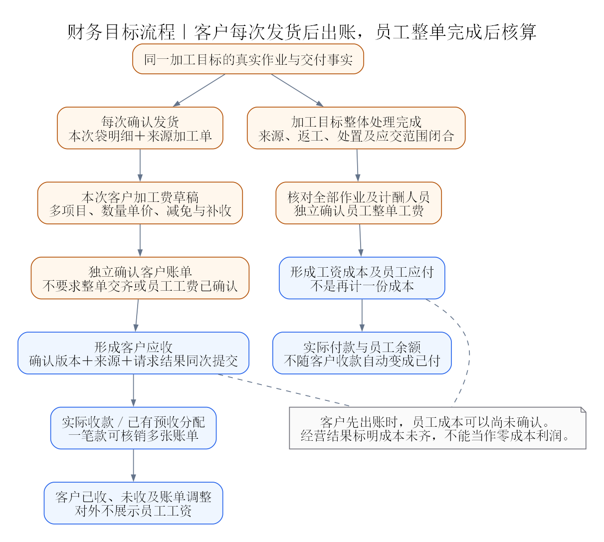
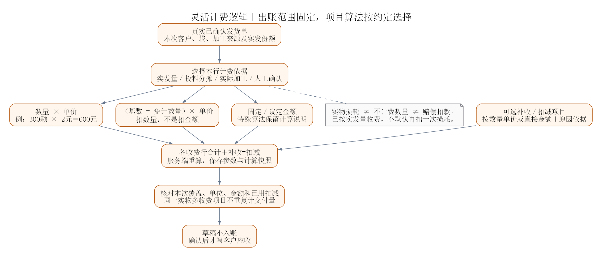

# 加工费灵活计费与财务设计复盘

> 历史归档：2026-10-30并入[完整总方案](../../大版本整体重构方案.md)。本文停止维护，旧任务及旧边界不自动成为现行要求，归档不代表已实施或验收。

日期：2026-10-30。状态：设计修订，尚未实施。源码核对基准为`3a94796`；现有运行事实见[项目核心](../../00_项目核心.md)。

本次明确改变原“整张加工单交齐后，客户费和员工费一起确认”的目标规则。本文是客户计费时点、员工工费时点及灵活计算的新目标依据；原[交货后结单方案](../../交货后工费结单与收付款改造方案.md)中与此冲突的内容仅作为现有旧设计参照。

新增库存与资产扩展见[专项调研](客户库存与本厂物料资产管理调研.md)：客户物料保管量不自动成为公司收入／采购成本；公司料实际耗用、耗材计耗、资产折旧与付款各自保留来源，避免与加工费及员工成本重复归集。客户库存入口已确认手机网页登录，账单可见范围仍须单独明确。

全范围改造与交付依赖见[大版本整体重构方案](../../大版本整体重构方案.md)。本文继续维护费用规则与F1—F6，不把客户账单确认和员工核算重新绑定。

## 1. 已确认的经营模式与时点

公司主要通过为客户加工赚取加工费，不以销售来料本金作为正常收入。

| 事项 | 本次确认 |
|---|---|
| 客户出账 | 每次实际发货后，分别针对本次已发部分填写账单；不等整张加工单全部交齐 |
| 员工工费 | 整张加工执行目标完成后核算，不随每次发货拆算 |
| 计算方法 | 可采用单价乘数量、减免计数量、损耗相关扣减等；不能固定为一种算法 |
| 费用确认 | 客户出账与员工工费确认分开，员工未核算不能阻塞本次客户出账 |
| 实施范围 | 先复盘和修订设计、图解与计划，不修改财务代码、历史账或服务器 |

拆单后的员工核算目标继续按当前“子单分别核算、母单汇总”设计；未拆母单按整单核算。本次没有确认把所有子单工资强制等到整个母单结束。

## 2. 现有设计是否满足

**库存和财务台账基础可以复用，现有结单粒度、确认门槛及客户计费界面不能直接满足新要求。**

| 需求 | 实际源码情况 | 结论 |
|---|---|---|
| 部分发货后出本次账单 | `OrderSettlementService.prepare`要求目标已交齐，只有母单／子单结单目标 | 不满足，需要按已确认发货建立客户计费范围 |
| 数量乘单价 | 后端支持`PIECE/GRAM`；客户页面`SettlementPanel`只提交一个固定金额行 | 后端有部分能力，页面不足 |
| 客户费用减损耗／折让 | 后端按件／按克客户行明确拒绝非零`deduction`；固定金额行也不允许扣减 | 不满足，不能只增加前端输入框 |
| 多项目收费 | 后端可接受多条客户行，前端固定生成一条“客户加工费” | 需要项目明细编辑和来源核对 |
| 客户费与员工费独立确认 | 当前最终确认要求入账与工资权限、全公司范围，并校验员工作业覆盖；同次写应收、工资及应付 | 不满足，需拆开业务确认边界与权限 |
| 账单确认后收款 | 现有应收、收款、多单分摊和已有款项后续核销可复用 | 保留，不把到账当作出账 |
| 员工费确认后付款 | 现有工资及员工应付、付款体系可复用 | 保留；工资成本与应付是同项工费的不同视图，不能计两次成本 |
| 历史金额调整 | 现有追加差额、旧账来源和请求回放有基础 | 保留，不覆盖已确认金额；需适配新客户账单来源 |
| 保存草稿后恢复 | 后端返回当前结单明细；现有页面读取时未恢复客户项目和原员工草稿，主要从作业事实重建 | 新界面须完整恢复草稿；切目标金额是否残留需在实现时定向复现 |

旧专题中“支持客户按件、按克和分项”是原设计目标，不表示当前前端已经具备。以上是源码核对结论，不冒充新功能运行测试结果。

## 3. 两条财务主线分开

### 3.1 客户加工费主线

已确认发货 → 形成该次可出账范围 → 填写收费项目与计算依据 → 保存草稿 → 确认客户账单并形成应收 → 收款及核销。

每次发货建议对应一张初始客户账单，可含多个加工单和多条收费项目。未出账、草稿、已确认、已部分收款、已结清分别显示。发货成功不自动生成一笔金额为0的应收；未定价时显示“本次发货待出账”。

“按本次已发部分出账”限定账单覆盖范围，不强制把所有收费项目的计费数量固定为本次实发数量。可以按约定对本批分摊投料量、实际加工量或固定服务费用，但必须记录依据，不能借此把整单重复收费。

### 3.2 员工工费主线

工序、批次、损耗、返工和交付事实归集 → 加工目标整体处理完成且应交范围闭合 → 核对计酬人员与各作业份额 → 独立确认员工工费 → 形成工资和员工应付 → 实际付款。

沿用原计划的作业来源、真实计酬账号和份额核对，不把最后交工人、每次发货人员或拍照人员直接视为全部工费归属人。客户按次出账后，尚未完成的加工目标仍显示“员工工费待核算”。

两次发货不能把同一作业工资计算两次；客户已收款也不代表员工已付款，员工已核算也不代表客户款已收。

### 3.3 与原有结单的关系

客户按次账单须有独立凭据身份和确认命令，不能用“员工免计”骗过旧结单；员工整单核算也不能假填客户免收或客户金额0，继续调用原双费用确认。

旧双费用结单及已记账结果按旧语义保留。新流程分别建立客户账单与员工结算资格，复用应收、工资、应付、收付款及历史来源机制，不重建财务总账。

## 4. 灵活算法：明细组合，计算可解释

建议提供三种收费行及独立调整：

| 方式 | 计算与使用 |
|---|---|
| 数量计费 | 单价 × 本行计费数量；计量单位可为颗、件、串、克等实际业务单位，数量和单价单位必须匹配 |
| 基数扣数量 | 单价 ×（计费基数 − 不计费数量）；明确扣的是数量而不是金额 |
| 固定／议定金额 | 直接填写本项目最终议定金额，保存说明或计算依据，处理尚不适合结构化的特殊约定 |
| 补收或扣减项目 | 可按单价 × 对应数量／重量，或直接填写金额；必须说明原因和关联依据 |

每行可以选择不同方式。同一次发货包含三张加工单时，可以分别填写各自价格；同一份交付可以有雕刻、抛光等多个收费项目，是否按工序分项由实际约定决定，不因报了15道工序就自动收15项钱。

首期用上述组合覆盖常见算法，特殊复杂算法先按议定金额保存完整计算说明。以后确有重复使用的具体算法，再提取为受控计算模板；不先建设任意脚本执行或通用公式引擎。计价模板可以记计算方法，不提前套用客户价；所有单价仍在本次发货后人工确认。

### 4.1 必须保留的计费信息

| 信息 | 保存内容 |
|---|---|
| 交付覆盖 | 发货单及袋明细、来源加工目标、对应实发份额；来自真实发货事实 |
| 项目 | 项目名称、归属加工目标、计费方式 |
| 数量依据 | 实发／投料分摊／工序实际加工／人工确认等；对应来源及快照 |
| 运算参数 | 原计费基数、免计数量、最终计费数量、单位、单价、补收或扣减金额及原因 |
| 结果 | 分步计算结果、行净额、整单金额、舍入规则、确认人与时间 |
| 特殊约定 | 议定金额说明、损耗／责任／协商依据，必要附件引用 |

财务计费数量与实物数量可以不同，但不能互相覆盖。修改计费基数、价格或赔偿金额不改库存、不改报工照片或真实损耗数。

## 5. “减损耗”必须分清三件事

| 含义 | 举例 | 财务处理 |
|---|---|---|
| 实物损耗 | 来500颗，最终交462颗 | 保存生产及实物事实，不自动产生客户扣款或员工扣款 |
| 不计费数量 | 约定只对462颗收费 | 使用462计费，或500减38后计费；两者是同一免计口径的不同表达 |
| 额外金额扣减／赔偿 | 约定扣38颗，每颗5元 | 另列190元金额减项，记录约定依据；是否同时采用实发数量计费由约定明确 |

使用实发462颗收费时，不能系统默认再把38颗损耗按加工单价扣一遍。反过来，实发数量计费与额外赔偿可以同时存在，但必须是明确的两项约定，不能由系统根据少发数自动推定。

客户损耗扣减不自动变成员工扣款。员工责任与确认金额分别办理，同一实物损耗可以作为不同费用方向的核对依据，但必须区分客户折让、客户赔偿和员工责任，不能共用一个自动连扣逻辑。

### 5.1 计算示例

以下均为不同约定的示例，不能同时默认叠加：

| 约定 | 算式 | 金额 |
|---|---|---:|
| 按最终实交462颗计费 | 462 × 2元／颗 | 924元 |
| 投料500颗，其中38颗免加工费 | （500 − 38）× 2元／颗 | 924元 |
| 约定按投料收费，另扣损耗赔偿 | 500 × 2 − 38 × 5 | 810元 |
| 按实发收费，另有加急费及折让 | 462 × 2 ＋ 50 − 20 | 954元 |
| 本项目最终议定总价 | 人工确认900元，保存约定说明 | 900元 |

上述462是整个示例最终交付数。真实按次出账时，每次只使用该次已发范围及应由本次承担的约定参数，不能两次都引用全部500或全部38扣减。

### 5.2 分批发货示例

第一次发300颗，单价2元，客户账单600元。此时剩余部分还在加工或返工，员工工费不提前确认。

第二次发162颗，单价仍为2元，客户账单324元。累计交462颗、累计基础加工费924元。若另约定损耗赔偿190元，可以在指定的第二次账单列明该减项，第二次净额134元；累计客户净额734元。不能第一张和第二张都扣190元。

若采用投料量计费，须明确500颗基数如何在本次交付范围中归属／分摊，或明确某次收取固定项目费、另一次免计。首期不自动用颗数比例分摊投料、损耗或赔偿，也不自动决定由最后一次发货承担全部差额。

## 6. 防重复：锁定交付范围，不锁死计费方式

建议首期对同一已确认发货单只允许一个有效初始客户账单，修改后通过同根版本及差额调整保存，不另开第二张初始账单。这样既符合“一次发货出一次账”，也避免为尚未要求的同次发货再分多份账单建设复杂分摊。

账单覆盖的实物份额单独保存。收费行可以有多项目：同300颗的雕刻费和抛光费是两个项目，不应被误判成实物出账了600颗；反过来，多项目也不能绕过同一初始账单的防重。

损耗相关金额项保存本次实际使用数量／金额、适用来源和已确认凭据。后次再引用同一事项时须看已用与剩余，不只在当前请求里检查编码重复。若是客户与员工不同方向的独立确认，用不同费用事项关联同一实物事实，不把物理损耗编号简单设为全局只能使用一次。

没有最终损耗确认时，可以先给已发部分按明确约定出账，未确定的赔偿项保持待核，不能阻塞所有正常收费，也不能自动记为0元已处理。后来明确的金额通过带依据的账单调整接续，保留原已发账单。

## 7. 账单调整、收款与余额

草稿可以编辑但不写应收。确认时服务端按参数重算，与来源及版本一起保存，不能信任前端提交的合计。确认账单后不覆盖原数；新差额另记，说明改价、折让、补收或损耗协商等原因。

已收部分超过调整后应收时，不能自动抹掉收款或把余额截成0。保留待处理差额，后续退款／转预收／其他处置按明确业务动作办理；本次不假定现有系统已具备自动退款。

若扣减大于本次收费导致净额为负，显示真实计算差额和阻断原因，不能直接生成负加工费、自动改成员工扣款或用0隐藏。需要确认它是客户赔付、跨账单减项还是另行结算，未具备对应处理链时保留待核。

客户应收来自已确认账单及调整，未收来自有效收款分摊；不在加工单、发货单和客户档案各保存一份可手改余额。一笔款可按现有能力核销多张账单，预收分配不重复登记到账。发货、出账、收款、员工核算和员工付款分别留日期。

## 8. 收益看什么，不能只看收到多少钱

按本项目管理口径，客户已确认加工费形成收入来源，实际收到的钱是收款事实；员工已确认工费形成工费成本及应付来源，实际付钱是付款事实。收付款不能再算一次收入或成本。

按次收入先确认、员工成本后确认后，财务页至少区分：

- 本次／累计已确认客户加工费。
- 已收、未收和未分配预收。
- 员工工费待核算，或已核算的成本与未付余额。
- 可归集的外协、耗材等已有成本，以及未归集／尚未确认事项。

单笔加工收益可以按“客户确认净加工费 − 已确认归集成本”查看，但成本未核全时须明确“成本未齐”。不能把暂未确认的员工工费当作0，就向经营者显示为最终利润。没有归集到本单的公司费用，也不能伪造分摊后称为完整净利润。

现有待结单／缺项清单主要围绕整单交齐，需要新增按次发货待客户出账与整单待员工核算两个清单；不能只改计价表单，不改工作台和报表缺项提示。

## 9. 操作界面建议

从发货回执、发货详情或“本次待出账”进入，自动带出客户和本次袋明细，金额与单价初始为空。

普通计费行只显示“项目、数量、单位、单价、金额”。选择“基数扣数量”再展开免计数；选择“补收／扣减”再展开原因、数量单价或金额及来源。特殊约定选择“议定金额”，不能把不同算法都强塞到一个必填长公式输入框。

页面持续显示可读算式与本次总额，例如“300颗 × 2元／颗＝600元”；确认前核对本次覆盖、项目、扣减和累计情况。用户不能直接改计算结果却不留下调整依据。

保存后重新打开须恢复原行、方法、参数、依据和版本；切客户／发货单不能携带上一单金额。客户确认只需要对应客户范围内的加工费入账权限，不再要求工资权限；员工工费仍按员工核算及全公司范围的现有职责控制。

对外账单只显示客户收费与调整，不包含内部员工工资。A5发货清单仍是交付凭据，不能因后续定价去改写原交付快照；客户费用可另出账单或对账汇总，不自动公开到持码页。

## 10. 数据与实现边界

| 对象 | 建议责任 |
|---|---|
| 客户按次加工费账单 | 独立账单号、所属发货单、客户、版本、状态、确认及交付覆盖快照 |
| 收费和调整行 | 方法、来源加工目标、基数、免计数、计费数、单位、单价、方向、金额、依据与计算快照 |
| 员工整单核算 | 沿用作业来源与计酬份额，拥有独立核算状态和确认版本，不假填客户免收 |
| 财务入账关联 | 客户账单确认关联既有应收；员工确认关联工资及应付，分别保存幂等来源 |
| 费用事项使用记录 | 对实际需要跨批引用的损耗扣减保存本次使用和调整关系，防止重复扣减 |

业务归属仍在现有`finance/domain/app/infra/web`内。建议单独的客户按次账单应用服务，员工核算复用并拆清`OrderSettlementService`中的现有职责。计算提取为被前端预览和服务端确认共同约定的有限模型，服务端重算为最终依据；不新建总账、支付通道或复杂公式平台。

数据库使用追加迁移，原双费用结单及应收／工资／应付不删、不改语义。数量、单价、金额先沿用现有三位、四位、两位精度及金额舍入口径；每行分步与总额口径固定并保存，计算输入不得使用浮点数。后续新增算法逐个确定顺序和舍入规则，而不是临时计算出一个无法复算的总数。

确认客户账单要锁定实际发货来源与账单根，重读确认状态、客户范围、版本、覆盖及费用事项使用；账单、应收、来源及请求结果同事务。员工核算用自己的完整作业与交齐资格、事务和请求号，不跨两种确认强绑同次提交。

## 11. 与既有历史和新流程接续

已经按旧双费用结单记账的加工目标，不能把其历史发货重新全部列为未出账。先读取旧结单、应收及已收金额的来源，明确覆盖到哪些发货及作业；来源无法核清时待核，不按比例猜分、不自动补第二份账。

新发货若对应部分已有账的旧加工目标，须只对尚未覆盖且能够核实的部分出账。旧员工工费已经确认的目标不因新的客户账单再次生成工资。

新袋级损耗与质量链尚未实施，所以员工完成判定仍需按整体计划接续；客户按次出账的资格则应从真实已发事实读取，不能继续调用必须整单交齐的门槛。旧模式与新模式按凭据明确区分，不能全局放宽旧结单接口来“支持部分出账”。

## 12. 实施次序和验证

| 增量 | 内容 | 必要验证 |
|---|---|---|
| F1 资格与凭据分离 | 发货单可出客户账，员工仍整单核算；新旧来源区分 | 发300尚未交齐仍可出客户账；员工不提前核算；旧应收不重复 |
| F2 有限计费模型 | 数量乘单价、基数扣数量、议定金额、多项目及金额调整 | 数量／金额扣减不混用、不同单位、精度、舍入、无依据及重复扣减 |
| F3 界面和草稿 | 当前发货上下文、按需展开、算式预览、完整恢复 | 切单不串金额，恢复不丢算法，未知结果保持原请求 |
| F4 独立确认与账务 | 客户确认写应收，员工确认写工资及应付，各自权限与回放 | 跨客户拒绝、无工资权限也可按已授权出客户账；失败回滚、并发不重复 |
| F5 读取与对账 | 发货待出账、员工待核算、客户对账、经营缺项 | 客户收入先到时不把员工成本当0；一款核销多账单正确 |
| F6 历史与现场 | 旧双费用结单覆盖核对、实际操作和打印 | 不重复应收／工资，客户账单与发货来源一致，原A5交付不改写 |

F1—F6接入主计划P5／P6，P7／P8使用正确账单来源和权限。可以先针对现有真实单行发货实现客户按次计费，不必等全部袋级改造结束；多来源汇总发货完成后使用同一计费模型按其明细覆盖，不另做第二套账。

本次只检查文档、链接、图形和算例；不运行业务测试，不把上述验收写成已通过。落地时按仓库最小充分验证执行。

## 13. 源码依据

- [客户结单界面](../../../frontend/src/features/finance/SettlementPanel.vue)：客户固定总额行、员工方式及草稿读取。
- [结单服务](../../../backend/src/main/java/com/zhubao/erp/finance/app/OrderSettlementService.java)：`prepare/assertComplete/price/assertPermission`及客户、员工入账。
- [结单控制器](../../../backend/src/main/java/com/zhubao/erp/finance/web/OrderSettlementController.java)：现行上下文与客户／员工可见范围。
- [结单明细](../../../backend/src/main/java/com/zhubao/erp/finance/domain/OrderSettlementItem.java)、[来源快照](../../../backend/src/main/java/com/zhubao/erp/finance/domain/OrderSettlementSource.java)、[V78迁移](../../../backend/src/main/resources/db/mysql/V78__m3_order_settlement.sql)：现有字段及持久化边界。
- [交齐查询](../../../backend/src/main/java/com/zhubao/erp/business/app/OrderDeliveryCompletionQuery.java)：原整单资格及来源。
- [财务概览](../../../backend/src/main/java/com/zhubao/erp/finance/app/FinanceDashboardService.java)、[经营读取](../../../backend/src/main/java/com/zhubao/erp/finance/app/FinanceReportService.java)：应收、成本、余额及缺项展示。
