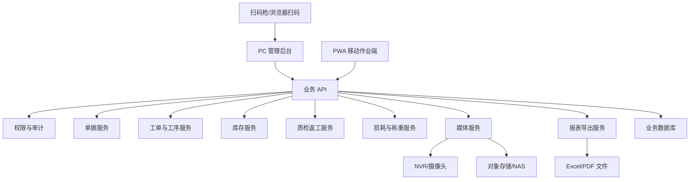
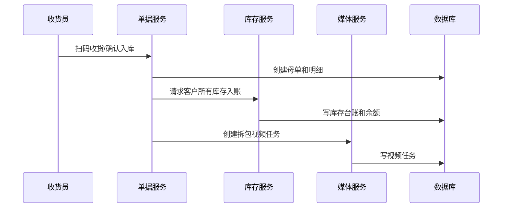
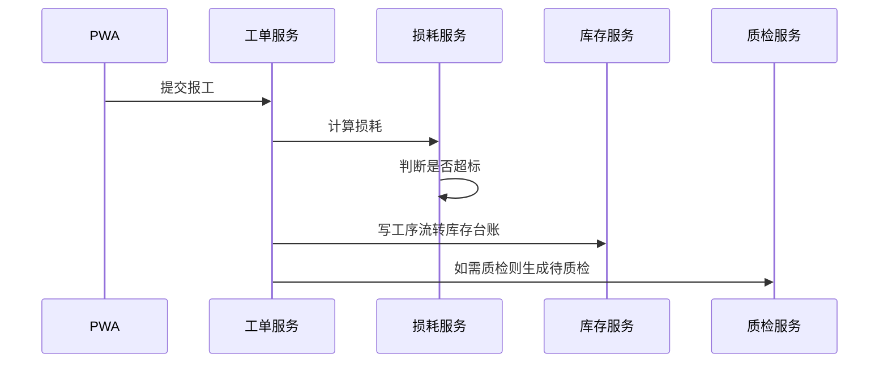
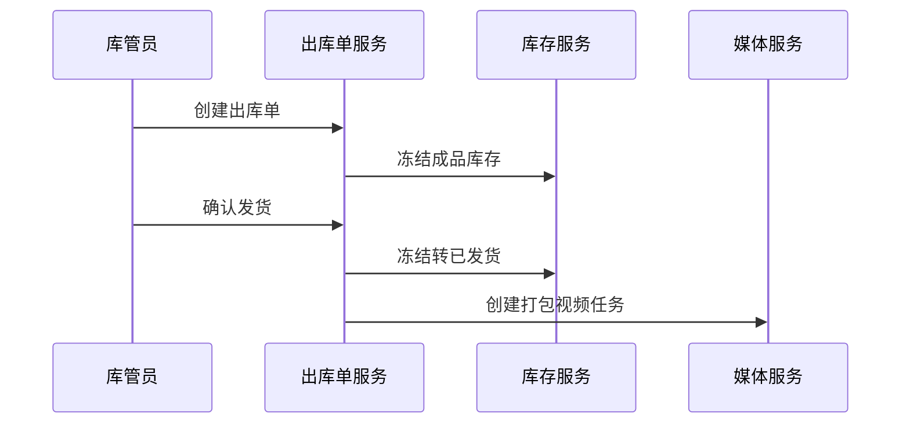
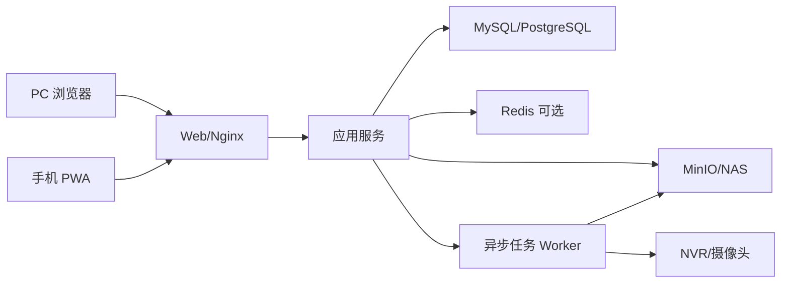

# 来料加工进销存与生产管理系统 系统架构设计

> 历史归档：2026-10-10 冻结，仅供追溯编写时方案；当前规则、契约和运行方式以 [文档索引](../../README.md) 中的现行文档为准。

**文档版本**：V1.0
**文档定位**：技术评审、选型评审、开发拆分依据
**关联文档**：[00_开源项目调研与技术选型报告](../research/00_开源项目调研与技术选型报告.md)

---

## 1. 架构目标

- 支撑一期核心业务闭环稳定运行。
- 技术路线冻结为 Java/Vue 定制业务系统，后台基座采用 RuoYi-Vue 体系。
- 复用开源成熟能力，不重复建设通用权限、报表、条码、视频、对象存储。
- 将库存、工单、损耗、称重交接、视频证据等核心领域能力清晰拆分。
- 支持后续电子秤、PDA、流程引擎、客户门户、财务接口等扩展。

---

## 2. 总体逻辑架构

---

## 3. 最终技术路线

### 3.1 生产主路线：Java / Vue + RuoYi-Vue

最终选择：

- 后端：Java + Spring Boot 3。
- 后台基座：RuoYi-Vue 体系。
- 前端：Vue 3。
- PC 管理后台：复用 RuoYi 权限、菜单、字典、日志、代码生成等能力。
- PWA 移动作业端：独立面向扫码、报工、质检、库存查询优化。
- 数据库：MySQL 8.4 LTS。
- 文件/视频：NAS 优先；对象存储按许可证和运维能力选择。

选择理由：

- 本项目核心是客户来料加工追溯，不是标准 ERP 财务制造流程。
- 客户所有权、称重交接、贵重物料工序损耗、视频证据、计件工资试算都需要领域定制。
- Java/Vue 更利于本地团队维护、现场硬件集成和长期二开。
- RuoYi-Vue 能复用权限、菜单、字典、日志、代码生成，避免重造后台基础设施。

必须自研的核心能力：

- 客户订单、母单、工单、工序、报工。
- 转移式库存台账和余额。
- 称重交接、损耗计算。
- 质检返工、轻量审批。
- 全链路追溯。
- 工资试算。

风险控制：

- 不能只依赖代码生成生成 CRUD，库存和工单必须有领域服务。
- 库存服务必须集中处理台账和余额，禁止各模块直接改余额。
- PWA 只做现场作业，不扩展成完整管理后台。

### 3.2 参考路线：ERPNext / Frappe、Odoo

ERPNext/Frappe 和 Odoo 不作为一期生产主基座，保留为模型参考。

参考价值：

- 制造订单、工单、工序、库存台账、质检等标准对象设计。
- 批次追溯、库存流水、质量记录的页面和报表组织方式。
- ERP 权限、审计、报表和单据状态管理经验。

不选择为主基座的原因：

- 客户所有权、称重交接、贵重物料损耗、视频证据和计件工资试算需要大量行业定制。
- 若绕开 ERP 原生库存和工单逻辑，会削弱 ERP 基座价值并增加升级风险。
- Odoo 社区版、企业版、第三方模块边界需要额外授权和功能核查。

---

## 4. 服务边界

### 4.1 权限与审计

职责：

- 用户、角色、菜单、按钮权限。
- 数据范围：本人、本班组、本部门、全部、自定义客户。
- 操作日志：报工更正、库存调整、视频替换、标签补打、单据作废。

不做：

- 一期不做复杂组织架构和多租户。

### 4.2 单据服务

职责：

- 客户订单。
- 来料入库。
- 母单。
- 出库单。
- 单据编码。
- 单据状态机。

规则：

- 单据状态变更必须校验前置条件。
- 单据作废必须写日志，必要时走审批。

### 4.3 工单与工序服务

职责：

- 母单拆分子工单。
- 工序模板生成工序实例。
- 工单分配、开工、报工。
- 返工工单生成。

规则：

- 工序实例保存单价、损耗率、质检配置快照。
- 返工作为 `work_order_type = rework` 的特殊工单。

### 4.4 库存服务

职责：

- 库存台账。
- 库存余额。
- 库存冻结。
- 库存调整。
- 库存状态转移。

规则：

- 库存服务是唯一能写库存台账和余额的业务服务。
- 其他模块通过库存服务申请库存变更。
- 库存余额不得由页面或其他服务直接修改。

### 4.5 质检返工服务

职责：

- 待质检生成。
- 质检记录。
- 返工、报废、让步通过。
- 复检。

规则：

- 需要质检的工序未通过不得进入下一步。
- 报废必须影响库存。

### 4.6 损耗与称重服务

职责：

- 称重交接记录。
- 损耗计算。
- 超标损耗审批。
- 损耗责任归因。

规则：

- 损耗按工序投入计算。
- 关键工序必须有称重交接。
- 一期只计算理论扣减，不实际扣工资。

### 4.7 媒体服务

职责：

- 视频截取任务。
- 照片和附件上传。
- 媒体文件存储。
- 视频播放和下载。

规则：

- 视频截取异步执行。
- 失败自动重试，失败后人工上传。
- 视频替换和删除必须审批或权限控制。

### 4.8 报表服务

职责：

- 订单进度。
- 产量统计。
- 损耗统计。
- 库存台账。
- 工资试算。
- Excel 导出。

规则：

- 报表优先基于业务事实表和台账，不直接拼页面状态。

---

## 5. 数据流

### 5.1 来料入库数据流

### 5.2 工序报工数据流

### 5.3 出库数据流

---

## 6. PWA 架构

一期 PWA 只承担现场作业，不做完整管理后台。

能力：

- 登录鉴权。
- 扫码。
- 我的任务。
- 报工。
- 称重交接。
- 质检。
- 库存查询。

技术要求：

- 支持 Android Chrome。
- 支持摄像头扫码；扫码失败可手工输入编码。
- 表单提交失败保留草稿。
- 关键页面减少表格，采用卡片和大按钮。

不做：

- 完整离线数据库。
- 原生蓝牙秤读取。
- 消息推送强依赖。

---

## 7. 开源组件复用

| 能力 | 一期方案 | 二期预留 |
|---|---|---|
| 权限后台 | RuoYi-Vue 权限、菜单、字典、日志 | 多组织、多租户 |
| 二维码生成 | 后端库或 node-qrcode | 批量打印优化 |
| 二维码识别 | BarcodeDetector / ZXing | PDA 扫码 SDK |
| 视频截取 | FFmpeg + NVR 能力 | 厂商 SDK 深度集成 |
| 文件/视频存储 | NAS 优先；S3 兼容服务备选 | 生命周期归档 |
| 图表 | ECharts | BI 平台 |
| Excel | EasyExcel / SheetJS | 模板化报表 |
| 审批 | 轻量审批表 | Flowable/Camunda |

---

## 8. 部署架构

一期建议单体优先，按模块化方式开发，避免过早微服务。

建议：

- 一期使用一套应用服务 + 一个异步任务进程。
- 视频截取和报表导出走异步任务。
- 文件存储与数据库分离。
- 数据库、附件、视频必须有备份策略。

---

## 9. 安全与审计

- 登录鉴权必须统一。
- 敏感接口必须校验权限和数据范围。
- 文件访问需要鉴权，不能直接暴露内部路径。
- 视频下载和替换必须记录日志。
- 库存调整、报工更正、单据作废必须保留前后值。
- 导出报表需要记录导出人、时间和筛选条件。

---

## 10. 架构冻结点

已冻结：

- 主路线：Java/Vue + RuoYi-Vue 体系。
- 数据库：MySQL 8.4 LTS。
- 移动端：PWA。
- 视频截取：FFmpeg + NVR/摄像头按时间段截取，失败人工上传。
- 标签打印：浏览器/Windows 驱动优先。

M0 POC 仍需验证：

- NAS 或 S3 兼容文件存储方式。
- PWA 扫码方案。
- NVR 按时间段截取视频。
- 标签实际打印效果。
- 库存余额同步还是异步汇总。

关键 POC 未通过前不得进入大规模开发。
