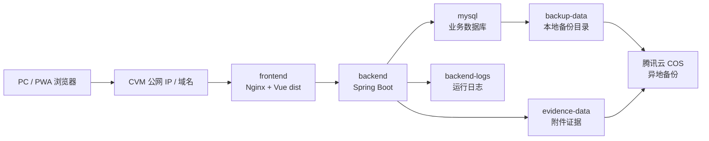

# 腾讯云与本地部署运维方案

> 归档说明：本文保留当时的设计、验证或客户沟通记录，不再作为当前开发入口；现行依据见[文档索引](../../README.md)。

**文档版本**：V1.0
**更新日期**：2026-07-07
**适用阶段**：M3.57 部署运维方案补强
**文档定位**：客户交付、部署实施、运维交接、硬件配置清单

---

## 1. 目标和交付边界

本文件补充两类最终交付路线：

1. 腾讯云部署：腾讯云 CVM 承载 Docker Compose 运行环境，腾讯云 COS 保存异地备份。
2. 本地部署：本地电脑或本地服务器承载 Docker Compose 运行环境，本地硬盘/NAS 保存备份，可选再同步到 COS。

本文件不替代 [19_Docker一键部署与离线交付](../../19_Docker一键部署与离线交付.md)。实际交付仍使用无源码运行包：

- `docker-compose.yml`
- `.env.example` / `.env`
- `start.ps1` / `start.sh`
- `backup-mysql.ps1` / `backup-mysql.sh`
- `verify-restore.ps1` / `verify-restore.sh`
- `README_DOCKER.md`
- `MANIFEST.sha256`
- `images/*.tar`
- `mysql-init/*.sql`

客户现场不交付 `backend/src`、`frontend/src`、`.git`、测试代码、开发依赖缓存和开发文档全集。

---

## 2. 官方依据

- 腾讯云 CVM：云服务器用于提供安全可靠的弹性计算服务，可按业务需要扩展或缩减计算资源。参考：[腾讯云云服务器文档](https://cloud.tencent.com/document/product/213)。
- 腾讯云 COS：对象存储用于海量文件存储和管理，可通过控制台、API、SDK、工具等方式接入。参考：[腾讯云对象存储文档](https://cloud.tencent.com/document/product/436)。
- COSCMD：腾讯云提供的对象存储命令行工具，支持 Windows、Linux、macOS，可通过 `pip install coscmd` 安装，并支持上传文件/文件夹。参考：[COSCMD 工具](https://cloud.tencent.com/document/product/436/10976)。
- COS 密钥安全：COSCMD 文档建议优先使用临时密钥，并遵循最小权限原则；如使用永久密钥，也应限制权限范围。

---

## 3. 方案 A：腾讯云部署

### 3.1 适用场景

适用于以下情况：

- 客户允许系统部署在云服务器。
- 需要远程运维、远程升级和异地备份。
- 门店、工厂或办公室有稳定公网访问需求。
- 现场没有可靠服务器或缺少本地 IT 运维人员。

### 3.2 拓扑



### 3.3 腾讯云资源清单

| 资源 | 最低配置 | 推荐配置 | 说明 |
|---|---:|---:|---|
| CVM vCPU | 2 核 | 4 核 | 试点可 2 核，正式多用户和报表建议 4 核起 |
| CVM 内存 | 4 GB | 8-16 GB | Java 后端、MySQL、Nginx 同机运行，正式环境建议 8 GB 起 |
| 系统盘 | 80 GB SSD | 100 GB SSD | 放操作系统、Docker、镜像和日志 |
| 数据盘 | 100 GB SSD | 300 GB-1 TB SSD | MySQL、附件、备份目录；按附件和视频证据增长评估 |
| 公网带宽 | 5 Mbps | 10-20 Mbps | PWA/后台访问、附件上传下载；视频证据多时提高带宽 |
| COS Bucket | 标准存储 | 标准 + 生命周期/归档策略 | 保存数据库备份、附件证据包、离线交付包 |
| 域名/证书 | 可选 | 推荐 | 正式外网访问建议 HTTPS |
| 安全组 | 仅开放必要端口 | 仅开放 80/443，SSH 限固定 IP | 禁止 MySQL 直接暴露公网 |

### 3.4 安全组端口建议

| 端口 | 来源 | 用途 | 策略 |
|---:|---|---|---|
| 80 | 办公公网 IP / 现场出口 IP | HTTP 访问 | 试点可开，正式建议跳转 HTTPS |
| 443 | 办公公网 IP / 现场出口 IP | HTTPS 访问 | 正式推荐 |
| 22 | 运维固定公网 IP | SSH 运维 | 必须限制来源 IP |
| 8080 | 运维固定公网 IP | 后端直连排障 | 默认不对业务用户开放 |
| 3306 | 不开放公网 | MySQL | 仅容器网络内部访问 |

### 3.5 部署步骤

1. 创建 CVM，建议使用 Linux 发行版。
2. 挂载数据盘，规划目录：
   - `/opt/zhubao-erp/runtime`
   - `/opt/zhubao-erp/data`
   - `/opt/zhubao-erp/backups`
3. 安装 Docker Engine 和 Docker Compose v2。
4. 上传无源码运行包，例如：
   - `zhubao-erp-runtime-m3.xx.zip`
   - `zhubao-erp-runtime-m3.xx.zip.sha256`
5. 在构建机或运维机执行发布包验收：

```powershell
powershell -ExecutionPolicy Bypass -File scripts\verify-runtime-package.ps1 -PackagePath .deploy-artifacts\zhubao-erp-runtime-m3.xx.zip
```

6. 解压运行包。
7. 修改 `.env`：
   - `ZHUBAO_PUBLIC_URL=https://erp.example.com/`
   - `ZHUBAO_HTTP_PORT=80`
   - `ZHUBAO_BACKEND_PORT=8080`
   - 数据库密码必须改为客户现场密码。
8. 执行：

```bash
chmod +x ./start.sh
./start.sh
```

9. 验证：
   - `docker compose ps`
   - `GET /actuator/health`
   - `GET /api/operations/center`
   - 运维中心中 `后端 API`、`前端 PWA`、`PWA 静态资源`、`数据库连接`、`数据库备份` 状态。
   - 执行一次 `backup-mysql.sh` 或 `backup-mysql.ps1`，确认生成 `.sql` 和 `.sha256`。
   - 执行一次 `verify-restore.sh` 或 `verify-restore.ps1`，确认备份能恢复到临时库。

---

## 4. 腾讯云 COS 备份方案

### 4.1 备份对象

| 对象 | 本地来源 | COS 路径建议 | 频率 |
|---|---|---|---|
| MySQL 逻辑备份 | `/backups/*.sql.gz` | `prod/mysql/yyyy/mm/dd/` | 每日一次，关键上线前手动一次 |
| 附件证据 | `/app/evidence` | `prod/evidence/yyyy/mm/` | 每日增量或每 6 小时 |
| 运行日志 | `/logs` | `prod/logs/yyyy/mm/dd/` | 每日 |
| 离线运行包 | `zhubao-erp-runtime-*.zip` | `release/packages/` | 每次发版 |
| 校验文件 | `*.sha256`、`MANIFEST.sha256` | 与对象同目录 | 每次上传 |

### 4.2 COS Bucket 建议

| 项 | 建议 |
|---|---|
| Bucket 命名 | `zhubao-erp-backup-<appid>` 或客户统一命名 |
| Region | 与 CVM 同地域优先，降低上传延迟 |
| 访问权限 | 私有读写 |
| 密钥策略 | 优先临时密钥；如使用永久密钥，限制到指定 Bucket 和指定前缀 |
| 生命周期 | 热数据保留 30-90 天，历史备份转低频/归档或按客户合规要求保留 |
| 删除保护 | 生产建议启用版本控制或保留策略，防误删 |

### 4.3 COSCMD 安装和配置

腾讯云 COSCMD 官方支持 Windows、Linux、macOS，推荐通过 pip 安装。

```bash
python3 -m pip install coscmd
coscmd -h
```

配置示例：

```bash
coscmd config \
  -a <SECRET_ID> \
  -s <SECRET_KEY> \
  -b <BucketName-APPID> \
  -r <REGION>
```

安全要求：

- 不把 `SECRET_ID`、`SECRET_KEY` 写入 Git。
- 不把 COS 配置文件打进客户运行包。
- 密钥只放客户服务器受限目录，并限制文件权限。
- 能使用临时密钥时优先使用临时密钥。

### 4.4 运维中心 COS 配置可见性

M3.55 起，运维中心会展示腾讯云 COS 备份 readiness，但不会保存密钥，也不会从页面执行上传、覆盖或删除命令。

Docker `.env` 建议配置：

```env
ZHUBAO_COS_BACKUP_ENABLED=true
ZHUBAO_COS_BACKUP_BUCKET=zhubao-erp-backup-1250000000
ZHUBAO_COS_BACKUP_REGION=ap-guangzhou
ZHUBAO_COS_BACKUP_PREFIX=prod/mysql/
ZHUBAO_COS_BACKUP_CREDENTIALS_MODE=temporary
ZHUBAO_COS_BACKUP_LIFECYCLE_POLICY=180d-retention-versioning
```

字段说明：

| 变量 | 说明 |
|---|---|
| `ZHUBAO_COS_BACKUP_ENABLED` | 是否在运维中心启用 COS readiness 展示 |
| `ZHUBAO_COS_BACKUP_BUCKET` | COS Bucket 名称，包含 APPID |
| `ZHUBAO_COS_BACKUP_REGION` | Bucket 所在地域，例如 `ap-guangzhou` |
| `ZHUBAO_COS_BACKUP_PREFIX` | 数据库备份上传前缀，建议按环境区分 |
| `ZHUBAO_COS_BACKUP_CREDENTIALS_MODE` | 凭证模式说明，推荐 `temporary`；不填写真实密钥 |
| `ZHUBAO_COS_BACKUP_LIFECYCLE_POLICY` | 生命周期、版本控制或保留策略说明 |

运维中心状态口径：

| 状态 | 含义 | 处理 |
|---|---|---|
| `DISABLED` | 未启用 COS 备份配置展示 | 本地部署可接受；腾讯云部署需启用 |
| `CONFIG_INCOMPLETE` | 已启用但缺少 Bucket、Region、Prefix、凭证模式或生命周期策略 | 补齐 `.env` 并重启后端 |
| `READY` | 配置完整 | 再通过 COSCMD 上传脚本和恢复演练证明真实可用 |

### 4.5 上传命令示例

数据库备份上传：

```bash
coscmd upload /opt/zhubao-erp/backups/zhubao_erp_20260707.sql.gz prod/mysql/2026/07/07/
coscmd upload /opt/zhubao-erp/backups/zhubao_erp_20260707.sql.gz.sha256 prod/mysql/2026/07/07/
```

运行包内置备份脚本也可以直接生成并上传：

```bash
./backup-mysql.sh --upload-cos --cos-prefix prod/mysql/
```

Windows 运维机：

```powershell
powershell -ExecutionPolicy Bypass -File .\backup-mysql.ps1 -UploadCos -CosPrefix prod/mysql/
```

附件证据目录同步：

```bash
coscmd upload -rs /opt/zhubao-erp/data/evidence prod/evidence/
```

离线运行包归档：

```bash
coscmd upload zhubao-erp-runtime-m3.48.zip release/packages/
coscmd upload zhubao-erp-runtime-m3.48.zip.sha256 release/packages/
```

### 4.6 恢复演练

每次试点上线前必须至少做一次恢复演练：

1. 从 COS 下载最近一次数据库备份和 checksum。
2. 校验 checksum。
3. 在测试环境恢复 MySQL。
4. 启动系统，验证客户来料主链路、库存追溯、质检返工、附件预览。
5. 记录恢复耗时、恢复人、备份文件、结果和异常。

M3.59 起，运行包内置非破坏性恢复校验脚本，可在同一 Docker MySQL 容器中导入临时库，不覆盖生产数据库：

```bash
./verify-restore.sh --backup-file ./runtime-backups/zhubao_erp_mysql_20260707-090000.sql --operator ops-user
```

Windows 运维机：

```powershell
powershell -ExecutionPolicy Bypass -File .\verify-restore.ps1 -BackupFile .\runtime-backups\zhubao_erp_mysql_20260707-090000.sql -Operator ops-user
```

脚本默认创建 `zhubao_restore_check_<timestamp>` 临时库，检查至少恢复出 1 张表后删除临时库。需要保留临时库人工抽查时使用 `--keep-database` 或 `-KeepDatabase`。

M3.60 起，运维中心可以展示最近一次恢复演练记录：后端只读扫描 `ZHUBAO_BACKUP_ROOT` 指向的目录，识别 `verify-restore-*`、`restore-*.log/json/ok` 和 `*.restore-ok`。M3.61 起，`verify-restore.ps1` / `verify-restore.sh` 成功后会自动在备份文件同目录写入 `verify-restore-<timestamp>.log`、`verify-restore-<timestamp>.json` 和各自 `.sha256`，并复制到 MySQL 容器 `/backups`，后端通过共享 `backup-data` 卷优先读取 JSON 结构化记录。腾讯云部署时建议再由 COSCMD 同步到 COS：

```bash
./verify-restore.sh --backup-file ./runtime-backups/zhubao_erp_mysql_20260707-090000.sql --operator ops-user
coscmd upload -rs ./runtime-backups prod/mysql/
```

运维中心状态口径：

| 状态码 | 含义 |
|---|---|
| `RESTORE-DRILL-POC` | 未配置备份目录，显示评审样例 |
| `RESTORE-DRILL-NONE` | 备份目录存在，但未发现恢复演练记录 |
| `RESTORE-DRILL-LATEST` | 已发现最近恢复演练记录，并展示文件大小和 SHA-256 |
| `RESTORE-DRILL-MISSING/ERROR` | 目录不存在或读取失败 |

M3.61 的 `restoreDrillRecords` 会额外展示恢复人、备份文件、备份 SHA-256、恢复表数量、耗时、临时库是否保留和检查项。该状态仍不是完整审计记录；正式上线验收还需要记录抽样业务链路、附件恢复、异常和处理结论。

M3.62 起，运维中心还会展示 `alerts` 告警汇总，按服务状态、备份/恢复演练状态、COS 配置状态和日志 WARN/ERROR 派生 `OPS-ALERT-*`。该告警为只读快照，不自动执行备份、恢复、COS 上传或删除动作；腾讯云部署时建议先把 `P1` 告警纳入值班检查，再接入企业微信/短信通知。

---

## 5. 方案 B：本地电脑部署

### 5.1 适用场景

适用于：

- 评审演示。
- 小规模试点。
- 现场网络不能开放公网。
- 客户只需要局域网访问。

不建议用于长期正式生产，原因是普通电脑断电、磁盘损坏、系统更新和人员误操作风险较高。

### 5.2 配置清单

| 项 | 最低配置 | 推荐配置 |
|---|---:|---:|
| CPU | 4 核 | 6-8 核 |
| 内存 | 8 GB | 16 GB |
| 磁盘 | 256 GB SSD | 512 GB-1 TB SSD |
| 系统 | Windows 10/11 Pro 或 Linux | Windows 11 Pro / Ubuntu LTS |
| Docker | Docker Desktop / Docker Engine | Docker Desktop WSL2 或 Linux Docker |
| 网络 | 千兆网口 | 千兆网口 + 固定局域网 IP |
| 备份 | 外接硬盘 | 外接硬盘 + NAS/COS 二次备份 |

### 5.3 本地电脑部署步骤

1. 安装 Docker Desktop 或 Docker Engine。
2. 解压无源码运行包。
3. 修改 `.env`：
   - `ZHUBAO_PUBLIC_URL=http://<局域网IP>/`
   - `ZHUBAO_HTTP_PORT=80`
   - `ZHUBAO_BACKEND_PORT=8080`
4. Windows 执行：

```powershell
powershell -ExecutionPolicy Bypass -File .\start.ps1
```

5. 局域网其他电脑访问：

```text
http://<部署电脑IP>/
```

6. 每天人工或计划任务复制备份目录到外接硬盘或 NAS。
7. 至少每日执行一次 `backup-mysql.ps1` 或 `backup-mysql.sh`，并校验 `runtime-backups/*.sha256`。
8. 每周至少执行一次 `verify-restore.ps1` 或 `verify-restore.sh` 做非破坏性恢复抽查。

### 5.4 风险控制

- 部署电脑必须固定 IP。
- 禁止随意休眠、关机、系统自动重启。
- 数据盘目录不要放在桌面、下载目录或同步盘。
- 至少每日导出数据库备份。
- 每周做一次备份恢复抽查。

---

## 6. 方案 C：本地服务器部署

### 6.1 适用场景

适用于正式本地化部署：

- 工厂局域网内使用。
- 不允许业务数据上云。
- 有本地机房、UPS、NAS 或 IT 运维人员。
- 摄像头、扫码枪、标签打印、电子秤等设备更多依赖局域网。

### 6.2 配置清单

| 项 | 最低配置 | 推荐配置 |
|---|---:|---:|
| CPU | 4 核 8 线程 | 8 核 16 线程 |
| 内存 | 16 GB | 32 GB |
| 系统盘 | 256 GB SSD | 512 GB SSD RAID1 |
| 数据盘 | 1 TB SSD/HDD | 2 TB+ RAID1/RAID5 |
| 网卡 | 千兆 | 双千兆或更高 |
| UPS | 建议 | 必须 |
| NAS | 可选 | 推荐，用于附件/视频/备份 |
| 操作系统 | Ubuntu LTS / Windows Server | Ubuntu LTS |
| 备份 | 本机备份 | NAS + 移动硬盘 + 可选 COS |

### 6.3 本地服务器部署步骤

1. 规划服务器固定 IP 和 DNS 名称。
2. 安装操作系统、Docker Engine、Docker Compose v2。
3. 挂载数据盘：
   - `/srv/zhubao-erp/runtime`
   - `/srv/zhubao-erp/data`
   - `/srv/zhubao-erp/backups`
4. 上传并解压无源码运行包。
5. 修改 `.env`：
   - `ZHUBAO_PUBLIC_URL=http://erp.local/`
   - `ZHUBAO_FRONTEND_PROBE_URL=http://frontend/`
   - `ZHUBAO_LOG_FILE=/logs/zhubao-erp.log`
6. 启动：

```bash
chmod +x ./start.sh
./start.sh
```

7. 将 NVR、标签打印、扫码枪、电子秤等现场设备 POC 结果录入软硬件联动页面。
8. 将 `backup-mysql.sh` 加入 cron 或将 `backup-mysql.ps1` 加入 Windows 任务计划，并把 `runtime-backups/` 或 Docker `backup-data` 卷同步到 NAS/COS。
9. 每月执行一次 `verify-restore.sh` 或 `verify-restore.ps1` 并记录恢复结果。

### 6.4 局域网端口

| 端口 | 用途 | 访问范围 |
|---:|---|---|
| 80/443 | 前端访问 | 办公网/车间网 |
| 8080 | 后端排障 | 运维电脑 |
| 3306 | MySQL | 不开放，只限容器网络 |
| NVR/RTSP | 摄像头/NVR | 仅服务器与 NVR 网段 |
| 打印机端口 | 标签打印 | 仅库房/服务器 |

---

## 7. 软硬件结合清单

| 设备 | 腾讯云部署 | 本地电脑部署 | 本地服务器部署 | 一期策略 |
|---|---|---|---|---|
| PC 浏览器 | 支持 | 支持 | 支持 | Chrome/Edge 优先 |
| PWA 手机扫码 | 支持，依赖公网/专线/内网穿透 | 支持，局域网访问 | 支持，局域网访问 | BarcodeDetector/ZXing 兜底，失败手工输入 |
| USB 扫码枪 | 连接使用电脑 | 连接使用电脑 | 连接使用电脑 | HID 键盘模式优先 |
| 标签打印机 | 连接使用电脑 | 连接使用电脑 | 连接使用电脑或打印服务器 | 浏览器/PDF 模板兜底 |
| NVR/摄像头 | 需要 VPN/专线/公网映射，不推荐直暴露 | 局域网访问 | 局域网访问 | 半自动截取，失败人工上传 |
| 电子秤 | 不建议云端直连 | 人工录入/拍照 | 人工录入/后续接口 | 一期人工读数，二期 RS232/USB/TCP |
| NAS | 可选 | 推荐 | 推荐 | 存附件/视频/备份 |
| UPS | 云端由云平台保障，本地终端仍建议 | 建议 | 必须 | 防止数据库损坏 |

---

## 8. 运维例行检查

每日：

- 检查 `docker compose ps`。
- 打开运维中心，查看服务状态、日志、报错、数据库备份和 PWA 静态资源。
- 检查最新数据库备份是否生成。
- 抽查 1 条客户来料链路能否追溯到附件/视频证据。

每周：

- 校验一次备份 checksum。
- 抽查一次附件预览。
- 清理过期日志和临时文件。
- 检查磁盘剩余容量。

每月：

- 做一次恢复演练。
- 复核账号、权限、密钥和安全组。
- 复核 Docker 镜像版本、运行包版本和 Git 提交记录。
- 复核 COS 生命周期/保留策略是否符合客户要求。

---

## 9. 交付验收清单

| 项 | 腾讯云部署 | 本地电脑部署 | 本地服务器部署 |
|---|---|---|---|
| 无源码运行包 | 必须，且 `verify-runtime-package.ps1` 通过 | 必须，且 `verify-runtime-package.ps1` 通过 | 必须，且 `verify-runtime-package.ps1` 通过 |
| Docker 一键启动 | 必须 | 必须 | 必须 |
| 运维中心可访问 | 必须 | 必须 | 必须 |
| 前端/PWA 探活 | 必须 | 必须 | 必须 |
| 日志读取 | 必须 | 必须 | 必须 |
| 数据库备份状态 | 必须，且备份脚本执行成功 | 必须，且备份脚本执行成功 | 必须，且备份脚本执行成功 |
| COS 备份 | 必须 | 可选 | 可选/推荐 |
| 本地备份 | 必须 | 必须 | 必须 |
| 恢复演练 | 必须，且 `verify-restore` 通过 | 推荐，且抽查通过 | 必须，且 `verify-restore` 通过 |
| 硬件 POC 记录 | 按需 | 必须 | 必须 |
| 端口/安全组记录 | 必须 | 防火墙记录 | 防火墙记录 |

---

## 10. 当前边界和后续开发项

当前系统已经具备 Docker 无源码运行包、发布包验收脚本、MySQL 备份脚本、非破坏性恢复演练脚本、运维中心、日志读取、前端/PWA 静态资源探活、备份文件扫描、checksum 展示和恢复演练目录标记展示基线。但以下内容仍需继续开发或现场实施确认：

- 将 MySQL 备份脚本纳入生产计划任务。
- COS 上传失败告警。
- COS 临时密钥或 CAM 最小权限策略落地。
- 备份恢复演练记录表、告警持久化/通知和人工验收闭环；M3.62 已完成 JSON 结构化证据、运维中心只读展示和快照告警汇总。
- HTTPS 证书、域名、反向代理和安全加固。
- NVR、标签打印机、扫码枪、电子秤的现场 POC 和型号冻结。
- NAS/S3/COS 附件对象存储适配，替代当前本地对象存储默认实现。
