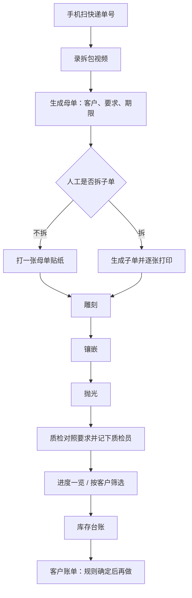

# 现场作业收口计划

> 历史归档：2026-10-10 冻结，仅供追溯编写时方案；当前规则、契约和运行方式以 [文档索引](../../README.md) 中的现行文档为准。

**文档版本**：V0.1
**更新日期**：2026-10-08
**定位**：按现场使用顺序，把现有来料加工系统收到可以试运行的作业链。本文只排施工顺序和验收，不替代 [01 产品需求](../../01_PRD_产品需求文档.md) 的范围说明。
**关联**：[02 业务流程](../../02_业务流程与规则设计.md)、[24 手机现场采集](./24_手机现场采集方案.md)、[14 开发进度](../../14_开发进度跟踪.md)。

---

## 1. 要收成的用法

客户来快递之后，收货人用自己的手机做完这一段：

1. 扫快递面单上的单号，对上已有记录或新建这一批。
2. 用手机录拆包视频，挂到本批。
3. 系统生成母单号。收货人写下加工要求、完成期限和对应客户。
4. 人工决定拆不拆。不拆打一张贴纸；拆开则每张子单打一张。贴纸上能直接读到验证码、客户、要求、期限。
5. 雕刻、镶嵌、抛光三个岗位用自己的账号扫贴纸，只看本工序要求。
6. 质检对照客户要求做判定，并记下当前质检员。
7. 办公室能看进度一览，按客户筛这批货和以后的应收应付。
8. 库存继续走现有台账。客户账单放在最后一段，计价规则没定之前不开工。

默认工序顺序是雕刻、镶嵌、抛光。某一批可以在拆单时勾掉不需要的工序。

---

## 2. 现在已经有的，本计划不重做

| 已有能力 | 本计划里的用法 |
|---|---|
| 来料确认写入库存台账 | 母单生成后仍走这条入账，不另写一套库存 |
| 报工、质检冻结、返工、复检放行、出库、退货写台账 | 工序和质检继续调用这些命令 |
| 登录、角色、客户范围 | 三个岗位账号落在现有账号上，按工序授权 |
| 黑白标签、按毫米出纸、二维码 `JG\|类型\|编码` | 贴纸沿用这套打印，补字段，不换打印方式 |
| 登记表导入 | 保留。手机收货是新入口，不替换纸质表导入 |
| [24 手机现场采集](./24_手机现场采集方案.md) 里的上传边界 | 照片 8MB、视频 50MB、文件落本机、按单号建证据包。本计划第 1 段把入口改成「先扫快递、再录像」 |

工作台里的评审单据、示意手机页、以及「扫码」输入框过滤，不算现场已经能用。

---

## 3. 和现有设计不一致、本计划按现场改的地方

| 现有设计 | 本计划 |
|---|---|
| 一期不做应收应付 | 前五段不动账。第 6 段单列客户账单，计价方式确认后再开发 |
| 标签只印客户、物料、数量、重量、收货日 | 要求和期限在建母单时写定，允许印上贴纸。工序进度仍不印，扫码再看 |
| 手机采集假定已经有母单或子单标签 | 收货时面单还没有系统标签。先扫快递单号，生成母单后再录视频、再贴系统贴纸 |
| 扫码解析认 `JG\|MO\|编码` 这一套旧类型 | 与标签对齐，认 `mother`、`work_order`、`outbound`、`rework`。快递面单另走「纯单号」识别 |
| 工序名称里有雕刻、抛光，没有镶嵌 | 补上镶嵌，三个岗位按这三道工序区分 |
| 操作工是一个通用角色 | 账号绑定可做的工序。扫到子单时只展示绑定工序的要求 |
| 质检单上的质检员是单据里的名字 | 提交质检的人取当前登录账号 |
| 母单没有加工要求和期限字段 | 母单增加这两项，子单和贴纸从母单带出 |

---

## 4. 施工顺序

六段按顺序做。前一段验收通过再开下一段。每一段都要补测试，并改对应页面，避免只加接口。

### 第 1 段：手机收货

**状态（2026-10-08）**：已落地。手机作业页识别快递运单号，生成带客户、加工要求和期限的母单，上传拆包短视频后可在来料页打开。第 2 段拆子单和贴纸、第 3 段工序岗位扫码、第 4 段质检对照已落地。进度一览和客户账单尚未做。

**做到**

- 收货账号在手机上打开收货页。
- 用后置摄像头读快递面单。读到的是运单号本身，或从面单内容里取出运单号。读不到就手输。
- 运单号已经对应母单时，打开那张母单，不再新建。
- 同一页填写客户、加工要求、完成期限，以及现有的物料、数量、重量。
- 提交后生成母单号，并确认入库、写入现有库存台账。
- 随即开始或补录拆包短视频，上传后挂到这张母单。电脑端来料页打开同一母单能看到这段视频。

**落点**

- 前端 `MobileOpsWorkspace.vue` 改成真实收货步骤，窄屏走这一页。示意按钮去掉。
- `scanCode.ts` 与 `LabelType` 的 `mother / work_order / outbound / rework` 对齐；另加快递运单号解析，不要求面单内容以 `JG|` 开头。
- 采集上传按 [24](./24_手机现场采集方案.md) 第 4 节做：`POST /api/documents/captures`，场景先用 `UNPACK`。
- `MotherOrderRecord` 增加加工要求、完成期限。确认入库命令带上这两项。

**验收**

1. 手机扫一个新运单号，填客户、要求、期限，生成母单，库存台账多一笔待加工。
2. 再扫同一个运单号，进入已有母单，不产生第二张。
3. 录一段短视频上传后，电脑来料页能打开。
4. 要求和期限空着不能提交。

**这一段不做**：拆子单、贴纸改版、工序岗位、质检、账单。

### 第 2 段：拆子单和贴纸

**状态（2026-10-08）**：已落地。来料母单详情可选择不拆或拆成多张。不拆打一张母单贴纸；拆开生成子单，数量和重量不超过剩余，并经库存台账把待加工转入在制。每张子单抄下客户、加工要求、期限，并记下勾选的工序（默认雕刻、镶嵌、抛光）。贴纸印验证码、客户、加工要求、期限和单号，二维码仍是 `JG|mother|母单号` 或 `JG|work_order|子单号`。补打写日志。工序岗位已在第 3 段落地，质检对照已在第 4 段落地。进度一览和客户账单尚未做。

**做到**

- 母单详情里由人选择「不拆」或「拆成多张」。
- 不拆：仍有母单号，打一张贴纸。
- 拆：校验拆出的数量、重量不超过母单剩余，生成子单号。每张子单抄下客户、加工要求、期限，并记下这一张要做哪些工序。
- 每张贴纸印：验证码、客户、加工要求、期限、单号。二维码仍是 `JG|mother|母单号` 或 `JG|work_order|子单号`。
- 验证码是给人眼核对的短码，随单号一起生成，贴纸上明文印刷。丢失可补打，补打记日志。

**落点**

- 新增母单拆分命令。现在只有流程说明，没有这条命令。
- 标签模板默认字段改为验证码、客户、加工要求、期限。物料、数量、重量可以留在模板里，但不再是唯一内容。
- `LabelWorkspace.vue` 从母单或子单取这些字段，不再靠手填样例才能打出现场贴纸。

**验收**

1. 不拆的母单打出一张贴纸，四项都能读到。
2. 拆成两张子单，数量合计不得超过母单，两张贴纸验证码不同。
3. 扫贴纸二维码能打开对应母单或子单。

**这一段不做**：岗位只看本工序、质检对照、账单。

### 第 3 段：三个工序岗位扫码

**状态（2026-10-08）**：已落地。账号可绑定雕刻、镶嵌、抛光中的一道或多道。手机作业页保留收货，并增加岗位报工：扫子单贴纸，不拆的母单扫母单贴纸。页面只显示当前账号能做的工序，包含单号、客户、本工序要求、期限和上一道是否已交。未绑定不能报工。上一道没交不能跳。中间工序写入库存台账但留在在制，最后一道完成才转入半成品；不拆母单报工前先把待加工转入在制。质检对照已在第 4 段落地。进度一览和客户账单尚未做。

**做到**

- 工序固定为雕刻、镶嵌、抛光。账号可绑定其中一道或多道。
- 岗位打开手机作业，扫子单（或不拆时的母单）贴纸。
- 页面只显示：单号、客户、本工序要求、期限、上一道是否已交。不显示其他工序的操作按钮。
- 本工序报工仍写入现有库存台账。

**落点**

- 工序模板补镶嵌。默认顺序：雕刻 → 镶嵌 → 抛光。
- 账号增加可做工序。没有单独再造一套登录。
- 扫码页按当前账号的工序过滤要求。`scanCode.ts` 在本段必须已经能解析贴纸。

**验收**

1. 雕刻账号扫子单，看到雕刻要求，看不到镶嵌、抛光的提交按钮。
2. 未绑定该工序的账号扫同一张贴纸，不能报工。
3. 雕刻报工之后，镶嵌账号才能交这一道；跳工序被拒绝。

**这一段不做**：质检条款对照、进度经营表、账单。

### 第 4 段：质检对照要求

**状态（2026-10-08）**：已落地。质检页扫子单贴纸，不拆的母单扫母单贴纸。加工要求按换行拆成条款，空行忽略，没有换行时整段算一条。页面逐条标合格、不合格或让步；不合格和让步必须写原因。每一条都有结果才能提交。质检员取当前登录账号的操作人，请求里另传的名字不算数。最后一道工序还没完成，或库存还不是半成品时，不能提交。有不合格时调用现有冻结命令把半成品转入冻结，并可开返工；返工单关联原单和这次质检。合格、让步不转入冻结，让步只留下核对记录。进度一览和客户账单尚未做。

**做到**

- 质检账号扫贴纸进入质检。
- 页面列出这张单的加工要求，逐条标合格、不合格或让步，并写原因。
- 质检员写入当前登录账号，不从列表里另选一个名字充数。
- 不合格仍走现有冻结、返工、复检放行，并写库存台账。

**落点**

- `QualityWorkspace.vue` 增加按要求核对，而不是只显示缺陷和工序名。
- 质检命令增加要求核对明细和质检员账号。

**验收**

1. 要求有三条时，三条都要有结果才能提交。
2. 提交后的质检员与登录账号一致。
3. 不合格可以开返工，返工单仍关联原单和这次质检。

### 第 5 段：进度一览和按客户筛选

**做到**

- 一张表看全部在制：客户、母单、子单、当前工序、期限、是否超期、质检结论。
- 可按客户、工序、期限、状态筛选。
- 点进一行能回到来料、生产或质检里的那张单。
- 这里的「台账」是进度一览。库存进出仍在库存页，两套数字都来自同一批单据，不在前端另存一份。

**验收**

1. 第 1 到第 4 段做出的单据会出现在这张表上。
2. 只筛一个客户时，其他客户的单不可见，并遵守账号的客户范围。
3. 接口没有数据时是空表和失败原因，不回退到样例行。

**状态（2026-10-09）**：已落地。进度页读取母单、子单、工序交付和质检对照。未拆分的母单显示待拆分；不拆或已拆的单显示当前工序、期限、是否超期和质检结论。可按客户、工序、期限、状态筛选。点状态回到来料、生产或质检，并用单号筛选那张单。客户范围账号看不到范围外的客户。

**这一段不做**：金额、应收、应付。

### 第 6 段：客户账单

四条规则已定，并已按经营核算落地，不做总账和银行代发：

| 事项 | 结论 |
|---|---|
| 计价单位 | 每个客户协议三选一：按克、按件，或雕刻 / 镶嵌 / 抛光分项 |
| 单价从哪来 | 客户协议。改价不影响已经入账的账单 |
| 何时入账 | 按克、按件在来料确认之后由财务生成本月账单；按工序在该道工序交付之后入账。返工不计 |
| 收付方向 | 客户侧是加工费应收。公司侧应付是工资、消耗品采购和外协 |

做到之后应能：按客户筛出应收、已收、未收；账单行能指回母单或子单；库存页继续管实物，账单页管金额。折旧只进公司月度经营。进度一览仍单独做。

---

## 5. 建议的提交切片

| 顺序 | 提交里只含 | 完成标志 |
|---|---|---|
| 1 | 扫码格式与标签对齐，补测试 | 已完成。贴纸二维码能被解析成母单或子单，快递面单按运单号识别 |
| 2 | 母单增加要求、期限；确认入库带上这两项 | 已完成。空要求和空期限不能入库 |
| 3 | 采集上传和手机收货页 | 已完成。识别运单号、生成母单、上传拆包视频 |
| 4 | 拆子单命令和贴纸四字段 | 已完成。不拆一张、拆开多张，验证码不同，补打写日志 |
| 5 | 镶嵌工序和岗位绑定 | 已完成。雕刻、镶嵌、抛光账号各看各的工序，未绑定不能报工，跳工序被拒绝 |
| 6 | 质检逐条核对和要求留人 | 已完成。三条都有结果才能提交，质检员等于登录账号，不合格可开返工 |
| 7 | 进度一览 | 已完成。按客户筛选只看该客户，并遵守客户范围 |
| 8 | 客户账单 | 已完成经营核算。按客户看应收已收未收，公司看应付和月度经营。不做总账和银行代发 |

每一刀都跑后端测试和前端测试。页面改动用手机宽度打开收货、扫码、质检各走一遍再提交。

---

## 6. 本计划不做

- 不接录像机，不按时间截取。录像机接口保留，作业页不引导。
- 不做原生 App，手机用浏览器。
- 不接快递公司接口。面单只取运单号，不回传物流轨迹。
- 不接条码打印机厂商驱动。继续用浏览器按标签纸尺寸打印。
- 不把工序进度印进贴纸。
- 不做会计总账和银行代发。客户账单只做经营核算。
