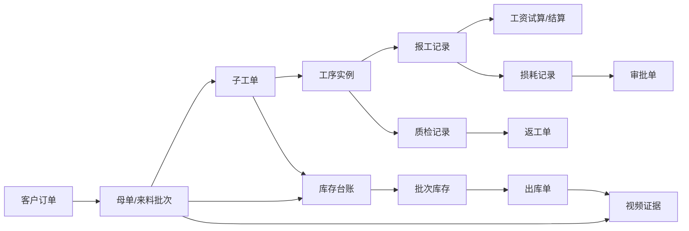
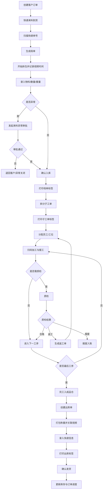

# 来料加工进销存与生产管理系统 优化版需求文档

> 原始需求来源归档：本文保留 V1.2 原始需求内容，当前产品范围与开发依据以[现行产品需求](./2026-10-13_01_PRD_产品需求文档.md)为准。

**文档版本**：V1.2  
**优化日期**：2026-07-06  
**适用业务**：客户来料加工，覆盖手串、金饰、贵重珠宝类物料的收货、生产、库存、出库、追溯与计件管理  
**文档用途**：作为产品设计、系统架构、数据库设计、开发排期、测试用例、上线验收与后续迭代的统一依据  

---

## 0. 本版优化重点

本版在原 V1.1 需求基础上进行结构化优化，重点解决以下问题：

1. 明确一期范围，避免 PC、APP、硬件、审批、工资、报表、库存等能力一次性铺得过大。
2. 补充订单、母单、子工单、工序、出库单、审批、工资结算等核心对象的状态机。
3. 将库存从“实时数量”提升为“批次库存 + 库存台账 + 库存调整”的可追溯模型。
4. 将质检从返工流程中独立出来，补齐质量判定、返工、报废、让步通过等场景。
5. 优化损耗计算口径，按工序投入重量计算，而不是简单按母单进料重量计算。
6. 补充计件工资的试算、结算、锁账、调整与历史单价规则。
7. 补充硬件失败兜底方案，包括视频截取失败、标签补打、扫码失败、设备离线等。
8. 补充上线验收标准、非功能指标、数据权限、审计留痕和待确认问题。

---

## 1. 项目概述

### 1.1 项目背景

当前来料加工业务主要依赖人工记录、纸质工单和人工统计，存在以下问题：

- 客户来料、生产过程、出库发货之间缺少统一编码，问题追责困难。
- 贵重物料损耗只能粗略统计，无法定位到具体批次、工序、员工和责任原因。
- 纸质工单在车间流转效率低，生产进度无法实时查看。
- 计件工资依赖人工核算，容易漏算、错算，返工和扣减缺乏依据。
- 库存账实不一致，尤其是来料、半成品、成品、返工品、报废品之间状态不清。
- 拆包和打包视频虽可通过监控回查，但无法自动关联到业务单据。

### 1.2 项目定位

建设一套“来料加工全链路管理系统”，以内部唯一编码为核心，连接客户订单、来料入库、生产工序、质检返工、库存台账、成品出库、视频证据、计件工资和审批流程。

系统定位不是普通进销存，而是面向客户来料加工的“批次追溯 + 生产流转 + 损耗责任 + 计件工资 + 硬件留证”一体化业务系统。

### 1.3 建设目标

1. 全链路可追溯：任意母单、子工单、出库单、快递单号均可反查完整业务链路。
2. 账实可核对：所有库存变化必须由业务单据驱动，并生成库存流水。
3. 损耗可解释：损耗按批次、工序、员工、原因和审批状态记录。
4. 工资可复核：计件工资可追溯到每一条报工记录和对应单价。
5. 操作可落地：一线员工以扫码为主，核心操作尽量控制在 3 步内。
6. 证据可关联：拆包、打包、异常处理等关键节点自动或半自动关联视频、照片和附件。
7. 权限可隔离：不同岗位只能查看和操作职责范围内的数据。

### 1.4 成功指标

|指标|目标值|
|---|---|
|来料到母单建档完成时间|常规场景小于 3 分钟|
|操作工扫码报工耗时|单次小于 30 秒|
|标签扫码识别成功率|大于 98%|
|核心库存流水覆盖率|100% 库存变化有流水|
|母单全链路追溯完整率|大于 99%|
|计件工资人工复核差异率|小于 1%|
|视频关联成功率|一期半自动模式大于 95%|
|核心页面响应时间|普通操作小于 2 秒，复杂查询小于 5 秒|

---

## 2. 实施范围与分期

### 2.1 一期目标：核心闭环可运行

一期目标是跑通“订单 - 来料 - 生产 - 质检 - 入库 - 出库 - 追溯 - 工资试算”的核心闭环，替代手工台账。

一期应包含：

- 基础档案：客户、物料、工序、工序模板、员工、工位、仓库、快递公司。
- 客户订单管理。
- 来料入库与母单管理。
- 标签打印：母单标签、子工单标签、出库标签。
- 生产工单拆分、分配、扫码报工。
- 基础质检与返工流程。
- 损耗记录与损耗超标审批。
- 库存台账与实时库存。
- 成品出库、部分发货、快递信息录入。
- 拆包和打包视频半自动截取。
- 全链路追溯查询。
- 计件工资试算报表，不做正式工资发放。
- 基础报表：订单进度、产量、损耗、库存、工资试算。
- RBAC 权限、操作日志、系统参数。
- PC 管理端和 Android APP 基础扫码报工端。

### 2.2 一期建议收缩项

以下能力建议不进入一期主验收，可作为预留字段或二期能力：

- 钉钉 / 微信审批通知正式对接。
- 蓝牙 / 串口电子秤自动读数。
- 阶梯计件正式计算。
- 工资扣减正式执行。
- 库位管理。
- 库存盘点审核。
- iOS APP。
- 客户小程序。
- 财务应收应付。
- AI 视觉识别。
- RFID。
- 数据大屏。

### 2.3 0 期 POC 建议

正式开发前建议先做 0 期 POC，周期 1-2 周，用于验证硬件和关键交互风险：

1. NVR 按时间段截取视频并导出 MP4。
2. 标签打印机打印二维码，验证扫码成功率。
3. 扫码枪 USB HID 模式在浏览器中输入。
4. Android 手机扫码识别子工单标签。
5. 电子秤暂不自动对接，但确认精度、量程和人工录入口径。

POC 验收不追求完整业务，只验证硬件可行性和风险。

### 2.4 二期目标：自动化与管理增强

二期重点提升效率和管理精度：

- 电子秤自动读数。
- 钉钉 / 微信 / 短信通知。
- 库存盘点。
- 库位管理。
- 工资正式结算和锁账。
- 标签模板可视化配置。
- 返工、报废、退货流程增强。
- 更多统计报表和经营分析。
- 批量导入、批量打印、批量审批优化。

### 2.5 三期目标：智能化与外部协同

三期重点扩展智能化与客户协同：

- AI 视觉计数。
- 秤面数字识别。
- 损耗异常智能预警。
- 产能预测与交期预测。
- 客户小程序查询。
- 财务对账和应收应付。
- RFID 高值物料追踪。
- 管理驾驶舱和数据大屏。

---

## 3. 业务术语

|术语|定义|
|---|---|
|客户订单|业务人员根据客户加工需求创建的业务源头单据，可关联多个母单和多个出库单|
|母单|来料入库后生成的批次单据，代表一批客户来料，是全链路追溯的核心对象|
|子工单|母单拆分后用于生产加工的工单，可分配给员工或工位|
|工序|加工过程中的作业节点，如串制、打磨、抛光、质检等|
|工序实例|某个子工单上的具体一道工序，具有顺序、状态、报工人、损耗等信息|
|报工|员工完成工序后扫码确认完成数量、重量、损耗和时间的动作|
|质检|对某个工序或成品进行质量判定，可产生合格、返工、报废等结果|
|返工单|质检不合格或客户要求变更时生成的重新加工单据，关联原子工单|
|库存台账|所有库存数量和重量变化的流水记录，是库存余额的唯一依据|
|批次库存|以母单、子工单、物料、仓库、状态为维度的库存余额|
|损耗|加工过程中发生的重量或数量减少，包括正常损耗、超标损耗、报废损耗等|
|标准损耗率|按物料、工序、产品类型配置的合理损耗比例|
|工资试算|基于报工记录和计件单价生成的未锁定工资统计|
|工资结算|在指定周期内确认工资，锁定后作为正式工资数据|
|视频证据|拆包、打包、异常处理等关键节点关联的视频片段或照片|

---

## 4. 角色与权限

### 4.1 预设角色

|角色|主要职责|数据权限|
|---|---|---|
|超级管理员|系统配置、角色权限、设备配置、数据备份恢复|全部数据|
|总经理|审批异常、查看经营报表、处理重大业务问题|全部数据|
|业务专员|客户、订单、进度跟踪、客户沟通|客户与订单数据|
|收货员|扫码收货、来料登记、称重、拆包视频、母单标签打印|入库相关数据|
|车间组长|工单拆分、工单分配、工序调整、返工处理|本班组生产数据|
|操作工|查看待办、扫码报工、查看个人产量|仅本人相关数据|
|质检员|工序质检、成品质检、发起返工或报废|质检相关数据|
|库管员|库存查询、出入库、打包、发货、出库标签打印|库存和出库数据|
|财务人员|查看工资试算、工资结算、库存金额类报表|报表和工资相关数据|

### 4.2 权限模型

系统采用 RBAC + 数据范围控制：

- 菜单权限：控制用户可见模块。
- 操作权限：控制新增、编辑、删除、审核、导出、打印、作废等动作。
- 数据权限：支持本人、本班组、本部门、全部、自定义客户范围。
- 敏感权限：修改重量、修改单价、删除生效单据、恢复备份、导出工资数据等需要二次验证。

### 4.3 敏感操作要求

以下操作必须记录修改前后值，并进入审计日志：

- 修改来料数量、重量、材质。
- 修改工序报工数量、损耗重量。
- 修改物料单价、计件单价。
- 删除或作废已生效业务单据。
- 重新截取、删除或替换视频证据。
- 手工调整库存。
- 工资结算后调整工资。

---

## 5. 核心业务对象

### 5.1 对象关系概览



### 5.2 客户订单

客户订单是客户需求的入口，可先创建订单，也允许无订单直接收货后补关联。

核心字段：

- 订单编号。
- 客户信息。
- 产品类型、款式、规格、加工要求。
- 约定来料数量、重量、材质。
- 交货日期。
- 业务专员。
- 订单状态。
- 附件，如设计图、样品图、聊天记录截图。
- 备注。

关键规则：

- 一个客户订单可关联多个母单。
- 一个客户订单可拆分多次出库。
- 订单完成条件为关联母单全部完成并全部出库，或人工确认关闭。

### 5.3 母单

母单代表一批客户来料，是追溯核心。

核心字段：

- 母单编码。
- 关联客户订单。
- 客户。
- 原始快递公司、快递单号。
- 收货人、收货时间。
- 物料明细：物料、材质、规格、数量、重量。
- 异常标记、异常原因。
- 拆包开始时间、结束时间。
- 拆包视频状态。
- 当前状态。
- 入库人。

关键规则：

- 母单编码全局唯一。
- 异常母单审批通过前不能进入生产。
- 母单可拆分多个子工单。
- 母单可多次部分出库。
- 母单不能直接删除，已生效后只能作废并保留记录。

### 5.4 子工单

子工单是生产执行单元。

核心字段：

- 子工单编码。
- 所属母单。
- 物料明细。
- 计划数量、计划重量。
- 工序模板。
- 当前工序。
- 负责人、班组、工位。
- 状态。
- 是否返工来源。

关键规则：

- 子工单总数量和总重量原则上不得超过母单可分配余额。
- 子工单可拆分、合并，但必须生成调整记录。
- 子工单报工必须按工序顺序执行，跳工序需权限控制。
- 子工单完工后进入成品待发库存。

### 5.5 工序实例

工序实例表示某个子工单上的具体加工步骤。

核心字段：

- 工序实例编号。
- 子工单编号。
- 工序编号、名称、排序。
- 标准损耗率。
- 计件单价快照。
- 是否需要损耗记录。
- 分配员工。
- 工序状态。
- 开工时间、完工时间。

关键规则：

- 工序单价必须在工序实例创建时保存快照，后续单价调整不影响历史工单。
- 工序可配置是否必须质检。
- 上一道工序未完成时，下一道默认不可开工。

### 5.6 报工记录

报工记录是产量、损耗和工资计算的直接依据。

核心字段：

- 报工编号。
- 子工单。
- 工序实例。
- 操作员工。
- 完成数量。
- 投入重量。
- 产出重量。
- 损耗重量。
- 报工时间。
- 是否返工报工。
- 是否计入工资。
- 异常说明。

关键规则：

- 正常工序报工计入产量和工资。
- 返工报工默认不计工资，但要记录数量。
- 报工完成后自动推动工序状态。
- 报工数据被工资结算锁定后，不能直接修改。

### 5.7 质检记录

质检记录用于判断产品是否可进入下一步。

核心字段：

- 质检编号。
- 子工单 / 工序实例。
- 质检类型：工序质检、成品质检、返工复检。
- 质检结果：合格、不合格、让步通过、返工、报废。
- 缺陷类型。
- 缺陷描述。
- 责任归因：员工、工序、材料、客户、其他。
- 质检员。
- 质检时间。
- 附件。

关键规则：

- 配置为必须质检的工序，未质检通过不得进入下一工序。
- 不合格可生成返工单或报废记录。
- 让步通过必须填写原因，并可配置是否需要审批。

### 5.8 库存台账

库存台账记录所有库存变化，是库存余额计算依据。

核心字段：

- 流水编号。
- 业务时间。
- 单据类型：入库、工序转移、完工入库、出库、退货、返工、报废、盘点、调整。
- 关联单据号。
- 母单、子工单。
- 物料、规格、批次。
- 仓库。
- 变动方向：入、出。
- 数量变动。
- 重量变动。
- 操作人。
- 备注。

关键规则：

- 禁止直接修改库存余额。
- 所有库存余额必须由台账汇总得出。
- 库存调整必须有调整单和审批记录。
- 每条台账不可删除，错误数据通过红冲或调整处理。

### 5.9 出库单

出库单用于成品发货。

核心字段：

- 出库单编码。
- 关联客户订单、母单。
- 出库明细：子工单 / 成品批次、数量、重量。
- 收件人、地址、电话。
- 快递公司、快递单号。
- 成品净重、包装重量、毛重。
- 打包视频。
- 出库状态。

关键规则：

- 出库数量不得超过成品待发库存。
- 一个母单支持多次出库。
- 发货确认后扣减库存。
- 已发货出库单不能直接删除，只能走退货或更正流程。

### 5.10 工资记录

工资记录分为工资试算和工资结算。

核心字段：

- 员工。
- 结算周期。
- 工序。
- 报工记录。
- 完成数量。
- 单价快照。
- 正常计件金额。
- 返工数量。
- 扣减金额。
- 实发金额。
- 状态：试算、待确认、已锁定、已调整。

关键规则：

- 一期只做工资试算和导出，不正式启用工资扣减。
- 二期启用工资结算锁账。
- 工资锁定后，相关报工记录不可直接修改。

---

## 6. 编码规则

### 6.1 编码原则

- 编码必须唯一、可读、可扫码。
- 编码生成由系统统一完成，禁止人工自定义主键编码。
- 编码一经使用不可复用。
- 作废单据仍保留原编码。

### 6.2 建议编码格式

|对象|格式|示例|
|---|---|---|
|客户订单|`DD-YYYYMMDD-流水号`|`DD-20260706-001`|
|母单|`CC-YYYYMMDD-流水号-JL`|`CC-20260706-001-JL`|
|子工单|`母单编码-ZD序号`|`CC-20260706-001-JL-ZD001`|
|返工单|`原子工单编码-FG序号`|`CC-20260706-001-JL-ZD001-FG001`|
|出库单|`母单编码-CK序号`|`CC-20260706-001-JL-CK001`|
|库存调整单|`TZ-YYYYMMDD-流水号`|`TZ-20260706-001`|
|审批单|`SP-YYYYMMDD-流水号`|`SP-20260706-001`|
|工资结算单|`GZ-YYYYMM-流水号`|`GZ-202607-001`|

### 6.3 二维码内容

二维码建议只存储业务编码和类型，不直接存储大量业务信息。

示例：

```text
type=work_order&code=CC-20260706-001-JL-ZD001
```

扫码后由系统根据类型和编码跳转到对应详情页或操作页。

---

## 7. 状态机设计

### 7.1 客户订单状态

|状态|含义|可执行动作|
|---|---|---|
|待到货|订单已创建，尚未收到来料|编辑、取消、关联来料|
|部分到货|已关联部分母单，但未全部到货|继续收货、查看进度|
|加工中|至少一个母单进入生产|查看进度、创建补充来料|
|部分发货|已有部分成品出库|继续出库、查看发货|
|已完成|全部加工并发货完成|查看、归档|
|已取消|订单取消|查看，不允许继续操作|
|异常关闭|因异常原因关闭|查看、重新打开需审批|

### 7.2 母单状态

|状态|含义|进入条件|限制|
|---|---|---|---|
|待录入|已扫码收货，信息未完整|扫描快递后生成|不可生产|
|待审批|来料异常待审批|标记异常|不可生产|
|已入库|来料确认入库|信息完整且无异常，或审批通过|可拆分|
|已拆分|已生成子工单|完成工单拆分|可继续拆分余额|
|生产中|至少一个子工单开始加工|子工单开工|可查看进度|
|部分完工|部分子工单完工|存在完工成品|可部分出库|
|已完工|全部子工单完工|全部进入成品仓|可出库|
|部分发货|已部分出库|生成并确认部分出库|可继续出库|
|已完成|全部出库完成|发货数量达到应发数量|只读|
|已作废|业务作废|审批通过|只读|

### 7.3 子工单状态

|状态|含义|可执行动作|
|---|---|---|
|待分配|已生成但未分配员工或工位|分配、调整、作废|
|待加工|已分配，未开工|扫码开工、重新分配|
|加工中|至少一道工序开始|报工、质检、异常记录|
|待质检|工序完成，等待质检|质检|
|返工中|已生成返工单并进入返工|查看返工进度|
|已完工|所有工序完成并质检通过|入成品仓、出库|
|已报废|确认报废|只读|
|已作废|审批作废|只读|

### 7.4 工序实例状态

|状态|含义|
|---|---|
|未开始|上一工序未完成或尚未开工|
|待加工|可开始加工|
|加工中|员工已扫码开工|
|待报工|员工完成但未提交报工|
|待质检|报工完成，需要质检|
|已完成|报工完成且质检通过或无需质检|
|返工中|质检不合格后进入返工|
|已跳过|经授权跳过|
|已作废|工序作废|

### 7.5 出库单状态

|状态|含义|
|---|---|
|待打包|已创建出库单，尚未打包|
|打包中|已开始打包并记录视频开始时间|
|待发货|已打包，待录入快递或确认发货|
|已发货|已确认发货并扣减库存|
|已取消|未发货前取消|
|已退货|对应货物发生退货|

### 7.6 审批状态

|状态|含义|
|---|---|
|待审批|审批已发起，等待处理|
|审批中|多人审批场景中部分已处理|
|已通过|审批通过，业务动作生效|
|已驳回|审批驳回，业务动作不生效或退回修改|
|已撤回|发起人撤回|
|已超时|超过配置时限未处理|
|已委托|转交给委托审批人|

### 7.7 工资结算状态

|状态|含义|
|---|---|
|试算中|系统根据报工动态计算|
|待确认|财务或管理人员确认|
|已锁定|作为正式工资周期数据，不允许直接修改|
|已调整|锁定后通过调整单修正|
|已导出|已导出 Excel 或对接财务|

---

## 8. 核心业务流程

### 8.1 主流程



### 8.2 来料异常流程

触发场景：

- 来料数量或重量与订单明显不符。
- 材质、规格与订单不符。
- 包裹破损、物料破损。
- 快递单号无法识别或客户无法确认。
- 高价值物料收货时需要管理人员确认。

流程要求：

1. 收货员标记异常。
2. 必填异常类型、异常说明。
3. 上传照片或关联拆包视频。
4. 自动生成审批单。
5. 审批通过后按实际来料入库。
6. 审批驳回后可退回客户、补充资料或关闭。

### 8.3 工序报工流程

操作工端流程：

1. 登录 APP。
2. 扫描子工单二维码。
3. 系统校验是否本人任务、是否当前可加工工序。
4. 展示当前工序、应完成数量、注意事项。
5. 输入完成数量、产出重量、损耗重量。
6. 提交报工。
7. 系统自动判断是否触发损耗审批、质检或进入下一工序。

### 8.4 质检返工流程

1. 工序完成后进入待质检。
2. 质检员扫码或从待质检列表进入。
3. 填写质检结果。
4. 合格：流转到下一工序或成品仓。
5. 让步通过：需填写原因，可配置是否审批。
6. 返工：选择返工目标工序，填写返工原因，生成返工单。
7. 报废：填写报废原因，生成报废库存流水，可配置审批。

### 8.5 部分发货流程

1. 选择母单或订单。
2. 查看可发成品批次。
3. 选择子工单或批次数量。
4. 创建出库单。
5. 打包并称重。
6. 关联打包视频。
7. 录入快递信息。
8. 确认发货并扣减库存。
9. 更新订单和母单发货进度。

### 8.6 客户退货流程

一期可做基础记录，二期完善。

1. 创建退货入库单。
2. 录入原出库单或快递单号。
3. 检验退货物品。
4. 选择处理方式：入成品仓、返工、报废、退客户。
5. 更新库存台账。
6. 记录退货原因和责任归因。

---

## 9. 核心业务规则

### 9.1 库存规则

库存按“客户 + 母单 + 子工单 + 物料 + 仓库 + 状态”管理。

预设仓库：

- 待加工来料仓。
- 生产在制仓。
- 半成品仓。
- 成品待发仓。
- 返工品仓。
- 报废品仓。
- 客户退货仓。

库存变动规则：

|业务动作|库存变化|
|---|---|
|母单确认入库|待加工来料仓增加|
|子工单拆分领料|待加工来料仓减少，生产在制仓增加|
|工序流转|生产在制仓内部状态变化，可记录工序位置|
|完工入库|生产在制仓减少，成品待发仓增加|
|创建出库单|不扣库存，可冻结可用库存|
|确认发货|成品待发仓减少|
|返工|成品或半成品转入返工品仓|
|报废|相关库存减少，报废品仓增加或记录报废损耗|
|退货|客户退货仓增加，再根据处理结果转移|

原则：

- 库存余额不允许手工直接修改。
- 所有调整必须通过库存调整单。
- 库存调整单需审批。
- 已发货库存不可直接回滚，必须通过退货或红冲流程处理。

### 9.2 数量与重量规则

- 贵重物料必须同时记录数量和重量。
- 重量默认保留 2 位小数，如业务需要可扩展至 3 位。
- 数量单位支持颗、件、串、克等，但同一物料主单位必须明确。
- 一批来料包含多种物料时，母单下必须维护多条物料明细。
- 子工单拆分时必须明确每条物料的分配数量和重量。
- 允许配置拆分误差范围，如重量误差小于 0.02g 可通过。

### 9.3 损耗规则

损耗应按工序投入计算，而不是简单按母单总进料计算。

推荐公式：

```text
本工序损耗重量 = 本工序投入重量 - 本工序产出重量 - 合理转移重量
本工序允许损耗重量 = 本工序投入重量 × 标准损耗率
超标损耗重量 = max(0, 本工序损耗重量 - 本工序允许损耗重量)
超标损耗金额 = 超标损耗重量 × 物料单价快照
```

损耗类型：

- 正常损耗。
- 超标损耗。
- 返工损耗。
- 报废损耗。
- 称重误差。
- 客户确认损耗。
- 材料原因损耗。

责任归因：

- 公司承担。
- 员工承担。
- 班组承担。
- 客户承担。
- 材料供应问题。
- 待确认。

审批规则：

- 超标损耗自动触发审批。
- 审批期间工单可继续流转，但损耗记录标记为待审批。
- 审批通过后损耗生效。
- 审批驳回后需调整损耗或设置豁免。

一期建议：

- 只统计超标损耗和理论扣减金额。
- 不正式从工资中扣款。
- 工资扣减金额默认 0。

### 9.4 质检与返工规则

- 可配置哪些工序必须质检。
- 最后一道工序建议默认需要成品质检。
- 返工必须生成独立返工单。
- 返工单必须关联原子工单、原工序和返工原因。
- 返工报工默认不计入工资。
- 返工损耗单独统计。
- 返工超过配置次数需审批。
- 报废需记录原因、责任归因和库存影响，可配置审批。

### 9.5 计件工资规则

计件工资来源于报工记录。

基本公式：

```text
单工序工资 = 合格完成数量 × 工序计件单价快照
```

规则：

- 每道工序独立计价。
- 跨工序工单按各工序分别计算。
- 返工报工不计工资。
- 工序单价变更只影响新建工序实例，不影响历史工单。
- 工资统计支持按员工、工序、班组、时间周期查看。
- 工资试算可实时更新。
- 工资结算锁定后，相关报工不能直接修改。

工资扣减：

- 一期只记录理论扣减，不实际扣工资。
- 二期如启用扣减，必须审批。
- 扣减需关联损耗、质检或其他异常记录。
- 扣减记录必须有原因、金额、操作人、审批人。

### 9.6 审批规则

默认审批场景：

|场景|触发条件|默认审批人|
|---|---|---|
|来料异常|数量、重量、材质、破损异常|总经理|
|损耗超标|工序损耗超过标准损耗率|总经理|
|返工超次数|返工次数超过配置上限|总经理或车间负责人|
|报废确认|贵重物料报废|总经理|
|库存调整|手工调整库存|总经理或库管负责人|
|单据作废|作废已生效单据|总经理|
|工资扣减|正式扣减员工工资|总经理或财务负责人|

审批要求：

- 审批详情必须展示关联单据、关键数据、附件和操作历史。
- 驳回必须填写原因。
- 支持委托审批。
- 支持超时提醒。
- 审批记录不可删除。

### 9.7 视频与附件规则

关键节点：

- 拆包。
- 打包。
- 来料异常。
- 质检异常。
- 报废。
- 库存调整。

视频要求：

- 一期采用半自动截取：记录开始和结束时间，后台异步截取。
- 视频截取前后默认增加 5 秒缓冲。
- 支持手动微调起止时间。
- 截取失败自动重试 3 次。
- 重试失败后允许人工重新截取或上传视频。
- 视频文件生成后不可直接删除，删除需审批。

### 9.8 标签规则

标签类型：

- 母单标签。
- 子工单标签。
- 出库标签。
- 返工标签。

标签内容：

- 编码。
- 二维码。
- 客户简称。
- 物料名称。
- 数量和重量。
- 工序或出库信息。
- 打印时间。

补打规则：

- 标签补打必须记录补打人、补打时间、补打原因。
- 作废标签对应的业务单据不得继续扫码流转。
- 扫码结果必须校验单据状态。

---

## 10. 功能需求

### 10.1 首页工作台

按角色展示不同工作台。

管理层：

- 今日入库数量。
- 今日出库数量。
- 在制工单数量。
- 待审批数量。
- 损耗异常数量。
- 延期订单数量。

收货员：

- 待入库。
- 待补充资料。
- 视频截取失败。
- 标签待打印。

车间组长：

- 待拆分母单。
- 待分配工单。
- 加工中工单。
- 返工中工单。

操作工：

- 我的待办工序。
- 我的今日完成。
- 我的返工任务。

库管员：

- 待打包出库单。
- 待发货出库单。
- 库存异常。

### 10.2 基础档案管理

#### 10.2.1 客户档案

字段：

- 客户编号。
- 客户名称。
- 联系人。
- 手机号。
- 地址。
- 客户等级。
- 默认快递信息。
- 备注。
- 状态。

功能：

- 新增、编辑、禁用、查询。
- 按姓名、手机号、客户编号检索。
- 手机号支持脱敏展示。
- 有关联订单的客户不允许物理删除。

#### 10.2.2 物料档案

字段：

- 物料编号。
- 物料名称。
- 材质。
- 规格。
- 主单位。
- 辅助单位。
- 损耗计价单位。
- 当前参考单价。
- 默认工序模板。
- 状态。

功能：

- 单价变更保留历史。
- 支持导入导出。
- 禁用后历史数据保留，新单不可选。

#### 10.2.3 工序档案

字段：

- 工序编号。
- 工序名称。
- 工序类型。
- 默认排序。
- 是否计件。
- 计件单价。
- 是否记录损耗。
- 标准损耗率。
- 是否需要质检。
- 状态。

功能：

- 工序可禁用。
- 工序单价变更保留历史。
- 工序顺序可在模板中调整。

#### 10.2.4 工序模板

字段：

- 模板编号。
- 模板名称。
- 适用品类。
- 工序列表。
- 默认质检节点。
- 备注。

功能：

- 一个模板包含多道有序工序。
- 创建子工单时自动带出。
- 子工单允许在权限控制下微调工序。

#### 10.2.5 员工与工位

字段：

- 员工编号。
- 姓名。
- 班组。
- 岗位。
- 可操作工序。
- 绑定账号。
- 手机号。
- 通知账号。
- 状态。

功能：

- 员工可绑定多个工序。
- 禁用后不能登录和接收新任务。
- 历史报工记录保留。

#### 10.2.6 仓库档案

字段：

- 仓库编号。
- 仓库名称。
- 仓库类型。
- 是否允许负库存。
- 状态。

一期默认不允许负库存。

### 10.3 客户订单管理

功能：

- 创建订单。
- 编辑订单。
- 上传附件。
- 关联来料母单。
- 查看生产和发货进度。
- 取消订单。
- 异常关闭订单。

查询条件：

- 订单编号。
- 客户。
- 业务专员。
- 订单状态。
- 交货日期。
- 是否延期。

订单详情应展示：

- 基本信息。
- 关联母单。
- 关联子工单。
- 出库记录。
- 生产进度。
- 附件。
- 操作日志。

### 10.4 来料入库管理

#### 10.4.1 扫码收货

功能：

- 扫描快递单号。
- 自动匹配已有订单。
- 无法匹配时允许手动选择客户或暂存为未关联。
- 生成母单。
- 记录收货人和收货时间。

#### 10.4.2 拆包录入

功能：

- 点击开始拆包，记录开始时间。
- 录入物料、规格、数量、重量。
- 支持一批来料多种物料。
- 标记异常。
- 上传照片。
- 点击确认入库，记录结束时间并触发视频截取。

校验：

- 重量必填。
- 数量按物料配置决定是否必填。
- 异常时异常类型和说明必填。
- 高价值物料可配置必须双人复核。

#### 10.4.3 母单标签打印

功能：

- 入库确认后提示打印。
- 支持补打。
- 支持批量打印。
- 二维码跳转母单详情。

### 10.5 生产工单管理

#### 10.5.1 工单拆分

功能：

- 按数量均分。
- 按重量均分。
- 手工指定每个子工单数量和重量。
- 选择工序模板。
- 生成子工单。
- 打印子工单标签。

校验：

- 拆分数量和重量不得超过母单可拆分余额。
- 超出误差范围需提示并阻止。
- 异常母单未审批通过不可拆分。

#### 10.5.2 工单分配

功能：

- 单个分配。
- 批量分配。
- 按员工分配。
- 按工位分配。
- 未开工工单允许重新分配。

#### 10.5.3 开工与报工

功能：

- 扫码进入工单。
- 校验员工权限。
- 显示当前工序。
- 录入完成数量、产出重量、损耗重量。
- 提交报工。
- 触发下一工序或质检。

异常：

- 扫错码提示当前二维码类型错误。
- 非本人任务提示无权限。
- 工序顺序错误提示当前应执行工序。
- 重复报工需阻止。

### 10.6 质检与返工管理

#### 10.6.1 待质检列表

展示：

- 子工单。
- 母单。
- 当前工序。
- 操作员工。
- 完成数量。
- 报工时间。

#### 10.6.2 质检操作

结果：

- 合格。
- 不合格返工。
- 报废。
- 让步通过。

功能：

- 填写缺陷类型。
- 上传照片。
- 选择责任归因。
- 生成返工单或报废记录。

#### 10.6.3 返工单管理

功能：

- 选择返工目标工序。
- 分配返工员工。
- 返工报工。
- 返工复检。
- 查看返工次数和原因。

### 10.7 库存管理

#### 10.7.1 实时库存

维度：

- 客户。
- 母单。
- 子工单。
- 物料。
- 仓库。
- 状态。

展示：

- 可用数量。
- 冻结数量。
- 可用重量。
- 冻结重量。
- 最近变动时间。

#### 10.7.2 库存台账

功能：

- 查询所有库存流水。
- 按单据追溯库存变化。
- 导出 Excel。

#### 10.7.3 库存调整

一期可只做管理员调整，二期完善盘点。

规则：

- 填写调整原因。
- 上传附件。
- 发起审批。
- 审批通过后生成调整流水。

### 10.8 出库管理

#### 10.8.1 创建出库单

功能：

- 选择订单或母单。
- 展示可发成品批次。
- 选择出库数量和重量。
- 自动生成出库单。

校验：

- 不得超过可用库存。
- 已冻结库存不可重复出库。

#### 10.8.2 打包称重

功能：

- 点击开始打包。
- 录入成品净重、包装重量。
- 自动计算毛重。
- 点击确认打包。
- 触发打包视频截取。

#### 10.8.3 快递与发货

功能：

- 录入快递公司。
- 扫码录入快递单号。
- 自动带出客户地址。
- 打印出库标签。
- 确认发货。

发货确认后：

- 扣减成品库存。
- 释放冻结库存。
- 更新母单和订单发货进度。

### 10.9 全链路追溯

检索入口：

- 母单编码。
- 子工单编码。
- 出库单编码。
- 订单编号。
- 入库快递单号。
- 出库快递单号。
- 客户姓名或手机号。
- 扫码。

追溯详情：

- 客户订单信息。
- 母单来料信息。
- 拆包视频。
- 子工单列表。
- 工序流转时间线。
- 报工记录。
- 质检记录。
- 返工记录。
- 损耗记录。
- 审批记录。
- 库存流水。
- 出库和快递信息。
- 打包视频。
- 工资试算明细。

### 10.10 审批管理

功能：

- 我的待审批。
- 我的已审批。
- 我发起的审批。
- 审批详情。
- 通过。
- 驳回。
- 委托。
- 批量审批。

审批详情必须包含：

- 审批类型。
- 发起人。
- 发起时间。
- 关联单据。
- 触发原因。
- 关键业务数据。
- 附件和视频。
- 审批历史。

### 10.11 工资与报表

#### 10.11.1 工资试算

功能：

- 按员工统计。
- 按工序统计。
- 按日期、周、月统计。
- 展示正常计件工资。
- 展示返工数量但金额为 0。
- 展示理论扣减金额。
- 导出 Excel。

#### 10.11.2 工资结算（二期）

功能：

- 创建结算周期。
- 生成工资结算单。
- 财务确认。
- 锁定。
- 导出。
- 调整单。

### 10.12 报表统计

一期报表：

- 订单进度报表。
- 母单进度报表。
- 员工产量报表。
- 工序产量报表。
- 损耗统计报表。
- 返工统计报表。
- 库存台账报表。
- 出库发货报表。
- 工资试算报表。
- 审批统计报表。

报表要求：

- 支持筛选。
- 支持排序。
- 支持导出 Excel。
- 关键指标口径需在报表页展示或帮助说明中维护。

### 10.13 系统管理

功能：

- 用户管理。
- 角色管理。
- 权限配置。
- 系统参数。
- 编码规则。
- 审批规则。
- 通知配置。
- 设备配置。
- 操作日志。
- 数据备份。

---

## 11. APP 端需求

### 11.1 一期 APP 范围

一期 APP 以 Android 为主，面向操作工、质检员、库管员。

功能：

- 登录。
- 扫码。
- 我的待办。
- 工序报工。
- 损耗录入。
- 质检录入。
- 返工处理。
- 库存扫码查询。
- 出库扫码辅助。

### 11.2 操作工端

页面：

- 我的待办。
- 扫码报工。
- 报工成功页。
- 我的今日产量。

交互原则：

- 扫码后自动定位当前任务。
- 默认带出当前工序。
- 尽量减少输入项。
- 异常提示要明确，如“当前工序未轮到你加工”。

### 11.3 质检端

页面：

- 待质检列表。
- 扫码质检。
- 缺陷录入。
- 返工确认。

### 11.4 离线与弱网策略

一期可不做完整离线，但需处理弱网：

- 提交中状态防重复点击。
- 网络失败提示重试。
- 扫码后无法加载时提示原因。
- 关键报工不建议离线缓存，避免重复和冲突。

---

## 12. 硬件集成需求

### 12.1 NVR 与摄像头

一期方案：

- 通过海康威视 SDK 或兼容接口按时间段截取视频。
- 拆包和打包人工点击开始、结束。
- 后台异步截取视频。

技术要求：

- NVR 与服务器在同一局域网。
- NVR 和服务器必须配置 NTP。
- 系统启动时检查时间偏差，超过 10 秒告警。
- 视频截取默认前后多取 5 秒。
- 最大并发截取 2 路。

异常处理：

- 截取失败自动重试。
- 失败后允许手动重试。
- 允许人工上传视频作为补充证据。
- NVR 离线时通知管理员。

### 12.2 标签打印机

一期优先适配佳博 GP-1324D 或同级。

要求：

- 支持二维码。
- 支持批量打印。
- 支持补打。
- 支持打印日志。
- 支持模板配置，至少通过参数调整标签尺寸和字段。

### 12.3 扫码枪

一期采用 USB HID 键盘模式。

要求：

- 输入框获得焦点后扫码自动填入。
- 扫码后自动触发查询或提交。
- 支持手动输入兜底。

### 12.4 电子秤

一期人工录入。

二期对接：

- 蓝牙 BLE。
- 串口 RS232。
- 稳定读数后自动回填。
- 保留人工修改权限和修改原因。

### 12.5 设备管理

设备档案：

- 设备编号。
- 设备类型。
- 品牌型号。
- 部署位置。
- IP / 端口 / 通道。
- 状态。
- 负责人。

设备状态：

- 在线。
- 离线。
- 异常。
- 停用。

---

## 13. 非功能需求

### 13.1 性能

|场景|指标|
|---|---|
|普通页面打开|小于 2 秒|
|复杂查询|小于 5 秒|
|百万级报表查询|小于 10 秒|
|APP 扫码响应|小于 1 秒|
|5 分钟内视频截取上传|小于 2 分钟|
|并发用户|一期支持 50 人同时在线|

### 13.2 可用性

- 月度可用率不低于 99.5%。
- 计划停机需提前通知。
- 一般故障恢复小于 2 小时。
- 严重故障恢复小于 8 小时。

### 13.3 安全

- 密码不少于 8 位，包含字母和数字。
- 登录失败 5 次锁定 30 分钟。
- 重要操作二次验证。
- Session 30 分钟无操作自动过期。
- 客户手机号脱敏展示。
- 工资数据导出需权限控制。
- 操作日志不可由普通用户删除。

### 13.4 审计

必须审计：

- 登录和退出。
- 新增、修改、作废业务单据。
- 修改重量、数量、单价。
- 审批操作。
- 打印和补打。
- 视频重新截取、上传、删除。
- 导出报表。
- 库存调整。
- 工资锁定和调整。

审计字段：

- 操作人。
- 操作时间。
- IP。
- 模块。
- 操作类型。
- 修改前值。
- 修改后值。
- 操作结果。

### 13.5 备份与恢复

- 数据库每日全量备份。
- 关键业务表可配置增量备份。
- 备份文件异地保存。
- 支持手动备份。
- 恢复备份仅超级管理员可操作。
- 恢复操作必须记录日志。

### 13.6 兼容性

- PC 支持 Chrome、Edge、Firefox 最新两个主版本。
- PC 最低适配 1366×768。
- Android APP 支持 Android 8.0 以上。
- iOS APP 二期或后续。

---

## 14. 数据迁移与基础数据准备

上线前必须准备：

- 客户档案。
- 物料档案。
- 工序档案。
- 工序模板。
- 员工和工位。
- 角色权限。
- 仓库档案。
- 快递公司。
- 标签模板。

系统应提供：

- Excel 导入模板。
- 导入校验。
- 导入错误报告。
- 重复数据检查。

---

## 15. 验收标准

### 15.1 一期业务验收

必须通过以下场景：

1. 创建客户订单。
2. 扫描快递单号生成母单。
3. 录入多种物料、数量、重量。
4. 触发拆包视频截取。
5. 打印母单标签。
6. 拆分多个子工单。
7. 打印子工单标签。
8. 分配给操作工。
9. 操作工 APP 扫码报工。
10. 记录损耗并触发超标审批。
11. 质检不合格生成返工单。
12. 返工完成后复检。
13. 完工进入成品库存。
14. 创建部分出库单。
15. 打包称重并截取视频。
16. 录入快递单号。
17. 打印出库标签。
18. 确认发货并扣减库存。
19. 通过母单查看完整追溯链路。
20. 导出产量、损耗、库存、工资试算报表。

### 15.2 数据验收

- 母单、子工单、出库单编码唯一。
- 库存变化 100% 有台账。
- 报工记录能追溯到员工、工序、时间和单价。
- 工资试算能追溯到报工记录。
- 损耗记录能追溯到工序和责任归因。
- 视频能关联到母单或出库单。

### 15.3 权限验收

- 操作工只能查看自己的任务。
- 车间组长只能查看本班组工单。
- 收货员不能修改工资数据。
- 财务可查看工资报表但不能修改报工。
- 敏感操作需要二次验证。

### 15.4 硬件验收

- 扫码枪可扫描快递单号和标签二维码。
- 标签二维码识别率满足要求。
- 打印机支持母单、子工单、出库标签打印。
- NVR 可按时间截取拆包和打包视频。
- 视频失败可重试和人工补充。

---

## 16. 风险与应对

|风险|等级|影响|应对|
|---|---|---|---|
|一期范围过大|高|延期、质量下降|严格控制一期范围，二期再做自动化和高级能力|
|NVR 对接不稳定|高|视频证据无法稳定关联|先做 POC，保留人工上传兜底|
|标签贴错|高|实物和系统数据错位|关键节点扫码校验，补打留痕，定期抽盘|
|损耗责任争议|高|影响员工接受度|一期只统计不扣款，规则试运行后再启用|
|工人不愿使用|高|系统落地失败|APP 操作极简，扫码为主，先试点再推广|
|基础数据准备不足|中|上线后无法使用|上线前导入客户、物料、工序、员工和模板|
|称重误差|中|损耗统计不准|配置误差范围，保留称重记录和修改原因|
|审批不及时|中|业务卡住|支持委托和超时提醒，紧急情况可先处理后补审|
|报工后修改频繁|中|工资和库存混乱|工资锁账和修改审批，修改前后留痕|
|硬件采购滞后|中|联调延期|硬件采购前置，开发期用模拟器或测试设备|

---

## 17. 待确认问题清单

上线前建议业务方逐项确认：

1. 一批母单是否允许包含多种物料和多个产品类型。
2. 子工单拆分是否必须同时按数量和重量完全拆平。
3. 工序是否允许跳过，哪些角色有权限跳过。
4. 每类产品的标准工序模板有哪些。
5. 每道工序的标准损耗率如何确定。
6. 损耗是否按员工个人承担，还是按班组承担。
7. 一期是否只做损耗统计，不实际扣工资。
8. 返工次数上限是多少。
9. 哪些工序必须质检。
10. 报废是否必须总经理审批。
11. 标签尺寸和打印内容是否固定。
12. 视频保存周期是多少。
13. 视频文件存储在本地服务器、NAS 还是对象存储。
14. 是否允许无订单直接收货。
15. 客户手机号是否必须脱敏。
16. 工资结算周期是日、周还是月。
17. 工资锁定后发现报工错误如何处理。
18. 是否需要对接现有财务软件。
19. 是否需要导入历史库存。
20. 试点车间、试点员工和试点产品范围是什么。

---

## 18. 推荐上线策略

### 18.1 试点上线

建议先选择：

- 1 个收货台。
- 1 个打包台。
- 1 条典型生产线。
- 5-10 名操作工。
- 1-2 类常见产品。

试点周期建议 2-4 周。

### 18.2 试点目标

- 验证扫码和标签是否适合现场。
- 验证工序模板是否符合真实加工流程。
- 验证损耗统计口径是否合理。
- 验证员工是否能接受 APP 报工。
- 验证视频截取是否能满足追溯要求。

### 18.3 全面推广条件

满足以下条件后再推广：

- 试点流程稳定。
- 核心报表与人工台账差异可解释。
- 现场人员已完成培训。
- 基础数据完整。
- 硬件稳定。
- 异常场景有处理方案。

---

## 19. 附录：一期功能优先级

### P0 必须有

- 客户、物料、工序、员工档案。
- 客户订单。
- 母单入库。
- 子工单拆分。
- 标签打印。
- 扫码报工。
- 基础质检。
- 返工。
- 库存台账。
- 出库发货。
- 全链路追溯。
- 基础权限。
- 操作日志。

### P1 强烈建议

- 拆包和打包视频截取。
- 损耗超标审批。
- 工资试算。
- 产量报表。
- 损耗报表。
- 库存报表。
- 补打标签留痕。
- 视频失败重试。

### P2 可后置

- 钉钉 / 微信通知。
- 电子秤自动读数。
- 工资正式锁账。
- 库存盘点。
- 库位管理。
- 标签可视化设计。
- iOS APP。
- 客户小程序。

---

## 20. 附录：需求变更记录

|版本|日期|说明|
|---|---|---|
|V1.0|2026-07-06|初始完整需求|
|V1.1|2026-07-06|补充计件工资、损耗、审批等规则|
|V1.2|2026-07-06|优化需求结构，补充状态机、库存台账、质检返工、工资结算、硬件兜底、验收标准和待确认问题|

---

**文档结束**
