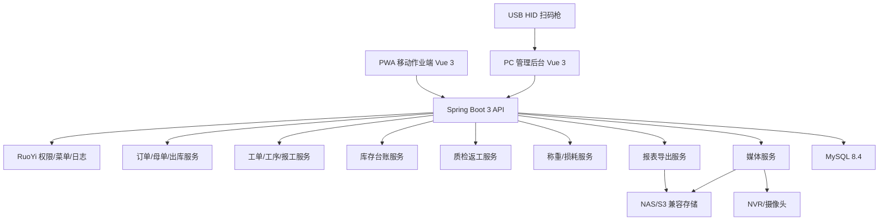

# 来料加工进销存与生产管理系统 综合评估与最终选型报告

> 归档说明：本文保留当时的设计、验证或客户沟通记录，不再作为当前开发入口；现行依据见[文档索引](../../README.md)。

**文档版本**：V1.0  
**文档定位**：最终评审结论、技术选型冻结、实施决策依据  
**评估日期**：2026-07-06  
**关联文档**：[00_开源项目调研与技术选型报告](./00_开源项目调研与技术选型报告.md)、[05_系统架构设计](../design/2026-10-13_05_系统架构设计.md)、[06_硬件与部署架构设计](../design/06_硬件与部署架构设计.md)、[09_配置与构型管理文档](../design/09_配置与构型管理文档.md)

---

## 1. 评估结论

当前文档包已经具备进入 M0 验证和 M1 实施基线冻结的基础。业务闭环、领域模型、权限审计、硬件兜底、备份恢复、构型管理均有明确设计，不再是单纯功能清单。

综合评估后，最终选型如下：

| 类别 | 最终选择 | 结论 |
|---|---|---|
| 主技术路线 | Java/Vue 定制业务系统 | 作为生产主路线 |
| 后台基座 | RuoYi-Vue 体系，优先 Spring Boot 3 + Vue 3 版本线 | 复用权限、菜单、字典、日志、代码生成 |
| 低代码备选 | JeecgBoot | 只作为备选，不作为默认主基座 |
| ERP 基座 | ERPNext/Frappe、Odoo | 作为业务模型参考，不作为生产主基座 |
| 数据库 | MySQL 8.4 LTS | 一期默认数据库 |
| 前端 | PC 管理后台 + PWA 移动作业端 | PWA 替代一期原生 Android |
| 文件存储 | NAS 优先；需要对象存储时选 S3 兼容商业/云服务或经许可证评估的方案 | 不把 MinIO 社区版作为无条件默认 |
| 视频处理 | FFmpeg + NVR/摄像头按时间段截取 | 一期半自动，失败人工上传 |
| 扫码 | PC USB HID 二维码扫码枪 + PWA 手机扫码 | 不采购专用 PDA 作为一期必需项 |
| 标签打印 | Windows 驱动/浏览器打印优先，必要时本地打印代理 | 不优先做厂商 SDK 深集成 |
| 电子秤 | 一期人工读数录入，二期接口采集 | 不把电子秤强集成作为一期阻塞项 |
| 审批 | 轻量固定审批表 | Flowable/Camunda 二期预留 |
| 备份 | 数据库全量备份 + binlog 增量 + 文件存储快照 + 恢复演练 | 试点前必须演练 |

---

## 2. 架构设计合理性评估

### 2.1 合理点

当前架构采用“模块化单体 + 异步任务 + 独立文件存储”的方式，适合一期：

- 业务复杂但用户规模不大，一期不需要微服务。
- 库存、工单、损耗、视频是强一致业务，拆成微服务会增加事务复杂度。
- 视频截取、报表导出适合异步任务，避免阻塞用户操作。
- PWA 移动作业端能降低 App 开发和现场部署成本。
- 转移式库存台账能解释来料、在制、成品、冻结、返工、报废、已发货的全链路变化。

### 2.2 需要坚持的架构约束

- 库存服务必须是唯一库存写入口。
- 页面和其他业务模块不得直接改库存余额。
- 报工、质检、损耗、库存、视频、审批必须保留审计记录。
- 返工必须作为特殊工单类型，不再建立独立返工状态机。
- 称重交接必须作为损耗责任的证据对象，不应简化为报工备注。

### 2.3 不建议的架构方向

- 不建议一期直接微服务化。
- 不建议把 ERPNext/Odoo 原生库存模型强行改造成客户来料贵重物料损耗系统。
- 不建议用低代码平台承载核心库存和工单状态机。
- 不建议把视频文件存数据库。
- 不建议一期做完整流程引擎。

---

## 3. 开源组件复用性评估

### 3.1 ERPNext/Frappe

ERPNext/Frappe 对制造、库存、工单和质量管理有较成熟的标准对象，适合参考 Work Order、Stock Ledger、Quality Inspection 等模型。

不作为生产主基座的原因：

- 本项目的核心不是标准制造 ERP，而是客户所有来料加工追溯。
- 客户所有权、称重交接、贵重物料工序损耗、视频证据、计件工资试算都需要深度定制。
- 一旦核心库存和工单逻辑绕开 ERP 原生模型，后续升级和维护成本会显著上升。

结论：作为模型参考和 POC 对照，不作为生产主基座。

### 3.2 Odoo

Odoo 的制造、库存和条码生态成熟，但社区版、企业版和第三方模块边界需要逐项核实。对当前项目而言，Odoo 深度二开门槛和授权边界风险高于收益。

结论：不作为一期主选型。

### 3.3 RuoYi-Vue

RuoYi-Vue 适合本项目作为后台基座：

- Java/Vue 技术栈在国内团队中更常见。
- 权限、菜单、字典、日志、代码生成可复用。
- 业务核心可以按当前文档的领域模型直接实现，不必迁就 ERP 原生对象。
- 便于和本地打印、扫码枪、NVR、电子秤等现场硬件集成。

结论：作为最终主选型。

### 3.4 JeecgBoot

JeecgBoot 的低代码和在线表单能力强，但本项目核心复杂度在库存台账、工序状态、称重交接和损耗规则，不适合主要依赖低代码表单驱动。

结论：作为备选，不作为默认主基座。

### 3.5 组件级复用

| 能力 | 选型 | 评估 |
|---|---|---|
| 权限/菜单/字典/日志 | RuoYi-Vue 内置能力 | 可复用 |
| 二维码生成 | 后端二维码库或前端二维码组件 | 可复用 |
| 二维码识别 | 浏览器 BarcodeDetector + ZXing 兜底 | 可复用 |
| 视频截取 | FFmpeg | 可复用 |
| 图表 | ECharts | 可复用 |
| Excel | EasyExcel / SheetJS | 可复用 |
| 审批 | 自研轻量审批表 | 一期自研更合理 |
| 对象存储 | NAS/S3 兼容方案 | 需按许可证和运维能力选择 |

---

## 4. 可维护性评估

### 4.1 当前设计的可维护点

- 文档按 PRD、流程、领域模型、页面、架构、硬件、接口、实施、构型分层，维护边界清晰。
- 领域模型将母单、工单、工序、报工、称重、质检、损耗、库存分开，避免一个大表承载所有业务。
- 库存台账采用转移模型，后期扩展退货、盘点、报废、调拨更自然。
- 单价、损耗率使用快照，避免历史报工随配置变化而失真。
- PWA 和 PC 后台职责分离，现场作业界面不会被管理后台复杂度拖累。

### 4.2 维护风险

| 风险 | 影响 | 控制措施 |
|---|---|---|
| 业务规则散落在页面 | 后期难维护 | 核心规则进入后端领域服务 |
| 库存被多个模块直接修改 | 账实失控 | 库存服务唯一写入口 |
| 报工更正无留痕 | 工资和损耗争议 | 更正记录 + 操作日志 |
| 视频文件和业务记录脱节 | 追溯失效 | 媒体元数据和业务单据强关联 |
| 低代码生成过多重复代码 | 扩展困难 | 代码生成仅用于基础 CRUD |

---

## 5. 权限管理评估

当前权限设计总体合理，建议最终采用：

- RBAC 控制功能、菜单、按钮和接口。
- 数据范围控制本人、本班组、本部门、全部、自定义客户范围。
- 敏感操作二次确认。
- 操作日志记录前后值、操作人、时间、来源 IP/设备。

必须落地的数据权限：

| 角色 | 数据范围 |
|---|---|
| 操作工 | 本人任务、本人工序报工 |
| 质检员 | 待质检和质检历史 |
| 车间组长 | 本班组工单、返工、报工 |
| 库管员 | 库存、出库、入库相关数据 |
| 业务员 | 自己负责客户或授权客户 |
| 总经理 | 全部数据 |

必须审计的动作：

- 库存调整。
- 报工更正。
- 损耗审批。
- 单据作废。
- 视频替换/删除/人工上传。
- 标签补打。
- 单价和损耗率变更。
- 报表导出。

评估结论：权限管理设计合理，但实施时必须将数据范围下沉到查询接口和导出接口，不能只在前端隐藏菜单。

---

## 6. 备份与恢复评估

当前文档已有备份范围和恢复演练要求，但需要进一步冻结为可执行策略。

### 6.1 最终备份策略

| 对象 | 策略 |
|---|---|
| MySQL 数据库 | 每日全量备份 + binlog 增量 |
| 业务附件 | NAS 快照或文件级增量备份 |
| 视频片段 | 按保存周期备份，低价值旧视频可归档 |
| 配置文件 | 版本化保存 |
| 标签/报表模板 | 版本化保存 |
| 代码和部署脚本 | Git 管理 |

### 6.2 推荐目标

| 指标 | 试点目标 | 正式目标 |
|---|---|---|
| RPO | 24 小时 | 15-60 分钟 |
| RTO | 1 个工作日 | 4 小时内 |
| 恢复演练 | 试点前 1 次 | 每季度 1 次 |
| 备份保留 | 30 天 | 90 天以上 |

### 6.3 必须补充的验收项

- 从备份恢复数据库到测试环境。
- 恢复附件和视频访问。
- 随机抽取母单，验证追溯链路和视频可打开。
- 验证权限和用户数据恢复正常。

评估结论：备份管理方向合理，但正式上线前必须增加 binlog 增量、恢复演练和抽样追溯验证。

---

## 7. 硬件合理性评估

### 7.1 一期硬件方案合理

当前硬件方案采用“兼容优先 + 人工兜底”，适合一期：

- NVR/摄像头只做按时间段截取，不把自动识别作为上线前提。
- 标签打印先走驱动/浏览器打印，不直接绑定厂商 SDK。
- PC 端扫码枪使用 USB HID，部署简单。
- PWA 手机扫码替代原生 App 和 PDA。
- 电子秤一期人工录入，避免接口差异阻塞上线。

### 7.2 最终硬件建议

| 硬件 | 最终建议 |
|---|---|
| 摄像头 | 拆包台、打包台、异常处理台至少各 1 路；1080p 最低，4MP 推荐 |
| NVR | 支持按时间段回放/导出，支持 RTSP 或厂商 SDK 更佳 |
| 标签打印机 | 300dpi 热敏/热转印标签机，优先 USB/网口和 Windows 驱动 |
| 扫码枪 | PC 使用二维 USB HID 扫码枪 |
| 手机 | Android Chrome 访问 PWA，扫码失败可手工输入 |
| 电子秤 | 一期人工读数；采购时优先支持 RS232/USB/TCP 输出 |
| 服务器 | 试点 4C/16GB 起；正式建议 8C/32GB、SSD、独立数据盘 |
| 存储 | NAS 起步，按视频保存周期配置容量和快照 |
| 网络 | 车间 Wi-Fi 覆盖作业区，服务器/NVR/PC 统一 NTP |

### 7.3 电子秤精度建议

如果业务允许重量误差约 0.02g，则电子秤读数精度应不低于 0.01g；高价值工位建议 0.001g。最终精度按物料价值和现场称重习惯确认。

评估结论：硬件方案合理，不应在一期强制采购 PDA 或强制电子秤自动采集。必须先完成 NVR、标签打印、PWA 扫码和文件存储 POC。

---

## 8. 最终技术架构

---

## 9. 最终选型清单

| 层级 | 选型 |
|---|---|
| 后端语言 | Java |
| 后端框架 | Spring Boot 3 |
| 后台基座 | RuoYi-Vue 体系 |
| 前端 | Vue 3 |
| PC UI | Element Plus 或 RuoYi 对应 UI |
| 移动端 | PWA 移动网页 |
| 数据库 | MySQL 8.4 LTS |
| 缓存 | Redis，可选但建议保留 |
| 文件/视频存储 | NAS 优先；对象存储按许可证和运维能力选择 |
| 视频处理 | FFmpeg |
| 扫码 | USB HID 扫码枪 + PWA BarcodeDetector/ZXing |
| 打印 | 浏览器/驱动打印优先，必要时本地打印代理 |
| 图表 | ECharts |
| Excel | EasyExcel 或 SheetJS |
| 审批 | 一期轻量审批表 |
| 流程引擎 | 二期再评估 Flowable/Camunda |

---

## 10. 最终实施建议

1. 立即将技术路线冻结为 Java/Vue + RuoYi-Vue 定制路线。
2. M0 POC 不再承担“是否选 ERP”的决策，而是验证硬件、扫码、视频、标签、库存台账核心原型。
3. ERPNext/Frappe、Odoo 保留为模型参考，不进入生产基座实施。
4. 一期以模块化单体交付，不拆微服务。
5. 一期严格控制范围：核心闭环、库存台账、追溯、质检返工、工资试算、视频证据。
6. 正式开发前补一份数据库 DDL 草案和 API 详细字段字典。
7. 试点上线前必须完成恢复演练和硬件 POC。

---

## 11. 参考资料

- [ERPNext Manufacturing](https://docs.frappe.io/erpnext/user/manual/en/manufacturing)
- [ERPNext Work Order](https://docs.frappe.io/erpnext/user/manual/en/work-order)
- [Odoo Manufacturing](https://www.odoo.com/documentation/19.0/applications/inventory_and_mrp/manufacturing.html)
- [Odoo Editions](https://www.odoo.com/page/editions)
- [RuoYi-Vue GitHub](https://github.com/yangzongzhuan/RuoYi-Vue)
- [JeecgBoot GitHub](https://github.com/jeecgboot/JeecgBoot)
- [FFmpeg Documentation](https://ffmpeg.org/documentation.html)
- [MySQL Backup and Recovery](https://dev.mysql.com/doc/refman/8.4/en/backup-and-recovery.html)
