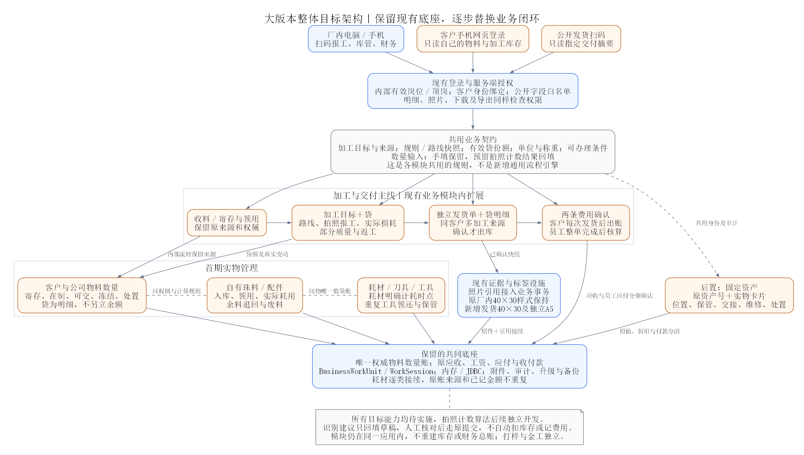
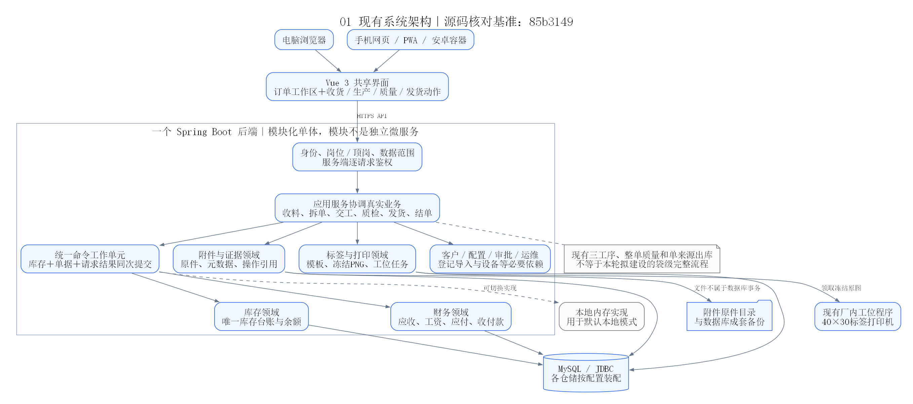
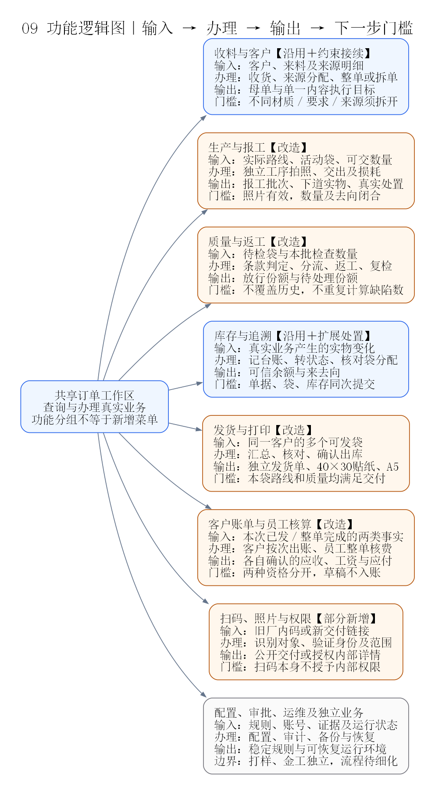
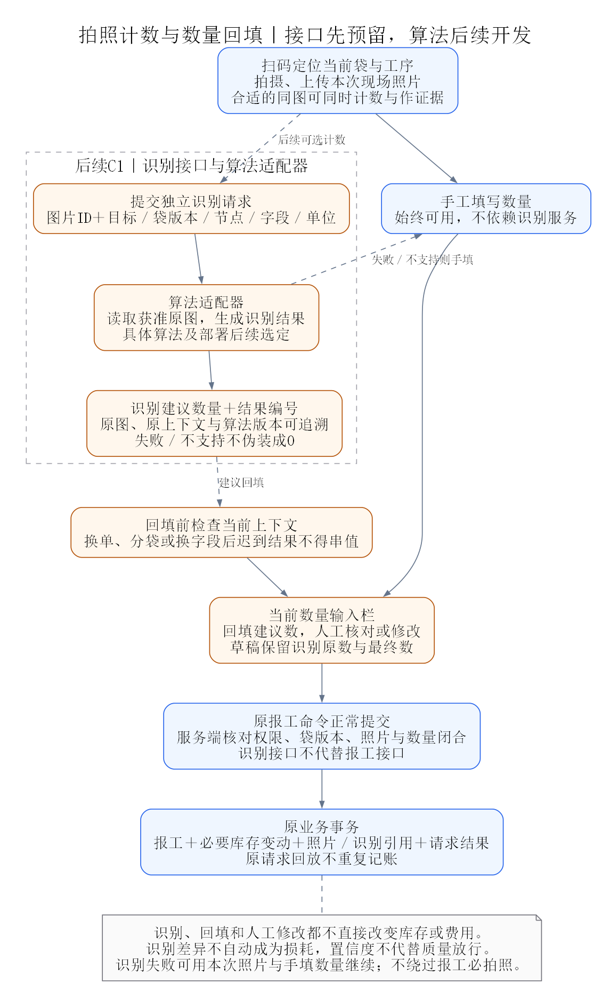
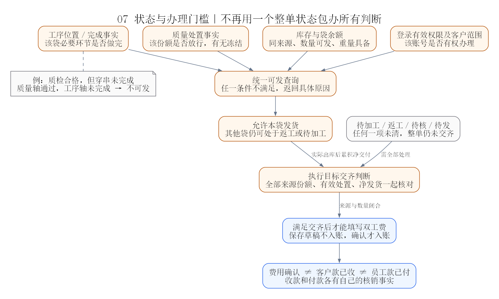
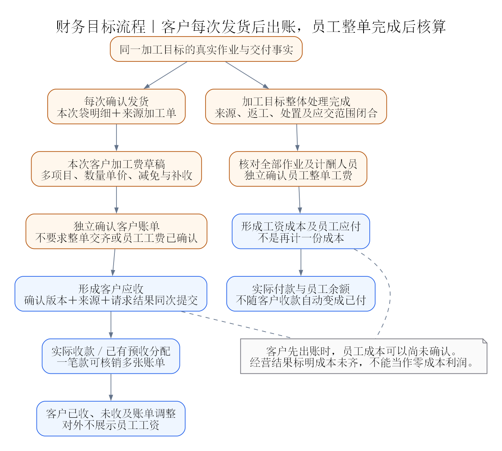
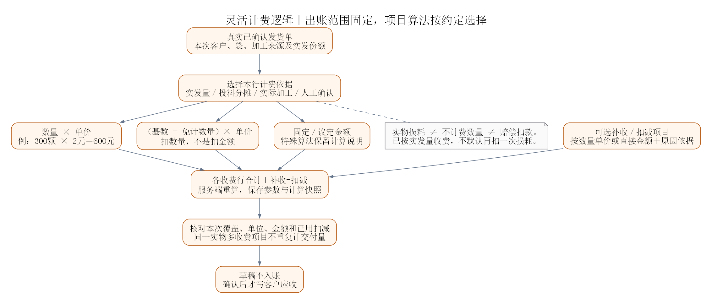
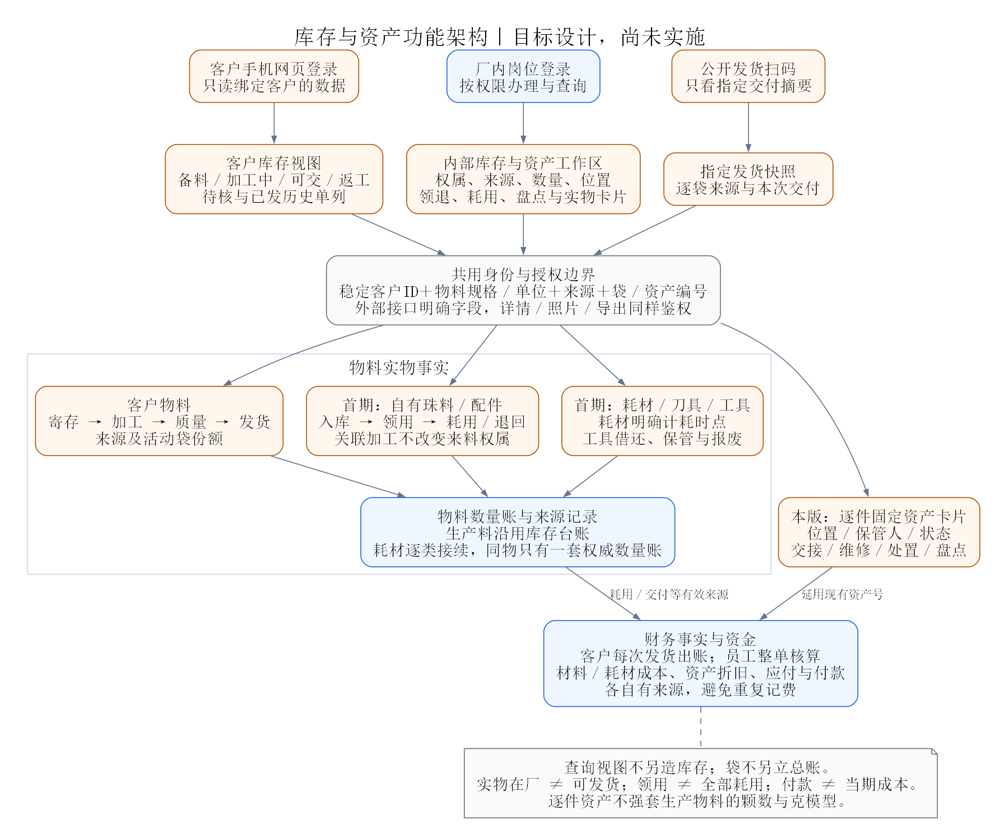
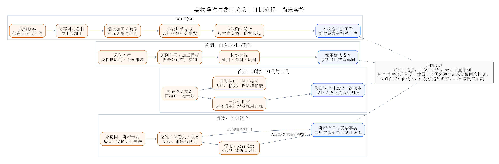
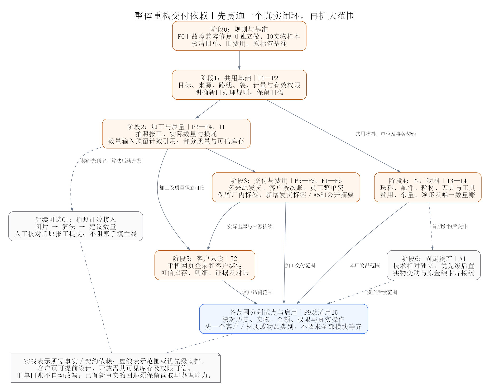

# 大版本整体重构方案

更新日期：2026-10-30。状态：完整整合方案，尚未实施业务重构。本文件统一维护本次确认的加工、交付、财务、客户库存、本厂物料工具、资产和拍照计数扩展设计；现行运行状态见[项目核心](./00_项目核心.md)。

建议先读第1—3章把握方向，按业务定位第4—12章，按第13—16章推进任务及验收，第17章提供完整图集。拍照计数只预留接口，算法后续独立开发。

- [1. 总体决策与已确认范围](#overview)
- [2. 整体架构、职责与使用入口](#architecture)
- [3. 现状差异与优先故障](#current-gaps)
- [4. 加工目标、来源、路线与实物袋](#process-bags)
- [5. 简单拍照报工、实际数量与损耗](#reporting)
- [6. 拍照计数预留接口与数量回填](#photo-count)
- [7. 部分质量、返工与可办理条件](#quality)
- [8. 独立发货、标签、A5与扫码](#shipping-printing)
- [9. 客户按次出账、员工整单核算与资金](#finance)
- [10. 客户物料库存、身份与手机查询](#customer-stock)
- [11. 本厂物料、工具与固定资产](#factory-assets)
- [12. 数据契约、代码落点与事务边界](#data-transactions)
- [13. 统筹阶段、全部实施任务与依赖](#implementation)
- [14. 历史接续、分批启用与回退](#history)
- [15. 代表性场景、验收与完成标准](#acceptance)
- [16. 对应增量前需落实的局部决策](#decisions)
- [17. 完整图集与可编辑图源](#diagrams)
- [18. 源码依据与设计边界](#sources)
- [19. 方案维护与归档关系](#document-management)

## 1. 总体决策与已确认范围

**保留现有技术与可用能力，重构业务处理粒度、共用事实和提交边界，按完整业务闭环逐步替换。** 现有Vue共享页面、Java模块化单体、库存台账、命令事务、权限、附件、冻结图片打印及收付款底座均有复用基础。

核心变化是从“整张加工单用一个数量、一个状态向后推进”，转为“来源明确的加工目标，按实物份额处理工序、质量和交付，再分别形成客户账单与员工核算”。同时补齐本厂自有珠料、配件、耗材、刀具及工具的管理。

这次应统一设计，逐步上线。客户库存视图从同一库存事实读取；材料成本从实际耗用取得依据；工具按持有人与领还追踪；固定资产保留独立实物身份。不能各功能分别补表，再靠重复录入维持一致。

### 1.1 本次重构的范围

| 层次 | 内容 | 本次处理 |
|---|---|---|
| 加工主线 | 材质默认路线、独立拍照报工、实际数量与损耗、部分质量／返工、分袋、多来源发货 | 首期核心闭环 |
| 财务 | 客户每次发货出账、灵活计费、员工整单核算、原应收应付与收付款接续 | 与主线交付一起贯通 |
| 本厂物料 | 自有珠料、配件、耗材、刀具、工具 | 已确认首期优先类别，按物品逐类启用 |
| 客户查询 | 手机网页登录，查询绑定客户自己的寄存及加工库存 | 在对应库存可信、权限贯通后开放 |
| 固定资产 | 实物卡片、位置、保管、交接、维修、处置、折旧接续 | 保留设计，实施后置 |
| 打样与金工 | 各自独立业务，可关联客户、要求和来源 | 保留边界，专属流程另行细化，不作为正常加工前置条件 |
| 扩展候选 | 轻量盘点、客户截止日对账、期初实物接续 | 随对应物料范围试点，不扩展成完整仓储平台 |

本次没有确认完整采购审批、自有产品销售、完整成本会计、小程序或新硬件集成，也没有确认把所有现有页面和代码全部改写。

### 已确认业务要求

| 主题 | 本次确认 |
|---|---|
| 材质工序 | 工序表的勾选表示该类材质通常采用的工序及顺序，作为默认路线；具体订单保存实际路线 |
| 独立业务 | 正常加工、打样、金工分别管理，可轻度关联，不互为办理前置条件 |
| 报工 | 具体工序需要独立报工，操作必须简单；报工需要拍照 |
| 加工损耗 | 下道承接上道实际交出数量，不要求所有工序始终交足最初来料数 |
| 质量与交付 | 允许部分质检、部分放行、部分返工、部分发货 |
| 单袋内容 | 加工单袋不混材质、加工要求和来料来源；不同内容必须拆子单 |
| 发货编号 | 发货单号独立于加工单号，一次发货可包含多个加工订单和不同材质、工序、要求 |
| 扫码 | 客户查看对外交付信息，内部人员按身份权限查看关联加工、照片、账单等详情 |
| 客户及员工费用 | 客户每次发货后出本次账单，可选数量单价、免计数量、金额调整或议定金额；员工工费整张加工目标完成后独立核算 |
| 厂内标签 | 已上线的厂内加工贴纸样式已获认可，尽量不改；继续使用40×30 mm |
| 发货打印 | 单袋发货贴纸也使用40×30 mm；汇总发货单采用A5纸，可由另一台打印机打印 |
| 当前工作 | 只形成方案与后续计划，不实施业务改造、不切换服务器、不更正业务数据 |

以下涉及袋号生命周期、分袋方式、表单默认值等内容，是为落实上述要求提出的设计建议，不将其写成已经上线的能力。

### 保留基准与改变方向

| 保持 | 原因 |
|---|---|
| 已满意的厂内40×30加工贴纸外观、旧码解析、冻结原图和打印队列 | 已有现场使用基础，新增袋身份不能破坏原标签 |
| 独立40×30发货袋贴纸、另一打印机的A5汇总路线 | 两种纸型与设备分别承担不同信息密度 |
| 母单原收料、历史交工、质量、出库、照片和已确认账务 | 历史是真实凭据，不能按新规则批量覆盖 |
| 统一库存台账、内存／JDBC切换、既有工作单元与权限 | 避免新增互不一致的数据源和事务机制 |
| PWA、附件原件与元数据备份、升级和必要设备依赖 | 属于已运行系统的必要能力，不因新设计而删减 |

| 改变 | 目标规则 |
|---|---|
| 固定工序与整单原量完成 | 材质给默认路线，订单存实际路线；每道按真实投入、产出、处置和剩余闭合 |
| 整单质量与交付互相阻塞 | 明确当前袋／份额，部分合格先放行，返工保留来源和复检 |
| 加工单与发货身份重叠 | 发货单独立编号，同客户可汇总多个加工目标，各袋保留原来源 |
| 客户费与工资一起确认 | 客户按本次已发部分出账；员工在整个加工目标完成后独立核算 |
| 公司料只有领用和退回 | 补实际耗用、余量、废料和成本来源，领用不是全部耗用 |
| 耗材、公司料可能重复维护数量 | 每件物品明确唯一权威数量账，按类别接续，不双录同一实物 |
| 客户查询复用内部账号和对象 | 受限客户身份、稳定客户绑定、只读接口及明确对外字段 |

新增确认：报工数量预留拍照计数接入，算法未来开发；识别结果回填数量后仍经办人核对，按原报工规则正式提交。

## 2. 整体架构、职责与使用入口

图中的职责保留在现有模块化单体内，表示业务边界，不表示增加独立服务或数据库。

| 责任 | 目标内容 | 现有落点及改造方式 |
|---|---|---|
| 订单与加工 | 收料来源、执行目标、路线快照、袋、报工、质量及返工 | 留在`business`；按清晰职责拆服务和动作，不继续把所有判断堆入一个整单状态 |
| 交付 | 发货草稿、同客户汇总、逐袋来源、确认快照、退货关联 | 留在`business`；汇总关联现有逐来源出库事实，不能再扣一次库存 |
| 实物库存 | 权属、物料规格、单位、仓库／位置、状态与数量变化 | `inventory`继续负责数量；袋是分配明细，客户页是查询视图 |
| 本厂物料与工具 | 公司料耗用、耗材接续、工具领还与保管 | 优先在`inventory`内扩展；不同物品采用适用计量，不强套颗数与克重 |
| 费用与资金 | 客户按次账单、员工核算、材料及耗材成本、原应收应付与核销 | 留在`finance`，拆开确认资格、命令和权限，复用原账务底座 |
| 固定资产 | 现有财务卡片＋实物信息及变动 | 延用资产号，不把整台机器强塞进生产物料模型，也不重复登记原值 |
| 身份与查询 | 内部有效岗位权限、客户绑定、公开交付访问 | 复用`security`与现有登录；外部身份和字段单独限制 |
| 证据与打印 | 当前操作照片、对外证据、旧厂内标签、新发货标签、A5 | 复用`document/label/scan`，补事务引用和新模板，不新建媒体或打印底座 |

前端继续沿用`App.vue`、共享`OrderWorkspace`及动作容器。工人办理突出“扫袋 → 拍照 → 核数量 → 提交”；库管突出“来源／物品 → 收发领退”；财务突出“本次发货待出账”和“整单待核员工费”。客户只读页面单独组织，避免加载整个内部管理界面再隐藏菜单。

现有大组件只在承担新职责或确有重复时逐步拆分，不按文件长度或旧目录名称集中搬家。计算和授权最终由服务端执行，前端显示同一契约下的预览及阻断原因。

### 现有架构及复用边界

电脑、手机和安卓容器共享前端业务，后端负责身份、岗位／顶岗和客户范围。业务服务协调库存、质量、财务、附件与打印。库存、财务和单据并非互不相干的应用，核心命令已有同一连接上的提交和原请求回放基础。

原件文件与数据库事务分开；数据库保存元数据和引用，备份必须同时覆盖原件。MySQL下各仓储仍按配置装配，不能只看profile就认定每个模块都持久化。厂内工位领取冻结PNG，不能把送入打印队列等同于实物已经出纸。

本图按现有主要调用链概括，不能据此认定所有兼容旧入口都已经进入统一事务；新增写入必须实际传递`WorkSession`。

### 岗位最短操作主线

这张图按输入、办理、输出及门槛解释功能，不要求增加同名菜单。现有共享订单详情和办理容器应继续使用，让工人从当前单据进入下一步，而不是在多个模块重复搜索、录客户和数量。

| 典型岗位 | 最短操作主线 |
|---|---|
| 收货／业务安排 | 选客户与来源 → 登记来料 → 整单或拆子单 → 确定实际路线 |
| 现场工人 | 扫袋 → 自动定位工序 → 拍照核数 → 一次提交 |
| 质检人员 | 扫待检袋 → 条款判定与数量分流 → 放行或指定返工 |
| 发货人员 | 同客户选可发袋 → 核对 → 确认出库 → 贴纸与A5 |
| 客户出账人员 | 读取本次已发范围 → 填灵活收费项目 → 独立确认客户账单 → 收款核销 |
| 员工核算人员 | 读取已完成加工目标及作业份额 → 独立确认员工工费 → 员工付款 |
| 客户 | 扫交付码看指定清单；手机网页登录查自己的物料与加工库存 |

### 各主线连接关系

| 主线 | 操作及结果 |
|---|---|
| 客户来料加工 | 收料／寄存 → 来源领用 → 单一内容加工目标 → 路线与分袋 → 拍照报工 → 部分质量／返工 → 满足条件的份额出库 |
| 交付与收入 | 同客户可发袋 → 独立发货单 → 40×30袋贴与A5 → 本次账单 → 应收 → 收款／预收核销 |
| 员工工费 | 全部作业与处置持续累积 → 加工目标整体完成 → 独立员工核算 → 工资及应付 → 实际付款 |
| 本厂珠料配件 | 采购／期初 → 入库 → 领用 → 实际耗用／余料退回／废料 → 成本来源，仍保留公司权属解释 |
| 耗材与工具 | 明确类别和唯一数量账 → 耗材按选定时点计耗；工具按领用人、位置、领还及损坏处置跟踪 |
| 客户查询 | 同一来源及库存事实 → 可信状态与合计 → 受限客户接口 → 手机只读页面及对账 |
| 固定资产 | 同一资产卡片 → 位置与保管 → 交接／维修／处置／盘点；金额、折旧与付款分别接续 |

标签读取已确认业务快照，补打不再出库，厂内模板不因新增标签顺带改字体或外观。A5不交给40×30打印代理排版。

#### 一次贯通示例

客户核实来料1000颗，400颗寄存、600颗进入加工。加工出现10颗不可恢复损耗，最终590颗可交，其中第一批交300颗、第二批交290颗：

- 第一批后在厂为400＋290＝690颗，核对为1000＝690＋300＋10；300颗可以先出客户账，不等整单员工核算。
- 第二批后在厂仍有寄存400颗，核对为1000＝400＋590＋10；加工目标交付、作业及处置闭合后才核该目标员工工费，寄存400颗不阻止它结束。
- 若按2元／颗计加工费，两次分别为600元、580元。实际单价、额外项目或协商扣减仍按各次账单确认；不自动再扣10颗，也不自动扣员工工资。
- 同时使用公司配件，若领用100件、耗70、退20、车间留10，则按本公司物料链核对；不能把100件配件加到客户的颗数库存，也不能仅因领用就确认全额耗用。

一料多胚或单位转换另存转换关系，上述同单位示例不能直接套到不同单位之间。

## 3. 现状差异与优先故障

### 加工交付现状差异

| 事项 | 对新方案的影响 | 处理位置 |
|---|---|---|
| 母单与执行单的库存身份解释不一致 | 不拆单可能有成品却查不到 | P0先修；后续统一目标解析契约 |
| 分批交工仍以原始总量判完成 | 存在损耗的工序不能正常关闭 | P3改成实际接收、交出和处置闭合 |
| 末道补录称重未必沿当前路径写入产出库存 | 发货数量对但重量仍可能不一致 | P0核对既有记录，P3验证真实称重接续，不自动更正存量 |
| 证据引用缺少统一工作单元入口 | 必拍照可能只在界面成立 | P3扩展真实仓储事务及批次引用 |
| 扫码可办理提示只读取角色权限集合 | 提示可能与业务管理账号实际顶岗权限不一致 | P1—P2统一有效权限查询，写接口继续逐请求校验 |
| 整单质量和库存状态混在一起 | 部分通过与部分返工互相阻塞 | P4按明确份额和状态方面办理 |
| 现有出库一行关联一加工目标 | 直接加总单号可能丢来源、重复扣库存 | P5新增汇总和逐袋关联，维持逐来源出库 |
| 原始总量仍影响交齐和计件缺口解释 | 发货已支持损耗但仍无法结单，或工资被补回原量 | P6同步修改完成判定及计件事实来源 |
| 原双费用确认把客户出账与员工核算绑在一起 | 不符合客户按次出账、员工整单核算的新规则 | P6按财务F1—F6分离资格、算法、权限和确认，复用原账务底座 |
| 新袋若独立维护另一套总余额 | 袋与库存出现两套可修改的真相 | P2—P6同事务分配和核对，库存台账保持唯一 |
| 袋只使用一个含糊状态 | 无法表达质检合格但后续工序未完 | 明确工序、质量、交付三个方面及共同查询 |
| 变更共享标签渲染会影响已满意的厂内标签 | 功能改进反而破坏现场可用性 | P7固定旧样式基准，新增模板独立接入 |

这些差异支持改造方向，也说明不能把改造等同于已经验收。没有必要为本次需求新增微服务、消息总线、通用流程引擎或另一套媒体／库存系统。

### 财务现状差异

**库存和财务台账基础可以复用，现有结单粒度、确认门槛及客户计费界面不能直接满足新要求。**

| 需求 | 实际源码情况 | 结论 |
|---|---|---|
| 部分发货后出本次账单 | `OrderSettlementService.prepare`要求目标已交齐，只有母单／子单结单目标 | 不满足，需要按已确认发货建立客户计费范围 |
| 数量乘单价 | 后端支持`PIECE/GRAM`；客户页面`SettlementPanel`只提交一个固定金额行 | 后端有部分能力，页面不足 |
| 客户费用减损耗／折让 | 后端按件／按克客户行明确拒绝非零`deduction`；固定金额行也不允许扣减 | 不满足，不能只增加前端输入框 |
| 多项目收费 | 后端可接受多条客户行，前端固定生成一条“客户加工费” | 需要项目明细编辑和来源核对 |
| 客户费与员工费独立确认 | 当前最终确认要求入账与工资权限、全公司范围，并校验员工作业覆盖；同次写应收、工资及应付 | 不满足，需拆开业务确认边界与权限 |
| 账单确认后收款 | 现有应收、收款、多单分摊和已有款项后续核销可复用 | 保留，不把到账当作出账 |
| 员工费确认后付款 | 现有工资及员工应付、付款体系可复用 | 保留；工资成本与应付是同项工费的不同视图，不能计两次成本 |
| 历史金额调整 | 现有追加差额、旧账来源和请求回放有基础 | 保留，不覆盖已确认金额；需适配新客户账单来源 |
| 保存草稿后恢复 | 后端返回当前结单明细；现有页面读取时未恢复客户项目和原员工草稿，主要从作业事实重建 | 新界面须完整恢复草稿；切目标金额是否残留需在实现时定向复现 |

旧专题中“支持客户按件、按克和分项”是原设计目标，不表示当前前端已经具备。以上是源码核对结论，不冒充新功能运行测试结果。

### 库存、耗材与资产现状差异

| 领域 | 源码已有基础 | 对新要求的缺口与判断 |
|---|---|---|
| 客户寄存备料 | 多行收货、待核／确认、来源批次、部分领用、从备料建加工单、退回备料、退还客户、冻结／解冻及冲正 | 可以沿用；需与新袋及工序实际损耗接续，增加统一客户库存解释和对账 |
| 加工库存 | 母／子单、材质、仓库、状态、数量／重量及台账；已有厂内查询 | 当前页面不足以表达袋级份额，也不等于对客户开放；“非冻结可用”不能直接理解成“可发货” |
| 客户查询 | 现有稳定客户ID、客户数据范围及服务端鉴权 | 当前角色均为内部岗位，没有客户自助身份、手机客户首页和专用对外字段契约 |
| 公司生产物料 | 公司收货、批次、领用到在制、按原领用退回、用途及关联加工单 | 领用仍在厂，不是耗用；缺少实际耗用、余料、废料及生产成本接续。入库表单没有结构化采购金额／应付来源 |
| 耗材 | 档案、采购、数量金额结存、领用、供应商应付；领用按当时结存平均金额计算成本 | 是财务内的独立数量金额账，未纳入生产库存台账；没有完整仓库／来源批次／退库／盘点闭环，不能与公司料重复登记同一实物 |
| 固定资产 | 卡片编码、名称、分类、原值、残值、起始月、使用月数；按月生成折旧 | 是简化财务卡片；缺位置、保管人、使用状态、序列号、交接、维修、报废及盘点。资产登记未联动采购应付或付款 |
| 工具、模具 | 可用现有物料档案作部分基础，但未发现独立借还／保管链路 | 建议按是否重复使用区分工具和耗材，先明确现场需要，再决定逐件或按数量管理 |
| 盘点 | 已有业务单据与冲正基础 | 未见独立实盘快照、差异复核和差异调整闭环；本轮可纳入轻量盘点设计，不能用原收货冲正代替全部盘盈盘亏 |

源码还有两项实施约束：

- `MaterialStockService.processingCards`把非冻结加工余额填入`availableQuantity`，该字段并没有同时验证必要工序和质量放行。客户界面必须改用明确含义的字段，不能直接显示为“可交货”。
- `FinanceCostService`的耗材采购先保存应付，再保存采购流水；相关JDBC方法各自获取连接。耗材领用也是先汇总再保存，未接入现有`BusinessWorkUnit/WorkSession`。扩展前应补足原请求回放、同次提交和锁后限额校验；这是静态代码发现的风险，本轮未做故障注入或并发复现。

### P0：旧不拆母单漏查成品及重量待核

2026-10-29只读核对`MD-20261029-0003`：拆单决定为`KEEP`，存在三道正式交工、质检记录，库存存在母单号和执行单号均为该母单的`FINISHED`余额120颗。发货页仍提示没有成品余额。

定位：`ScanContextService.balancesOf(motherCode, null)`只纳入执行单号为空的母单库存，漏掉“不拆母单以自身编号作为执行目标”的在制、半成品和成品。已查到原因但未修复；此前临时定位测试已撤回。当前没有更改真实单据或发布修复。

同次只读核对还发现该单末道补录总重量为7.780克，成品账面重量为7.260克，存在需核实的称重接续差异。不能据此自动更正库存或照搬其中一个值发货；修复查询后仍须核对实物及记录。P3须验证末道实称重量正确传递，存量差异另按事实更正边界处理。

实现范围：

- 同母单下纳入空执行号的原始库存及执行号等于母单号的整单加工库存，不能因此混入其他子单／其他母单。
- 核查该母单的质检、放行、发货事实在共享详情中的一致展示，避免查询缺失造成二次误判。
- 保持权限、库存扣减、质检放行门槛和原请求回放，不用修改原单数据解决查询问题。

验证：真实服务链的收料、不拆、交工、质检、放行、扫码读取成品、确认出库；未放行拒绝、其他来源不混入、重复请求不重复扣库。相关测试入口为`ScanContextServiceTest`，必要时联动`ShippingDeliveryTest`及对应前端测试。现场只读复查这张单；实际发货必须由经办人员核对数量、重量和物流后办理，不能用排障代发货。

本增量可独立提交和按后续授权发布，不依赖新流程全部完成。

## 4. 加工目标、来源、路线与实物袋

### 业务对象与编号

| 对象 | 记录什么 | 与其他对象的关系 |
|---|---|---|
| 来料母单 | 客户、原始来料、来源明细、数量重量和委托要求 | 可整单加工，也可拆子单；原始收料事实不因损耗覆盖 |
| 加工执行目标 | 一套实际要求、路线、数量和来源 | 拆单时为子单；符合单一内容条件的不拆母单也可直接执行 |
| 实物袋 | 当前装在一起且状态一致的一份实物 | 只属于一个执行目标；一个目标可分多袋 |
| 工序报工批次 | 哪个袋在什么工序处理多少，交到哪里，有何损耗及照片 | 每次提交独立留痕；分批交工不同于整道工序结束 |
| 质检批次／轮次 | 对哪些袋、多少数量、哪些要求作了什么判定 | 初检、复检不互相覆盖；结果只作用于本批实物 |
| 返工任务 | 原不合格来源、返工数量、要重做的环节及顺序 | 保留原子单和原质量记录，不伪造一张无来源的新委托单 |
| 发货汇总单 | 同一客户本次实际交付、物流和备注 | 独立发货单号，下挂多个袋明细，可跨该客户多个母单／子单 |
| 发货袋明细 | 本袋实际交付内容和来源 | 与一份真实可发实物对应；打印多份不增加实物袋数 |
| 客户账单与员工核算 | 客户按本次发货计费，员工按完成加工目标核算 | 两种确认分开；保留加工来源，不因多次发货重复计工资 |

“来源”应落实到具体收料明细或备料领用明细，不能只用“客户来料／公司自备”这类来源类型代替。现有同材质多来源子单不得被新规则自动改写，新建子单执行单一来源约束，历史单按[历史接续章节](#history)办理。

### 材质默认路线及独立打样／金工

#### 工序表的业务含义

| 分组 | 原表环节及排列 |
|---|---|
| 前置选料 | 筛籽选料 |
| 开粗 | 切料、取胚、打孔 |
| 精工 | 车型、精挑、去耳、抛光（珠） |
| 镶嵌 | 开槽、镶标、除胶 |
| 交付准备 | 拍照、核数、质检、穿串；原表归为“发货” |
| 返工 | 按需要选择重做环节，不作为固定的最后一道正常工序 |

| 材质 | 默认路线范围 |
|---|---|
| 牙骨、紫金鼠、橄榄、小桃核、猴头、木料 | 原表从筛籽选料到穿串的全部15个环节 |
| 星月 | 从车型到穿串的11个环节 |
| 大核桃 | 筛籽选料，以及开槽、镶标、除胶、拍照、核数、质检、穿串，共8个环节 |

选择材质带出默认路线，安排生产时可以按委托选择、调整顺序，保存本单路线快照。分组用于汇总，具体环节用于独立办理和岗位授权。模板更新只影响新单，已开工路线变化沿用改单与版本记录。

工序表中的“拍照”是专门的交付拍摄作业；每道报工必须拍照是作业证据要求，两者不能互相冒充。质检节点由质量表单完成，并写回该节点办理事实，不让员工在质量表单之外重复提交一份普通质检报工。

原表把质检排在穿串之前。不能直接套用现有“最后一道结束后才做质检”的固定结构：目标规则为**质量通过且本袋实际路线上的全部交付前环节已完成，才形成可发数量**。质检通过但穿串未做完的袋仍不可发。后续作业影响已经检查的质量项目时，复检相关项目。试点前确认质检与穿串的实际顺序，未确认时保留原表，不擅自调序或增加双重质检。

#### 打样与金工

打样参考流程：平设、建模、珠型确认、选料与加工、交付确认。“来料／自备”为材料来源，“雕刻／车型”为加工选择，是否可组合另行确定。

金工参考流程：平设、建模、倒模、执模、抛光（金）。抛光（金）与抛光（珠）分开定义。

两类业务有独立单据、状态和办理入口，可引用客户、样品或加工单。关联不自动交工、改库存、改账或阻止正常加工。专属金额、领料、损耗和签样规则尚未确认，后续单独细化，不借本次工序扩展直接上线完整金工或打样模块。

### 单袋约束、分袋与旧码

#### 单袋约束

每个活动袋只对应一个加工执行目标、一个材质、一套要求版本、一个来源，以及一致的工序位置、质量处置和交付状态组合。三个状态方面分别从事实读取，不能用一个“已完成”字段代替；不同要求版本也不得放进同一袋。

材质、要求或来源不同要拆子单；同一子单因数量或处理状态不同只需分袋，不新建加工委托。返工补充说明用于描述如何修复；实质改变客户要求时走改单，不能靠改袋备注绕过版本管理。

#### 何时保持袋号，何时分袋

| 场景 | 办理方式 |
|---|---|
| 整袋沿同一路线交下道 | 保持袋号，追加工序记录，不逐道换贴 |
| 确认本袋发生损耗，其余实物仍在一起 | 保持存续袋号，更新实际余量和损耗记录；有实物的废料另记去向 |
| 部分交工、部分留本道 | 一次提交生成交出袋和剩余袋，数量分别记录 |
| 部分合格、部分返工 | 一次质检生成合格袋和返工袋，不能共用一个活动码 |
| 部分发货、部分留存 | 生成发货袋和留存袋，再选发货袋办理出库 |

建议发生实物分袋时关闭原袋的办理资格，原袋作为来源记录保留，系统生成新袋号和待打印标签。旧码扫码显示分袋去向，只读追溯；不能再次按旧数量交工或出库。新袋数量之和加本次明确处置数量，必须等于本次原袋数量。

分袋嵌入部分交工、质检和发货表单，不要求员工另进一个分袋模块手工编号码。分袋业务保存后打印失败，只补打已有袋号，不再次分袋。新标签未贴到实物前提示“待换贴”，并可从原袋追到待贴的新袋。

首期不新增跨子单合袋，也不为了减少袋数自动合并同子单的多个袋。

### 加工目标与规则版本

加工执行目标统一解释“不拆母单”和“子单”，包含稳定客户、主料来源明细、材质、单位、要求版本、实际路线和办理规则版本。扫码、报工、质检、发货及员工核算都使用同一目标解释，不再各自猜执行号。

不同主料、要求或来源拆不同子单；同一目标因部分加工、部分返工或部分发货分袋。未分拆保持袋号；真实分拆关闭父袋操作资格并生成子袋，保留关系。活跃实物只统计有效叶袋，不把父袋和子袋相加。旧来源混合单不自动改写。

路线模板只影响新建单的默认值，不能修改已经保存的路线。新旧办理规则通过实际执行目标明确区分，不能用一个全局开关让所有在制单突然换含义。

## 5. 简单拍照报工、实际数量与损耗

### 5.1 正常操作

1. 扫厂内贴纸；只有一个活动袋时直接定位，多袋时选择手上袋，旧码不得默认取第一袋。
2. 自动定位本账号当前可办理工序；只有一道时自动选中，多道时保留明确选择。
3. 拍摄至少一张本次现场照片，确认本次处理／交出数量；默认带出可处理数量供核对。
4. 正常整袋只点一次提交。有损耗、挑出、部分交工时展开相应数量和去向。

不强制先记100%再交工。原五档进度作为可选过程记录保留，查询、照片上传和进度保存都不改变实物数量。零数量补登末道重量作为称重补录，关联原交工及称重照片，不重复计加工数量。

### 5.2 照片与提交结果

每次正式工序报工至少关联一张当前操作照片；历史照片不能自动当作本次拍摄。沿用现有采集、附件存储、预览及权限，不另建媒体系统。相册选择可保留作重试／设备兼容入口，但服务端不能把选择文件的时间当作真实拍摄时间，也不声称能仅凭图片证明拍摄现场。

建议先把文件上传到已经存在的加工目标，取得附件编号，再在同一次报工事务内校验并绑定照片、保存工序与数量事实。照片未上传成功不能完成新模式报工；事务失败时不交工，已上传文件可用于原请求重试，不重复上传。后续追加照片仍可独立办理，不能重复报工。

表单保存原目标、袋版本、数量、照片和请求号。超时显示“结果待核对”，按原请求查询／重试，不清空后另开一笔。客户端传附件编号不是证据已存在，服务端须核对同一目标、客户范围、可用图片及本次操作引用。

### 5.3 数量闭合与完成条件

同一计量对象、同一单位下，每道工序累计遵循：

**接收数量＝交下道数量＋已确认退出本路线的数量＋尚未处理数量。**

退出数量按损耗、报废、退料等实际原因分开。待返工、待核差异和未加工不能直接记成正常损耗。待核部分独立保留，已交出的正常部分可以继续流转，但未核清的部分不能悄悄结清。

“本批已交工”“已到货部分处理完”“整道工序全部完成”分别显示。上道仍会来货时，下道暂时处理完不能关闭整道工序；上道已关闭且本道数量全部有明确处理结果，才能关闭本道。全批报废、没有合格产出的路线也可以按真实处置结束，不提交虚假的正数交工或称重。

例如来料500颗，切料损耗20颗交480颗，取胚损耗10颗交470颗，打孔损耗5颗交465颗。下道各自承接480、470、465，不再要求500。原收料500颗不覆盖。

数量与重量分别记录。抛光可以数量不变而重量减少，不能从重量差推算颗数。中间环节默认不增加每道强制称重，实际称重和分袋重量按需要登记；末道／放行／发货使用对应实物的真实重量，不把原始收料重量当作产出重量，不自动按颗数比例伪造各袋重量。

未称或发生实物减少后需复称的份额，明确标记重量未知／待复称，不填写0或把原始账面重量当作已知实重。分袋不能给每个新袋复制原整袋重量；转状态或发货需要适用重量时先完成实际称重，再以可追溯事实接续台账。

切料／取胚是否存在一料多胚、单位转换需在试点前确认。若存在，必须建立明确的投入产出记录，不能使用上述同单位数量等式强行解释；本轮不预建通用换算引擎。

### 5.4 损耗与库存

袋的数量分配不能代替库存台账。真实损耗、报废、退料通过现有库存领域追加相应流水，与袋数量、工序事实在同一工作单元提交。仍在厂内的废品可转报废库存，真实退还才记录离厂；自然磨耗等无存续实物的减少单独记损耗，不伪装成退料或收货冲正。

已有重量损耗审批不能直接当成颗数减量流水。沿用现有权限与审批职责；损耗是否需要复核、标准如何确定在试点前明确，不自行设置比例。实物事实与责任／费用认定分开，未完成复核的差异保留待核范围，不自动扣工资或客户费用。

### 称重与复称接续补充

数量减少时，并不总能立即知道减少了几克。现有库存数量与重量分别核对，而计划又要求不在每道工序强制称重，因此需要明确称重状态：

1. 袋分配可记录“重量未称／待复称”，未知不是0，也不是按颗数分摊的估算值。
2. 同一在制库存维度内分袋不重复搬总库存；不能给每个新袋都复制整单原重量。
3. 发生数量处置但重量尚未核实，应标明相关重量待复称，历史账面重量不能展示成已经确认的当前实重。
4. 需要转移对应状态或确认发货时，必须取得本份额适用的实际重量，并通过有来源的追加事实接续；不能在发货页面覆盖库存数字。
5. 纯重量损耗与颗数损耗分开。现有库存规则虽允许一项为0，但不等于允许把未知重量当0写入。

已有`depart`带原收货关联等约束，不能把任意过程损耗伪装为收货冲正／退料。具体数量与重量处置应在库存领域按明确业务类型扩展和验证，不能只复用一个名称相近的方法。

数量输入保持手工路径，并按[拍照计数接口](#photo-count)预留识别建议数的回填与引用。算法识别不改变本章数量闭合和正式报工要求。

## 6. 拍照计数预留接口与数量回填

**本次预留数量输入与拍照计数的对接契约，识别算法后续独立开发。** 报工先接入；收料、核数、质检或发货以后确有需要时复用同一契约，分别指定数量字段和业务上下文。本轮不启动识别接口或模型开发。

### 正常使用与人工核对

沿用本次现场拍照入口：拍摄并上传图片 → 选择“拍照计数”（接入后才提供）→ 得到识别建议数 → 回填当前数量栏 → 经办人核对或修改 → 正常提交。合适的同一张现场照片可同时作为计数图片和报工证据，不要求无意义地再拍一遍。

识别是数量来源，正式提交仍是原来的报工命令。识别成功不自动交工、分袋、质检放行、出库或记账；识别数与投入数有差异时也不自动认定损耗。差异必须在原数量与去向规则内处理。

数量栏保留手工输入。算法未接入、识别失败或物品不支持时可用本次已上传照片和手填数量完成正常报工；不绕过工序报工必拍照要求，也不让未来识别服务成为当前业务的强依赖。

### 拟定接口与最小数据

以下接口名为设计候选，不是现行可调用API；在实际开发对应能力时再更新正式API契约。

| 边界 | 拟定契约 |
|---|---|
| 发起计数 | `POST /api/count-recognitions`；登录后提交已上传图片ID、业务上下文和独立的识别请求号 |
| 读取结果 | `GET /api/count-recognitions/{recognitionId}`；按同一客户／目标权限读取，允许任务尚未完成 |
| 算法接入 | 应用层定义`QuantityRecognitionPort`输入输出；未来在`infra`接入实际算法，本地算法或外部服务由后续选型确定 |
| 正式报工 | 原报工接口继续接收最终数量，另带可选`quantityInputSource`及`recognitionId`；不能把识别接口当成报工接口 |

| 内容 | 字段及规则 |
|---|---|
| 识别请求 | `requestId`、`imageId`、`targetCode`、`bagCode`、`bagVersion`、`processNodeId`、`quantityField`、`quantityUnit`；非报工场景按实际对象提供等价上下文 |
| 识别结果 | `recognitionId`、状态、原图片ID、原业务上下文、`recognizedQuantity`、单位、算法版本及识别时间；置信信息与异常提示仅在算法真实提供时保存 |
| 任务状态 | 待处理／成功／失败／不支持；未成功的数量为空，不能以0代替失败；识别成功为0也要允许人工核对 |
| 数量来源 | `MANUAL`或`PHOTO_COUNT`；采用识别建议后再修改仍保留识别关联，分别保存识别原数和最终确认数 |
| 正式业务快照 | 图片与识别引用、当时目标／袋版本／节点／字段、识别原数、最终确认数、操作人及确认时间；服务端从已存结果读取原数，不信任前端声称的算法结果 |

旧报工请求未传数量来源时按手工输入解释，识别引用可以为空；没有识别结果不影响既有手填流程。只有采用拍照计数来源时才要求有效识别关联，避免接入新能力破坏旧调用方。

首期计数只处理可直接点数的物品与相应单位；不把数出的颗数推算为克重或串数。一次识别先对应一张明确计数图片。其他图片可作证据，但不把同一袋的多张照片结果相加；未来需要多图去重时另定覆盖规则。

请求携带业务上下文，是为了防止换单、换袋或分袋之后，迟到结果回填到另一处数量栏。接入形式可以允许快速完成或稍后查询同一识别任务，不因此要求新增消息总线或复杂任务平台。

### 采用结果与正式提交

1. 上传和识别分别核对登录身份、目标／客户范围、图片可用性及上下文；算法适配器按授权读取原件，不公开内部附件链接，也不把服务密钥交给浏览器。
2. 回填前核对当前目标、袋版本、节点、数量字段和单位。上下文已改变的结果保留可追溯，不能静默覆盖当前表单；重新核对后重新识别或手工填写。
3. 识别回填和经办人修改只更新草稿，不改变库存。不能把置信度当成质检放行或自动确认的依据，也不预设未经验证的准确率或阈值。
4. 正式提交时，服务端重新检查上下文、识别归属、最终数量及各类处置闭合，并在原工作单元内保存报工、必要库存变化、照片／识别引用和原请求结果。
5. 识别请求号与正式报工请求号分别使用。识别重试只回放识别结果；报工重试只回放原业务结果，不能因重复计数而新增第二笔报工。

本阶段预留字段、应用接口和回填位置，不部署空识别服务，不展示无法使用的按钮，也不绑定某个模型、厂商或计费服务。算法接入后仍保留人工核对与手填路径。

### 实施与验收分工

P3实现数量录入、草稿及正式报工时一并保留输入来源和可选识别引用的契约；未来C1独立交付识别任务、算法适配器与回填交互。C1不作为P3、部分质量、发货和客户计费启用的前置条件。

至少验证：正确回填并人工确认；识别原数与改后数量可查；失败／不支持时手填仍可提交；换单／分袋后迟到结果不串值；跨客户图片或结果被拒；数量单位不符被拒；识别重试不报工；正式报工重试不重复扣量；识别差异不自动变成损耗。

## 7. 部分质量、返工与可办理条件

质检按实际袋和本次处理数量办理，逐条要求判定与数量分流同时记录。本次接收数量分为合格、让步、返工、确认报废、待核等互斥去向，合计一致；多条要求不合格的同一颗不能按条款重复计算。

已通过的部分可以单独放行；返工部分进入指定环节，保留原工序和质量记录，后续复检只作用于对应返工实物。不能用一次复检结果覆盖整张子单，也不能自动让其他袋全部通过。照片按本次工序报工要求采集；质量结论沿用质量证据机制，支持对应袋和缺陷定位。

可发条件统一为：该袋质量已放行、实际路线所有交付前必要环节已完成、相关数量重量已具备、无未处理冻结。质量通过但待穿串等情况明确显示剩余环节，不能仅凭质检合格写成可发。

工序、质量、库存分别保存事实，由共同的可办理查询计算按钮与阻断原因，不让前端仅凭百分比或整单状态自行放行。

### 工序、质量、交付与办理条件分别表达

#### 三个状态方面分别记录

| 方面 | 举例 | 用途 |
|---|---|---|
| 工序位置及完成事实 | 待车型、已到货部分处理完、待穿串、路线完成 | 判断下一步做什么、能做多少 |
| 质量处置 | 未检、合格、让步、待返工、冻结、待核 | 判断这一份实物能否继续／放行 |
| 交付事实 | 在厂未发、草稿选中、已出库、退货待复核 | 判断本次还能发多少及是否交齐 |

这三个方面不是一份可任意修改的总状态，也不要求建设复杂的状态机平台。它们从各自事实读取，由可办理查询统一给出结果。订单列表的“生产中／部分已发”等仅作摘要。

同一活动袋的实物必须具有相同的工序位置、质量处置和交付状态组合，出现不同组合就分袋。“质量通过”不自动等于“工序结束”，“打印出纸”不等于“已经出库”。

#### 三种办理范围分别核对

**本袋可发**检查这一袋：有效权限、正确来源、足额库存、所需重量、有效质量放行、必要工序完成、无相关冻结。

**本次客户可出账**检查已确认发货及其未覆盖的账单来源，不要求加工目标交齐。**加工目标交齐**检查全部份额：来源覆盖完整，净发货及明确处置闭合，无待加工、待返工、待核、待发，作为员工整单核算依据。某袋先发不代表整单交齐，但可先给已发部分出客户账。

质量结论要能追到本次检查的份额和要求版本。合格实物同质分袋可以明确继承对应份额的结果；返工、实质改单或影响检验项的后续加工不能沿用不再适用的结论。

### 共同可办理结果

工序位置／完成、质量处置、交付状态分别表达；另行记录客户账单、员工核算和资金余额，不能用“已完成”一词代替全部含义。

| 判断 | 读取的事实 | 不采用的替代判断 |
|---|---|---|
| 本次报工可提交 | 输入袋及节点有效、数量合法、有效现场照片、本人有效权限 | 界面显示100%或只有照片已选中 |
| 本袋可发货 | 必要工序完成、质量已放行、未冻结、可交余量及适用实重明确 | 非冻结、整单有一条合格记录 |
| 本次客户可出账 | 本次发货已确认，实物覆盖和旧费用覆盖可核实 | 整张加工单交齐或员工工资已确认 |
| 员工可核算 | 当前加工目标整体作业、交付及各类处置闭合，仍有待返工等问题时不提前结束 | 成品余额归零、客户已经付款或存在一张出货单 |
| 客户库存可见 | 登录绑定匹配物料所有权，字段、来源和附件均获准 | 链接持有者、客户输入编号或仅业务关联同客户 |
| 公司料可计耗 | 明确实际耗用明细、数量和计价来源 | 已领到车间或采购款已付 |

共同可办理查询返回允许动作及具体原因，所有入口采用有效岗位／顶岗权限；写接口仍重新检查当时状态、版本和权限。查询不是锁定或预扣库存。

员工核算单位沿用执行目标：不拆时为母单，拆分时为子单；本次没有确认必须等所有兄弟子单都完成。客户欠款与员工待付余额各自跟踪，不阻止已满足条件的另一种业务确认。

## 8. 独立发货、标签、A5与扫码

### 独立发货单与确认

同一客户本次发货先建立草稿，逐袋选择真实可发货品。各袋带出材质、规格、对外要求、数量单位、重量、来源加工目标，填写物流及备注；客户不能混在一张汇总单。

草稿不扣库存、不认定交货、不因打印预览成为正式出库。确认时重新核对各袋与库存，在同一事务内保存汇总单、袋明细、逐来源库存流水、袋出库状态和请求结果。任一明细失败，本次全部回滚；同一请求重试返回原单。草稿不占库存，重复选袋在确认时按最新数量和版本拒绝重复发出。

整张发货单使用独立编号；袋序仅在所属发货单内唯一，必须与发货单号一起识别。内部袋号独立保存，分袋后继承加工来源，但不继承已经失效的可办理资格。

### 交付及费用状态分开

加工完成、质量结束、部分已发、全部交齐、本次客户已出账、员工工费已核算分别展示。同一子单可能同时显示“已发300颗、可发150颗、返工15颗”，已发部分可以先出客户账，员工工费尚待整单完成。

客户账单以本次真实已发范围为依据，可包含多个加工来源和多个收费项目，独立确认后写客户应收，不要求员工工费完成。计费数量与实发覆盖分开记录，允许数量单价、基数扣免计数、补收／扣减和议定金额，但不默认重复减损耗。

员工核算仍以原加工目标为依据。新完成判定读取有效损耗／报废／退料处置、逐袋质量和净发货，不能要求净发货等于最初来料；所有未完成事项处理且来源数量闭合后核对员工工费。少交不能仅靠打勾抹平，多次发货不重复工资；客户账单和员工核算分别追加调整，不改写旧账。详见[本方案财务章节](#finance)。

### 厂内40×30、发货40×30与A5

#### 保护已上线的厂内加工贴纸

现有母单、子单、厂内加工贴纸的纸型、布局、字号、二维码位置、脚注、保存标识和打印原图链路作为保留基准，不借本次改造重新设计，也不追溯重绘旧批次。本文不把此前草图中的删字段或改字体建议套用到上线模板。

单一活动袋可通过旧母单／子单码直接定位。新增分袋需要可区分的袋码，沿用已认可的外观，仅替换必要的业务编号、二维码内容和字段值；这是支持分袋所需的身份扩展，不是整体换版。袋码不能冒充一个新的加工子单。多个活动袋时旧单码先选袋，已拆分的旧袋码只读显示去向。

旧标签已经印出的数量按原标签快照解释，扫码显示当前事实；影响实物识别的要求变化或真实分袋仍需明确换贴，不声称单靠扫码就能消除纸面旧信息。保持现有换贴、版本与补打记录。

#### 单袋发货贴纸

继续40×30 mm，新增专用发货模板，不改变厂内加工模板和驱动纸型。建议沿用熟悉的黑白、二维码与文字区结构。

| 位置／优先级 | 内容 |
|---|---|
| 顶部主编号 | 独立发货单号＋袋序，或可唯一回查的发货袋编号；不能以加工单号代替 |
| 醒目信息 | 本袋实际交货数量及单位 |
| 主要字段 | 客户名称、材质／规格 |
| 可读要求 | 本袋对外加工要求摘要，优先保留尺寸、孔径、方向等关键约束 |
| 脚注 | 实际交货日期、短备注；无备注可留空 |
| 二维码 | 本次发货袋的对外查看入口，内部登录后可追溯来源 |

原始八类信息均有对应位置，但40×30不承诺完整容纳任意长文本。完整要求、完整来源加工单号、长备注在A5及扫码页展示；重要约束不能静默截断。预览应指出放不下的内容，由经办人核对对外摘要，不无限缩小字体，也不擅自变更纸型。

草稿预览可用，但正式发货贴纸来自已确认交付快照。打印失败仅重试打印，不再次出库。物流单号主要放A5和扫码页，不能为了挤进物流再裁掉袋身份或数量。

#### A5汇总发货单

采用A5（148×210 mm），建议先做竖版。包含发货单号、客户、日期、物流、汇总二维码；逐袋列袋序／袋号、材质、规格、数量单位、重量、加工要求和来源加工单；底部列袋数、分单位合计及备注，可保留经办、复核、客户签收空栏。

较多明细自动续页，页页显示同一发货单号、客户和页码，不缩小到无法阅读；整单合计与本页小计区分。纸面签收空栏不是系统已签收事实。默认不打印工资、成本、内部质量责任；交货后尚未确定的费用不以零元补齐。

A5与40×30使用同一已确认发货快照，袋序、数量和来源对应一致。首期由独立打印入口生成A5打印视图／PDF，经办人选择支持A5的办公打印机；不把A5任务送入40×30标签队列，不为此改动现有工位程序。后续只有需要静默集中打印时才扩展办公打印机路由。

### 公开扫码与内部授权

新发货袋码和A5汇总码使用能直接打开的HTTPS页面链接；现有厂内`JG|...`码继续兼容，不为客户页面强制更换所有厂内标签。

| 身份 | 信息范围 |
|---|---|
| 未登录、持有码 | 对应发货袋／本次汇总的对外交付信息、经选择公开的照片；不返回内部明细 |
| 内部登录人员 | 按现有岗位、顶岗和客户范围查看加工、报工照片、质检、返工、库存及允许读取的账单 |
| 已绑定的客户登录 | 手机网页登录查自己的物料与加工库存；私密账单的具体可见范围另定，不把持码者自动视为客户本人 |

公开交付摘要与客户登录库存分别提供。账单、欠款和内部工资不进入持码页；手机网页登录与客户绑定已确认，私密账单的具体可见范围仍需明确。

公开链接使用不可枚举的服务端访问标识，和内部业务主键、打印实例分别管理，可停止公开访问而不删除业务事实。转发二维码也能访问公开页，因此只返回可随货提供的字段。内部详情仍须登录鉴权，不能通过加URL参数或前端隐藏控制。

客户端若能识别同一服务域名下的新交付链接，可打开内部授权视图；外部微信打开公开页。不能通过设备类型、网络位置或识别出二维码来授予内部权限。附件使用专门对外授权与预览，不直接复用内部附件下载地址。

## 9. 客户按次出账、员工整单核算与资金

### 经营模式与两种费用时点

公司主要通过为客户加工赚取加工费，不以销售来料本金作为正常收入。

| 事项 | 本次确认 |
|---|---|
| 客户出账 | 每次实际发货后，分别针对本次已发部分填写账单；不等整张加工单全部交齐 |
| 员工工费 | 整张加工执行目标完成后核算，不随每次发货拆算 |
| 计算方法 | 可采用单价乘数量、减免计数量、损耗相关扣减等；不能固定为一种算法 |
| 费用确认 | 客户出账与员工工费确认分开，员工未核算不能阻塞本次客户出账 |
| 实施范围 | 先复盘和修订设计、图解与计划，不修改财务代码、历史账或服务器 |

拆单后的员工核算目标继续按当前“子单分别核算、母单汇总”设计；未拆母单按整单核算。本次没有确认把所有子单工资强制等到整个母单结束。

### 两条财务主线分开

#### 客户加工费主线

已确认发货 → 形成该次可出账范围 → 填写收费项目与计算依据 → 保存草稿 → 确认客户账单并形成应收 → 收款及核销。

每次发货建议对应一张初始客户账单，可含多个加工单和多条收费项目。未出账、草稿、已确认、已部分收款、已结清分别显示。发货成功不自动生成一笔金额为0的应收；未定价时显示“本次发货待出账”。

“按本次已发部分出账”限定账单覆盖范围，不强制把所有收费项目的计费数量固定为本次实发数量。可以按约定对本批分摊投料量、实际加工量或固定服务费用，但必须记录依据，不能借此把整单重复收费。

#### 员工工费主线

工序、批次、损耗、返工和交付事实归集 → 加工目标整体处理完成且应交范围闭合 → 核对计酬人员与各作业份额 → 独立确认员工工费 → 形成工资和员工应付 → 实际付款。

沿用原计划的作业来源、真实计酬账号和份额核对，不把最后交工人、每次发货人员或拍照人员直接视为全部工费归属人。客户按次出账后，尚未完成的加工目标仍显示“员工工费待核算”。

两次发货不能把同一作业工资计算两次；客户已收款也不代表员工已付款，员工已核算也不代表客户款已收。

#### 与原有结单的关系

客户按次账单须有独立凭据身份和确认命令，不能用“员工免计”骗过旧结单；员工整单核算也不能假填客户免收或客户金额0，继续调用原双费用确认。

旧双费用结单及已记账结果按旧语义保留。新流程分别建立客户账单与员工结算资格，复用应收、工资、应付、收付款及历史来源机制，不重建财务总账。

### 灵活算法：明细组合，计算可解释

建议提供三种收费行及独立调整：

| 方式 | 计算与使用 |
|---|---|
| 数量计费 | 单价 × 本行计费数量；计量单位可为颗、件、串、克等实际业务单位，数量和单价单位必须匹配 |
| 基数扣数量 | 单价 ×（计费基数 − 不计费数量）；明确扣的是数量而不是金额 |
| 固定／议定金额 | 直接填写本项目最终议定金额，保存说明或计算依据，处理尚不适合结构化的特殊约定 |
| 补收或扣减项目 | 可按单价 × 对应数量／重量，或直接填写金额；必须说明原因和关联依据 |

每行可以选择不同方式。同一次发货包含三张加工单时，可以分别填写各自价格；同一份交付可以有雕刻、抛光等多个收费项目，是否按工序分项由实际约定决定，不因报了15道工序就自动收15项钱。

首期用上述组合覆盖常见算法，特殊复杂算法先按议定金额保存完整计算说明。以后确有重复使用的具体算法，再提取为受控计算模板；不先建设任意脚本执行或通用公式引擎。计价模板可以记计算方法，不提前套用客户价；所有单价仍在本次发货后人工确认。

#### 必须保留的计费信息

| 信息 | 保存内容 |
|---|---|
| 交付覆盖 | 发货单及袋明细、来源加工目标、对应实发份额；来自真实发货事实 |
| 项目 | 项目名称、归属加工目标、计费方式 |
| 数量依据 | 实发／投料分摊／工序实际加工／人工确认等；对应来源及快照 |
| 运算参数 | 原计费基数、免计数量、最终计费数量、单位、单价、补收或扣减金额及原因 |
| 结果 | 分步计算结果、行净额、整单金额、舍入规则、确认人与时间 |
| 特殊约定 | 议定金额说明、损耗／责任／协商依据，必要附件引用 |

财务计费数量与实物数量可以不同，但不能互相覆盖。修改计费基数、价格或赔偿金额不改库存、不改报工照片或真实损耗数。

### “减损耗”必须分清三件事

| 含义 | 举例 | 财务处理 |
|---|---|---|
| 实物损耗 | 来500颗，最终交462颗 | 保存生产及实物事实，不自动产生客户扣款或员工扣款 |
| 不计费数量 | 约定只对462颗收费 | 使用462计费，或500减38后计费；两者是同一免计口径的不同表达 |
| 额外金额扣减／赔偿 | 约定扣38颗，每颗5元 | 另列190元金额减项，记录约定依据；是否同时采用实发数量计费由约定明确 |

使用实发462颗收费时，不能系统默认再把38颗损耗按加工单价扣一遍。反过来，实发数量计费与额外赔偿可以同时存在，但必须是明确的两项约定，不能由系统根据少发数自动推定。

客户损耗扣减不自动变成员工扣款。员工责任与确认金额分别办理，同一实物损耗可以作为不同费用方向的核对依据，但必须区分客户折让、客户赔偿和员工责任，不能共用一个自动连扣逻辑。

#### 计算示例

以下均为不同约定的示例，不能同时默认叠加：

| 约定 | 算式 | 金额 |
|---|---|---:|
| 按最终实交462颗计费 | 462 × 2元／颗 | 924元 |
| 投料500颗，其中38颗免加工费 | （500 − 38）× 2元／颗 | 924元 |
| 约定按投料收费，另扣损耗赔偿 | 500 × 2 − 38 × 5 | 810元 |
| 按实发收费，另有加急费及折让 | 462 × 2 ＋ 50 − 20 | 954元 |
| 本项目最终议定总价 | 人工确认900元，保存约定说明 | 900元 |

上述462是整个示例最终交付数。真实按次出账时，每次只使用该次已发范围及应由本次承担的约定参数，不能两次都引用全部500或全部38扣减。

#### 分批发货示例

第一次发300颗，单价2元，客户账单600元。此时剩余部分还在加工或返工，员工工费不提前确认。

第二次发162颗，单价仍为2元，客户账单324元。累计交462颗、累计基础加工费924元。若另约定损耗赔偿190元，可以在指定的第二次账单列明该减项，第二次净额134元；累计客户净额734元。不能第一张和第二张都扣190元。

若采用投料量计费，须明确500颗基数如何在本次交付范围中归属／分摊，或明确某次收取固定项目费、另一次免计。首期不自动用颗数比例分摊投料、损耗或赔偿，也不自动决定由最后一次发货承担全部差额。

### 防重复：锁定交付范围，不锁死计费方式

建议首期对同一已确认发货单只允许一个有效初始客户账单，修改后通过同根版本及差额调整保存，不另开第二张初始账单。这样既符合“一次发货出一次账”，也避免为尚未要求的同次发货再分多份账单建设复杂分摊。

账单覆盖的实物份额单独保存。收费行可以有多项目：同300颗的雕刻费和抛光费是两个项目，不应被误判成实物出账了600颗；反过来，多项目也不能绕过同一初始账单的防重。

损耗相关金额项保存本次实际使用数量／金额、适用来源和已确认凭据。后次再引用同一事项时须看已用与剩余，不只在当前请求里检查编码重复。若是客户与员工不同方向的独立确认，用不同费用事项关联同一实物事实，不把物理损耗编号简单设为全局只能使用一次。

没有最终损耗确认时，可以先给已发部分按明确约定出账，未确定的赔偿项保持待核，不能阻塞所有正常收费，也不能自动记为0元已处理。后来明确的金额通过带依据的账单调整接续，保留原已发账单。

### 账单调整、收款与余额

草稿可以编辑但不写应收。确认时服务端按参数重算，与来源及版本一起保存，不能信任前端提交的合计。确认账单后不覆盖原数；新差额另记，说明改价、折让、补收或损耗协商等原因。

已收部分超过调整后应收时，不能自动抹掉收款或把余额截成0。保留待处理差额，后续退款／转预收／其他处置按明确业务动作办理；本次不假定现有系统已具备自动退款。

若扣减大于本次收费导致净额为负，显示真实计算差额和阻断原因，不能直接生成负加工费、自动改成员工扣款或用0隐藏。需要确认它是客户赔付、跨账单减项还是另行结算，未具备对应处理链时保留待核。

客户应收来自已确认账单及调整，未收来自有效收款分摊；不在加工单、发货单和客户档案各保存一份可手改余额。一笔款可按现有能力核销多张账单，预收分配不重复登记到账。发货、出账、收款、员工核算和员工付款分别留日期。

### 收益看什么，不能只看收到多少钱

按本项目管理口径，客户已确认加工费形成收入来源，实际收到的钱是收款事实；员工已确认工费形成工费成本及应付来源，实际付钱是付款事实。收付款不能再算一次收入或成本。

按次收入先确认、员工成本后确认后，财务页至少区分：

- 本次／累计已确认客户加工费。
- 已收、未收和未分配预收。
- 员工工费待核算，或已核算的成本与未付余额。
- 可归集的外协、耗材等已有成本，以及未归集／尚未确认事项。

单笔加工收益可以按“客户确认净加工费 − 已确认归集成本”查看，但成本未核全时须明确“成本未齐”。不能把暂未确认的员工工费当作0，就向经营者显示为最终利润。没有归集到本单的公司费用，也不能伪造分摊后称为完整净利润。

现有待结单／缺项清单主要围绕整单交齐，需要新增按次发货待客户出账与整单待员工核算两个清单；不能只改计价表单，不改工作台和报表缺项提示。

### 操作界面建议

从发货回执、发货详情或“本次待出账”进入，自动带出客户和本次袋明细，金额与单价初始为空。

普通计费行只显示“项目、数量、单位、单价、金额”。选择“基数扣数量”再展开免计数；选择“补收／扣减”再展开原因、数量单价或金额及来源。特殊约定选择“议定金额”，不能把不同算法都强塞到一个必填长公式输入框。

页面持续显示可读算式与本次总额，例如“300颗 × 2元／颗＝600元”；确认前核对本次覆盖、项目、扣减和累计情况。用户不能直接改计算结果却不留下调整依据。

保存后重新打开须恢复原行、方法、参数、依据和版本；切客户／发货单不能携带上一单金额。客户确认只需要对应客户范围内的加工费入账权限，不再要求工资权限；员工工费仍按员工核算及全公司范围的现有职责控制。

对外账单只显示客户收费与调整，不包含内部员工工资。A5发货清单仍是交付凭据，不能因后续定价去改写原交付快照；客户费用可另出账单或对账汇总，不自动公开到持码页。

### 数据与实现边界

| 对象 | 建议责任 |
|---|---|
| 客户按次加工费账单 | 独立账单号、所属发货单、客户、版本、状态、确认及交付覆盖快照 |
| 收费和调整行 | 方法、来源加工目标、基数、免计数、计费数、单位、单价、方向、金额、依据与计算快照 |
| 员工整单核算 | 沿用作业来源与计酬份额，拥有独立核算状态和确认版本，不假填客户免收 |
| 财务入账关联 | 客户账单确认关联既有应收；员工确认关联工资及应付，分别保存幂等来源 |
| 费用事项使用记录 | 对实际需要跨批引用的损耗扣减保存本次使用和调整关系，防止重复扣减 |

业务归属仍在现有`finance/domain/app/infra/web`内。建议单独的客户按次账单应用服务，员工核算复用并拆清`OrderSettlementService`中的现有职责。计算提取为被前端预览和服务端确认共同约定的有限模型，服务端重算为最终依据；不新建总账、支付通道或复杂公式平台。

数据库使用追加迁移，原双费用结单及应收／工资／应付不删、不改语义。数量、单价、金额先沿用现有三位、四位、两位精度及金额舍入口径；每行分步与总额口径固定并保存，计算输入不得使用浮点数。后续新增算法逐个确定顺序和舍入规则，而不是临时计算出一个无法复算的总数。

确认客户账单要锁定实际发货来源与账单根，重读确认状态、客户范围、版本、覆盖及费用事项使用；账单、应收、来源及请求结果同事务。员工核算用自己的完整作业与交齐资格、事务和请求号，不跨两种确认强绑同次提交。

## 10. 客户物料库存、身份与手机查询

### 权属、实物类别与唯一数量账

| 管理对象 | 权属及计量 | 日常操作 | 财务关系 |
|---|---|---|---|
| 客户原料／配件 | 指定客户所有；按材质、规格、来源、单位分开 | 寄存、领用加工、退库、退还、冻结、核对 | 保管数量不自动成为工厂收入或采购成本 |
| 客户加工中实物／成品 | 延续原权属与来源；按加工目标及袋份额 | 报工、损耗、质量分流、返工、发货、退货复核 | 每次实际发货后可出加工费；库存状态不自动定价 |
| 公司生产材料／配件 | 公司所有；按单位、批次及适用规格 | 入库、领用、实际耗用、余料退回、废料处置 | 实际耗用与成本确认建立唯一来源；领用不自动全额计成本 |
| 消耗品 | 公司所有，通常按数量和计价单位管理 | 采购入库、领用耗用、退回／更正、盘点 | 首期可沿用“领用即计耗”的管理规则；若车间还需管理余额，应改为领用与耗用分开 |
| 可重复使用工具／模具 | 按数量或逐件身份，归属不随借用改变 | 借出、归还、移交、损坏、报废 | 领用不直接等于消耗；费用归类单独确认 |
| 固定资产 | 逐件卡片，位置、保管人、状态 | 登记、交接／调拨、维修、报废、盘点 | 原值、折旧、付款分别关联，购入、折旧、付款不重复当作同一期间成本 |

同类名称不代表同一管理方式。例如客户提供的胶水仍是客户物料，公司自有模具也不因存放在耗材柜就变成一次性耗材。档案应能明确管理类别、规格和单位；首期不建设通用分类规则引擎。

#### 共同事实与专业台账

生产物料继续由`StockLedgerService`负责实物数量；袋是其来源分配明细，不另立可编辑余额。金额由财务负责，逐件资产由资产卡片及变动记录负责。统一的是身份、来源和核对规则，不能强迫机器资产使用“颗数＋克”的生产库存模型。

耗材目前另有数量账，建议分两步接续：先确定每个物品唯一的权威数量账，禁止同物双录；再逐类把需要仓库、领退及盘点的耗材接入库存领域，财务只保存金额与成本来源。未迁移的旧耗材仍按原账读取，迁移类别切换后旧写入口关闭。迁移记录结存接续和旧金额覆盖，不能把期初再当采购、应付或费用新增一次。

库存汇总可以跨页面查看，业务操作仍落到确定的权属、来源、单位和明细。客户库存、内部总览、财务报表都不能通过修改汇总数字调整实物。

#### 来源、仓库和袋

保留收货单及行、备料批次、领用行、加工目标、袋及父子关系、出货明细的结构化追溯，不把所有编号塞进备注。现有`batchCode`用于备料批次，不能挪作袋号。

仓库是库存管理范围，货架／柜／盒或车间位置是实物存放信息；只有现场需要按位置交接时才增加位置字段，不把任意盒号当成新仓库。资产位置也不必与生产物料仓库一一对应。

原料主来源仍遵循单袋单材质、单要求、单来源。若使用公司提供的镶标、胶水等辅料，以“辅料投入／实际耗用明细”关联加工目标，不将公司辅料改成客户来料，不破坏主料来源。确需混合不同主料的业务先另行定规则。

### 客户手机网页登录与库存页

首期提供登录后的只读页面：**库存概览 → 物料／加工单 → 来源与变动详情**。页面适配手机，不要求先开发小程序。可从发货扫码页进入登录入口，但持有贴纸二维码本身不获得整个客户库存权限。

#### 客户应看到什么

| 页面内容 | 显示口径 |
|---|---|
| 待核来料 | 已收到但数量／重量或资料未确认，单列；不算可领用和可发货 |
| 可用备料 | 已核实、尚未领用且未冻结的客户寄存料 |
| 加工中 | 已领到加工目标、仍在加工或后续必要环节中的份额 |
| 待质检／返工／暂缓 | 独立说明当前份额及原因，不与可交成品混在一起 |
| 可交成品 | 所有必要环节完成且质量已放行、未冻结、未出库的当前份额 |
| 已发／已退还 | 历史区间的出库记录，不计入当前在厂库存 |
| 损耗与其他处置 | 按有效记录展示数量及说明；实物报废仍留厂的份额要计入在厂，并与不可恢复损耗区分 |
| 来源和最近变动 | 收货日期、客户外部编号、材质规格、来源加工单、数量单位、最近更新时间；仅提供允许对外的照片和说明 |

冻结是当前实物中的受限份额，不能在总量中扣一次、状态统计又扣一次；“可用备料”和“可交成品”含义不同。质量、工序、交付三类状态先由内部规则计算，再映射客户可理解的展示。

数量按物料／规格／单位分别汇总，不能把颗、串、件相加。重量未知显示“未称／待复称”；只汇总已知重量时必须注明不完整，不能显示成全量总重量。未核实历史来源标明待核，不制造来源、重量或完成时间。

查询显示最近更新时间；分页、筛选、合计、详情、照片和导出必须采用同一客户授权条件。首期按需刷新即可，不承诺未经验证的实时推送或性能指标。金额及账单另按客户财务可见规则设计，库存登录不会自动开放员工工资、工厂成本、其他客户资料或全部原始附件。

#### 身份与权限

建议单独提供受限客户身份：管理员核实后绑定稳定客户ID，客户页面仅开放查询。不能给外部客户借用业务管理、财务或库管账号，也不能只靠前端隐藏菜单。

首期默认一个客户账号对应一个客户主体；如实际需要同客户多人、同一集团多主体，再在已核实关系内扩展绑定，禁止按相同名称或客户输入的ID自动认领。身份验证、邀请／初始凭据交付、停用和找回方式在客户入口实施前确定。

服务端从登录身份取得客户绑定，查询参数只能缩小范围。逐条核对明细、来源单、图片及下载权限，空绑定拒绝；停用客户访问后撤销有效会话。复用现有会话安全与审计，外部账号采用独立白名单，内部`ALL`或顶岗权限不能传给客户身份。

客户自有库存应同时校验`ownerType=CUSTOMER`和`ownerCustomerId`属于登录绑定，不能只按业务关联的`customerId`筛选。公司配件即使关联了该客户的加工单，也不能显示成该客户寄存的原料；如需展示投入说明，使用单独且获准的字段，不计入客户自有库存总量。

公开发货码继续只读指定交付摘要；客户登录后读自己库存；内部登录后按岗位读加工及财务。三个入口可以同域运行，但响应字段和鉴权分别定义。对外DTO显式列字段，不直接序列化内部库存单据或财务对象。

### 客户物料来源闭环与对账

客户来料先区分“寄存待安排”和“本次即加工”。两条入口最终都保留原收货明细，转入加工只改变存放与任务归属，不等于客户物料已离厂。

建议对每个来源、同一物料和单位按截止时点核对：

**累计有效收料＋有效客户退回入厂＝当前在厂实物＋累计有效交付／退还出厂＋已确认不可恢复损耗＋其他明确离厂处置。**

厂内领用、分袋、工序交接、冻结、退回备料都属于内部流转，不在这个等式两侧重复增加。实物尚存的报废、返工和冻结仍在“当前在厂”中；草稿和待核收货另列。撤销或退货以有效反向事实计算，不能删掉原记录。存在单位转换或一料多胚时，必须用转换记录核对，不能直接套用同数量守恒。

例：客户已核实入料1000颗，400颗仍寄存，600颗进入加工，实际不可恢复损耗10颗，产出590颗，其中300颗已发。当前在厂为400＋290＝690颗，来源核对为1000＝690＋300＋10。不能再把“累计领用600颗”加到当前在厂量里；已发300颗形成该次加工费的覆盖范围，寄存400颗不因此收加工费。

退回备料、退还客户原料、成品发货、客户成品退货分别使用对应业务单据。成品退货关联原出货和原费用范围；新返工、退款或账单调整各自确认，不能只增加库存就自动删账或重复算工资。

轻量对账应能按客户、来源、物料／单位、截止日列期初、收料、出厂、损耗、期末及未核事项。客户确认对账只是确认记录，不应触发生产、自动出库或自动生成加工费。

## 11. 本厂物料、工具与固定资产

### 公司珠料、配件、耗材和刀具工具

#### 公司生产物料

建议形成：**入库 → 领用到车间／加工目标 → 实际耗用、余料退回或废料处置**。关联加工单不改变公司权属；供应商应付、实际付款、材料库存金额和耗用成本各有来源。

例如领用100件辅料，其中耗用70、退回20、车间还留10，则100＝70＋20＋10。不能因领用就确认100件全部消失或全部计入客户本次发货成本。实际耗用关联哪一加工目标、能否进一步归属某次发货，应按证据保留；暂未分配的费用标记未归集，不平均塞入客户账单。

材料成本也不自动成为客户应付。公司提供配件是否另收费、计入加工单价还是列补收项目，在该次客户账单中明确，沿用灵活计费和确认规则。

公司料入库现无结构化采购计价闭环，应优先补采购来源、供应商、数量单位及金额关联；首期可直接登记实际采购入库和应付，不必引入采购申请、询价、合同、到票等完整供应链。具体计价方法在样本数据核对后选定，不能因为耗材现用平均成本，就推定所有珠料／贵重配件也适用。

#### 消耗品

耗材已列为首期优先类别，胶水、砂纸、包装袋等具体品名仍需按现场清单核对。先确定按瓶／包领用即可，还是需要车间剩余量；不强制为每次涂胶称重或拍照。独立工序报工必拍照的要求，不自动扩大为每个耗材动作都必拍。

沿用领用即计耗的物品，领用后不再另报一笔相同耗用成本；实行车间余额的物品，领用只移位，实际耗用才计成本。支持退库或更正时要关联原明细，并按原费用覆盖作追加调整；采购应付或付款不能再重复计入领用成本。

#### 可重复使用工具与模具

刀具、工具已列为首期优先类别。先回答“谁拿着、在哪里、能否使用、是否归还”。低价值同质工具可按数量借还；需要维修、追溯或容易遗失的工具逐件编号。刀片等一次性或磨耗后更换的物品，可按实际管理方式归耗材；可反复使用的刀具与工具保留领还关系。重复使用不代表必须折旧，实物管理类别与财务处理分别记录。

例如某种工具原有10件，借出6件后库内4、借用6；归还4件后库内8、借用2。后续损坏要从明确持有人和领用明细登记维修或报废，不能只把“借用2”直接改成零。工具数量与状态核对不等于给客户增加费用。

工具交接不作为生产主料投入，也不因借给客户加工单而转移权属。与现有设备／网关档案可以关联同一实物，但在线状态、资产状态和保管状态不相互替代。

保管和领用应关联稳定人员身份，历史同时保留当时名称；同名人员不能互相替代。日常领还尽量用“扫物品码 → 数量／领用人 → 确认”，维修、遗失、报废时再填写原因和所需证据，避免给普通领用叠加无关步骤。

### 固定资产实物与金额卡片

首期建议以每件资产为中心，补充型号／序列号、购置日期与来源、位置、保管人、使用状态、照片和备注；已有财务资产编码继续使用，不为同一台机器另建一份重复原值。

必要动作是登记、交接／位置变更、维修记录、停用／报废及盘点。记录前后值、操作人、时间和依据。借用或调拨是否需要独立流程，取决于实际发生频次；维保提醒、备件计划、联网采集可以后置。

财务继续关联原值、残值、折旧和资金事实。现有折旧按使用月数均分并在末期调整尾差，只是当前系统管理算法；不据此宣称满足全部会计和税务处理。停用／报废对后续折旧的生效月份与调整规则必须在开放这些动作前确定，已生成历史折旧不能直接覆盖。

购买设备的付款不是每月折旧；折旧不是再次付款。报废也不自动形成现金收入，处置回款及相关调整另据真实单据办理。

资产贴纸如有需要，可另建40×30模板，显示资产号、名称／简要规格与内部码；厂内加工标签保持原样。资产二维码要求内部登录，不套用客户公开发货码。是否实际贴标待实物清单确定后再排入实施。

### 轻量盘点与期初接续

建议先支持选定客户／仓库／物料或资产范围的盘点：保存盘点时点账面快照，填写实际数量或逐件在场状态，复核差异，确认后生成有来源的调整记录。原账面和原业务单据保留。

盘点过程中若允许正常收发，确认差异必须核对快照后的变动；首期也可按小范围短时暂停办理。现场先选择一种明确办法，不在没有需要时建设复杂动态盘点平台。差异确认权限独立，盘点数量不能通过普通查询或收货表单直接改余额。

上线前将现有物料清单逐项归类：已在系统且来源清楚的继续接续；线下库存按实物核对后登记期初；来源、重量或金额不明的单列待核。期初库存不是新的采购、客户来料或当期成本，旧应付和已记耗用不能重复生成。

## 12. 数据契约、代码落点与事务边界

以下为建议概念与字段，表名和接口名待实现时按仓库惯例确定，不为尚未出现的业务建设通用工作流平台。

### 数据归属

| 归属 | 建议记录 | 必要字段／约束 |
|---|---|---|
| `business` | 工序定义与材质路线 | 稳定工序ID、中文名称、分组、节点类型、启停、默认序号；工序改名不改历史身份 |
| `business` | 单据实际路线 | 执行目标、路线版本、有序节点及办理类型；复用既有要求版本和改单，不再创建第二套要求版本系统 |
| `business` | 袋及分配明细 | 袋号、母单／执行目标、来源明细、要求版本、材质、数量单位、已知重量、位置／阶段、版本、原袋关系 |
| `business` | 袋事件 | 分袋、交工、数量处置、质量分流、返工、出库的来源和去向，真实操作号、操作者及时间 |
| `business` | 工序批次与处置 | 输入袋、输出袋、节点、投入／交出／退出／待处理数量、原因、适用重量、照片引用和请求号 |
| `business` | 质量份额 | 原质量轮次、袋、检查数量及互斥结果、返工路线和复检关联；条款保留，不按条款重复计数量 |
| `business` | 发货汇总与袋明细 | 汇总单号、稳定客户ID、物流、日期、版本；每条明细保存袋号、来源加工目标及出库事实编号 |
| `document` | 操作照片引用 | 真实执行目标、真实报工批次、袋定位、附件ID；同单、同客户、图片可用和权限校验 |
| `label` | 新标签与A5快照 | 明细／汇总对象、已确认交付版本、对外字段和二维码访问引用；打印不写库存 |
| `scan`及对应业务应用层 | 对外访问引用 | 不可枚举的访问标识、可见范围、对应交付快照和停用状态；不携带员工会话 |

袋分配是原库存维度下的实物明细，不另建独立库存总账。首期不把袋号加入所有库存维度键，也不挪用已有备料`batchCode`含义；袋分配和对应库存变化在同一工作单元内提交并核对总量。

活动份额只累计有效叶袋，已关闭父袋不再计余量。工序位置、质量处置和交付状态分开读取，但同一袋内必须一致；由共同的可办理查询返回允许动作和阻断原因，不靠一个整单状态驱动所有按钮。

可办理查询使用包含顶岗限制的有效权限，与写接口保持同一口径。当前`ScanContextService.has`只读取角色权限集合，P1—P2接续时应一并核对空顶岗、顶岗切换及工种绑定，不把“能读订单”当成“能办理全部动作”。

袋及执行目标保存称重是否适用／已知的事实；未知重量不转为0、不估算分配。数量处置后重量尚未核实时标记待复称，不能把历史账面值当实重展示。进入要求实际重量的库存转移或发货前补足适用称重；过程损耗使用明确业务类型及来源，不能绕过既有离厂／冲正语义。相关接口、台账接续和失败路径纳入P3、P4、P5验证。

现有`biz_outbound_order`及台账保留。建议新增汇总头和袋关联明细，逐袋实际出库继续保存兼容的出货事实，关联其唯一编号；汇总不再额外扣同一份库存。读模型统计时不得同时累加汇总总额／总量和其旧出货明细，不恢复已退出的旧item双写。

### 关键提交边界

| 操作 | 必须一起成功或回滚 |
|---|---|
| 分袋／部分交工 | 原袋关闭、输出袋、数量关系、工序批次／事件、成功结果；仅分配不重复扣库存 |
| 含损耗的报工 | 上述事实＋相应库存减量／转报废事实＋至少一张有效照片引用 |
| 部分质检与放行 | 本轮条款、数量份额、输出袋、必要冻结／放行台账、返工关联、成功结果 |
| 多袋确认发货 | 汇总及所有袋明细、逐来源出库台账、袋状态、快照、成功结果 |
| 客户出账 | 本次发货范围、账单计算快照、应收及请求结果同事务，不要求员工工费已核算 |
| 员工核算 | 整单完成与作业份额核对、工资及员工应付、请求结果同事务，不重复客户按次应收 |

文件原件先上传发布，不能假设文件系统和数据库共用事务。正式报工在事务内核对已存在附件并绑定；若现有证据仓储不支持传入`WorkSession`，在既有document分层内补充该能力，不在业务服务里绕过证据校验直写表。失败保留未绑定原件，不自动清理已有文件。

同一请求回放优先返回原结果，不因原袋已关闭而拒绝已成功请求。新请求再核对袋版本与余量。锁定顺序统一为相关母单按稳定编号排序、执行目标／袋按稳定编号排序、再沿既有库存仓储规则写入；不能在多单发货与单袋报工之间形成相反锁序。采用现有事务机制，不引入分布式锁。

### 拟定接口职责

- 工序与路线：维护工序、读取材质默认路线、保存执行目标路线快照；现有要求文字模板不自动转正式工序。
- 袋查询：按旧单码／袋码定位真实执行对象和活动袋；返回可办理工序、数量、照片要求和具体阻断原因。
- 报工提交：输入袋版本、节点、本次数量／去向、已上传图片ID和请求号；输出真实批次、输出袋及待打印对象。
- 部分质检：提交本次检查数量、条款和结果分量；放行、开返工、复检分别作用于明确份额。
- 发货：创建／修改草稿、预览、一次确认多袋、读取已确认快照；草稿和确认接口分开，不预留扣库存。
- 打印：40×30发货袋模板及任务、A5汇总打印视图／PDF；复用既有标签权限和来源鉴权。
- 对外读取：单袋／汇总公开字段专用DTO；内部关联详情仍使用现有登录、数据范围和财务权限。

具体URL、请求字段、错误码与兼容响应在对应增量实现时更新[API契约](./16_字段字典与API契约.md)，本次不登记为已可用端点。

### 实物与费用事实责任

| 事实 | 负责方 | 不能代替它的东西 |
|---|---|---|
| 客户原来交来多少 | 收料单据与来源明细 | 后续损耗后的剩余数 |
| 当前哪袋、在哪里、属于谁 | 袋分配与工序事实 | 订单列表显示的一个状态 |
| 哪些货合格、哪些返工 | 明确份额的质量轮次 | 整张单上一个“合格”文字 |
| 实物还剩多少、怎样变化 | 库存台账及对应袋分配 | 照片、打印或人为改余额 |
| 本次实际发了什么 | 出货明细与库存出库事实 | 发货草稿或已打印标签 |
| 是否交齐 | 同一完成判定读取各类有效事实 | 100%进度、成品余额为零或存在一张出货单 |
| 客户本次应付多少 | 本次已发范围、计费依据及客户账单确认 | 等待员工工费完成、根据袋数自动定价 |
| 员工整单应得多少 | 加工目标完成、作业份额及员工核算确认 | 本次发货人员、发货次数或最后报工人 |

袋分配服务于同一库存台账，不再形成一套可独立修改的“袋库存总账”。核对余量只汇总当前有效的活动份额，不能把已关闭父袋与其新袋一起累加。

### 主要代码落点与改造方向

| 现有落点 | 当前约束 | 改造方向 |
|---|---|---|
| `WorkshopProcesses`、`MotherSplitPanel.vue` | 固定雕刻、镶嵌、抛光及默认顺序 | 工序字典、材质默认路线、每单路线快照和岗位绑定 |
| `ChildLineAllocation` | 同材质可以分配多来源 | 新模式子单固定单一来源，旧映射保留 |
| `ProcessBatchHandoff`、`ProcessStationService` | 分批累计仍和原工单总量比较，完成后以原总量承接 | 按袋和工序接收、交出、处置及剩余核对 |
| `EvidenceCapture`、`BusinessEvidenceService` | 常见路径先提交业务再补证据，引用目标和操作受限 | 新模式先上传照片，报工与引用同事务；支持袋和真实批次定位 |
| `QualityRound`、`QualityRequirementService` | 整单条款与轮次，冻结／放行按当前整笔适用库存 | 袋／数量分流、分量冻结与放行、返工份额和复检 |
| `OutboundOrderRecord`、`ShippingPanel.vue` | 一条出货事实关联一个加工目标和一组库存维度 | 独立汇总发货单＋逐袋来源明细，复用现有出货台账 |
| `OrderDeliveryCompletionQuery` | 路线、质检与净交付围绕原始目标数量核对 | 读取有效处置与逐袋净发货，更新交齐、结单及计件来源解释 |
| `LabelService`、`labelPrint.ts`、`print-agent/` | 40×30冻结PNG及既有厂内码 | 保持原样；新发货模板复用原图链路，A5另走办公打印 |
| `ScanCodeParser`、`ScanContextService` | 厂内格式，业务查询需登录 | 兼容旧码，新增袋解析和受限的客户公开交付页 |

数量输入另按[拍照计数契约](#photo-count)预留来源与可选识别引用。采用识别时，正式确认的原数、最终数和引用快照随原业务事务保存；识别任务本身不写库存或账务。

物料实际耗用、耗材采购／领用和工具领还也要按各自命令，将应同时生效的单据、数量、成本／应付来源、持有人或位置变动及请求结果接入同一工作单元，不因留在旧财务服务中就例外。

实施继续保留领域内`domain/app/infra/web`、内存默认与JDBC可切换。迁移只追加；本次核对基准最高为V79，开发时重查最新编号，不预占或修改已发布脚本。每个增量使用最小充分验证并独立语义化提交，现行接口只在真实实现时更新，不把本章设计登记成已上线API。

## 13. 统筹阶段、全部实施任务与依赖

下表整合既有P、F、I、A增量，不再建立另一套互相竞争的执行任务。阶段表达主要依赖及交付边界，不表示所有事项必须串行，也不表示现在已经开始实施。

| 阶段 | 重点与已有任务映射 | 可审查交付与启用条件 |
|---|---|---|
| 0 收口与稳定 | P0、I0；确认本次规则、实物样本、旧单／旧账覆盖和标签基准 | P0兼容修复可独立做；`MD-20261029-0003`查询漏查与重量差异分别处理，不修改数据掩盖故障 |
| 1 共用基础 | P1—P2；执行目标、默认路线与快照、来源、袋、单位／称重、有效权限及原请求 | 新规则先用于明确范围的新单；旧码和旧单仍正常；数据及事务接口先定清楚 |
| 2 加工与质量 | P3—P4、I1；拍照报工、实际数量、损耗、部分放行、返工和共同可办理查询 | 一个来源、一种常用材质先贯通；无照片拒绝、数量闭合、部分返工不阻断合格份额 |
| 3 交付与费用闭环 | P5—P8、P6中的F1—F6；多袋发货、客户按次账、员工整单核算、两种纸型和公开交付 | 真实新单走完“收料到分批发货出账、整单核员工费”；历史应收／工资无重复；现场打印与扫码验收 |
| 4 本厂实物闭环 | I3—I4及适用I5；自有珠料、配件、耗材、刀具、工具 | 按物品类别分别接续数量和金额；耗用、余量、领还及盘点差异可核对，不双录 |
| 5 客户库存开放 | I2、I1对应读模型及适用I5对账 | 先开放一个核实客户；内部与客户同口径、状态真实、客户间及附件／导出越权拒绝 |
| 6 固定资产补齐 | A1及资产实盘 | 实物与财务同资产号，位置／保管／处置可追溯，折旧及付款不重复 |

阶段4可在共用物料规则确定后独立推进，不必等全部材质工序配置完。阶段5的页面和身份方案可提前设计，实际开放取决于其可见范围的库存、质量、交付和权限是否可信，不以A5或资产模块全部完成为前置条件。阶段6技术上相对独立，按已确认优先级后置。

F1—F6也可先从现有真实单行发货提供按次计费，再接同一模型的汇总明细；前提是先核清旧费用覆盖，不能临时另造一套客户账。本厂物料和客户门户都复用已确定的事实，而非复制加工数量逻辑。

P9作为加工链现场启用与历史接续的验收任务，贯穿阶段1—3；I5按具体物料或资产范围执行，不能等所有扩展完成才核对实物。首次应优先完成一个完整可用闭环，再扩大到更多客户、材质和物品。

### 加工交付P1—P9具体任务

#### P1：工序、路线和单一来源

**目标：** 新单能按材质带出实际路线，新建子单不混来源。

落点：`WorkshopProcesses`、`MotherOrderSplitService`、`ChildLineAllocation`、要求版本／改单服务、`MotherSplitPanel.vue`、账号工序绑定和配置入口。

任务：建立工序稳定身份和中文显示，导入方案中的默认范围；保存有序路线；校验同子单材质、来源、要求一致；扩展账号可绑定工序及有效权限，保留旧名称映射和旧路线解释；同一中文“质检”节点明确交由质量服务办理。

验收：调整默认模板不改在制单；新单选序和去重符合业务；来源混合拒绝；旧三工序、改单及岗位范围仍能读取。默认数据可先准备，不在后续数量与质量链路未闭合时启用新流程写入。

#### P2：袋身份和旧码兼容

**目标：** 实物可以区分，旧标签仍可用。

落点：`business`新增袋领域／仓储／应用服务，`ScanCodeParser`、`ScanContextService`、共享订单详情和扫码定位组件。

任务：创建单一来源执行目标的活动袋；实现分袋关系、原袋只读关闭和新袋自动编号；旧码单袋直接映射，多袋明确选择；新袋标签沿用厂内已认可外观，打印对象与加工子单类型区分，禁止把袋当成新子单。

验收：数量守恒、同袋并发分拆只有一次成功、跨客户拒绝、旧码不默认第一袋、补打不再次分袋、查询不写库存。真实原图对比证明旧厂内模板和打印批次未变化。

#### P3：逐工序实际数量与必拍照报工

**目标：** 简单报工支持损耗和分批，不再被原始数量锁死。

落点：`ProcessStationService`、`ProcessBatchHandoff`、`StockLedgerService`及直接仓储、`BusinessEvidenceService`、`ProductionPanel.vue`、`EvidenceCapture.vue`、`businessOperationApi.ts`及生产接口。

任务：上传照片后一次提交报工；数量按袋和节点闭合，明确处理中、分批交出、暂时无到货、整道关闭；有损耗时才展开字段。中间工序同状态交接不重复搬整单库存；真实损耗／报废追加台账。末道重量使用本次实称值，重量补录不重复交数量。全损不伪造产出。

预留任务：数量表单、草稿和提交模型保留输入来源与可选识别引用，落实识别原数／人工确认数快照；旧调用未传来源按手填解释。识别服务及算法由C1后续独立接入，不将P3绑到算法开发，当前不展示空计数按钮。

验收：500→480→470→465正常闭合；上道先到200颗、本道损耗5交195可继续但不能提前关整道；无照片、跨单图片、超交、待核差异、全损分别符合规则；超时回放、照片失败和事务回滚不重复交工、不留负库存。按真实实现核对零数量称重补录及工资数量来源。

#### P4：部分质量、返工和可发条件

**目标：** 合格部分先交，问题部分可追溯返工。

落点：`QualityRequirementService`、`QualityRound`及直接仓储、`ExecutionRound`、`QualityPanel.vue`、库存冻结／放行与扫码可办理查询。

任务：按检查批次分结果数量，生成合格／返工等输出袋；部分冻结、部分放行；返工可选择所需环节并独立拍照报工，复检只作用于该份额；质量节点在路线中只办理一次。处理质检在穿串前的路线时，可发查询还要核对后续节点，不能照搬旧末道前置条件。

验收：465中450合格、15返工互不阻塞；合格但后续工序未完仍不可发；复检不覆盖其他袋、不重复放行；同一不合格实物多条缺陷只计一次；并发放行／返工不能重复消耗同一份量。

#### P5：多加工来源的独立汇总发货

**目标：** 同一客户多个加工目标一次发货，单袋保持单一来源。

落点：`BusinessOperationService`及出货仓储、`ShippingPanel.vue`、`OrderActionHost.vue`、`InventoryTraceWorkspace.vue`、扫码及发货查询接口。

任务：新增汇总草稿和逐袋明细；编号由服务端生成，失败重试不另换一张真实单；部分发货先分袋；一次确认后形成逐袋库存流水和整张汇总快照。沿用现有单行出货来源，统一查询层读取新旧出货，避免双计。

验收：同一客户跨母单、跨材质、跨要求的独立袋可汇总；跨客户拒绝；只发300留150数量正确；任一袋失败整单回滚；两个发货草稿竞争同一袋时不能双发；原请求超时恢复同一单号；旧发货记录仍能追溯。

#### P6：客户按次出账、员工整单核算与读取口径

**目标：** 每次发货可独立出客户账，整单完成后核员工工费，计算灵活且不重复记账。

落点：新增客户按次账单应用服务，拆清现有结单职责；接续`OrderDeliveryCompletionQuery`、`SettlementPanel.vue`、财务读取、`OrderWorkspace`及共享详情。

任务：分别建立本次已发可出账与加工目标整体完成可核员工费的资格；客户可填写数量单价、基数扣数量、金额调整和议定金额。保留本次交付覆盖及计算依据，客户确认写应收，不再依赖工资权限；员工确认写工资及应付。同步损耗、净发货和计件事实来源，不把原量差额补成工资。增加发货待出账、员工待核算和成本未齐提示；草稿不入账、已确认只追加调整。详细实现按F1—F6。

验收：先发300颗即可出该次客户账，后发162颗另出账，未交齐时员工不能核算；最终462已交＋35损耗＋3报废闭合后核员工工费。数量与金额扣减不混用，同一事项不跨批重复扣减，同一发货不重复初始账单。客户出账不要求工资权限，各自回放不重复入账；历史双费用结单覆盖需核清，不重复应收或工资；负净额及全损费用未定时分别待核。

#### P7：保留厂内样式，新增40×30发货与A5

**目标：** 满足现场纸型与打印设备，不把标签功能整体重做。

落点：`LabelService`、`LabelWorkspace.vue`、`OrderLabelPanel.vue`、`labelPrint.ts`、现有打印任务；新增独立A5发货文档视图。

任务：保存当前厂内标签真实模板及渲染基准；新增专用发货袋模板，字段从确认快照读取，客户摘要需可核对；A5按同一快照生成逐袋明细和续页，办公打印入口独立选择打印机。首期不改`print-agent/`去承载A5，也不新增另一套标签代理。

验收：旧母单／子单／保存标识／换行／脚注和二维码画面保持原样；现有40×30驱动和队列继续用；新单袋标签最长样例不裁切，二维码现场可扫；A5与标签袋序数量一致、多页合计正确、打印失败不再次扣库存。PDF如作为交付格式，需验证宋体和分页；旧厂内标签字体不因新文稿字体要求顺带改动。

#### P8：客户公开扫码与内部授权追溯

**目标：** 同一发货袋码，外部看交付，内部按权限查详情。

落点：`scan`、标签扫码载荷、公开读取控制器／DTO、附件对外预览、前端独立公开交付页与原登录详情。

任务：生成同一服务域名的HTTPS交付链接；服务端以不可枚举访问标识查指定快照；公开返回字段白名单和可公开图片。内部扫描同一链接仍经正常登录及客户范围、财务读取权限，支持来源加工、账单等跳转；保留旧`JG|...`解析。公开访问停用不删除原业务。

验收：微信外部扫码可读正确单袋／汇总，换编号不能查其他单；公开响应没有内部字段或内部附件地址；无账单权限员工仍不能看账；客户间、岗位间越权拒绝；旧码仍能报工。客户库存手机网页登录已确定；私密账单的具体可见规则仍待明确，不以开放账单数据替代身份验证。

#### P9：试点、接续与正式启用

依赖P1—P8的相关纵向链路完成后作正式对外交付验收。各阶段可提前用隔离数据跑一个常用材质、一个来源和真实岗位验证内部纵向切片，不等全厂路线配置完，也不把客户公开页作为最早内部试验的前置条件。最终贯通收料、分袋、拍照报工、部分质检、返工、分批发货、标签／A5、客户扫码和结单后，再启用对应新单模式。

新旧流程按执行目标明确记录版本，避免通过一组全局开关推断历史语义。新模式一旦写出袋／处置事实，不得退回旧写接口继续按原数量报工。旧在制单默认旧流程，必要接续需显式核对来源、余量和未完成节点；不自动给历史单补照片、分袋或损耗。

正式迁移前按部署规则做成套备份和隔离升级验证。回退应用不能删除新表、新实物事实或旧迁移；已发生新业务的目标不能直接用旧代码接写，必要时停止对应写入口、保留只读，使用兼容修复恢复。旧单未迁移继续可读可办理。

### 财务F1—F6具体任务

| 增量 | 内容 | 必要验证 |
|---|---|---|
| F1 资格与凭据分离 | 发货单可出客户账，员工仍整单核算；新旧来源区分 | 发300尚未交齐仍可出客户账；员工不提前核算；旧应收不重复 |
| F2 有限计费模型 | 数量乘单价、基数扣数量、议定金额、多项目及金额调整 | 数量／金额扣减不混用、不同单位、精度、舍入、无依据及重复扣减 |
| F3 界面和草稿 | 当前发货上下文、按需展开、算式预览、完整恢复 | 切单不串金额，恢复不丢算法，未知结果保持原请求 |
| F4 独立确认与账务 | 客户确认写应收，员工确认写工资及应付，各自权限与回放 | 跨客户拒绝、无工资权限也可按已授权出客户账；失败回滚、并发不重复 |
| F5 读取与对账 | 发货待出账、员工待核算、客户对账、经营缺项 | 客户收入先到时不把员工成本当0；一款核销多账单正确 |
| F6 历史与现场 | 旧双费用结单覆盖核对、实际操作和打印 | 不重复应收／工资，客户账单与发货来源一致，原A5交付不改写 |

F1—F6接入主计划P5／P6，P7／P8使用正确账单来源和权限。可以先针对现有真实单行发货实现客户按次计费，不必等全部袋级改造结束；多来源汇总发货完成后使用同一计费模型按其明细覆盖，不另做第二套账。

本次只检查文档、链接、图形和算例；不运行业务测试，不把上述验收写成已通过。落地时按仓库最小充分验证执行。

### 库存物料I0—I5及资产A1任务

保留模块化单体及DDD分层。`inventory`负责生产物料及逐步接入的耗材数量，`business`负责袋、工序、质量和交付，`finance`负责计价、成本、应收应付与资产财务卡片，`security`负责受限客户身份，`document/label`继续负责证据及标签。资产实物变动初期可作为清晰独立职责与现有资产卡片协作，尚无依据拆成微服务或全面重写。

| 增量 | 交付边界 | 依赖与验收重点 |
|---|---|---|
| I0 物品与口径核定 | 用实际样本确认类别、权属、来源、单位、领用／耗用规则、位置及负责人；确定客户账号绑定办法 | 可先做；产出清单和数据接续规则，不修改线上余额 |
| I1 库存事实与查询口径 | 接续袋、实际损耗、未知重量；区分可用备料、加工中和可交成品；建立来源对账查询 | 与P1—P5共用数量基础，不再做第二套余额；先使内部查询可核对 |
| I2 客户手机只读入口 | 受限客户身份、绑定、登录、库存概览／明细、允许公开证据、停用与会话撤销 | 基于I1已可信范围；客户间、明细、图片、导出均需越权验证；不依赖微信开发 |
| I3 公司料实际耗用 | 补采购计价关联、领用后余额、耗用／退回／废料、成本来源 | 依赖I0及相应库存／财务事务；不能把客户料计入公司材料成本 |
| I4 耗材接续与工具借还 | 确定唯一数量账，分批迁移耗材、保留旧金额来源；按需要增加工具借还 | 先补现有耗材同次提交、回放及并发限额；不因页面合并而双写 |
| A1 资产实物管理 | 延用资产编码，补实物信息、交接、维修与处置；接续采购付款及折旧来源 | 不依赖加工袋上线；开放处置前确定折旧规则，已记金额不重复 |
| I5 盘点、对账与试点 | 选定范围实盘、差异复核与调整、客户截止日对账、期初接续 | 基础读写规则完成后逐类启用；客户库存与内部台账按同口径核对 |

这里的顺序表达依赖，不要求P0—P9、I0—I5和A1全部完成才发布一次。首期先覆盖自有珠料、配件、耗材、刀具、工具；A1固定资产后置。可先用一个客户的一种物料贯通内部库存，再开放其只读账户；各实物类别按独立范围试点。每次切换都明确已启用类别和旧账入口，不承诺未经工作量评估的整体工期。

技术实施继续使用`BusinessWorkUnit/WorkSession`处理应一起生效的单据、数量、金额来源及命令结果；库存与金额限额在锁后重读，原请求重放返回原结果。数据库迁移递增追加，补内存与JDBC两种仓储，沿用最小充分验证，不为文档调研运行全量构建或发布。

### 后续C1：拍照计数实际接入

在[第6章契约](#photo-count)基础上实现识别任务、图片读取、算法适配器、结果回填、授权和追溯；以实物样本评估适用材质、数量范围及识别表现。当前只预留，不预定算法厂商、模型、准确率或上线日期，不阻塞主线手工核数。

## 14. 历史接续、分批启用与回退

| 对象 | 接续办法 |
|---|---|
| 旧加工单及来源 | 保留原规则和记录；新规则首选新建单。确需接续在制单，先核清现量、工序、质量、来源及费用覆盖，形成显式接续记录 |
| 旧码及标签 | 单袋可唯一解析时直接定位；多袋要求选择；关闭父袋只读追溯。旧标签不强制全部换贴，旧冻结图片不改写 |
| 旧出货 | 维持原逐来源出库事实，新汇总只关联其编号，不重记出库或恢复已退出的item双写 |
| 旧双费用结单 | 读取原应收、工资、应付和收付款覆盖；来源不明待核，不按比例猜分到新发货，不补第二份账 |
| 旧耗材与公司料 | 每类物品明确切换时点、期初数量／金额及原来源；已迁移类别关闭旧写入口，未迁移继续原路径 |
| 资产及工具 | 已有资产延用身份；线下实物按清单核实后登记期初，不再把期初当新增采购、当期成本或应付 |

迁移脚本追加，既有表和历史数据保留。上线前备份原件和数据库，目标数据库做隔离升级及所涉恢复验证；不能用业务库试写验收单。

尚未产生新业务事实时可关闭相应入口；已有新事实后，“停用新增”不等于恢复成旧逻辑。已启用新单继续用能理解其数据的版本查询和办理；业务更正使用追加记录。回退方案应明确能否识别新增数据，不能只回滚旧程序再让其接管新模式库存或账务。

### 旧在制单与照片接续

旧单、旧码、旧交工、旧质检、旧出货和账务全部保留。历史缺照片不补造、不用新必拍规则追溯否定已完成事实。已经开工的旧单默认继续旧流程；确需转新流程时按当前真实库存、来源、未完成工序和照片实际情况显式接续。

单一来源可核清的旧在制目标可建立袋映射；混来源、数量不符或原标签对应多份实物时先待核，不自动把整单库存分给第一袋。补录明确标记补录，不编造过去的操作人、拍摄时间或实物去向。

### 旧双费用结单覆盖

已经按旧双费用结单记账的加工目标，不能把其历史发货重新全部列为未出账。先读取旧结单、应收及已收金额的来源，明确覆盖到哪些发货及作业；来源无法核清时待核，不按比例猜分、不自动补第二份账。

新发货若对应部分已有账的旧加工目标，须只对尚未覆盖且能够核实的部分出账。旧员工工费已经确认的目标不因新的客户账单再次生成工资。

新袋级损耗与质量链尚未实施，所以员工完成判定仍需按整体计划接续；客户按次出账的资格则应从真实已发事实读取，不能继续调用必须整单交齐的门槛。旧模式与新模式按凭据明确区分，不能全局放宽旧结单接口来“支持部分出账”。

## 15. 代表性场景、验收与完成标准

沿用[AGENTS](../AGENTS.md)的最小充分验证。普通文档只做差异、格式和链接检查；局部前端用相关测试／类型检查；业务变更验证受影响链路。迁移在相关仓储及目标MySQL隔离库验证，不直接在业务库试写。仅正式发布或广泛公共影响时扩大到相应全量构建／测试；实际制作运行包时才做包门禁。

| 场景 | 必须观察到的结果 |
|---|---|
| 旧不拆母单120颗成品 | 读取到正确余额，未授权不发货；确认一次产生一次出库 |
| 各材质默认路线 | 原表范围和保存顺序正确；在制单不被默认模板改写 |
| 500逐工序降到465 | 每道可正常结束，数量减少有去向，原来料不变 |
| 部分到货及后续续交 | 下道只处理已到数量，上道未闭合不提前结束整道 |
| 每道照片、失败和超时 | 无有效照片不能新报工，原请求与图片可恢复，不重复写库存 |
| 全损、仅重量损耗 | 无虚假产出，颗数与重量不混算，无成品费用不擅自确认 |
| 450合格＋15返工 | 实物分袋，合格份额可先发，复检只影响返工份额 |
| 发300留150 | 两袋来源相同、数量闭合，已发袋不可再次选择 |
| 同客户多加工单发货 | 独立汇总编号，逐袋保留来源，任一明细失败全部回滚 |
| 并发报工／分袋／放行／出库 | 同一份实物不被重复消费，无负余额，锁后重读有效 |
| 换贴、补打及旧码 | 原袋只读追溯，新袋可办理；旧厂内模板外观保持 |
| 40×30与A5 | 真实出纸、扫码、续页及两设备选择正确，与确认快照一致 |
| 外部与内部扫码 | 公开信息有限，内部岗位和财务权限有效，无跨客户泄露 |
| 客户按次出账与员工核算 | 每次已发独立出客户账；整体闭合后核员工费，分批发货不重复工资，旧应收不重复 |
| 历史数据接续 | 旧照片／旧码／旧账保留，不自动造事实，未知来源明确待核 |

### 库存、工具与资产场景

| 场景 | 应观察到的行为 |
|---|---|
| 客户登录及改查询参数 | 只能读取绑定客户；其他客户ID、加工单号、袋号、附件、导出均拒绝，空绑定无数据访问权 |
| 同一客户寄存转加工 | 备料减少、加工份额增加，在厂总量不凭空变化，来源可追溯 |
| 来源1000颗、出厂300、损耗10 | 在厂690颗，来源核对闭合；寄存、加工、可发和历史已发不重复汇总 |
| 半成品未冻结但未放行 | 可以显示加工中，不能显示为可交成品或允许发货 |
| 未称、混单位、报废留厂 | 未称不写成零，不同单位不相加，实物报废留厂与不可恢复损耗分别统计 |
| 公司料领用100、耗70、退20、余10 | 实物和费用分别闭合，客户物料余额不被改写，同次发货不重复归集材料成本 |
| 耗材采购或领用失败／重试／并发 | 应付、数量及费用来源按对应事务同次生效，原请求不重复，不透支 |
| 资产转交和处置 | 同一资产编码保留前后位置、保管人及历史；付款、原值和折旧不重复计费 |
| 盘点期间发生收发 | 差异按约定时点及后续变动复核，确认一次只生成一次调整 |
| 历史接续与部分启用 | 旧账、旧标签、旧应收应付可查，已迁移类别无双录，未迁移类别继续正常办理 |

### 500颗部分质检与分批交付示例

以下为设计示例，不是现有真实单据的处置：

1. 来料500颗，逐工序共确认损耗35颗，送检465颗；每次报工留本次照片。
2. 质检450颗通过，15颗返工；分成两袋。所有必要后续环节完成后，450颗进入可发范围。
3. 合格部分先发300颗，留150颗；该次发货可同时包含同一客户其他加工单的独立袋。
4. 返工15颗复检后12颗合格、3颗确认报废；12颗完成相关环节后可再发。
5. 最终本加工目标净交付462颗，损耗35颗、报废3颗，500颗来源闭合；没有待核或未完成事项后进入员工整单核算。
6. 两次发货各有自己的发货单号、40×30单袋贴纸与A5清单，也可分别出本次客户账单；都能追溯同一来源加工目标，不重复收费或计工资。

正常报工不重复录客户、材质、要求和工序；常规整袋提交只需拍照、核对数量、提交。分袋编号自动生成；失败和超时保留原内容。无权限或不可办理时应明确指出缺照片、数量差异、待返工、待放行或无可发库存，不能只灰掉按钮。

### 拍照计数扩展验收

人工数量不依赖识别服务；同图可计数并作本次证据；识别原数与最终数可追溯；0与失败不同；不支持场景可手填；换单、换字段、分袋和结果迟到不串值；越权图片与识别结果拒绝；结果不能自动放行或产生损耗；识别与报工分别重试且不重复写业务。C1实际启用时验证算法与现场交互，预留契约不等于识别准确率已验收。

### 各范围完成标准

| 方面 | 验收结果 |
|---|---|
| 工人操作 | 手机扫码能定位正确袋和下一步，拍照、核数、提交简单；弱网或重试不重复报工 |
| 数量与质量 | 损耗后的实际数量可继续交工，部分质检／返工／出库分别成立；来源、袋及库存可核对 |
| 交付与打印 | 多加工来源一个发货号，逐袋来源不丢；原厂内标签保持，40×30发货与A5内容一致且现场可扫 |
| 财务 | 每次发货可独立出客户账，员工整单后核；算式可复算、调整有来源、旧应收与工资不重复 |
| 本厂实物 | 自有珠料、配件、耗材、刀具、工具能回答库存、领用去向、耗用或未还，数量和费用不混算 |
| 客户查询 | 登录后只见自己的真实库存，各状态和单位含义清楚；所有明细及附件均受相同授权约束 |
| 历史与运维 | 旧单、旧码、旧账可查可办，分批启用不会双写；原件／元数据、升级及恢复可接续 |

每个增量按[AGENTS](../AGENTS.md)选择最小充分验证，库存、金额、权限及事务覆盖所涉正常、失败、越权和必要并发路径。只有正式发布、实际打包或真实公共影响时扩大相应验证，不把全仓测试和打包固定套到每个小提交。

## 16. 对应增量前需落实的局部决策

不再重问已确认的纸型、客户登录方式、客户按次出账、员工整单核算和本厂物品优先类别。仍需落实：质检与穿串节点、一料多胚和单位转换、损耗／报废复核、无成品费用结束、实际品名规格与计耗方式、刀具工具按数量或逐件、客户凭据与私密账单范围、盘点时点及差异权限、资产处置的折旧生效规则。

这些决策在对应增量开始前收口，不把资产规则未定变成加工报工不能推进，也不以未定事项为由提前放宽库存或费用约束。工期应在数据契约和首个闭环拆分后评估，本次不编造整版开发天数。

| 待明确事项 | 影响及建议处理 |
|---|---|
| 质检与穿串的实际先后 | 在正式启用新路线前核定；先保留原表排列，不沿用固定末道质检假设 |
| 一料多胚／计量单位变化 | 如存在，单独记录投入产出；同单位链路可以先试点 |
| 损耗、挑出和报废的复核职责 | 沿用现有权限，确定哪些处置需要复核，不自设损耗比例 |
| 全损或无成品的业务完结 | 数量可按真实处置关闭；是否有工费及怎样结束费用另行确认，不自动按正常全交结单 |
| 40×30发货字段的实纸取舍 | 用最长真实客户名、要求和备注试印，确认对外摘要与扫码补充范围 |
| A5设备与打印方向 | 选定支持A5的打印机后做实际打印验证，不把标签打印机默认视为办公打印机 |
| 客户私密账单访问 | 手机网页登录已确认；实施前明确绑定、初始凭据和账单可见范围，公开交付页不因此受阻 |
| 打样与金工专属规则 | 保持独立边界，另行细化各自库存、确认和费用流程 |

上述事项仅限制对应增量，不阻止已有发货缺陷修复、基础建模或其他独立工作。具体交付顺序见实施计划。

客户手机网页登录，以及首期自有珠料、配件、耗材、刀具、工具的类别优先级已确定。后续局部决策为：客户初始凭据交付及找回方式、同客户是否多人访问；各类别实际品名／规格／单位清单；是否需要货架位置；耗材领用后是否继续管理车间余量；工具按数量还是逐件管理；公司料计价与成本归属；盘点组织和差异权限；资产处置影响折旧的具体规则。

这些缺口分别限制对应增量，不阻止先完成共用库存口径和已确认加工主线。完整采购审批、资产维保计划和精细成本分摊均为候选后续需求，未作为本轮已确认必做项。

拍照计数后续再确定算法部署方式、适用品类、图片采集条件和数量范围；已确认先预留对接，不以选型未定阻止人工数量报工。

## 17. 完整图集与可编辑图源

现状图解释旧实现；目标图及计数扩展表示待实现设计。蓝色主要表示沿用基础，橙色表示改造，灰色表示边界；以图中文字为准。整体图统筹全范围，加工主线图只表达其相应任务，不能把新增客户库存或物料工具遗漏掉。

| 图 | 查看与放大 | 可编辑图源 |
|---|---|---|
| 整体目标架构 | [PNG](./diagrams/refactor-master/01-overall-architecture.png) · [SVG](./diagrams/refactor-master/01-overall-architecture.svg) | [DOT](./diagrams/refactor-master/01-overall-architecture.dot) |
| 整体交付依赖 | [PNG](./diagrams/refactor-master/02-delivery-roadmap.png) · [SVG](./diagrams/refactor-master/02-delivery-roadmap.svg) | [DOT](./diagrams/refactor-master/02-delivery-roadmap.dot) |
| 拍照计数预留与回填 | [PNG](./diagrams/refactor-master/03-photo-counting-extension.png) · [SVG](./diagrams/refactor-master/03-photo-counting-extension.svg) | [DOT](./diagrams/refactor-master/03-photo-counting-extension.dot) |
| 现有系统架构 | [PNG](./diagrams/system-review/01-current-architecture.png) · [SVG](./diagrams/system-review/01-current-architecture.svg) | [DOT](./diagrams/system-review/01-current-architecture.dot) |
| 加工交付目标架构 | [PNG](./diagrams/system-review/02-target-architecture.png) · [SVG](./diagrams/system-review/02-target-architecture.svg) | [DOT](./diagrams/system-review/02-target-architecture.dot) |
| 加工业务流程 | [PNG](./diagrams/system-review/03-business-flow.png) · [SVG](./diagrams/system-review/03-business-flow.svg) | [DOT](./diagrams/system-review/03-business-flow.dot) |
| 对象与编号 | [PNG](./diagrams/system-review/04-object-relationships.png) · [SVG](./diagrams/system-review/04-object-relationships.svg) | [DOT](./diagrams/system-review/04-object-relationships.dot) |
| 数量闭合示例 | [PNG](./diagrams/system-review/05-quantity-example.png) · [SVG](./diagrams/system-review/05-quantity-example.svg) | [DOT](./diagrams/system-review/05-quantity-example.dot) |
| 报工提交边界 | [PNG](./diagrams/system-review/06-reporting-transaction.png) · [SVG](./diagrams/system-review/06-reporting-transaction.svg) | [DOT](./diagrams/system-review/06-reporting-transaction.dot) |
| 状态与办理门槛 | [PNG](./diagrams/system-review/07-status-gates.png) · [SVG](./diagrams/system-review/07-status-gates.svg) | [DOT](./diagrams/system-review/07-status-gates.dot) |
| 扫码与打印权限 | [PNG](./diagrams/system-review/08-access-printing.png) · [SVG](./diagrams/system-review/08-access-printing.svg) | [DOT](./diagrams/system-review/08-access-printing.dot) |
| 加工功能逻辑 | [PNG](./diagrams/system-review/09-functional-logic.png) · [SVG](./diagrams/system-review/09-functional-logic.svg) | [DOT](./diagrams/system-review/09-functional-logic.dot) |
| 加工主线P任务依赖 | [PNG](./diagrams/system-review/10-implementation-roadmap.png) · [SVG](./diagrams/system-review/10-implementation-roadmap.svg) | [DOT](./diagrams/system-review/10-implementation-roadmap.dot) |
| 按次客户账与整单员工费 | [PNG](./diagrams/finance-review/01-billing-and-labor-flow.png) · [SVG](./diagrams/finance-review/01-billing-and-labor-flow.svg) | [DOT](./diagrams/finance-review/01-billing-and-labor-flow.dot) |
| 灵活计费 | [PNG](./diagrams/finance-review/02-flexible-pricing.png) · [SVG](./diagrams/finance-review/02-flexible-pricing.svg) | [DOT](./diagrams/finance-review/02-flexible-pricing.dot) |
| 库存与资产功能 | [PNG](./diagrams/inventory-assets-review/01-ownership-and-functions.png) · [SVG](./diagrams/inventory-assets-review/01-ownership-and-functions.svg) | [DOT](./diagrams/inventory-assets-review/01-ownership-and-functions.dot) |
| 实物操作与费用 | [PNG](./diagrams/inventory-assets-review/02-operations-and-finance.png) · [SVG](./diagrams/inventory-assets-review/02-operations-and-finance.svg) | [DOT](./diagrams/inventory-assets-review/02-operations-and-finance.dot) |

所有图源及产物继续作为本方案附件维护，不随旧调研归档。图中文字统一指定宋体`SimSun`，修改DOT后重新生成对应SVG与PNG并检查中文、连线和边界。

## 18. 源码依据与设计边界

### 加工交付与公共底座源码

| 结论 | 核对入口 |
|---|---|
| 共享页面和动作入口 | [App.vue](../frontend/src/App.vue)、[OrderActionHost.vue](../frontend/src/features/orders/OrderActionHost.vue) |
| 固定工序与原量交工 | [WorkshopProcesses](../backend/src/main/java/com/zhubao/erp/business/domain/WorkshopProcesses.java)、[ProcessStationService](../backend/src/main/java/com/zhubao/erp/business/app/ProcessStationService.java) |
| 母单库存漏查 | [ScanContextService](../backend/src/main/java/com/zhubao/erp/scan/app/ScanContextService.java)的`balancesOf` |
| 质量放行粒度 | [QualityRequirementService](../backend/src/main/java/com/zhubao/erp/business/app/QualityRequirementService.java)、[QualityRound](../backend/src/main/java/com/zhubao/erp/business/domain/QualityRound.java) |
| 出货与库存维度 | [OutboundOrderRecord](../backend/src/main/java/com/zhubao/erp/business/domain/OutboundOrderRecord.java)、[StockDimension](../backend/src/main/java/com/zhubao/erp/inventory/domain/StockDimension.java)、[StockTransferRules](../backend/src/main/java/com/zhubao/erp/inventory/domain/StockTransferRules.java) |
| 交齐和结单 | [OrderDeliveryCompletionQuery](../backend/src/main/java/com/zhubao/erp/business/app/OrderDeliveryCompletionQuery.java)、[OrderSettlementService](../backend/src/main/java/com/zhubao/erp/finance/app/OrderSettlementService.java) |
| 同连接命令事务 | [JdbcBusinessWorkUnit](../backend/src/main/java/com/zhubao/erp/work/app/JdbcBusinessWorkUnit.java) |
| 照片引用需接续事务 | [BusinessEvidenceService](../backend/src/main/java/com/zhubao/erp/document/app/BusinessEvidenceService.java)、[BusinessEvidenceLinkRepository](../backend/src/main/java/com/zhubao/erp/document/domain/BusinessEvidenceLinkRepository.java) |
| 打印原图与模板 | [labelPrint.ts](../frontend/src/features/m1/labelPrint.ts)、[PrintBatchService](../backend/src/main/java/com/zhubao/erp/label/app/PrintBatchService.java) |
| 有效权限和内部扫码 | [PermissionGuard](../backend/src/main/java/com/zhubao/erp/security/app/PermissionGuard.java)、[ScanController](../backend/src/main/java/com/zhubao/erp/scan/web/ScanController.java) |

### 财务源码

- [客户结单界面](../frontend/src/features/finance/SettlementPanel.vue)：客户固定总额行、员工方式及草稿读取。
- [结单服务](../backend/src/main/java/com/zhubao/erp/finance/app/OrderSettlementService.java)：`prepare/assertComplete/price/assertPermission`及客户、员工入账。
- [结单控制器](../backend/src/main/java/com/zhubao/erp/finance/web/OrderSettlementController.java)：现行上下文与客户／员工可见范围。
- [结单明细](../backend/src/main/java/com/zhubao/erp/finance/domain/OrderSettlementItem.java)、[来源快照](../backend/src/main/java/com/zhubao/erp/finance/domain/OrderSettlementSource.java)、[V78迁移](../backend/src/main/resources/db/mysql/V78__m3_order_settlement.sql)：现有字段及持久化边界。
- [交齐查询](../backend/src/main/java/com/zhubao/erp/business/app/OrderDeliveryCompletionQuery.java)：原整单资格及来源。
- [财务概览](../backend/src/main/java/com/zhubao/erp/finance/app/FinanceDashboardService.java)、[经营读取](../backend/src/main/java/com/zhubao/erp/finance/app/FinanceReportService.java)：应收、成本、余额及缺项展示。

### 库存物料资产源码

- 现有库存页面：[InventoryTraceWorkspace.vue](../frontend/src/features/m1/InventoryTraceWorkspace.vue)、[PrepStockPanel.vue](../frontend/src/features/m1/PrepStockPanel.vue)。
- 库存操作与查询：[MaterialStockService.java](../backend/src/main/java/com/zhubao/erp/inventory/app/MaterialStockService.java)、[StockDesk.java](../backend/src/main/java/com/zhubao/erp/inventory/app/StockDesk.java)、[MaterialStockController.java](../backend/src/main/java/com/zhubao/erp/inventory/web/MaterialStockController.java)。
- 权属、维度与角色：[StockDimension.java](../backend/src/main/java/com/zhubao/erp/inventory/domain/StockDimension.java)、[OwnerType.java](../backend/src/main/java/com/zhubao/erp/inventory/domain/OwnerType.java)、[RoleCode.java](../backend/src/main/java/com/zhubao/erp/security/domain/RoleCode.java)。
- 耗材、资产和费用：[FinanceCostService.java](../backend/src/main/java/com/zhubao/erp/finance/app/FinanceCostService.java)、[FinanceCommands.java](../backend/src/main/java/com/zhubao/erp/finance/domain/FinanceCommands.java)、[FixedAsset.java](../backend/src/main/java/com/zhubao/erp/finance/domain/FixedAsset.java)、[JdbcFinanceRepository.java](../backend/src/main/java/com/zhubao/erp/finance/infra/JdbcFinanceRepository.java)。
- 财务界面与成本归集：[FinanceWorkspace.vue](../frontend/src/features/m1/FinanceWorkspace.vue)、[FinanceDashboardService.java](../backend/src/main/java/com/zhubao/erp/finance/app/FinanceDashboardService.java)；现有表结构：[V36](../backend/src/main/resources/db/mysql/V36__m3_finance_operations.sql)。
- 旧库存专题仍解释已实施规则：[库存管理与母单加工要求模板改造方案](./库存管理与母单加工要求模板改造方案.md)。本次扩展不把其中原先排除的范围写成已实现能力。

以上为本次已有源码核对依据，未把设计验收当成运行测试。照片计数接口属于本次预留设计，目前没有可宣称已上线的识别服务或算法实现。

## 19. 方案维护与归档关系

原5份独立调研及实施文档已移入[本次归档](./archive/2026-10-30-refactor-research/README.md)，保留历史来源，停止分别维护。业务规则、技术细节、实施任务和验收条件均已合入本文，后续不需要依赖归档拼接新方案。

现行实现、真实发布与未关闭事项仍只在[项目核心](./00_项目核心.md)维护。原有库存专题及旧交货后结单专题仍可解释现行／历史实现，与本文新目标不一致的旧结单规则不得作为新开发要求。
