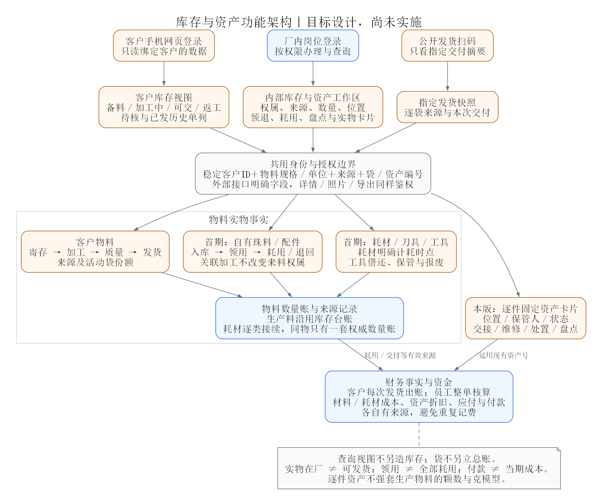
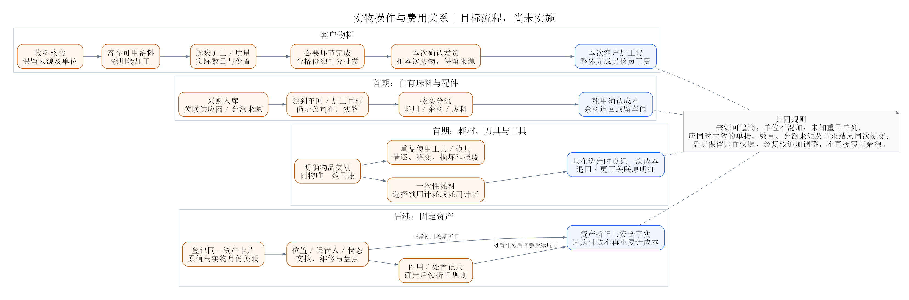

# 客户库存与本厂物料资产管理调研

日期：2026-10-30。性质：大版本设计调研与实施建议，尚未改造业务代码、迁移数据或发布。本文按现有源码调用链核对能力，不代表已完成现场库存核验。

配套入口：[全局设计与图解](./系统设计复盘与功能图解.md)、[加工与分袋方案](./工序报工与分袋交付改进方案.md)、[主线实施计划](./工序报工与分袋交付实施计划.md)、[财务设计](./加工费灵活计费与财务设计复盘.md)。实际运行状态统一见[项目核心](./00_项目核心.md)。

各专题的共用契约、整体交付先后和历史接续由[大版本整体重构方案](./大版本整体重构方案.md)统筹；本文保留库存、物料、工具与资产的具体边界及I0—I5／A1任务。

## 1. 判断与范围

**应纳入同一个大版本的整体设计，沿用现有架构分阶段实施。** 现有系统已有客户寄存、加工库存、公司料、耗材和固定资产基础，但不能据此认为已具备客户库存门户、完整物料消耗闭环或资产实物管理。

核心要分清：**归谁所有、是什么实物、在哪里和处于什么状态、何时产生费用、谁能查看。** 客户、工厂和财务可以看同一来源的不同视图，不能各自维护一套可独立修改的余额。

已确认：客户先通过**手机网页登录**，只查询其绑定客户自己的物料和加工库存；本厂首期优先管理**自有珠料、配件、耗材、刀具、工具**。客户加工费每次发货后出账；员工工费整张加工目标完成后核算；厂内加工贴纸尽量不改，单袋发货仍为40×30，汇总发货用A5。

本次新增调研范围包括客户库存读取、客户物料、公司生产物料、耗材／工具和固定资产。固定资产保留整体设计，实施优先级排在上述首期实物之后。具体品名规格、管理深度及现场职责仍待梳理。采购审批、完整供应链、法定会计与税务折旧、自动设备采集不因本次调研自动纳入开发范围。

## 2. 现有能力与真实缺口

| 领域 | 源码已有基础 | 对新要求的缺口与判断 |
|---|---|---|
| 客户寄存备料 | 多行收货、待核／确认、来源批次、部分领用、从备料建加工单、退回备料、退还客户、冻结／解冻及冲正 | 可以沿用；需与新袋及工序实际损耗接续，增加统一客户库存解释和对账 |
| 加工库存 | 母／子单、材质、仓库、状态、数量／重量及台账；已有厂内查询 | 当前页面不足以表达袋级份额，也不等于对客户开放；“非冻结可用”不能直接理解成“可发货” |
| 客户查询 | 现有稳定客户ID、客户数据范围及服务端鉴权 | 当前角色均为内部岗位，没有客户自助身份、手机客户首页和专用对外字段契约 |
| 公司生产物料 | 公司收货、批次、领用到在制、按原领用退回、用途及关联加工单 | 领用仍在厂，不是耗用；缺少实际耗用、余料、废料及生产成本接续。入库表单没有结构化采购金额／应付来源 |
| 耗材 | 档案、采购、数量金额结存、领用、供应商应付；领用按当时结存平均金额计算成本 | 是财务内的独立数量金额账，未纳入生产库存台账；没有完整仓库／来源批次／退库／盘点闭环，不能与公司料重复登记同一实物 |
| 固定资产 | 卡片编码、名称、分类、原值、残值、起始月、使用月数；按月生成折旧 | 是简化财务卡片；缺位置、保管人、使用状态、序列号、交接、维修、报废及盘点。资产登记未联动采购应付或付款 |
| 工具、模具 | 可用现有物料档案作部分基础，但未发现独立借还／保管链路 | 建议按是否重复使用区分工具和耗材，先明确现场需要，再决定逐件或按数量管理 |
| 盘点 | 已有业务单据与冲正基础 | 未见独立实盘快照、差异复核和差异调整闭环；本轮可纳入轻量盘点设计，不能用原收货冲正代替全部盘盈盘亏 |

源码还有两项实施约束：

- `MaterialStockService.processingCards`把非冻结加工余额填入`availableQuantity`，该字段并没有同时验证必要工序和质量放行。客户界面必须改用明确含义的字段，不能直接显示为“可交货”。
- `FinanceCostService`的耗材采购先保存应付，再保存采购流水；相关JDBC方法各自获取连接。耗材领用也是先汇总再保存，未接入现有`BusinessWorkUnit/WorkSession`。扩展前应补足原请求回放、同次提交和锁后限额校验；这是静态代码发现的风险，本轮未做故障注入或并发复现。

## 3. 总体功能与数据边界

| 管理对象 | 权属及计量 | 日常操作 | 财务关系 |
|---|---|---|---|
| 客户原料／配件 | 指定客户所有；按材质、规格、来源、单位分开 | 寄存、领用加工、退库、退还、冻结、核对 | 保管数量不自动成为工厂收入或采购成本 |
| 客户加工中实物／成品 | 延续原权属与来源；按加工目标及袋份额 | 报工、损耗、质量分流、返工、发货、退货复核 | 每次实际发货后可出加工费；库存状态不自动定价 |
| 公司生产材料／配件 | 公司所有；按单位、批次及适用规格 | 入库、领用、实际耗用、余料退回、废料处置 | 实际耗用与成本确认建立唯一来源；领用不自动全额计成本 |
| 消耗品 | 公司所有，通常按数量和计价单位管理 | 采购入库、领用耗用、退回／更正、盘点 | 首期可沿用“领用即计耗”的管理规则；若车间还需管理余额，应改为领用与耗用分开 |
| 可重复使用工具／模具 | 按数量或逐件身份，归属不随借用改变 | 借出、归还、移交、损坏、报废 | 领用不直接等于消耗；费用归类单独确认 |
| 固定资产 | 逐件卡片，位置、保管人、状态 | 登记、交接／调拨、维修、报废、盘点 | 原值、折旧、付款分别关联，购入、折旧、付款不重复当作同一期间成本 |

同类名称不代表同一管理方式。例如客户提供的胶水仍是客户物料，公司自有模具也不因存放在耗材柜就变成一次性耗材。档案应能明确管理类别、规格和单位；首期不建设通用分类规则引擎。

### 3.1 共同事实与专业台账

生产物料继续由`StockLedgerService`负责实物数量；袋是其来源分配明细，不另立可编辑余额。金额由财务负责，逐件资产由资产卡片及变动记录负责。统一的是身份、来源和核对规则，不能强迫机器资产使用“颗数＋克”的生产库存模型。

耗材目前另有数量账，建议分两步接续：先确定每个物品唯一的权威数量账，禁止同物双录；再逐类把需要仓库、领退及盘点的耗材接入库存领域，财务只保存金额与成本来源。未迁移的旧耗材仍按原账读取，迁移类别切换后旧写入口关闭。迁移记录结存接续和旧金额覆盖，不能把期初再当采购、应付或费用新增一次。

库存汇总可以跨页面查看，业务操作仍落到确定的权属、来源、单位和明细。客户库存、内部总览、财务报表都不能通过修改汇总数字调整实物。

### 3.2 来源、仓库和袋

保留收货单及行、备料批次、领用行、加工目标、袋及父子关系、出货明细的结构化追溯，不把所有编号塞进备注。现有`batchCode`用于备料批次，不能挪作袋号。

仓库是库存管理范围，货架／柜／盒或车间位置是实物存放信息；只有现场需要按位置交接时才增加位置字段，不把任意盒号当成新仓库。资产位置也不必与生产物料仓库一一对应。

原料主来源仍遵循单袋单材质、单要求、单来源。若使用公司提供的镶标、胶水等辅料，以“辅料投入／实际耗用明细”关联加工目标，不将公司辅料改成客户来料，不破坏主料来源。确需混合不同主料的业务先另行定规则。

## 4. 客户手机库存页

首期提供登录后的只读页面：**库存概览 → 物料／加工单 → 来源与变动详情**。页面适配手机，不要求先开发小程序。可从发货扫码页进入登录入口，但持有贴纸二维码本身不获得整个客户库存权限。

### 4.1 客户应看到什么

| 页面内容 | 显示口径 |
|---|---|
| 待核来料 | 已收到但数量／重量或资料未确认，单列；不算可领用和可发货 |
| 可用备料 | 已核实、尚未领用且未冻结的客户寄存料 |
| 加工中 | 已领到加工目标、仍在加工或后续必要环节中的份额 |
| 待质检／返工／暂缓 | 独立说明当前份额及原因，不与可交成品混在一起 |
| 可交成品 | 所有必要环节完成且质量已放行、未冻结、未出库的当前份额 |
| 已发／已退还 | 历史区间的出库记录，不计入当前在厂库存 |
| 损耗与其他处置 | 按有效记录展示数量及说明；实物报废仍留厂的份额要计入在厂，并与不可恢复损耗区分 |
| 来源和最近变动 | 收货日期、客户外部编号、材质规格、来源加工单、数量单位、最近更新时间；仅提供允许对外的照片和说明 |

冻结是当前实物中的受限份额，不能在总量中扣一次、状态统计又扣一次；“可用备料”和“可交成品”含义不同。质量、工序、交付三类状态先由内部规则计算，再映射客户可理解的展示。

数量按物料／规格／单位分别汇总，不能把颗、串、件相加。重量未知显示“未称／待复称”；只汇总已知重量时必须注明不完整，不能显示成全量总重量。未核实历史来源标明待核，不制造来源、重量或完成时间。

查询显示最近更新时间；分页、筛选、合计、详情、照片和导出必须采用同一客户授权条件。首期按需刷新即可，不承诺未经验证的实时推送或性能指标。金额及账单另按客户财务可见规则设计，库存登录不会自动开放员工工资、工厂成本、其他客户资料或全部原始附件。

### 4.2 身份与权限

建议单独提供受限客户身份：管理员核实后绑定稳定客户ID，客户页面仅开放查询。不能给外部客户借用业务管理、财务或库管账号，也不能只靠前端隐藏菜单。

首期默认一个客户账号对应一个客户主体；如实际需要同客户多人、同一集团多主体，再在已核实关系内扩展绑定，禁止按相同名称或客户输入的ID自动认领。身份验证、邀请／初始凭据交付、停用和找回方式在客户入口实施前确定。

服务端从登录身份取得客户绑定，查询参数只能缩小范围。逐条核对明细、来源单、图片及下载权限，空绑定拒绝；停用客户访问后撤销有效会话。复用现有会话安全与审计，外部账号采用独立白名单，内部`ALL`或顶岗权限不能传给客户身份。

客户自有库存应同时校验`ownerType=CUSTOMER`和`ownerCustomerId`属于登录绑定，不能只按业务关联的`customerId`筛选。公司配件即使关联了该客户的加工单，也不能显示成该客户寄存的原料；如需展示投入说明，使用单独且获准的字段，不计入客户自有库存总量。

公开发货码继续只读指定交付摘要；客户登录后读自己库存；内部登录后按岗位读加工及财务。三个入口可以同域运行，但响应字段和鉴权分别定义。对外DTO显式列字段，不直接序列化内部库存单据或财务对象。

## 5. 客户物料闭环与对账

客户来料先区分“寄存待安排”和“本次即加工”。两条入口最终都保留原收货明细，转入加工只改变存放与任务归属，不等于客户物料已离厂。

建议对每个来源、同一物料和单位按截止时点核对：

**累计有效收料＋有效客户退回入厂＝当前在厂实物＋累计有效交付／退还出厂＋已确认不可恢复损耗＋其他明确离厂处置。**

厂内领用、分袋、工序交接、冻结、退回备料都属于内部流转，不在这个等式两侧重复增加。实物尚存的报废、返工和冻结仍在“当前在厂”中；草稿和待核收货另列。撤销或退货以有效反向事实计算，不能删掉原记录。存在单位转换或一料多胚时，必须用转换记录核对，不能直接套用同数量守恒。

例：客户已核实入料1000颗，400颗仍寄存，600颗进入加工，实际不可恢复损耗10颗，产出590颗，其中300颗已发。当前在厂为400＋290＝690颗，来源核对为1000＝690＋300＋10。不能再把“累计领用600颗”加到当前在厂量里；已发300颗形成该次加工费的覆盖范围，寄存400颗不因此收加工费。

退回备料、退还客户原料、成品发货、客户成品退货分别使用对应业务单据。成品退货关联原出货和原费用范围；新返工、退款或账单调整各自确认，不能只增加库存就自动删账或重复算工资。

轻量对账应能按客户、来源、物料／单位、截止日列期初、收料、出厂、损耗、期末及未核事项。客户确认对账只是确认记录，不应触发生产、自动出库或自动生成加工费。

## 6. 公司生产物料、耗材和工具

### 6.1 公司生产物料

建议形成：**入库 → 领用到车间／加工目标 → 实际耗用、余料退回或废料处置**。关联加工单不改变公司权属；供应商应付、实际付款、材料库存金额和耗用成本各有来源。

例如领用100件辅料，其中耗用70、退回20、车间还留10，则100＝70＋20＋10。不能因领用就确认100件全部消失或全部计入客户本次发货成本。实际耗用关联哪一加工目标、能否进一步归属某次发货，应按证据保留；暂未分配的费用标记未归集，不平均塞入客户账单。

材料成本也不自动成为客户应付。公司提供配件是否另收费、计入加工单价还是列补收项目，在该次客户账单中明确，沿用灵活计费和确认规则。

公司料入库现无结构化采购计价闭环，应优先补采购来源、供应商、数量单位及金额关联；首期可直接登记实际采购入库和应付，不必引入采购申请、询价、合同、到票等完整供应链。具体计价方法在样本数据核对后选定，不能因为耗材现用平均成本，就推定所有珠料／贵重配件也适用。

### 6.2 消耗品

耗材已列为首期优先类别，胶水、砂纸、包装袋等具体品名仍需按现场清单核对。先确定按瓶／包领用即可，还是需要车间剩余量；不强制为每次涂胶称重或拍照。独立工序报工必拍照的要求，不自动扩大为每个耗材动作都必拍。

沿用领用即计耗的物品，领用后不再另报一笔相同耗用成本；实行车间余额的物品，领用只移位，实际耗用才计成本。支持退库或更正时要关联原明细，并按原费用覆盖作追加调整；采购应付或付款不能再重复计入领用成本。

### 6.3 可重复使用工具与模具

刀具、工具已列为首期优先类别。先回答“谁拿着、在哪里、能否使用、是否归还”。低价值同质工具可按数量借还；需要维修、追溯或容易遗失的工具逐件编号。刀片等一次性或磨耗后更换的物品，可按实际管理方式归耗材；可反复使用的刀具与工具保留领还关系。重复使用不代表必须折旧，实物管理类别与财务处理分别记录。

例如某种工具原有10件，借出6件后库内4、借用6；归还4件后库内8、借用2。后续损坏要从明确持有人和领用明细登记维修或报废，不能只把“借用2”直接改成零。工具数量与状态核对不等于给客户增加费用。

工具交接不作为生产主料投入，也不因借给客户加工单而转移权属。与现有设备／网关档案可以关联同一实物，但在线状态、资产状态和保管状态不相互替代。

保管和领用应关联稳定人员身份，历史同时保留当时名称；同名人员不能互相替代。日常领还尽量用“扫物品码 → 数量／领用人 → 确认”，维修、遗失、报废时再填写原因和所需证据，避免给普通领用叠加无关步骤。

## 7. 固定资产从金额卡片补到实物卡片

首期建议以每件资产为中心，补充型号／序列号、购置日期与来源、位置、保管人、使用状态、照片和备注；已有财务资产编码继续使用，不为同一台机器另建一份重复原值。

必要动作是登记、交接／位置变更、维修记录、停用／报废及盘点。记录前后值、操作人、时间和依据。借用或调拨是否需要独立流程，取决于实际发生频次；维保提醒、备件计划、联网采集可以后置。

财务继续关联原值、残值、折旧和资金事实。现有折旧按使用月数均分并在末期调整尾差，只是当前系统管理算法；不据此宣称满足全部会计和税务处理。停用／报废对后续折旧的生效月份与调整规则必须在开放这些动作前确定，已生成历史折旧不能直接覆盖。

购买设备的付款不是每月折旧；折旧不是再次付款。报废也不自动形成现金收入，处置回款及相关调整另据真实单据办理。

资产贴纸如有需要，可另建40×30模板，显示资产号、名称／简要规格与内部码；厂内加工标签保持原样。资产二维码要求内部登录，不套用客户公开发货码。是否实际贴标待实物清单确定后再排入实施。

## 8. 轻量盘点与期初接续

建议先支持选定客户／仓库／物料或资产范围的盘点：保存盘点时点账面快照，填写实际数量或逐件在场状态，复核差异，确认后生成有来源的调整记录。原账面和原业务单据保留。

盘点过程中若允许正常收发，确认差异必须核对快照后的变动；首期也可按小范围短时暂停办理。现场先选择一种明确办法，不在没有需要时建设复杂动态盘点平台。差异确认权限独立，盘点数量不能通过普通查询或收货表单直接改余额。

上线前将现有物料清单逐项归类：已在系统且来源清楚的继续接续；线下库存按实物核对后登记期初；来源、重量或金额不明的单列待核。期初库存不是新的采购、客户来料或当期成本，旧应付和已记耗用不能重复生成。

## 9. 架构与实施次序

保留模块化单体及DDD分层。`inventory`负责生产物料及逐步接入的耗材数量，`business`负责袋、工序、质量和交付，`finance`负责计价、成本、应收应付与资产财务卡片，`security`负责受限客户身份，`document/label`继续负责证据及标签。资产实物变动初期可作为清晰独立职责与现有资产卡片协作，尚无依据拆成微服务或全面重写。

| 增量 | 交付边界 | 依赖与验收重点 |
|---|---|---|
| I0 物品与口径核定 | 用实际样本确认类别、权属、来源、单位、领用／耗用规则、位置及负责人；确定客户账号绑定办法 | 可先做；产出清单和数据接续规则，不修改线上余额 |
| I1 库存事实与查询口径 | 接续袋、实际损耗、未知重量；区分可用备料、加工中和可交成品；建立来源对账查询 | 与P1—P5共用数量基础，不再做第二套余额；先使内部查询可核对 |
| I2 客户手机只读入口 | 受限客户身份、绑定、登录、库存概览／明细、允许公开证据、停用与会话撤销 | 基于I1已可信范围；客户间、明细、图片、导出均需越权验证；不依赖微信开发 |
| I3 公司料实际耗用 | 补采购计价关联、领用后余额、耗用／退回／废料、成本来源 | 依赖I0及相应库存／财务事务；不能把客户料计入公司材料成本 |
| I4 耗材接续与工具借还 | 确定唯一数量账，分批迁移耗材、保留旧金额来源；按需要增加工具借还 | 先补现有耗材同次提交、回放及并发限额；不因页面合并而双写 |
| A1 资产实物管理 | 延用资产编码，补实物信息、交接、维修与处置；接续采购付款及折旧来源 | 不依赖加工袋上线；开放处置前确定折旧规则，已记金额不重复 |
| I5 盘点、对账与试点 | 选定范围实盘、差异复核与调整、客户截止日对账、期初接续 | 基础读写规则完成后逐类启用；客户库存与内部台账按同口径核对 |

这里的顺序表达依赖，不要求P0—P9、I0—I5和A1全部完成才发布一次。首期先覆盖自有珠料、配件、耗材、刀具、工具；A1固定资产后置。可先用一个客户的一种物料贯通内部库存，再开放其只读账户；各实物类别按独立范围试点。每次切换都明确已启用类别和旧账入口，不承诺未经工作量评估的整体工期。

技术实施继续使用`BusinessWorkUnit/WorkSession`处理应一起生效的单据、数量、金额来源及命令结果；库存与金额限额在锁后重读，原请求重放返回原结果。数据库迁移递增追加，补内存与JDBC两种仓储，沿用最小充分验证，不为文档调研运行全量构建或发布。

## 10. 代表性验收场景

| 场景 | 应观察到的行为 |
|---|---|
| 客户登录及改查询参数 | 只能读取绑定客户；其他客户ID、加工单号、袋号、附件、导出均拒绝，空绑定无数据访问权 |
| 同一客户寄存转加工 | 备料减少、加工份额增加，在厂总量不凭空变化，来源可追溯 |
| 来源1000颗、出厂300、损耗10 | 在厂690颗，来源核对闭合；寄存、加工、可发和历史已发不重复汇总 |
| 半成品未冻结但未放行 | 可以显示加工中，不能显示为可交成品或允许发货 |
| 未称、混单位、报废留厂 | 未称不写成零，不同单位不相加，实物报废留厂与不可恢复损耗分别统计 |
| 公司料领用100、耗70、退20、余10 | 实物和费用分别闭合，客户物料余额不被改写，同次发货不重复归集材料成本 |
| 耗材采购或领用失败／重试／并发 | 应付、数量及费用来源按对应事务同次生效，原请求不重复，不透支 |
| 资产转交和处置 | 同一资产编码保留前后位置、保管人及历史；付款、原值和折旧不重复计费 |
| 盘点期间发生收发 | 差异按约定时点及后续变动复核，确认一次只生成一次调整 |
| 历史接续与部分启用 | 旧账、旧标签、旧应收应付可查，已迁移类别无双录，未迁移类别继续正常办理 |

## 11. 尚需现场核定的内容

客户手机网页登录，以及首期自有珠料、配件、耗材、刀具、工具的类别优先级已确定。后续局部决策为：客户初始凭据交付及找回方式、同客户是否多人访问；各类别实际品名／规格／单位清单；是否需要货架位置；耗材领用后是否继续管理车间余量；工具按数量还是逐件管理；公司料计价与成本归属；盘点组织和差异权限；资产处置影响折旧的具体规则。

这些缺口分别限制对应增量，不阻止先完成共用库存口径和已确认加工主线。完整采购审批、资产维保计划和精细成本分摊均为候选后续需求，未作为本轮已确认必做项。

## 12. 源码依据

- 现有库存页面：[InventoryTraceWorkspace.vue](../frontend/src/features/m1/InventoryTraceWorkspace.vue)、[PrepStockPanel.vue](../frontend/src/features/m1/PrepStockPanel.vue)。
- 库存操作与查询：[MaterialStockService.java](../backend/src/main/java/com/zhubao/erp/inventory/app/MaterialStockService.java)、[StockDesk.java](../backend/src/main/java/com/zhubao/erp/inventory/app/StockDesk.java)、[MaterialStockController.java](../backend/src/main/java/com/zhubao/erp/inventory/web/MaterialStockController.java)。
- 权属、维度与角色：[StockDimension.java](../backend/src/main/java/com/zhubao/erp/inventory/domain/StockDimension.java)、[OwnerType.java](../backend/src/main/java/com/zhubao/erp/inventory/domain/OwnerType.java)、[RoleCode.java](../backend/src/main/java/com/zhubao/erp/security/domain/RoleCode.java)。
- 耗材、资产和费用：[FinanceCostService.java](../backend/src/main/java/com/zhubao/erp/finance/app/FinanceCostService.java)、[FinanceCommands.java](../backend/src/main/java/com/zhubao/erp/finance/domain/FinanceCommands.java)、[FixedAsset.java](../backend/src/main/java/com/zhubao/erp/finance/domain/FixedAsset.java)、[JdbcFinanceRepository.java](../backend/src/main/java/com/zhubao/erp/finance/infra/JdbcFinanceRepository.java)。
- 财务界面与成本归集：[FinanceWorkspace.vue](../frontend/src/features/m1/FinanceWorkspace.vue)、[FinanceDashboardService.java](../backend/src/main/java/com/zhubao/erp/finance/app/FinanceDashboardService.java)；现有表结构：[V36](../backend/src/main/resources/db/mysql/V36__m3_finance_operations.sql)。
- 旧库存专题仍解释已实施规则：[库存管理与母单加工要求模板改造方案](./库存管理与母单加工要求模板改造方案.md)。本次扩展不把其中原先排除的范围写成已实现能力。
