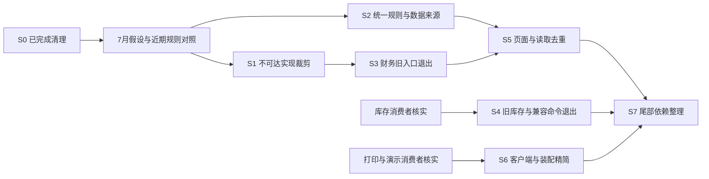

# 系统级代码瘦身方案

**方案日期：2026-10-27。目标：优先减少不必要的生产代码、重复业务入口和规则维护点。**

本方案汇总本轮全仓盘点、功能与代码量评估、依赖调查、财务迁移复核和首批清理结果。它用于安排后续增量，不代表所列候选已经获得删除条件或已经实施。最新进度、阻断和验证事实统一维护在[项目核心](./00_项目核心.md)。

## 1. 总体判断与目标

系统围绕来料加工，必要复杂度来自库存、金额、权限、追溯、持久化和现场交付；目前的臃肿主要来自新旧入口并存、已经停用却未裁剪的实现、前后端各维护规则、样例进入生产模块，以及多处重复组装业务状态。

后续以**删除没有必要继续维护的实现**为主。保留现有模块化单体与 DDD 四层，不借瘦身引入微服务、通用工作流平台、插件框架或另一套财务／库存模型。拆小文件只有在消除重复职责、减少实际维护点时才安排；单纯搬文件不算代码减少。

目标保持以下结果：

- 来料、母单／拆单、工序进度、分批交工、质检／返工／放行、发货／售后仍可贯通。
- 一个业务事实有明确来源，同一规则不再由多个页面或前后端分别决定。
- 新业务命令走现行授权、工作单元和原请求回放；旧实现退出后不留下可重新提前计费或绕过库存单据的备用路径。
- 原 17 页对应的业务能力及必要依赖保留。归并重复外壳时逐项接续岗位动作和授权入口，不能按目录名或无菜单直接删功能。
- 改动可量化：生产源码净减、全部源码净减、退出的写入口与重复规则数分别记录。
- **重点排查 2026 年 7 月业务理解尚未成熟时形成的实现与假设，近期已确认的业务规则作为保留基准。** 逐方法区分早期片段和后续修正；不能按文件最初日期整文件删除，也不能为复用旧实现把现行业务退回早期原型。

## 2. 调研材料与最新事实校正

### 2.1 证据入口

| 材料 | 本方案采用的结论 |
|---|---|
| [全仓功能与依赖评估](./archive/2026-10-27-code-review/现行代码功能与依赖评估.md) | 功能全景、16 个领域、页面到服务关系、运行保障及候选退出范围；属于调查时点快照 |
| [逐文件源码索引](./archive/2026-10-27-code-review/逐文件源码索引.csv) | 文件、符号、引用、条件装配和字节摘要，供定位候选；删除前重新核实当前消费者 |
| [源码直接依赖](./archive/2026-10-27-code-review/源码直接依赖.csv)、[领域依赖](./archive/2026-10-27-code-review/后端领域依赖.csv)、[接口索引](./archive/2026-10-27-code-review/后端接口索引.csv) | 显式／词法关系和控制器证据；不能替代 Spring、脚本和外部客户端核验 |
| [交货后工费与收付款方案](./交货后工费结单与收付款改造方案.md)第 9、11—14 节 | 旧计费应退出的业务边界、事务保护、历史接续及现有迁移责任；不另建第二套实施路线 |
| [库存与要求模板方案](./库存管理与母单加工要求模板改造方案.md)、[跨材质契约](./A5_跨材质子单契约.md) | 公司料／寄存／加工库存、来源行和数量单位不能因精简混为一谈 |
| [权限方案](./角色权限与数据范围改造方案.md)、[安卓与打印方案](./安卓APP与集中打印开发文档.md) | 客户与组织范围、有效权限、共用面板、设备和打印客户端边界 |
| 当前源码与提交 `fd1e250`、`37a7f10`、`58b806a`、`4bc102b`、`31a5daa` | 结单基础、确认入账、旧写拒绝、收款余额复核和 V79 策略迁移已经有实现；不能继续沿用旧快照的“尚无代码”判断 |
| 首批清理 `9ac96eb` | 已删除无消费者前端封装、废弃评审矩阵并精简样例；下一轮不重复计算成果 |

材料有差异时，按当前源码、对应提交及实际验证事实解释；目标方案文字不能覆盖已实现事实，历史调查也不能重新成为执行指令。

### 2.2 必须更正的旧结论

| 早期调查结论 | 当前复核事实 | 对瘦身顺序的影响 |
|---|---|---|
| 交货后结单只有方案／D1 | 已有 `OrderDeliveryCompletionQuery`、`OrderSettlementService` 和两种结单仓储；确认可同次写应收、逐单工资和员工应付 | 接续现有实现，不重复建模；结单办理页和历史接续等未完成项仍按核心推进 |
| 旧提前计费仍可执行 | 旧协议写入、账单生成、工资重算／整月确认及改单直接记账已拒绝；`OrderChangeService` 不再调用旧 posting 入账 | 已不可达的内部算法可以先裁剪，不必等全部结单界面完成；混合服务和旧地址拒绝壳分别处理 |
| 收款仅有幂等、没有写事务内余额复核 | `4bc102b` 已补事务内复核与原请求先回放 | 不重复修复；裁剪时保留这些保护。已有预收后续核销及真实 MySQL 验证不因此自动完成 |
| 数据库源码仅到 V77／V78 草稿 | 当前迁移源码已到 V79，V79 用于启用结单策略 | 源码、目标库执行和服务器发布分别记录；测试服最近留档仍是 V77，不能直接写成已部署 V79 |
| 运维／附件样例、导入评审矩阵仍待清理 | 首批已清理，生产目录减少 968 行，本增量含测试净减 1,036 行 | 作为已完成基线；保留必要类型和最小测试数据，不再以搬动同一数据重复报减量 |

“接口已停用”“内部旧代码已删除”“客户端已迁移”“历史可读”“目标环境验收”是不同状态，不能用其中一项代替其余事项。

### 2.3 重点复核 7 月早期实现，保护近期已确认逻辑

用户明确说明：7 月对业务尚不熟悉，近期业务逻辑已经确认。后续先检查早期自行假设出来的流程、角色、收费、状态和硬件能力，以近期确认的实际业务检验它们，不让早期文档或旧测试反过来决定现行业务。

已按 Git 历史作来源复核：基准为 `21d483e`，HEAD 可达历史中有 **149 个 7 月提交，集中于 7 月 6—9 日，含合并提交**。受检的 884 个现存代码路径中，325 个当前路径首次在 7 月加入；范围包含前端及其测试、后端生产 Java、客户端与运维代码，不能将这个数字解释为全仓过时代码数量。

另对 15 个候选／保护样本执行逐行 `git blame`，结果见[早期代码来源复核](./archive/2026-10-27-july-review/早期代码来源复核.csv)。Git 作者日期和标准逐行归因只说明来源：未逐一追踪跨文件复制，外层规则也可能已改变旧行的含义；以下行数均不等于可删除行数。

| 重点对象 | 7 月归因行／当前样本行 | 审查目标与近期保护边界 |
|---|---:|---|
| `HardwareIntegrationService` | 209／209 | 优先核对固定设备、任务和健康度假设；真实网关与 POC 证据保留 |
| `registerImportTemplates.ts` | 468／468 | 优先核对本地模板和映射规则；保留实际 API 契约类型，规则切换到后端后再删重复实现 |
| `SampleLibraryWorkspace` | 1,020／1,171 | 核对早期评审外壳和本地计划；保护后续批次修正、后端计划执行限制和原请求恢复 |
| `RegisterImportPostingExecutionService` | 388／445 | 核对早期入账与主数据假设；保护近期真实账号、岗位校验、逐行状态和请求回放 |
| `OperationsCenterService` | 1,537／1,920 | 核对早期展示及固定健康语义；有效探活、成套备份与恢复证据不因年代删除 |
| `BusinessOperationService` | 824／1,169 | 审查通用命令和缺会话旧路径；近期来源行、母单锁、发货退回保护和实物损耗语义保留 |
| `AuthUserAccountManagementService` | 1,051／1,390 | 核对早期角色／前置审批假设及无消费者分支；近期客户组织范围、顶岗、工种、审计和会话撤销保留 |
| `StockLedgerService` | 57／148 | 属于仍必要的早期内核，默认保留；台账正确性与事务保护按现行契约验证 |
| `App.vue` | 73／532 | 虽首次建于 7 月，大部分当前行来自 10 月；保护近期导航、共享动作、有效权限与账号切换清理 |
| `ProductionPanel`、`OrderWorkspace`、`MotherOrderSplitService`、`QualityRequirementService` | 本次样本均无 7 月归因行 | 作为近期业务保留基准，不能为了适配早期原型删掉分批交工、来源分配、逐条质检、返工或放行规则 |

还需区分“编写月份”和“业务假设是否仍有效”：`FinanceBillingService/FinancePayrollService` 当前路径首次加入于 **10 月 10 日**，本次归因也均在 10 月，不能称作 7 月源码。其旧计价／工资重算已被近期明确的交货后定费规则替代，所以仍列为可裁剪对象；近期确认的结单、收款余额锁和历史账务接续继续保留。

**判定顺序：近期已确认的业务要求 → 现行单据与账务事实／实际调用 → 早期假设的适用性 → 删除或接续方式。** 旧测试和早期设计只能提供历史证据，不作为推翻近期规则的理由；近期逻辑的技术问题按已确认规则定向修复，不借瘦身重新定义业务。

每个早期候选补充四项记录：首次来源及逐行／方法范围、当时的业务假设、与近期规则的具体差异、当前消费者与接续方。结论归为“不符合现行业务”“已被替代”“仍必要”“待业务确认”；只有满足相应消费者和数据条件的部分才进入删除增量。

## 3. 度量方式与完成标准

历史全仓快照覆盖 1,132 个文本文件、154,627 行，含测试、配置、迁移及客户端。前后端生产源码当时约 9.4 万行，前端包含样式；测试约 5 万行。因此代码与功能量的判断是：**必要底座基本匹配，重复和过渡实现偏多**，不能把所有文件都当作业务冗余。

该快照之后有结单开发和首批清理并行进行，不能直接用历史总量减去 1,036 宣称当前全仓绝对规模。每次只核算自己的增量，执行下一批前重新记录涉及目录和文件字节。

| 指标 | 记录口径 | 通过标准 |
|---|---|---|
| 生产源码净减少 | 本增量生产文件删除行数减新增行数，测试数据和工具另列 | 纯清理增量应净减；必要接续代码单独解释，不能长期净增却称瘦身 |
| 全部源码净减少 | 同时计入新测试工具、夹具与替代实现 | 移到测试目录只计生产隔离，不计同等行数的全仓削减 |
| 活动实现数量 | 旧业务写入口、规则来源、查询状态计算、页面动作容器分别计数 | 被替代的实现退出实际调用与装配，不能只隐藏按钮 |
| 依赖变化 | 移除的 Bean 注入、导出、专属类型、配置分支和脚本调用 | 不遗留失效导入、空服务、空 DTO 或无实际作用的适配层 |
| 功能与数据 | 本次影响的岗位、范围、库存／金额及历史读取 | 实际能力等价，原账与原始证据保留，失败／回放语义不变 |

不设缺乏证据的“全仓必须删 20%”目标。每批在删除清单明确后给出可核验减量，合并提交后累计。压缩排版、删必要中文说明、删除仍有效的测试、迁入归档或缩短标识符均不作为业务瘦身成果。

## 4. 系统级分类与删除清单

### 4.1 第一类：确认无消费者后可直接裁剪

| 编号 | 对象与位置 | 删除范围／保留范围 | 退出条件 |
|---|---|---|---|
| A1 | `FinanceBillingService` 的旧 `run/billMother/billProcess` 及专属助手 | 删除已被拒绝入口隔断的旧算法；保留客户账、收款、红字、余额、客户名称与历史协议读取 | 核对类内调用闭包和反射／测试；不因 helper 同名就误删现行账务所用方法 |
| A2 | `FinancePayrollService` 的旧 `build/withAdjustments`、自动工价／损耗扣薪等助手 | 删除交工重算链；保留工资行、旧月确认解释和新工资报表口径 | 证明助手不再供现行读写使用；`findPayrollRun` 与历史成本读取不随旧生成器删除 |
| A3 | `OrderChangePostingService` 及 `OrderChangeService` 的闲置 posting 字段／注入 | 当前旧服务只拒绝写入，且无生产 `posting.post` 调用；检查后移除空服务和专属依赖 | 同次调整构造器、Spring 装配和相关测试；旧 HTTP 拒绝路径仍需存在时移到最小边界壳，不保留整套 posting 装配 |
| A4 | 前端剩余无调用 API 包装、专属类型及无效导出 | 逐项删除，没有生产调用的封装不为假设中的未来页面长期保留 | 检查动态导入、同文件使用、测试、脚本和其他实际客户端；不能将 mapper 的类内使用漏算 |
| A5 | 余留评审文案、死分支和仅为不存在能力准备的字段 | 删除失效实现和占位状态；测试只保留必要输入 | 当前范围确实无消费者；有效迁移、演示开关、历史反序列化和真实硬件兜底不属于此类 |

首批已完成的 8 个账号客户端封装和导入评审矩阵不再列为待删。`scanContextFixture.ts` 的纯位置迁移没有净减收益，本轮已撤回，不再作为优先任务。

已明确用于 B1 接续的 `fetchRegisterImportWorkspace` 先保留，随消费者切换实际启用；不能在 S1 因暂时未调用删掉，随后又为同一计划重新添加。

### 4.2 第二类：先让消费者使用唯一来源，再删除重复实现

| 编号 | 重复对象 | 唯一接续方向 | 必须保留的能力 |
|---|---|---|---|
| B1 | `SampleLibraryWorkspace.vue` 与 `registerImportTemplates.ts` 的本地模板、汇总、规则及映射计划生成 | 用现有 `registerImportApi.fetchRegisterImportWorkspace` 和后端计划服务；删除本地计划构建与专用推导代码 | 上传预检、字段显示、批次复核、修正、问题导出、显式入账和逐行恢复 |
| B2 | `HardwareIntegrationService.devices/tasks`、设备页和运维页中的固定健康数据 | 真实网关、明确配置和人工 POC 各自注明来源；未知状态直接显示未采集 | 设备读数、密钥管理、POC 证据和人工兜底；不为替换样例额外引入厂商 SDK |
| B3 | `FinanceWorkspace`、`financeApi`、改单／损耗表单残留的旧定价字段、状态和按钮 | 使用现行结单与原账查询，业务改单只处理要求、路线和交期 | 客户账、收付款、工资汇总、耗材、外协、资产、折旧、损耗事实和审批 |
| B4 | 原来料／生产／进度／质量外壳与订单中心重复的列表、详情和提交入口 | 订单中心及 `OrderActionHost` 共用面板承接；原授权编码与岗位能力继续有效 | 收货／拆单、设备产量绑定、损耗申请、进度与交工区别、扫码和深链 |
| B5 | `MobileOpsWorkspace/MobileOrderDetail` 与统一订单详情重复的读取、动作和权限计算 | 共用详情、共用动作、同一有效权限；归并组件不另建手机后端 | 相机／扫码、岗位动作、手输入兜底、返回路径、草稿和结果未知恢复 |
| B6 | `OrderWorkspaceQueryService/ProgressBoardService/FormalBusinessWorkspaceQuery/ScanContextService` 重复状态解释 | 保留场景不同的响应，用少量稳定的事实／状态计算统一口径 | 客户／本人／班组／部门范围、历史库存事实、进度、质量和交货状态 |

登记导入当前已有“仅后端计划可执行”的保护，本地计划不是已发现的后端绕过漏洞。B1 的目的在于删除第二套规则和失败回退维护成本；后端读取失败时保留批次与重试状态即可，不继续本地计算一份可疑计划。

### 4.3 第三类：核实外部消费者后才能退出

| 编号 | 候选 | 已知消费者／风险 | 删除前需补的证据 |
|---|---|---|---|
| C1 | `PrepStockController/PrepStockService`、`/api/inventory/prep-stock/*` | 新页面走 `/material-stock/*`，旧接口仍有 Bean、权限与测试；可能存在外部调用和旧批次 | 旧 API 实际调用、旧批次的来源／单位／单据接续、内存与 JDBC 同义；替代路径实际可用后才移除 |
| C2 | `/api/inventory/ledger/transfers` 对外通用写入口 | 管理员接口和部分测试造数仍使用；业务内核广泛依赖台账服务 | 管理员／脚本真实用途、测试造数接替；可移除 HTTP 暴露，不得删除 `StockLedgerService` 内核 |
| C3 | 业务命令无请求号／无会话的兼容重载 | 导入、测试和内部调用路径不同，不能据 HTTP 新路径推断全部无用 | 生产消费者全部迁到同一工作会话，兼容构造器与必要测试接续；不能用“外层有事务”代替连接核实 |
| C4 | Java 打印程序、旧 v1 打印协议和相关仓储方法 | 当前发放 C# EXE，但 Java 源码／测试及旧维护能力仍存在 | 厂内程序版本、队列、重试、历史任务和脚本消费清单；有实际用户则保留并明确维护边界 |
| C5 | DEMO 仓储、seed 装配与演示过滤 | 有显式开关、构造器依赖和测试；默认 LIVE 不等于演示功能无用 | 是否继续提供演示、装配是否需调整；不动已发布 seed SQL 和历史表 |
| C6 | `biz_mother_order_item/biz_outbound_order_item` 旧明细双写 | A3 的仓外消费者仍未核实 | 外部报表、导出、脚本和样本核对；证据齐全前维持双写，源码裁剪不删表 |

这些候选不应阻塞 A 类或其他独立任务。外部证据缺失时保留对应候选并说明具体缺什么，不把“可能有人使用”无限扩大到所有清理。

### 4.4 第四类：明确保留

收货来源行与拆单分配、母子单身份、工序批次／正式交工、称重、质量轮次、返工、发货退货、库存余额／流水、原应收／红字／工资／应付／收付款、权限与客户组织范围、工作单元与请求回放、附件原件及授权、标签版本／实例／核纸、PWA／安卓、升级／备份恢复均为保留项。

低频能力不等于无用。`m1`、`sample`、`ops` 等名字不能作为删除依据；`machine` 被生产和导入消费，`register` 是实际 Excel 入账链路，`ops` 是升级工具，均不能整模块按旧名拔除。

## 5. 分阶段执行方案

| 阶段 | 边界与默认顺序 | 具体交付 | 关闭条件 |
|---|---|---|---|
| S0：已完成 | `9ac96eb` 的前端无消费者清理 | 生产目录减 968 行，本增量含测试净减 1,036 行；必要夹具隔离 | 已有 42 项直接相关测试及类型检查结果，计入已完成，不重做 |
| S1：先裁剪不可达代码 | A1—A5，按第 2.3 节优先检查 7 月遗留；已确定弃用的财务内部算法／闲置 posting 可独立切片处理 | 每个增量删一条独立实现及其专属依赖，保留混合服务有效部分 | 实际净减，相关读写与装配正常；旧地址仍不得写钱 |
| S2：消除重复规则和固定样例 | B1、B2 为本轮 7 月重点，分别实施 | 导入改用后端元数据和计划；设备与运维删固定健康任务／虚假实时展示 | 不再维护本地映射生成器；缺数明确、失败可重试，真实 POC／读数仍可用 |
| S3：裁剪财务旧入口与专属类型 | B3，接续现有结单迁移 | 去掉旧前端价目／重算／改单定价状态，裁剪混合服务旧仓储写方法与专属请求 | 客户账、历史工资成本、收付款、物理损耗和业务审核仍正确；直接接口也不能提前记钱 |
| S4：收口旧库存和兼容命令 | C1—C3，逐条取得消费者证据后处理 | 当前页面、导入、脚本和测试接替；旧 HTTP 写和独立连接路径退出 | 不丢旧批次／单位／来源，同请求回放、越权、回滚及并发限额通过 |
| S5：页面与读取去重 | B4—B6，先迁专属能力，再裁剪重复外壳 | 共用动作与详情；删重复列表／状态计算／旧布局，按实际影响下推查询条件 | 原 17 页能力对照无缺口，跨端动作和授权一致；页内分页不冒充数据库分页 |
| S6：按现场证据精简打印与演示 | C4、C5；C6 取得证据后另增量 | 少维护一套程序／协议或演示装配；保留恢复路径和原数据 | 现场消费者已接替；不得以 SPOOLED 代验出纸；旧明细无证据继续双写 |
| S7：清理尾部依赖、样式、测试和文档 | 随 S1—S6 清理，最后检查一次整体残留 | 移除专属依赖、失效配置／选择器、旧假数据与无意义空壳；历史调查留档 | 没有孤立引用，增量统计真实，必要测试和部署文件保留 |

阶段编号表示依赖类别，不要求先清完所有近期文件再检查 7 月实现。7 月仍有消费者的疑点可以优先按 S2 做最小接续与删除；无消费者片段按 S1 直接裁剪。S1 的财务死代码不以新结单页面完成为前置。S3 涉及用户实际操作能力时，才要求对应结单和历史读取有接续；不以瘦身为名另外开发一套结单。S4、S6 的外部证据可同步核实，不强制等待整个系统其他阶段完成。

默认主智能体串行推进每个相关增量。文件多不自动派子智能体；如确需独立委派，按 AGENTS 限定范围和人数。Git 操作、同一文件编辑及有依赖的验证始终串行。

## 6. 页面归并必须完成的能力对照

| 候选外壳 | 已有共同承接点 | 必须先接续的独有内容 |
|---|---|---|
| `InboundWorkspace` | `IntakePanel`、订单中心、母单动作 | 待核／稍后拆、拆单来源分配、收货附件、入库动作和完成后跳转 |
| `ProductionWorkspace/ProgressWorkspace` | `ProductionActionPane/ProductionPanel/ProcessProgressPanel` | 设备产量与绑定建议；岗位、五档进度、交工与最终重量分别处理 |
| `QualityWorkspace` | `QualityActionPane/QualityPanel` | 物理损耗申请、责任与审批；不能把损耗事实随旧工资试算删除 |
| `MobileOpsWorkspace/MobileOrderDetail` | 统一详情、`OrderActionHost` 和共用面板 | 相机、手输、连续扫码、岗位默认动作、返回、草稿、原请求及账号切换清理 |
| `InventoryTraceWorkspace` | 新库存单据面板、发货／售后共用面板 | 公司料／寄存／加工库存、旧批次、流水前后余额、退货与售后 |

删除外壳前，逐一核对 `App.vue.workspaceLoaders`、`navigateTab/activateTab`、注入打开页、工作台快捷操作、客户页跳转、扫码深链和菜单权限。导航、同权限下的可达能力和服务端范围判断必须一起核实。

页面数和文件数减少可以作为结果，但减少菜单或折叠按钮本身不算代码瘦身完成。

## 7. 依赖保护与架构约束

### 7.1 必须共同保留的边界

- 业务命令 → `BusinessWorkUnit/WorkSession` → 业务单据／库存／财务／请求结果；工作会话内读取与写入必须使用同一连接，保留锁后重读和版本判断。
- `business ↔ inventory/finance/approval/label/scan/security` 是实际业务协作。删除某个场景的实现前确认它是否仍用于维护、历史读取、标签校验或范围授权；源码导入环不等于需要拆微服务。
- 内存默认与 JDBC 可切换是既定运行要求。两种仓储可用共享契约测试减少重复测试组织，但不通过删除内存实现实现瘦身。
- 客户稳定 ID、本人／班组／部门范围、顶岗和工种授权是共享规则；不能用页面角色判断替换服务端有效权限，空范围不得扩大可见性。
- 附件上传、数据库引用、打印队列、设备读数消费和导入逐行入账涉及多步骤副作用，保留可恢复状态。削减重复状态前先说明成功、失败和未知结果如何接续。

### 7.2 裁剪配置前的装配检查

| 配置 | 实际关联 | 瘦身要求 |
|---|---|---|
| `business.repository` | 演示快照仓储 | 与正式单据分开，不能误认为正式业务落库开关 |
| `business-document.repository` | 正式单据、要求、改单、进度、轻任务、待核和部分标签存储版本 | 退出一个消费者不等于可删整组仓储 |
| `finance.repository` | 财务与结单两种仓储 | 保留结单和原账同事务能力及不支持组合的拒绝 |
| `command-request.repository` | 工作单元及原请求仓储 | 不将内存撤销当作 JDBC 独立提交的事务保障 |
| `label-template.repository` | 模板、打印任务、工位／队列和追溯 | 名称虽叫模板，不能只留下模板而删任务依赖 |
| `auth.users.repository` | 账号与登录会话 | 删除辅助界面或客户端封装不影响会话落库、撤销和审计 |
| 审批、文档独立开关及 Compose 覆盖 | 部分 MySQL profile 默认仍可为 memory | 检查实际部署覆盖，不假定只开 profile 就全部持久化 |

兼容构造器遵循项目约定；只在相关能力真实退出时删除其专属重载与测试装配，不批量删除所有兼容构造器。

### 7.3 依赖、样式与测试工具

第三方依赖须核对真实用途和构建入口：相机扫码兜底、拼音、二维码、Excel 解析和打印渲染都有当前消费者，不能因某个旧页面退出而整项卸载。构建依赖与生产依赖的位置调整不是业务代码减少，只有确定不用的包才删除，并在实际影响构建时执行对应检查。

CSS 删除须核对 Vue 动态 class、响应式布局、打印样式和 PWA／安卓场景，不能只凭静态搜索不到选择器判死。当前共享工作区已有样式与表单改动，本方案不顺带覆盖。仅测试消费的帮助函数可保留原位置；没有实际净减或依赖收益时，不为目录整齐批量迁移和改写导入。

## 8. 验证与已知基线

方案本身只做文档差异、源码引用、链接和结构检查，不跑业务测试、构建、打包或数据库操作。实施时按以下最小充分范围选择，遵循 AGENTS，不恢复“每批全仓全绿”的默认门禁。

| 改动 | 必要验证 |
|---|---|
| 未调用的客户端封装／类型／样例 | 消费者复查、相关 API 或组件测试；共享类型变化时做前端类型检查 |
| 已不可达的财务助手／空 posting 装配 | 相关服务／装配、旧写拒绝、现行结单与历史读取；必要时后端编译；不联跑无关前端 |
| 导入统一元数据与计划 | 上传、确认、后端计划失败、字段修正、显式入账、逐行恢复及原请求；相关页面测试 |
| 库存入口／会话兼容路径 | 正常、越权、重复、失败回滚、并发不透支；按实际涉及的 JDBC 锁行为选择目标数据库验证 |
| 页面／读取合并 | 原能力对照、岗位范围、深链、扫码、草稿和结果未知恢复；去重计算与权限筛选一致 |
| 打印程序／协议／构建依赖 | 相关路由、快照与客户端测试；实际改变打包或交付时才跑相应包门禁，现场出纸另验 |
| SQL／升级装配 | 只追加迁移，核仓储和升级探针；无关业务清理不启动数据库演练 |

首批清理已有 42 项直接相关测试与类型检查通过。扩大检查另复现 6 项旧失败：`BusinessWorkspaces.test.ts` 两项、`LabelWorkspace.test.ts` 一项、`scanTargetGuard.test.ts` 三项，涉及旧文案／控件、标签选项和 mock。撤回扫码工具移动后，相关测试和工具与基线无内容差异，失败仍存在。

这些失败单独列为基线，不宣称全仓通过；也不为了瘦身删掉失败用例。如果后续 S5 真实退出原外壳，先用现行共用面板覆盖同一业务场景，再移除仅对应已删除实现的重复测试。

## 9. 每个删除增量的执行与交付要求

每个增量只需一份简洁的删除记录，不再新增大型调查文档，至少明确：

1. 删除对象：具体文件、方法、导出或配置分支；不能只写“清理旧代码”。
2. 消费者证据：生产调用、类型、测试、脚本、条件装配、动态入口及必要外部客户端分别核对。
3. 接续与保留：替代方、历史读取、权限、事务、原请求、附件和打印依赖；不需要替代的死代码明确说明原因。
4. 删除结果：实际退出的实现、剩余最小拒绝壳、未关闭候选及其缺失证据。
5. 验证与统计：实际运行结果和基线差异；生产、测试与全仓净变化分列，排除并行工作与仅移动文件。
6. 恢复方式：对应语义化提交；独立源码确需归档时保留原路径索引并退出构建／扫描，不把归档误计为全仓删除。

数据库表、原账、原件及已发布迁移不随源码清理删除。新增结单或收付款事实之后，回退也不得重新开放旧提前记钱路径；必要时回退到兼容读取与停写版本，不能用旧备份覆盖新款项。

共享工作区中的业务、样式和测试改动不得混入清理提交；核心文档有并行更新时只提交本增量记录，不能覆盖他人状态。每批选定验证通过且相关失败已解释后独立提交。推送、打包、部署与现场验收按实际任务范围安排，不随源码清理自动触发。

## 10. 推荐从哪里继续

**下一批重点转为 7 月早期业务假设：先审固定设备／健康任务和本地导入规则，再审早期通用业务命令、运维展示及权限占位分支。** 无消费者片段直接裁剪，仍在使用但与现行业务不符的部分先按现行规则最小接续，再删除旧实现。近期已经确认的业务不为此退回或重写。

已确定弃用的旧财务内部算法和闲置 posting 仍是独立 S1 候选；按具体增量穿插处理，不再将其固定排在所有 7 月问题之前。随后接续财务旧客户端入口退出。库存、打印及明细双写先收集消费者证据；页面归并先完成独有能力对照。查询性能改造、巨型文件拆分只有在消除重复或有实际规模需求时实施，不把它们放在“先做减法”之前。

尚待核实的系统级事项集中为：旧库存 API 的实际外部使用；Java／旧协议打印客户端；原页面的设备产量、损耗与手机兜底接续；A3 仓外明细读取；DEMO 是否继续提供。当前不具备这些证据只保留相应候选，不阻塞已具备条件的删除任务。

本方案不新增业务需求。财务结单、后续核销和历史待核的功能交付仍按现有财务方案与核心推进，瘦身只处理其已被替代的实现和维护负担。

## 11. 文档维护与本轮交付

- 项目核心维护最新状态、未关闭事项和实际验证；本方案维护目标、分类、依赖与顺序，不复制各阶段流水。
- 旧全仓评估及 CSV 留作可追溯快照，不逐提交重刷或当作当前无消费者证明；实施前定向复核必要源码。
- 本次补充 Git 时序与 15 个逐行来源样本，明确 7 月重点和近期规则保护边界；来源统计不当作过时代码或可删行数。
- 接口、规则或部署真正变化时才更新对应专题；README 仅在启动／导航变化时调整，旧归档入口不恢复为现行执行计划。
- 本轮仅整合方案和核心导航，未执行 S1—S7、修改业务代码、运行测试或部署；文档检查结果在交付时记录。
