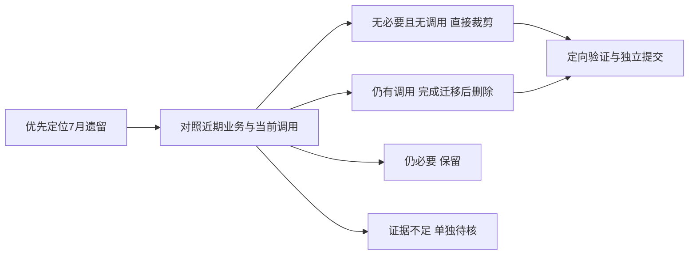

# 系统级代码瘦身方案

**整理日期：2026-10-27。目标：减少不必要的代码、重复入口和规则维护点。**

本方案汇总全仓功能与依赖调查、7 月代码来源复核、财务迁移检查和首批清理结果。执行顺序见第 3 节，具体删除对象见第 4 节；最新进度和未关闭事项以[项目核心](./00_项目核心.md)为准。

## 1. 目标与保留边界

**优先排查 7 月业务理解尚未成熟时形成的假设，以近期已确认的业务规则为保留基准。** 按方法和调用链区分早期实现与后续修正，逐项判断必要性。代码日期用于定位问题，实际业务和当前调用决定如何处理。

本次瘦身围绕四类负担展开：新旧入口并存、停用后残留的实现、重复维护的业务规则，以及进入生产模块的样例和占位代码。保留现有模块化单体与 DDD 四层，优先删除无必要实现；不为瘦身引入微服务、通用工作流、插件框架或另一套财务／库存模型。文件拆分和目录迁移按实际去重收益安排。

必须保持的业务与运行能力：

- 收货、母单／拆单、来源分配、五档进度、分批交工、称重、质检／返工／放行、发货和售后。
- 库存余额与流水、原应收／红字／工资／应付／收付款，以及历史成本和来源追溯。
- 登录会话、客户与组织范围、顶岗与工种授权、工作单元、锁定读取、版本校验和原请求回放。
- 附件原件与授权、标签版本／实例／核纸、PWA／安卓、升级、备份与恢复。

原 17 页对应的业务能力和授权入口继续保留。重复页面可以在能力完整迁移后合并；低频、旧目录名或无菜单都不能单独作为删除依据。

## 2. 当前基准与判定方法

### 2.1 已完成与已有实现

| 事项 | 已核实状态 | 后续处理 |
|---|---|---|
| 首批清理 `9ac96eb` | 删除 8 个无页面调用的账号客户端封装、废弃导入评审矩阵并精简样例；生产目录减少 968 行，本增量含测试净减 1,036 行 | 计入已完成，不重复安排或累计 |
| 交货后结单 | 已有交货完成判定、结单服务和两种仓储，确认可同次写应收、逐单工资及员工应付 | 使用现有实现；办理页面、历史接续等剩余事项按核心推进 |
| 旧提前计费 | 协议写入、账单生成、工资重算／整月确认及改单直接记账已拒绝 | 已不可达的内部算法可独立裁剪；客户端迁移和旧地址拒绝壳另行核对 |
| 收款保护 | 已补事务内余额复核及原请求先回放 | 保留保护，不重复修复；已有预收后续核销和真实 MySQL 验证仍按实际状态记录 |
| 数据库版本 | 迁移源码已到 V79，V79 用于启用结单；测试服最近留档仍是 V77 | 分别记录源码、目标库执行和服务器发布，不将源码版本视为已部署版本 |

“接口停用、旧实现删除、客户端迁移、历史可读、目标环境验收”分别记录。已有某一项结果，不代表其余事项已经完成。

### 2.2 每个候选如何判断

先对照近期已确认的业务，再检查现行单据、账务事实与实际调用，最后决定删除或迁移方式。旧设计和旧测试用于追溯，不用于推翻近期规则；近期实现的技术问题按已确认规则定向修复。

每个候选记录：**代码来源、早期假设、与当前规则的差异、当前调用方、替代方和处理结论**。业务结论分为：不符合现行业务、已被替代、仍必要、待确认。再按第 4 节选择直接裁剪、迁移后删除、核实后退出或保留。

调用检查覆盖页面、服务、类型、测试、脚本、Spring 条件装配、动态入口和必要的外部客户端。单次静态搜索未找到引用，只能产生调查候选。

## 3. 执行顺序

已完成的首批清理单独计入基准，后续按下列七个阶段安排。编号表示默认推进顺序；明确无调用的片段可随相关任务先删，外部证据不足的候选单独保留，不阻塞其他阶段。

| 顺序 | 重点与对应清单 | 主要动作 | 完成条件 |
|---|---|---|---|
| 1. 设备与运维的早期假设 | 7 月固定设备、任务和健康状态，B2、A5 | 区分真实网关、配置和人工 POC；迁移页面显示后删除固定健康任务与虚假实时状态 | 缺数显示未采集；有效探活、POC 证据、读数及人工兜底保留 |
| 2. 登记导入的重复规则 | 7 月本地模板、汇总和计划生成，B1 | 使用现有后端元数据及计划接口，删除前端第二套规则 | 上传、复核、修正、问题导出、显式入账和逐行恢复正常；失败保留批次并可重试 |
| 3. 旧命令与已停用财务实现 | 早期通用命令／权限占位、无调用声明，A1—A5、B3、C3 | 先裁剪无调用算法、闲置 posting 注入和专属类型；仍被调用的旧入口完成迁移后退出 | 近期事务、权限、收款保护和业务审核保留，旧地址继续拒绝提前记钱 |
| 4. 页面与查询去重 | 原工作台、手机入口和重复状态计算，B4—B6 | 先迁移独有能力，再合并重复列表、详情、动作和读取规则 | 原 17 页能力对照无缺口，跨端授权、扫码、草稿和请求恢复一致 |
| 5. 旧库存入口收口 | 旧备料、通用转移及相关兼容路径，C1—C3 | 核实实际用途，迁移页面、脚本和测试调用，退出旧 HTTP 写及独立连接路径 | 旧批次、单位和来源可追溯；回放、越权、回滚及并发限额验证通过 |
| 6. 打印、演示与双写核实 | Java／旧协议客户端、DEMO 和旧明细，C4—C6 | 取得现场与仓外证据后，逐项退出多余程序、协议或装配 | 实际调用已接替，恢复路径和原数据保留；无证据的明细双写继续保留 |
| 7. 尾部清理 | 专属依赖、样式、配置、测试和文档 | 随各阶段清理残留，最后核对一次整体引用 | 无失效导入、空服务、无用配置或旧假数据；必要测试和部署文件保留 |

旧财务内部算法可以作为独立小增量穿插处理，其删除不依赖新结单页面全部完成。涉及用户实际操作的旧财务入口，则须有现行结单和历史读取接替。外部库存／打印调用核实可提前开展；业务功能交付继续沿用原方案。

## 4. 具体删除清单

### 4.1 A 类：确认无调用后直接裁剪

| 编号 | 对象与位置 | 删除与保留范围 | 删除前条件 |
|---|---|---|---|
| A1 | `FinanceBillingService` 的旧 `run/billMother/billProcess` 及专属助手 | 删除已被拒绝入口隔断的旧算法；保留客户账、收款、红字、余额、客户名称与历史协议读取 | 核对类内调用闭包和反射／测试；不因 helper 同名就误删现行账务所用方法 |
| A2 | `FinancePayrollService` 的旧 `build/withAdjustments`、自动工价／损耗扣薪等助手 | 删除交工重算链；保留工资行、旧月确认解释和新工资报表口径 | 证明助手不再供现行读写使用；`findPayrollRun` 与历史成本读取不随旧生成器删除 |
| A3 | `OrderChangePostingService` 及 `OrderChangeService` 的闲置 posting 字段／注入 | 当前旧服务只拒绝写入，且无生产 `posting.post` 调用；检查后移除空服务和专属依赖 | 同次调整构造器、Spring 装配和相关测试；旧 HTTP 拒绝路径仍需存在时移到最小边界壳，不保留整套 posting 装配 |
| A4 | 前端剩余无调用 API 包装、专属类型及无效导出 | 逐项删除，没有生产调用的封装不为假设中的未来页面长期保留 | 检查动态导入、同文件使用、测试、脚本和其他实际客户端；计入 mapper 的类内调用 |
| A5 | 余留评审文案、死分支和仅为不存在能力准备的字段 | 删除失效实现和占位状态；测试只保留必要输入 | 当前范围确实无调用方；有效迁移、演示开关、历史反序列化和真实硬件兜底不属于此类 |

已明确用于 B1 的 `fetchRegisterImportWorkspace` 先保留，随页面切换启用。`scanContextFixture.ts` 的纯位置迁移已撤回；没有实际收益的目录搬动不再优先安排。

### 4.2 B 类：迁移到现行实现后删除重复代码

| 编号 | 重复对象 | 替代方 | 必须保留的能力 |
|---|---|---|---|
| B1 | `SampleLibraryWorkspace.vue` 与 `registerImportTemplates.ts` 的本地模板、汇总、规则及映射计划生成 | 用现有 `registerImportApi.fetchRegisterImportWorkspace` 和后端计划服务；删除本地计划构建与专用推导代码 | 上传预检、字段显示、批次复核、修正、问题导出、显式入账和逐行恢复 |
| B2 | `HardwareIntegrationService.devices/tasks`、设备页和运维页中的固定健康数据 | 真实网关、明确配置和人工 POC 各自注明来源；未知状态直接显示未采集 | 设备读数、密钥管理、POC 证据和人工兜底；不为替换样例额外引入厂商 SDK |
| B3 | `FinanceWorkspace`、`financeApi`、改单／损耗表单残留的旧定价字段、状态和按钮 | 使用现行结单与原账查询，业务改单只处理要求、路线和交期 | 客户账、收付款、工资汇总、耗材、外协、资产、折旧、损耗事实和审批 |
| B4 | 原来料／生产／进度／质量外壳与订单中心重复的列表、详情和提交入口 | 订单中心及 `OrderActionHost` 共用面板承接；原授权编码与岗位能力继续有效 | 收货／拆单、设备产量绑定、损耗申请、进度与交工区别、扫码和深链 |
| B5 | `MobileOpsWorkspace/MobileOrderDetail` 与统一订单详情重复的读取、动作和权限计算 | 共用详情、共用动作、同一有效权限；归并组件不另建手机后端 | 相机／扫码、岗位动作、手输入兜底、返回路径、草稿和结果未知恢复 |
| B6 | `OrderWorkspaceQueryService/ProgressBoardService/FormalBusinessWorkspaceQuery/ScanContextService` 重复状态解释 | 保留场景不同的响应，用少量稳定的事实／状态计算统一口径 | 客户／本人／班组／部门范围、历史库存事实、进度、质量和交货状态 |

登记导入已有“仅后端计划可执行”的限制，未发现本地计划绕过后端记账的证据。B1 要消除的是第二套规则和失败回退维护成本；后端计划失败时保留批次与重试状态即可。

### 4.3 C 类：核实外部调用后退出

| 编号 | 候选 | 已知调用方／风险 | 删除前需补的证据 |
|---|---|---|---|
| C1 | `PrepStockController/PrepStockService`、`/api/inventory/prep-stock/*` | 新页面走 `/material-stock/*`，旧接口仍有 Bean、权限与测试；可能存在外部调用和旧批次 | 旧 API 实际调用、旧批次的来源／单位／单据接续、内存与 JDBC 同义；替代路径实际可用后才移除 |
| C2 | `/api/inventory/ledger/transfers` 对外通用写入口 | 管理员接口和部分测试造数仍使用；业务内核广泛依赖台账服务 | 管理员／脚本真实用途、测试造数接替；可移除 HTTP 暴露，不得删除 `StockLedgerService` 内核 |
| C3 | 业务命令无请求号／无会话的兼容重载 | 导入、测试和内部调用路径不同，HTTP、导入和内部调用分别核对 | 生产调用方全部迁到同一工作会话，兼容构造器与必要测试接续；核实实际使用的事务连接 |
| C4 | Java 打印程序、旧 v1 打印协议和相关仓储方法 | 当前发放 C# EXE，但 Java 源码／测试及旧维护能力仍存在 | 厂内程序版本、队列、重试、历史任务和脚本消费清单；有实际用户则保留并明确维护边界 |
| C5 | DEMO 仓储、seed 装配与演示过滤 | 有显式开关、构造器依赖和测试；默认 LIVE 不等于演示功能无用 | 是否继续提供演示、装配是否需调整；不动已发布 seed SQL 和历史表 |
| C6 | `biz_mother_order_item/biz_outbound_order_item` 旧明细双写 | 项目核心技术债 A3 的仓外调用方仍待核实 | 外部报表、导出、脚本和样本核对；证据齐全前维持双写，源码裁剪不删表 |

缺少证据时明确记录待核内容和保留范围。`machine`、`register`、`ops` 均有实际用途，不能按旧名字整模块移除；其他保留能力见第 1 节。

## 5. 删除前的依赖核对

### 5.1 页面能力迁移

| 候选外壳 | 已有共同承接点 | 必须先接续的独有内容 |
|---|---|---|
| `InboundWorkspace` | `IntakePanel`、订单中心、母单动作 | 待核／稍后拆、拆单来源分配、收货附件、入库动作和完成后跳转 |
| `ProductionWorkspace/ProgressWorkspace` | `ProductionActionPane/ProductionPanel/ProcessProgressPanel` | 设备产量与绑定建议；岗位、五档进度、交工与最终重量分别处理 |
| `QualityWorkspace` | `QualityActionPane/QualityPanel` | 物理损耗申请、责任与审批；不能把损耗事实随旧工资试算删除 |
| `MobileOpsWorkspace/MobileOrderDetail` | 统一详情、`OrderActionHost` 和共用面板 | 相机、手输、连续扫码、岗位默认动作、返回、草稿、原请求及账号切换清理 |
| `InventoryTraceWorkspace` | 新库存单据面板、发货／售后共用面板 | 公司料／寄存／加工库存、旧批次、流水前后余额、退货与售后 |

逐一检查 `App.vue.workspaceLoaders`、`navigateTab/activateTab`、注入打开页、工作台快捷操作、客户页跳转、扫码深链和菜单权限。页面合并须保持同权限下的可达能力与服务端范围判断；隐藏菜单或折叠按钮不算实现退出。

### 5.2 事务、权限与副作用

- 业务命令经 `BusinessWorkUnit/WorkSession` 连接业务单据、库存、财务和请求结果；保留同连接读写、锁后重读与版本判断。
- 内存默认与 JDBC 可切换继续保留。共享契约测试可以减少重复组织，不能靠删除一种仓储实现降低代码量。
- 客户稳定 ID、本人／班组／部门范围、顶岗和工种是共享规则；服务端有效权限继续逐请求校验，空范围保持拒绝。
- 附件发布、打印队列、设备读数消费和导入逐行入账保留成功、失败及未知结果的恢复方式。
- 跨领域导入关系按实际职责调整。保留维护、历史读取、标签校验等消费者，避免为减少一条依赖而复制权限或余额规则。

### 5.3 条件装配

| 配置 | 实际关联 | 瘦身要求 |
|---|---|---|
| `business.repository` | 演示快照仓储 | 与正式单据分开，不能误认为正式业务落库开关 |
| `business-document.repository` | 正式单据、要求、改单、进度、轻任务、待核和部分标签存储版本 | 退出一个调用方不等于可删整组仓储 |
| `finance.repository` | 财务与结单两种仓储 | 保留结单和原账同事务能力及不支持组合的拒绝 |
| `command-request.repository` | 工作单元及原请求仓储 | 不将内存撤销当作 JDBC 独立提交的事务保障 |
| `label-template.repository` | 模板、打印任务、工位／队列和追溯 | 名称虽叫模板，不能只留下模板而删任务依赖 |
| `auth.users.repository` | 账号与登录会话 | 删除辅助界面或客户端封装不影响会话落库、撤销和审计 |
| 审批、文档独立开关及 Compose 覆盖 | 部分 MySQL profile 默认仍可为 memory | 检查实际部署覆盖，不假定只开 profile 就全部持久化 |

兼容构造器按项目约定处理，随对应能力退出时才删除专属重载与测试装配。第三方包核实真实用途后再卸载；扫码兜底、拼音、二维码、Excel 和打印渲染仍有消费者。

CSS 核对动态 class、响应式、打印及 PWA／安卓场景后再删。共享工作区已有的样式与表单修改保留；仅测试使用的工具没有净减或依赖收益时可保持原位置。

## 6. 验证、统计与交付

### 6.1 最小充分验证

方案整理只检查文档、链接和差异。代码实施按实际影响选择以下验证，遵循 AGENTS；定向验证已通过且无新问题时停止，不固定追加全量测试、生产构建和打包。

| 改动 | 必要验证 |
|---|---|
| 未调用的客户端封装／类型／样例 | 调用方复查、相关 API 或组件测试；共享类型变化时做前端类型检查 |
| 已不可达的财务助手／空 posting 装配 | 相关服务／装配、旧写拒绝、现行结单与历史读取；必要时后端编译；不联跑无关前端 |
| 导入统一元数据与计划 | 上传、确认、后端计划失败、字段修正、显式入账、逐行恢复及原请求；相关页面测试 |
| 库存入口／会话兼容路径 | 正常、越权、重复、失败回滚、并发不透支；按实际涉及的 JDBC 锁行为选择目标数据库验证 |
| 页面／读取合并 | 原能力对照、岗位范围、深链、扫码、草稿和结果未知恢复；去重计算与权限筛选一致 |
| 打印程序／协议／构建依赖 | 相关路由、快照与客户端测试；实际改变打包或交付时才跑相应包门禁，现场出纸另验 |
| SQL／升级装配 | 只追加迁移，核仓储和升级探针；无关业务清理不启动数据库演练 |

首批清理的 42 项直接相关测试和类型检查已通过。扩大检查另复现 6 项旧失败：`BusinessWorkspaces.test.ts` 两项、`LabelWorkspace.test.ts` 一项、`scanTargetGuard.test.ts` 三项，涉及旧文案／控件、标签选项及 mock。撤回扫码工具移动后，相关测试和工具无内容差异，失败仍存在。

这些失败单独记录。若第 4 阶段真实退出原页面外壳，先用现行面板覆盖同一业务场景，再移除只针对已删除实现的重复用例。

### 6.2 减量统计

| 指标 | 记录口径 | 通过标准 |
|---|---|---|
| 生产源码净减少 | 本增量生产文件删除行数减新增行数，测试数据和工具另列 | 纯清理增量应净减；必要接续代码单独解释，不能长期净增却称瘦身 |
| 全部源码净减少 | 同时计入新测试工具、夹具与替代实现 | 移到测试目录只计生产隔离，不计同等行数的全仓削减 |
| 活动实现数量 | 旧业务写入口、规则来源、查询状态计算、页面动作容器分别计数 | 被替代的实现退出实际调用与装配，不能只隐藏按钮 |
| 依赖变化 | 移除的 Bean 注入、导出、专属类型、配置分支和脚本调用 | 不遗留失效导入、空服务、空 DTO 或无实际作用的适配层 |
| 功能与数据 | 本次影响的岗位、范围、库存／金额及历史读取 | 实际能力等价，原账与原始证据保留，失败／回放语义不变 |

历史全仓快照为 1,132 个文本文件、154,627 行，含测试、配置、迁移和客户端；当时前后端生产源码约 9.4 万行，前端含样式，测试约 5 万行。其后有并行开发和清理，每批只统计自己的变化，不能将历史总量直接减去某次清理量当作当前规模。

每批在删除清单明确后给出可核验减量，合并后累计。移到测试目录只计生产隔离；排版压缩、删除必要说明或仍有效的测试、移动到归档和缩短标识符不计作业务瘦身。

### 6.3 每个增量的交付记录

记录六项即可：删除对象与范围、调用方证据、替代方及保留能力、实际删除与未关闭项、验证和净减统计、对应提交与恢复方式。清理提交只包含本增量，核心文档有并行修改时保留他人状态。

独立源码确需归档时保留原路径索引并退出构建／扫描。数据库表、原账、附件原件和已发布迁移继续保留；迁移只能追加。新增结单或收付款事实后，回退版本也须兼容读取和停写，不重新开放旧计费或用旧备份覆盖新款项。

默认由主智能体逐个推进相关增量；委派、同文件编辑、Git 操作与有依赖的验证按 AGENTS 执行。推送、打包、部署和现场验收按实际任务范围安排。

## 7. 调研证据与来源说明

### 7.1 调研材料

| 材料 | 本方案采用的结论 |
|---|---|
| [全仓功能与依赖评估](./archive/2026-10-27-code-review/现行代码功能与依赖评估.md) | 功能全景、16 个领域、页面到服务关系、运行保障及候选退出范围；属于调查时点快照 |
| [逐文件源码索引](./archive/2026-10-27-code-review/逐文件源码索引.csv) | 文件、符号、引用、条件装配和字节摘要，供定位候选；删除前重新核实当前调用方 |
| [源码直接依赖](./archive/2026-10-27-code-review/源码直接依赖.csv)、[领域依赖](./archive/2026-10-27-code-review/后端领域依赖.csv)、[接口索引](./archive/2026-10-27-code-review/后端接口索引.csv) | 显式／词法关系和控制器证据；不能替代 Spring、脚本和外部客户端核验 |
| [交货后工费与收付款方案](./交货后工费结单与收付款改造方案.md)第 9、11—14 节 | 旧计费应退出的业务边界、事务保护、历史接续及现有迁移责任；不另建第二套实施路线 |
| [库存与要求模板方案](./库存管理与母单加工要求模板改造方案.md)、[跨材质契约](./A5_跨材质子单契约.md) | 公司料／寄存／加工库存、来源行和数量单位不能因精简混为一谈 |
| [权限方案](./角色权限与数据范围改造方案.md)、[安卓与打印方案](./安卓APP与集中打印开发文档.md) | 客户与组织范围、有效权限、共用面板、设备和打印客户端边界 |
| 当前源码与提交 `fd1e250`、`37a7f10`、`58b806a`、`4bc102b`、`31a5daa` | 结单基础、确认入账、旧写拒绝、收款余额复核和 V79 策略迁移已经有实现；不能继续沿用旧快照的“尚无代码”判断 |
| 首批清理 `9ac96eb` | 已删除无调用方前端封装、废弃评审矩阵并精简样例；下一轮不重复计算成果 |

源码、对应提交和实际验证用于核实实现事实；近期已确认的业务要求用于判断规则是否适用。历史方案和测试不重新成为现行执行指令。

### 7.2 7 月来源复核

以 `21d483e` 为历史基准，HEAD 可达历史中有 149 个 7 月提交，集中在 7 月 6—9 日，含合并提交。受检的 884 个现存代码路径中，325 个当前路径首次在 7 月加入；范围含前端及其测试、后端生产 Java、客户端和运维代码。

对 15 个候选／保护样本执行逐行 `git blame`，见[早期代码来源复核](./archive/2026-10-27-july-review/早期代码来源复核.csv)。下列行数只说明来源，不等于过时或可删除行数；未逐一追踪跨文件复制，外层近期规则也可能改变旧行含义。

| 重点对象 | 7 月归因行／当前样本行 | 审查目标与近期保护边界 |
|---|---:|---|
| `HardwareIntegrationService` | 209／209 | 优先核对固定设备、任务和健康度假设；真实网关与 POC 证据保留 |
| `registerImportTemplates.ts` | 468／468 | 优先核对本地模板和映射规则；保留实际 API 契约类型，规则切换到后端后再删重复实现 |
| `SampleLibraryWorkspace` | 1,020／1,171 | 核对早期评审外壳和本地计划；保护后续批次修正、后端计划执行限制和原请求恢复 |
| `RegisterImportPostingExecutionService` | 388／445 | 核对早期入账与主数据假设；保护近期真实账号、岗位校验、逐行状态和请求回放 |
| `OperationsCenterService` | 1,537／1,920 | 核对早期展示及固定健康语义；有效探活、成套备份与恢复证据不因年代删除 |
| `BusinessOperationService` | 824／1,169 | 审查通用命令和缺会话旧路径；近期来源行、母单锁、发货退回保护和实物损耗语义保留 |
| `AuthUserAccountManagementService` | 1,051／1,390 | 核对早期角色／前置审批假设及无调用方分支；近期客户组织范围、顶岗、工种、审计和会话撤销保留 |
| `StockLedgerService` | 57／148 | 属于仍必要的早期内核，默认保留；台账正确性与事务保护按现行契约验证 |
| `App.vue` | 73／532 | 虽首次建于 7 月，大部分当前行来自 10 月；保护近期导航、共享动作、有效权限与账号切换清理 |
| `ProductionPanel`、`OrderWorkspace`、`MotherOrderSplitService`、`QualityRequirementService` | 本次样本均无 7 月归因行 | 作为近期业务保留基准，不能为了适配早期原型删掉分批交工、来源分配、逐条质检、返工或放行规则 |

`FinanceBillingService/FinancePayrollService` 当前路径首次加入于 10 月 10 日，本次归因也均在 10 月，应按真实来源记录。其旧计价／工资重算已被交货后定费规则替代，仍属清理候选；近期结单、收款余额锁和历史账务接续保留。

## 8. 维护与本轮范围

项目核心维护最新进度、阻断和验证；本方案维护目标、顺序与删除边界。历史评估和 CSV 保留为证据快照，实施前只复核相关源码，不逐提交重刷整套资料。

规则、接口或部署实际变化时更新对应专题，README 只在启动／导航变化时调整。本轮重排章节、统一术语并合并重复说明，保留已有结论、候选范围和证据；没有执行后续代码清理、业务测试或部署。
