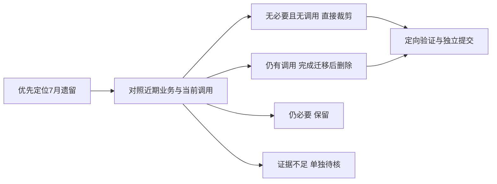

# 系统级代码瘦身最终报告与实施方案

**更新日期：2026-10-28。目标：减少不必要的代码、重复入口和规则维护点。**

本报告依据当前源码调查及 2026-10-28 用户最终确认，确定代码退役范围、接续方式和执行条件。原八项待核定方向已完成业务裁定，敏感账号升权暂不采用双人复核。已开始按增量实施；各项完成与验证见第 2.1 节及[项目核心](./00_项目核心.md)为准。

调查覆盖 143 个非测试命名前端文件、590 个后端生产 Java 文件及直接关联测试、客户端和脚本。首轮已定位旧财务算法及专属助手 567 行、14 个无生产调用的前端函数。补查覆盖库存与财务口径、请求、打印、演示装配、收发货明细、账号事务和配置等 12 个主题，形成 396 条源码定位证据；具体接续结论见第 4.4 节。完整实施预计净减约 5,000—8,000 行生产源码，约占当前 98,147 行的 5%—8%，不是已经实现的减量。

## 1. 目标与保留边界

**优先排查 7 月业务理解尚未成熟时形成的假设，以近期已确认的业务规则为保留基准。** 按方法和调用链区分早期实现与后续修正，逐项判断必要性。代码日期用于定位问题，实际业务和当前调用决定如何处理。

本次瘦身围绕四类负担展开：新旧入口并存、停用后残留的实现、重复维护的业务规则，以及进入生产模块的样例和占位代码。保留现有模块化单体与 DDD 四层，优先删除无必要实现；不为瘦身引入微服务、通用工作流、插件框架或另一套财务／库存模型。文件拆分和目录迁移按实际去重收益安排。

必须保持的业务与运行能力：

- 收货、母单／拆单、来源分配、五档进度、分批交工、称重、质检／返工／放行、发货和售后。
- 库存余额与流水、原应收／红字／工资／应付／收付款，以及历史成本和来源追溯。
- 登录会话、客户与组织范围、顶岗与工种授权、工作单元、锁定读取、版本校验和原请求回放。
- 附件原件与授权、标签版本／实例／核纸、PWA／安卓、升级、备份与恢复。

运行能力最终收口为：**新库存接口＋台账内核、新业务请求＋原请求恢复、打印工位＋v2 协议、正式业务数据＋最新收发货明细、管理员直接管理账号＋审计。** 演示展示、旧命令、重复记账、预审批新申请及历史检查命令别名退出维护。

原 17 页对应的业务能力和授权入口继续保留。重复页面可以在能力完整迁移后合并；低频、旧目录名或无菜单都不能单独作为删除依据。

## 2. 当前基准与判定方法

### 2.1 已完成与已有实现

| 事项 | 已核实状态 | 后续处理 |
|---|---|---|
| 10-28 实施第 1 批 | 旧财务算法与专属助手、posting 装配、无调用权限／库存助手已裁剪；后端生产源码净减 766 行，58 项定向测试通过 | 后续范围未完成，逐批继续，不将估算记作成果 |
| 首批清理 `9ac96eb` | 删除 8 个无页面调用的账号客户端封装、废弃导入评审矩阵并精简样例；生产目录减少 968 行，本增量含测试净减 1,036 行 | 计入已完成，不重复安排或累计 |
| 交货后结单 | 已有交货完成判定、结单服务和两种仓储，确认可同次写应收、逐单工资及员工应付；订单详情和财务页已有办理入口，已有预收可后续核销 | 使用现有实现；历史待核独立清单及真实 MySQL 并发核销仍按核心推进 |
| 旧提前计费 | 协议写入、账单生成、工资重算／整月确认及改单直接记账已拒绝 | 已不可达的内部算法可独立裁剪；客户端迁移和旧地址拒绝壳另行核对 |
| 收款保护 | 已补事务内余额复核及原请求先回放 | 保留保护，不重复修复；已有预收后续核销和真实 MySQL 验证仍按实际状态记录 |
| 数据库版本 | 迁移源码到 V79；核心已记录测试服 `cloud-20261027-settle-373af84` 从 V77 升到 V79 SUCCESS，结单已启用 | 以核心发布记录为准；本轮未连接服务器重新验收 |

“接口停用、旧实现删除、客户端迁移、历史可读、目标环境验收”分别记录。已有某一项结果，不代表其余事项已经完成。

### 2.2 每个候选如何判断

先对照近期已确认的业务，再检查现行单据、账务事实与实际调用，最后决定删除或迁移方式。旧设计和旧测试用于追溯，不用于推翻近期规则；近期实现的技术问题按已确认规则定向修复。

每个候选记录：**代码来源、早期假设、与当前规则的差异、当前调用方、替代方和处理结论**。业务结论分为：不符合现行业务、已被替代、仍必要、待确认。再按第 4 节选择直接裁剪、迁移后删除、核实后退出或保留。

调用检查覆盖页面、服务、类型、测试、脚本、Spring 条件装配、动态入口和必要的外部客户端。单次静态搜索未找到引用，只能产生调查候选。

### 2.3 用户最终确定的九项边界

| 项目 | 最终决定 | 对代码的处理 |
|---|---|---|
| 旧库存入口 | 全部使用新库存接口；用户确认旧库存没有录入业务数据 | 退出 `PrepStockController/PrepStockService` 和 `/api/inventory/prep-stock/*`，现行库存操作统一到 `material-stock`；无需再等待旧接口使用意向确认 |
| 台账与财务 | 保留台账内核，遵循新的财务计算 | 退出 `/api/inventory/ledger/transfers` 通用 HTTP 写入口；保留台账查询、工作单元、余额／冲正和真实来源。数量／重量不转成收入或工资 |
| 请求 | 统一新的请求方式 | 所有实际库存／金额业务写入有稳定请求号、真实操作者和事务；删除无请求号／无会话写入回退，迁移导入、设备和测试消费者 |
| 厂内打印 | 厂内全部使用打印工位 | 保留 C# `ZhubaoPrintReceiver.exe`、工位／队列与每目标任务；退出 Java 打印程序和正式出纸的浏览器旁路，纯标签预览保留 |
| 打印协议 | 只保留最新协议 | 以当前 v2 `/agents/v2/jobs/*` 为准；旧 v1 领取／回报和底层专属算法退出。历史快照、补打依据和核纸记录继续可追溯 |
| DEMO | 不保留演示 | 退出演示工作台、样例注入及演示专属配置／提示；保留内存仓储模式、正式基础字典、有效模板和单管理员初始化能力 |
| 收发货明细 | 只保留最新明细写入和消费链 | 新收货采用 `biz_receipt_line`，来源分配采用 `biz_child_line_allocation`；发货采用现行 `biz_outbound_order` 逐次记录及其台账。停止旧两个 item 表双写并改接审计脚本 |
| 检查命令 | 历史检查命令可以放弃 | 退出 `check-m0.ps1/check-m1.ps1`；保留 `check.ps1`、当前定向检查、升级和交付脚本 |
| 账号升权 | 十来人、一个核心管理员，暂不双人复核 | 管理员直接保存、改权、启停和解锁并留审计；取消预审批新申请／材料评审／审批放行链。最后一个管理员保护、客户授权事务和会话撤销保留 |

“旧库存没有录入业务数据”按用户确认作为退役依据，不推断所有历史母单、财务、打印或附件表为空。本次退役不删除已有数据，不修改已发布迁移；遗留表与原件保留在备份中。业务方向已定，后续只需完成本报告列出的源码接续和定向验证。

## 3. 执行顺序

已完成的首批清理单独计入基准，后续按下列七个阶段安排。编号表示默认推进顺序；明确无调用的片段可穿插裁剪。第 2.3 节已确定的退出方向不再另设业务批准环节。

| 顺序 | 重点与对应清单 | 主要动作 | 完成条件 |
|---|---|---|---|
| 1. 设备与运维的早期假设 | 7 月固定设备、任务和健康状态，B2、A5 | 区分真实网关、配置和人工 POC；迁移页面显示后删除固定健康任务与虚假实时状态 | 缺数显示未采集；有效探活、POC 证据、读数及人工兜底保留 |
| 2. 登记导入的重复规则 | 7 月本地模板、汇总和计划生成，B1 | 使用现有后端元数据及计划接口，删除前端第二套规则 | 上传、复核、修正、问题导出、显式入账和逐行恢复正常；失败保留批次并可重试 |
| 3. 旧命令、财务与账号简化 | 旧算法、无调用声明、B3、C3、C9 | 裁剪旧财务闭包，接续未结单缺项；统一新请求，取消账号预审批写入与放行 | 结单／收款／账号审计事务保留，旧写不重新开放；管理员无需审批单可保存 |
| 4. 页面与查询去重 | 原工作台、手机入口和重复状态计算，B4—B6 | 先迁移独有能力，再合并重复列表、详情、动作和读取规则 | 原 17 页能力对照无缺口，跨端授权、扫码、草稿和请求恢复一致 |
| 5. 旧库存入口与明细收口 | 新库存接口、台账内核、C1—C3、C6 | 退出旧备料和通用 HTTP 写，停止旧 item 双写并迁移审计／下游判断 | 单位和来源不丢失；回放、越权、回滚及并发限额通过，结单判定仍读真实发货与流水 |
| 6. 打印与演示退出 | C# 工位、v2、C4—C5、C7—C8 | Java、v1 算法、浏览器正式打印、DEMO 装配和历史命令别名退出 | 最新工位能领取／回报／核纸；正式空库为空，无自动样例设备、客户或伪造附件 |
| 7. 尾部清理 | 专属依赖、样式、配置、测试和文档 | 随各阶段清理残留，最后核对一次整体引用 | 无失效导入、空服务、无用配置或旧假数据；必要测试和部署文件保留 |

旧财务内部算法可以作为独立小增量穿插处理，其删除不依赖其他页面合并。涉及实际操作的旧入口先接替调用；新库存与打印方向已由用户确认，实施时核对依赖和测试，不再以缺少重复确认拖延退出。

## 4. 具体删除清单

### 4.1 A 类：确认无调用后直接裁剪

10-28 的逐项结论见调查报告 D01—D18。A1／A2 已核到类内闭包及专属 `FinanceTexts` 助手；新增候选包括无调用的权限关键字助手、库存旧退还校验、旧报工方法、旧账号造任务闭包与空配置。删除范围须按方法／类型记录，不扩成整个权限、库存或审批模块。

| 编号 | 对象与位置 | 删除与保留范围 | 删除前条件 |
|---|---|---|---|
| A1 | `FinanceBillingService` 的旧 `run/billMother/billProcess` 及专属助手 | 删除已被拒绝入口隔断的旧算法；保留客户账、收款、红字、余额、客户名称与历史协议读取 | 核对类内调用闭包和反射／测试；不因 helper 同名就误删现行账务所用方法 |
| A2 | `FinancePayrollService` 的旧 `build/withAdjustments`、自动工价／损耗扣薪等助手 | 删除交工重算链；保留工资行、旧月确认解释和新工资报表口径 | 证明助手不再供现行读写使用；`findPayrollRun` 与历史成本读取不随旧生成器删除 |
| A3 | `OrderChangePostingService` 及 `OrderChangeService` 的闲置 posting 字段／注入 | 当前旧服务只拒绝写入，且无生产 `posting.post` 调用；检查后移除空服务和专属依赖 | 同次调整构造器、Spring 装配和相关测试；旧 HTTP 拒绝路径仍需存在时移到最小边界壳，不保留整套 posting 装配 |
| A4 | 前端剩余无调用 API 包装、专属类型及无效导出 | 逐项删除，没有生产调用的封装不为假设中的未来页面长期保留 | 检查动态导入、同文件使用、测试、脚本和其他实际客户端；计入 mapper 的类内调用 |
| A5 | 余留评审文案、死分支和仅为不存在能力准备的字段 | 删除失效实现和占位状态；演示功能按 C5 成组退出 | 有效迁移、历史反序列化和真实硬件兜底保留 |
| A6 | `BusinessDataAccess.areaVisible/related`、DEMO filter 关键字助手、`MaterialStockService.assertCustomerReturnable` | 无调用的旧权限／退还算法退出；DEMO filter 最终随 C5 整体退出，不重复统计 | 正式 `DocumentVisibility/CustomerScopeRules`、来源行锁与 `usedAmount(..., session)` 保留 |
| A7 | `BusinessOperationService.reportProduction(ReportProductionCommand)` 与专属 `buildRemark` | 退出无生产调用的 WIP→半成品报工方法，生产／导入／网关接现行 `ProcessStationService` | 同名命令／结果仍被新岗位交工使用，不删类型或整个服务 |
| A8 | `ApprovalService.createAccountManagementApprovalTask`、`findPending` 及专属造任务助手 | 只测试消费的旧事后账号造任务闭包退出；预审批新任务生成另随 C9 退出 | 现行业务审批与历史账号任务读取／授权保留 |
| A9 | `OrderChangePanel` 金额确认死闭包、`FinanceWorkspace.billing` 恒空结果区、`videoTone/round3` | 裁剪不可达的函数、输入缓存和永不显示的旧账单结果区 | 历史金额展示、业务审核、生效、标签快照和原请求恢复保留 |
| A10 | `DeskTask.withCode/EvidenceCodes.scenes/NavigationMenuService.fullMenuTree`、`LabelEdition.distinguishes`、`zhubao.m0.storage-mode` | 无调用或仅测试便利方法和空配置最后收尾 | 不为几行收益移动有效测试工具，版本判断及实际菜单授权保留 |

已明确用于 B1 的 `fetchRegisterImportWorkspace` 先保留，随页面切换启用。`scanContextFixture.ts` 的纯位置迁移已撤回；没有实际收益的目录搬动不再优先安排。

A4 的 14 个函数为：`financeApi` 的 `savePriceAgreement/generateBilling/saveWorkerRate/generatePayroll/confirmPayroll`；附件的 `fetchDocumentPackages/fetchEvidenceAttachments/uploadCapture`；设备的 `fetchMachineOutputs/submitMachineOutput/fetchMachineProfiles/saveMachineProfile`；收货的 `lookupMobileIntake`；标签的 `applyCustomerMark`。同时删除无人使用的 7 个界面／结果 interface 及这些函数的专属输入类型。请求构建器、mapper 和打印预览在同文件有调用，不能按“未被其他文件导入”机械删除。

### 4.2 B 类：迁移到现行实现后删除重复代码

调查报告 M01—M11 补充了具体消费者和退出条件。当前 `MobileOrderDetail` 已复用统一 `OrderDetail`，`FormalBusinessWorkspaceQuery` 已复用 `ProgressBoardService.listFrom`，不能将它们继续按完全独立的重复实现估算收益。损耗页面的旧工资必填和文案、`operationDraft` 的闲置请求类型交集也应随对应调用链收缩。

| 编号 | 重复对象 | 替代方 | 必须保留的能力 |
|---|---|---|---|
| B1 | `SampleLibraryWorkspace.vue` 与 `registerImportTemplates.ts` 的本地模板、汇总、规则及映射计划生成 | 用现有 `registerImportApi.fetchRegisterImportWorkspace` 和后端计划服务；删除本地计划构建与专用推导代码 | 上传预检、字段显示、批次复核、修正、问题导出、显式入账和逐行恢复 |
| B2 | `HardwareIntegrationService.devices/tasks`、设备页和运维页中的固定健康数据 | 真实网关、明确配置和人工 POC 各自注明来源；未知状态直接显示未采集 | 设备读数、密钥管理、POC 证据和人工兜底；不为替换样例额外引入厂商 SDK |
| B3 | `FinanceWorkspace`、`financeApi`、改单／损耗表单残留的旧定价字段、状态和按钮 | 使用现行结单与原账查询，业务改单只处理要求、路线和交期 | 客户账、收付款、工资汇总、耗材、外协、资产、折旧、损耗事实和审批 |
| B4 | 原来料／生产／进度／质量外壳与订单中心重复的列表、详情和提交入口 | 订单中心及 `OrderActionHost` 共用面板承接；原授权编码与岗位能力继续有效 | 收货／拆单、设备产量绑定、损耗申请、进度与交工区别、扫码和深链 |
| B5 | `MobileOpsWorkspace/MobileOrderDetail` 与统一订单详情重复的读取、动作和权限计算 | 共用详情、共用动作、同一有效权限；归并组件不另建手机后端 | 相机／扫码、岗位动作、手输入兜底、返回路径、草稿和结果未知恢复 |
| B6 | `OrderWorkspaceQueryService/ProgressBoardService/FormalBusinessWorkspaceQuery/ScanContextService` 重复状态解释 | 保留场景不同的响应，用少量稳定的事实／状态计算统一口径 | 客户／本人／班组／部门范围、历史库存事实、进度、质量和交货状态 |

登记导入已有“仅后端计划可执行”的限制，未发现本地计划绕过后端记账的证据。B1 要消除的是第二套规则和失败回退维护成本；后端计划失败时保留批次与重试状态即可。

### 4.3 C 类：业务已经裁定，完成接续后退出

本节替代首轮调查 W01—W08 的待定结论；新增 C9 为已确定的账号简化。以下“实施条件”是工程工作，不是新的业务确认。

| 编号／原调查 | 已确定退出对象 | 接续与保留范围 | 实施完成条件 |
|---|---|---|---|
| C1／W01 | `PrepStockController/PrepStockService`、旧备料 HTTP | 统一 `MaterialStockController/MaterialStockService`；保留公司料、寄存、加工、待核、退还、冻结及冲正 | Bean、权限路径、旧测试装配和调用退出；新接口及内存／JDBC 的实际场景通过 |
| C2／W02 | `/api/inventory/ledger/transfers` 通用写入口 | 台账内核及 `/ledgers`、`/balances` 等有效只读查询保留；烟测造数在测试内部显式建立事实 | 外部 HTTP 不再能任意转移；不再用通用写接口替代真实业务流程 |
| C3／W03 | 无请求号或无会话的业务写回退、随机 `legacy-UUID` 重试键 | HTTP、导入、设备消费统一真实操作者、稳定请求与 `BusinessWorkUnit/WorkSession`；已有会话内助手保留 | 正常／同请求回放／改内容拒绝／未知结果／失败回滚通过；不在已有事务里嵌套新工作单元 |
| C4／W04、W05 | Java 打印客户端、v1 代理算法、旧共享令牌 | 保留 C#、构建与启动脚本、下载更新、每工位凭据、v2、快照准备、当前任务查询／维护与核纸 | v1 地址只保留必要最小拒绝壳或移除路由，不维护旧算法；新任务仍使用 `PrintRoutingRepository` 的内存／JDBC |
| C5／W06 | DEMO 工作台仓储／seed／过滤及运行时样例 | 详见第 4.4 节；保留正式读模型、基础模板、内存仓储及真实证据 | 应用不再注入演示仓储；空库无演示单据、假客户、假附件、固定 POC 或自动样例网关设备 |
| C6／W07 | 旧收货／发货 item 双写及其运行时读取 | 新收货行、拆单来源、发货记录与台账接替；`a3/a6` 审计改查新结构；历史 SQL／表不动 | 两处 item 插入退出；母单下游判断仍锁定读新发货记录；新单不再依赖旧表存在记录 |
| C7／W08 | `check-m0.ps1/check-m1.ps1` | 保留当前检查、发布、备份及升级脚本 | 仓内引用和入口说明没有失效路径 |
| C8／补查 | `OrderLabelPanel.printBrowser`、`openLabelPrint/buildLabelPrintDocument` 的正式出纸旁路 | 纯预览的 `buildLabelMarkup/labelFaceCss/labelPreviewScale`、二维码、换贴及补打原因保留，正式出纸统一工位 | 页面只能以新批次提交工位；不能把浏览器调用等同工位完成或物理出纸 |
| C9／业务确认 | 账号预审批 readiness／draft／新申请／上传／审批消费链及 `enforce-account-actions` 配置 | 管理员直接保存与审计；`AuthAccountActionRepository`、最后管理员保护、客户授权、密码策略、会话失效保留。历史只读仍需要的申请仓储及选择开关保留到读链接替 | 角色／范围／启停／解锁不再依赖申请单；账号和审计同事务，失败回滚；已有申请及附件仅历史可读，不再生成新申请或进入可审批待办 |

`machine/register/ops` 均有正式用途；取消演示或旧协议不等于退出整个模块。已有数据、标签实例与原始凭据不随执行代码删除。

### 4.4 补充调查：此前未核完整的依赖与接续结论

后端路径以 `backend/src/main/java/com/zhubao/erp/` 为根，前端路径以 `frontend/src/` 为根。以下结论已经核对当前源码、直接测试和装配；删改后的行为验证仍须在对应实施增量执行。

| 主题 | 本次补查事实 | 最终处理 |
|---|---|---|
| 新库存与财务 | `MaterialStockController` 已覆盖公司料／备料收退、领用、退回、备料建单、冻结和冲正；`OrderDeliveryCompletionQuery` 按母子单、发货记录和台账核实交齐，`OrderSettlementService` 同次写应收、工资和应付 | 保留台账实物事实；结单只在实际交齐后记双工费。进度 100%、库存为零、领用或损耗申请都不能直接产生收入／工资；收款核销和员工付款仍分别办理 |
| 未结单查询空壳 | `FinanceBillingService.unpriced()` 固定空列表，仍被 `FinanceController` 和 `FinanceReportService.operating()` 使用，经营缺项条件实际永不成立 | 删除旧协议计价算法不受影响；“已交齐待结单”提示／列表要接新交货评估和结单状态，保留来源不明待核分类，不能把空列表解释成没有待结单订单 |
| 请求实际消费者 | `BusinessOperationService.confirmInbound/shipFinishedStock` 仍可回退无会话；`ProcessStationService.report/reportProduction` 缺编号可生成随机 `legacy-UUID`。`MobileIntakeService` 已有完整工作单元及 `postInboundInSession` | 新入口强制稳定原请求；有事务助手继续复用。导入收货／报工已有批次行稳定键；发货旧键还按发货号＋行号构造，迁移时保留已成功／未知结果的原键接续，不能换号重新记账 |
| 设备读数报工 | `DeviceGatewayService` 先调用岗位报工，再保存消费记录；调用的是没有显式请求号的报工重载。消费查重不等同生产结果回放 | 按读数及目标生成稳定新业务请求，重试复用原号；生产成功而消费保存失败时须能核回原结果。沿现有事务／结果仓储补接，不保留随机号回退 |
| 打印 v1 的真实状态 | `PrintJobController` 的旧创建、重试、代理领取和回报已经直接抛出停用异常；`PrintJobService.claim/report/assertStation/stationToken` 仍残留实现。Java 与 C# 都已请求 v2 | 先清无生产调用的 v1 算法和旧令牌，不再称其仍对现场接单；Java 客户端按用户确认退出，不能误删 v2 |
| 打印服务并非全旧 | `PrintBatchService` 仍调用 `PrintJobService.prepareBatchSnapshot/withCustomerMark/readEdition/assertBatchReadable`；管理员维护还区分 `PRINT_JOB` 和新目标任务；`PrintLeaseScheduler` 当前只处理旧任务租约 | 保留并收缩实际快照与历史维护职责。v2 租约由 `PrintBatchService/PrintRoutingRepository` 处理；调整定时清理时须明确作用对象，不能用删旧定时器掩盖新任务长期未知状态 |
| 浏览器与工位 | `OrderLabelPanel.vue:127,152` 仍提供浏览器打印，`labelPrint.ts` 建 iframe 后调用 `win.print()`；这条链确实活跃 | 随 C8 退出正式打印按钮与专属文档／iframe 助手；保留同文件仍在用的标签预览、版式和字号规则 |
| DEMO 装配闭包 | `BusinessWorkspaceService` 即使默认 LIVE 仍注入 `BusinessWorkspaceRepository`；两种演示仓储、seed、filter、DTO 默认 DEMO、首页和 4 个页面提示、相关测试及 Compose／env 仍有关联 | 整体取消演示依赖和开关；正式 `FormalBusinessWorkspaceQuery/BusinessReviewData` 仍在用。`JdbcDataSourceConfiguration` 中 `business` 前缀、Compose 和 `.env.example` 同步清理，不碰 `business-document` |
| 自动样例网关 | 内存仓储构造器和 `JdbcGatewayDeviceRepository.seedReviewDevicesWhenEmpty()` 都会加入 4 个评审设备及共用演示密钥，JDBC 在 `@PostConstruct` 执行 | 取消两处自动注入及 `demo-device-key` 默认配置；保留实际设备注册／换钥／读数／人工兜底，不删除已经配置的现场设备 |
| 其他默认演示数据 | `InMemoryDocumentManagementRepository` 注入固定文档包、假附件和审计；`InMemoryHardwarePocRecordRepository` 注入 4 条 7 月 POC；`InMemoryMasterDataRepository` 注入 4 个样例客户；`MobileIntakeService.KNOWN_CUSTOMERS` 及名字 hash 回退仍供兼容路径使用 | 移除生产自动样例、固定客户映射与虚构客户 ID；测试显式造数据。真实 POC／附件不删；材质基础项、加工要求模板和现行正式工序不是演示数据，继续保留 |
| 演示账号与初始化 | 内存账号仓储默认生成多岗位演示账号，`demoUsernames()` 及旧 demo 用户接口仍存在；JDBC 账号由实际表和历史迁移维护 | 退出多角色演示账号自动生成与用户名公开列表。初始化至少一个可登录管理员，保留强制改密和现有账号，不能把 `demo_account` 历史标记直接当作删账号条件 |
| 最新收发货明细 | `writeMotherOrder/writeOutbound` 各有一次旧 item 插入；新收货行已有独立保存。`biz_outbound_order` 本身保存每次发货的材质、单位、数量、重量、物流及 ledger_code；当前没有新的独立“发货行表” | 停止两个 item 写入；保留母单主表、`biz_receipt_line`、`biz_child_line_allocation`、`biz_outbound_order`。不虚构新表，不把母单汇总伪装成新原始行；存量缺行按实际来源处理 |
| 旧明细消费者 | 运行时还在 `motherHasDownstream()` 的锁定读表清单引用 `biz_outbound_order_item`；`a3/a6` 脚本以及入库／发货／JDBC 测试含旧表和旧数量断言 | 同步收掉旧表存在性条件和双写断言，改查新行与真实台账；保留等待母单行锁后的当前读，不能简化成旧快照查询 |
| 账号预审批纠正 | `validatePreApprovalApplication()` 在申请号为空时直接返回 null；`enforce-account-actions=true` 只影响显式提供申请的审批检查 | 首轮报告将旧开关描述为普遍阻断不准确，已更正。按已确认单管理员模式退出新申请、评估和放行逻辑；历史只读职责与新写入分开 |
| 账号写入原子性 | upsert／启停／解锁／删除都用 `AuthAccountActionRepository.commit`；JDBC 同连接写账号、客户授权、审计，内存实现有撤销；申请消费只是其中可选分支 | 只删预审批分支和专属注入，保留整个正式账号事务内核、最后管理员保护及成功后会话撤销／失败补偿；不把单管理员模式变成无审计直接改表 |
| 审批页面的账号遗留入口 | `ApprovalAccess.allowedRoles/canDecide` 仍允许账号管理／账号预审批场景决策，`ApprovalService.pendingTasks` 及审批页使用可决策结果展示待办 | 账号场景改为历史只读并退出可决策待办，后端也拒绝继续审批；保留历史可见性与正式损耗／业务审批，不只隐藏前端按钮 |
| 导入、页面与状态 | 后端已有模板／汇总／计划；`App.navigateTab` 将来料、生产、进度、质量导向订单中心，但 loaders、注入导航、深链仍可到旧页。手机已复用 `OrderDetail`，正式工作台已复用进度基表 | 先接续旧页的设备绑定、损耗、待核、附件、扫码和请求恢复，再删外壳。状态计算只抽取共同事实，保留标签动作、批次与交货差异；不按页面总行数报净减 |
| 类型、CSS 与依赖 | 二次扫描未新增“导入后从未使用”的命名导入；首轮 145 个无外部引用导出仍包含大量类内活跃代码。19 个失效样式候选未发现相应动态拼接，`tone-gray` 明确为动态类 | 14 个闲置函数和专属类型按闭包裁剪；CSS 拆组合选择器并复核响应式／打印场景。ZXing、拼音、二维码、POI、C# 渲染保留，不以瘦身为由卸载活跃依赖 |

补查定位与类型／样式证据见[补充调查说明](./archive/2026-10-28-deprecation-audit/补充调查说明.md)。上述事实已经完成源码调查，不再列成“尚未调查”；库存／财务并发、删改后类型与装配、目标数据库行为和物理出纸属于实施验收，不在本轮报告中伪称通过。

## 5. 删除前的依赖核对

### 5.1 页面能力迁移

| 候选外壳 | 已有共同承接点 | 必须先接续的独有内容 |
|---|---|---|
| `InboundWorkspace` | `IntakePanel`、订单中心、母单动作 | 待核／稍后拆、拆单来源分配、收货附件、入库动作和完成后跳转 |
| `ProductionWorkspace/ProgressWorkspace` | `ProductionActionPane/ProductionPanel/ProcessProgressPanel` | 设备产量与绑定建议；岗位、五档进度、交工与最终重量分别处理 |
| `QualityWorkspace` | `QualityActionPane/QualityPanel` | 物理损耗申请、责任与审批；不能把损耗事实随旧工资试算删除 |
| `MobileOpsWorkspace/MobileOrderDetail` | 统一详情、`OrderActionHost` 和共用面板 | 相机、手输、连续扫码、岗位默认动作、返回、草稿、原请求及账号切换清理 |
| `InventoryTraceWorkspace` | 新库存单据面板、发货／售后共用面板 | 公司料／寄存／加工库存、旧批次、流水前后余额、退货与售后 |

逐一检查 `App.vue.workspaceLoaders`、`navigateTab/activateTab`、注入打开页、工作台快捷操作、客户页跳转、扫码深链和菜单权限。页面合并须保持同权限下的可达能力与服务端范围判断；隐藏菜单或折叠按钮不算实现退出。

### 5.2 事务、权限与副作用

- 业务命令经 `BusinessWorkUnit/WorkSession` 连接业务单据、库存、财务和请求结果；保留同连接读写、锁后重读与版本判断。
- 内存默认与 JDBC 可切换继续保留。共享契约测试可以减少重复组织，不能靠删除一种仓储实现降低代码量。
- 客户稳定 ID、本人／班组／部门范围、顶岗和工种是共享规则；服务端有效权限继续逐请求校验，空范围保持拒绝。
- 附件发布、打印队列、设备读数消费和导入逐行入账保留成功、失败及未知结果的恢复方式。
- 跨领域导入关系按实际职责调整。保留维护、历史读取、标签校验等消费者，避免为减少一条依赖而复制权限或余额规则。

### 5.3 条件装配

| 配置 | 实际关联 | 瘦身要求 |
|---|---|---|
| `business.repository` | 演示快照仓储，已确定退出 | 随 C5 删除演示装配、Compose／env 与 JDBC 触发前缀，不能误删 `business-document.repository` |
| `business-document.repository` | 正式单据、要求、改单、进度、轻任务、待核和部分标签存储版本 | 退出一个调用方不等于可删整组仓储 |
| `finance.repository` | 财务与结单两种仓储 | 保留结单和原账同事务能力及不支持组合的拒绝 |
| `command-request.repository` | 工作单元及原请求仓储 | 不将内存撤销当作 JDBC 独立提交的事务保障 |
| `label-template.repository` | 模板、打印任务、工位／队列和追溯 | 名称虽叫模板，不能只留下模板而删任务依赖 |
| `auth.users.repository` | 账号与登录会话 | 删除辅助界面或客户端封装不影响会话落库、撤销和审计 |
| `auth.pre-approval` | 旧新申请与历史读取共用仓储 | 删除新申请、放行和 `enforce-account-actions`；历史只读未接替前保留需要的仓储及 `repository` 选择，不把只读依赖算成无用配置 |
| 审批、文档独立开关及 Compose 覆盖 | 部分 MySQL profile 默认仍可为 memory | 检查实际部署覆盖，不假定只开 profile 就全部持久化 |

兼容构造器按项目约定处理，随对应能力退出时才删除专属重载与测试装配。第三方包核实真实用途后再卸载；扫码兜底、拼音、二维码、Excel 和打印渲染仍有消费者。

CSS 核对动态 class、响应式、打印及 PWA／安卓场景后再删。共享工作区已有的样式与表单修改保留；仅测试使用的工具没有净减或依赖收益时可保持原位置。

## 6. 验证、统计与交付

### 6.1 最小充分验证

方案整理只检查文档、链接和差异。代码实施按实际影响选择以下验证，遵循 AGENTS；定向验证已通过且无新问题时停止，不固定追加全量测试、生产构建和打包。

| 改动 | 必要验证 |
|---|---|
| 未调用的客户端封装／类型／样例 | 调用方复查、相关 API 或组件测试；共享类型变化时做前端类型检查 |
| 已不可达的财务助手／空 posting 装配 | 相关服务／装配、旧写拒绝、现行结单与历史读取；必要时后端编译；不联跑无关前端 |
| 导入统一元数据与计划 | 上传、确认、后端计划失败、字段修正、显式入账、逐行恢复及原请求；相关页面测试 |
| 库存入口／会话兼容路径 | 正常、越权、重复、失败回滚、并发不透支；按实际涉及的 JDBC 锁行为选择目标数据库验证 |
| 页面／读取合并 | 原能力对照、岗位范围、深链、扫码、草稿和结果未知恢复；去重计算与权限筛选一致 |
| 打印程序／协议／构建依赖 | 相关路由、快照与客户端测试；实际改变打包或交付时才跑相应包门禁，现场出纸另验 |
| SQL／升级装配 | 只追加迁移，核仓储和升级探针；无关业务清理不启动数据库演练 |

首批清理的 42 项直接相关测试和类型检查已通过。扩大检查另复现 6 项旧失败：`BusinessWorkspaces.test.ts` 两项、`LabelWorkspace.test.ts` 一项、`scanTargetGuard.test.ts` 三项，涉及旧文案／控件、标签选项及 mock。撤回扫码工具移动后，相关测试和工具无内容差异，失败仍存在。

这些失败单独记录。若第 4 阶段真实退出原页面外壳，先用现行面板覆盖同一业务场景，再移除只针对已删除实现的重复用例。

### 6.2 减量统计

| 指标 | 记录口径 | 通过标准 |
|---|---|---|
| 生产源码净减少 | 本增量生产文件删除行数减新增行数，测试数据和工具另列 | 纯清理增量应净减；必要接续代码单独解释，不能长期净增却称瘦身 |
| 全部源码净减少 | 同时计入新测试工具、夹具与替代实现 | 移到测试目录只计生产隔离，不计同等行数的全仓削减 |
| 活动实现数量 | 旧业务写入口、规则来源、查询状态计算、页面动作容器分别计数 | 被替代的实现退出实际调用与装配，不能只隐藏按钮 |
| 依赖变化 | 移除的 Bean 注入、导出、专属类型、配置分支和脚本调用 | 不遗留失效导入、空服务、空 DTO 或无实际作用的适配层 |
| 功能与数据 | 本次影响的岗位、范围、库存／金额及历史读取 | 实际能力等价，原账与原始证据保留，失败／回放语义不变 |

历史全仓快照为 1,132 个文本文件、154,627 行，含测试、配置、迁移和客户端；当时前后端生产源码约 9.4 万行，前端含样式，测试约 5 万行。其后有并行开发和清理，每批只统计自己的变化，不能将历史总量直接减去某次清理量当作当前规模。

2026-10-28 按当前已跟踪生产源码重算：后端 Java 64,411 行；前端 TS／Vue 27,507 行、CSS 3,374 行；Java／C# 打印源码 2,329 行；安卓生产源码 526 行，合计 **98,147 行**。含注释与空行，不含测试／夹具、SQL、部署脚本及二进制文件。

| 累计完成范围 | 预计生产源码净减 | 占当前生产源码 | 说明 |
|---|---:|---:|---|
| 无调用算法、函数、死分支与专属类型 | 1,000—1,500 行 | 约 1%—1.5% | 567 行旧财务闭包包含其中，不再另加 |
| 设备／运维、导入、重复页面及状态收口 | 3,000—5,000 行 | 约 3%—5% | 接续独有能力产生的新代码已作为扣减因素估算 |
| 完整执行已确定的库存、请求、打印、DEMO、明细与账号简化 | 5,000—8,000 行 | 约 5%—8% | 原待核方向已经确定，实际净减仍须逐增量用差异统计；同一个 filter、样例或类型只算一次 |

上述是累计估算，不能相加；测试、证据和文档变化另列。取消账号预审批只裁专属分支，不把整段账号服务、审计或事务仓储的行数计为可删。源码行数也不直接折算为安装包大小或响应速度。

每批在删除清单明确后给出可核验减量，合并后累计。移到测试目录只计生产隔离；排版压缩、删除必要说明或仍有效的测试、移动到归档和缩短标识符不计作业务瘦身。

### 6.3 每个增量的交付记录

记录六项即可：删除对象与范围、调用方证据、替代方及保留能力、实际删除与未关闭项、验证和净减统计、对应提交与恢复方式。清理提交只包含本增量，核心文档有并行修改时保留他人状态。

独立源码确需归档时保留原路径索引并退出构建／扫描。数据库表、原账、附件原件和已发布迁移继续保留；迁移只能追加。新增结单或收付款事实后，回退版本也须兼容读取和停写，不重新开放旧计费或用旧备份覆盖新款项。

默认由主智能体逐个推进相关增量；委派、同文件编辑、Git 操作与有依赖的验证按 AGENTS 执行。推送、打包、部署和现场验收按实际任务范围安排。

## 7. 调研证据与来源说明

### 7.1 调研材料

| 材料 | 本方案采用的结论 |
|---|---|
| [全仓功能与依赖评估](./archive/2026-10-27-code-review/现行代码功能与依赖评估.md) | 功能全景、16 个领域、页面到服务关系、运行保障及候选退出范围；属于调查时点快照 |
| [逐文件源码索引](./archive/2026-10-27-code-review/逐文件源码索引.csv) | 文件、符号、引用、条件装配和字节摘要，供定位候选；删除前重新核实当前调用方 |
| [源码直接依赖](./archive/2026-10-27-code-review/源码直接依赖.csv)、[领域依赖](./archive/2026-10-27-code-review/后端领域依赖.csv)、[接口索引](./archive/2026-10-27-code-review/后端接口索引.csv) | 显式／词法关系和控制器证据；不能替代 Spring、脚本和外部客户端核验 |
| [交货后工费与收付款方案](./交货后工费结单与收付款改造方案.md)第 9、11—14 节 | 旧计费应退出的业务边界、事务保护、历史接续及现有迁移责任；不另建第二套实施路线 |
| [库存与要求模板方案](./库存管理与母单加工要求模板改造方案.md)、[跨材质契约](./A5_跨材质子单契约.md) | 公司料／寄存／加工库存、来源行和数量单位不能因精简混为一谈 |
| [权限方案](./角色权限与数据范围改造方案.md)、[安卓与打印方案](./安卓APP与集中打印开发文档.md) | 客户与组织范围、有效权限、共用面板、设备和打印客户端边界 |
| 当前源码与提交 `fd1e250`、`37a7f10`、`58b806a`、`4bc102b`、`31a5daa` | 结单基础、确认入账、旧写拒绝、收款余额复核和 V79 策略迁移已经有实现；不能继续沿用旧快照的“尚无代码”判断 |
| 首批清理 `9ac96eb` | 已删除无调用方前端封装、废弃评审矩阵并精简样例；下一轮不重复计算成果 |
| [10-28 首轮调查](./archive/2026-10-28-deprecation-audit/调查报告.md)及[补充调查](./archive/2026-10-28-deprecation-audit/补充调查说明.md) | 首轮方法／类型闭包与补查的 12 个主题、396 条定位；原 W 类结论已由本报告第 2.3、4.3 节替代，账号强制开关的解释已勘误 |

源码、对应提交和实际验证用于核实实现事实；近期已确认的业务要求用于判断规则是否适用。历史方案和测试不重新成为现行执行指令。

### 7.2 7 月来源复核

以 `21d483e` 为历史基准，HEAD 可达历史中有 149 个 7 月提交，集中在 7 月 6—9 日，含合并提交。受检的 884 个现存代码路径中，325 个当前路径首次在 7 月加入；范围含前端及其测试、后端生产 Java、客户端和运维代码。

对 15 个候选／保护样本执行逐行 `git blame`，见[早期代码来源复核](./archive/2026-10-27-july-review/早期代码来源复核.csv)。下列行数只说明来源，不等于过时或可删除行数；未逐一追踪跨文件复制，外层近期规则也可能改变旧行含义。

| 重点对象 | 7 月归因行／当前样本行 | 审查目标与近期保护边界 |
|---|---:|---|
| `HardwareIntegrationService` | 209／209 | 优先核对固定设备、任务和健康度假设；真实网关与 POC 证据保留 |
| `registerImportTemplates.ts` | 468／468 | 优先核对本地模板和映射规则；保留实际 API 契约类型，规则切换到后端后再删重复实现 |
| `SampleLibraryWorkspace` | 1,020／1,171 | 核对早期评审外壳和本地计划；保护后续批次修正、后端计划执行限制和原请求恢复 |
| `RegisterImportPostingExecutionService` | 388／445 | 核对早期入账与主数据假设；保护近期真实账号、岗位校验、逐行状态和请求回放 |
| `OperationsCenterService` | 1,537／1,920 | 核对早期展示及固定健康语义；有效探活、成套备份与恢复证据不因年代删除 |
| `BusinessOperationService` | 824／1,169 | 审查通用命令和缺会话旧路径；近期来源行、母单锁、发货退回保护和实物损耗语义保留 |
| `AuthUserAccountManagementService` | 1,051／1,390 | 核对早期角色／前置审批假设及无调用方分支；近期客户组织范围、顶岗、工种、审计和会话撤销保留 |
| `StockLedgerService` | 57／148 | 属于仍必要的早期内核，默认保留；台账正确性与事务保护按现行契约验证 |
| `App.vue` | 73／532 | 虽首次建于 7 月，大部分当前行来自 10 月；保护近期导航、共享动作、有效权限与账号切换清理 |
| `ProductionPanel`、`OrderWorkspace`、`MotherOrderSplitService`、`QualityRequirementService` | 本次样本均无 7 月归因行 | 作为近期业务保留基准，不能为了适配早期原型删掉分批交工、来源分配、逐条质检、返工或放行规则 |

`FinanceBillingService/FinancePayrollService` 当前路径首次加入于 10 月 10 日，本次归因也均在 10 月，应按真实来源记录。其旧计价／工资重算已被交货后定费规则替代，仍属清理候选；近期结单、收款余额锁和历史账务接续保留。

## 8. 维护与本轮范围

项目核心维护最新进度、阻断和验证；本方案维护目标、顺序与删除边界。历史评估和 CSV 保留为证据快照，实施前只复核相关源码，不逐提交重刷整套资料。

规则、接口或部署实际变化时更新对应专题，README 只在启动／导航变化时调整。10-28 已依据用户决定定稿，并补齐此前未展开的请求、打印、演示装配、明细、账号事务、空查询和配置调查；角色权限与库存专题同步已确定的业务边界。当前只修改报告、证据和文档，未执行后续源码清理、业务测试、服务器数据检查或部署。待执行的是工程接续与验收，不再将九项已定决定留作待业务确认。
