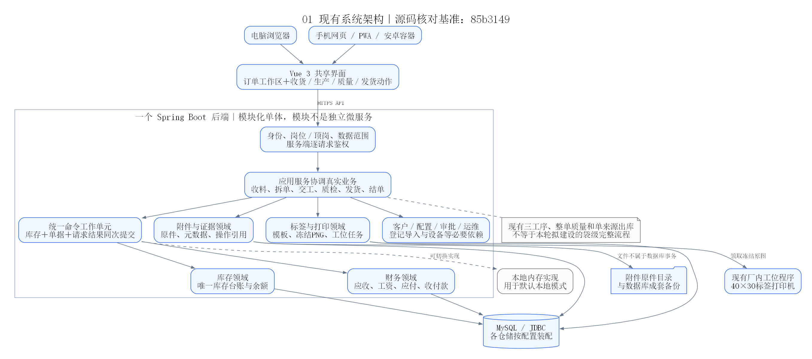
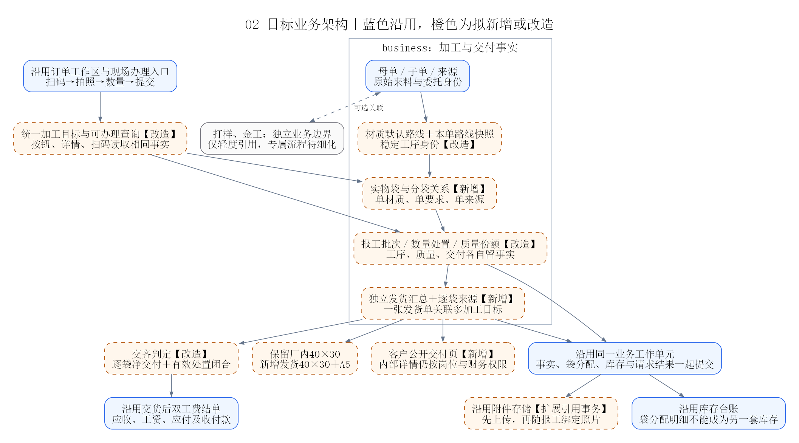
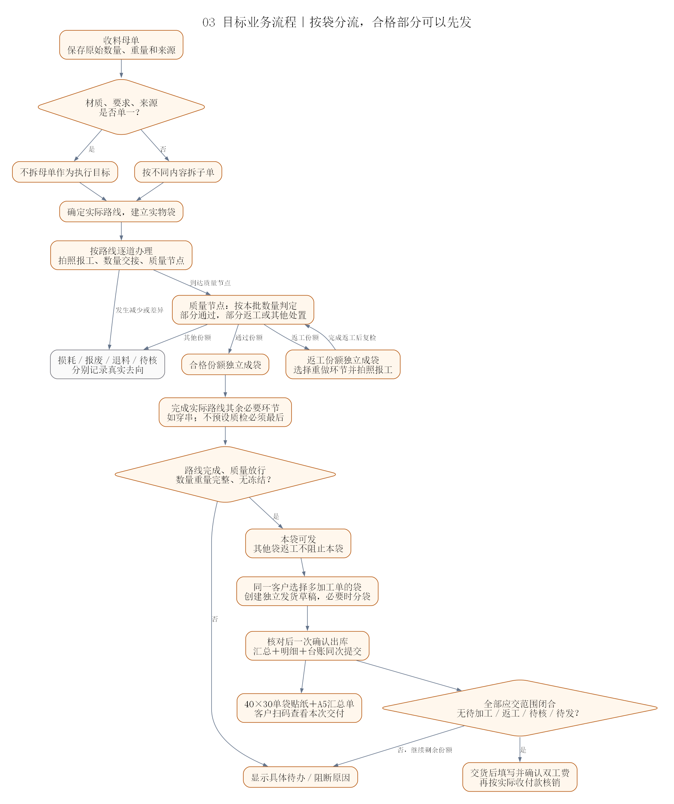
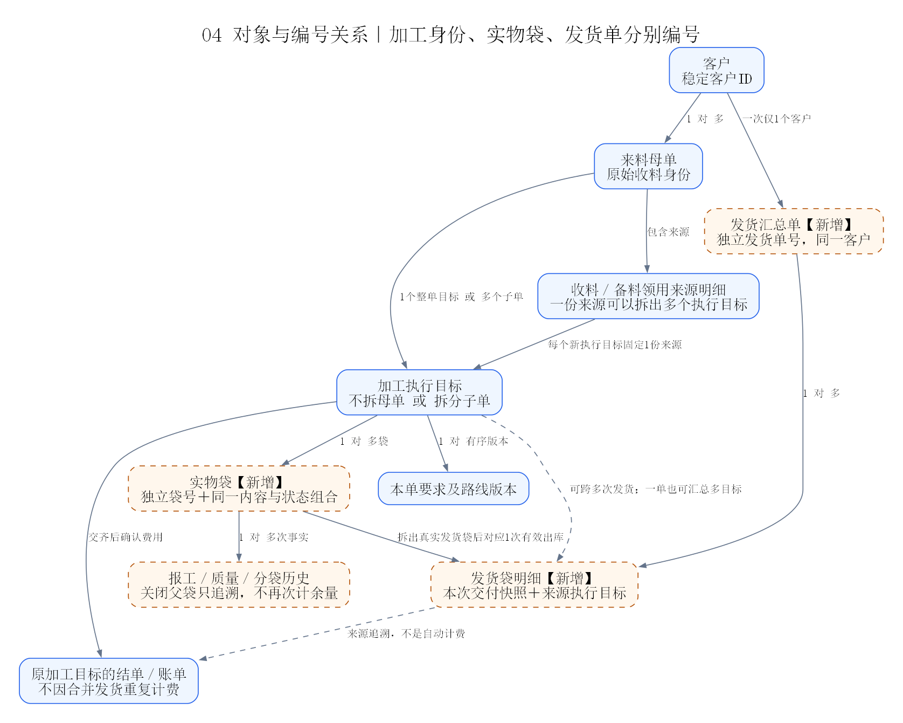
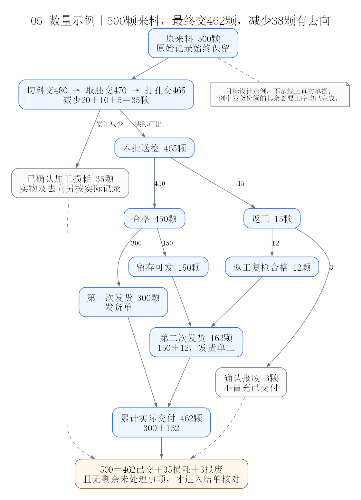
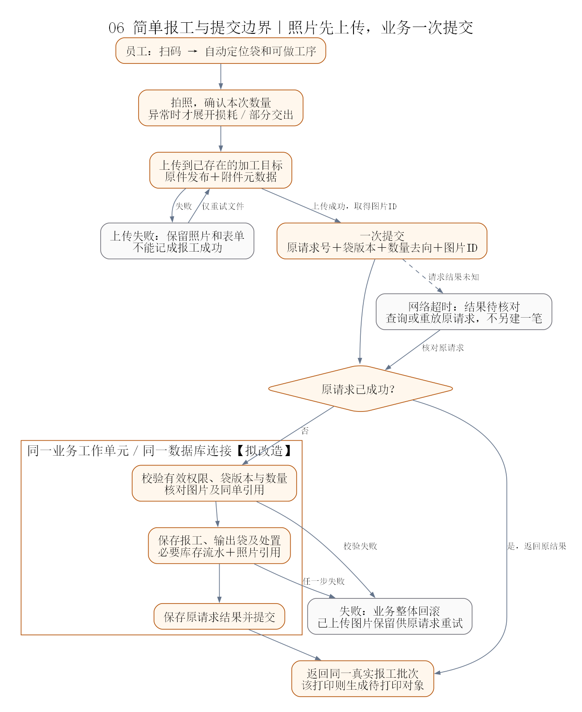
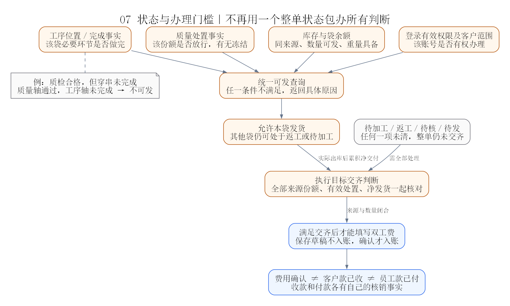
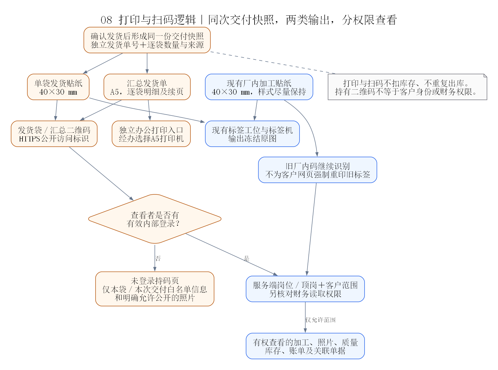
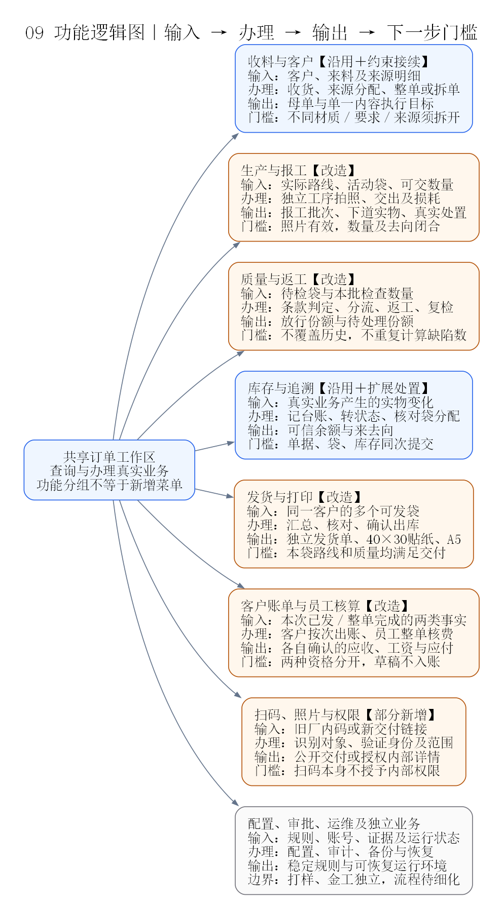
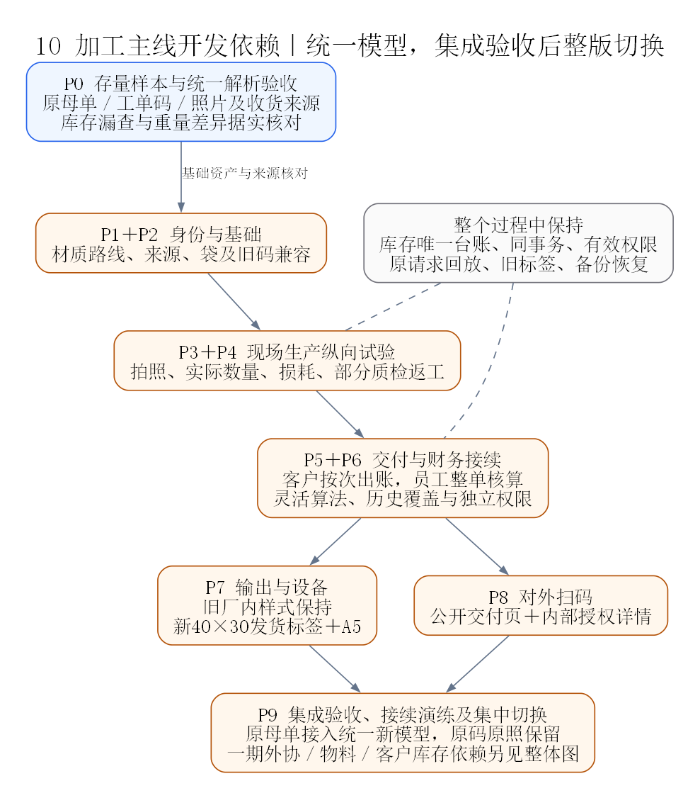

# 系统设计复盘与功能图解

日期：2026-10-30。性质：设计复盘与目标图解，未实施业务改造。源码核对基准为`85b3149`；运行状态仍以[项目核心](./00_项目核心.md)为准。

本文帮助理解系统为什么这样分工、哪些设计可以继续沿用、改进需要改变什么。[业务方案](./工序报工与分袋交付改进方案.md)规定规则，[实施计划](./工序报工与分袋交付实施计划.md)安排后续工作。本次复盘不把目标图中的能力当成已经上线，也没有重新核验服务器运行状态。

财务目标补充确认：客户按每次已发部分出账，员工整张加工目标完成后核算；两条确认分离。相关目标图已更新，计算方式、历史接续及两张财务专图见[财务设计复盘](./加工费灵活计费与财务设计复盘.md)。图01仍解释当前旧实现。

大版本扩展：客户库存查询、客户物料、本厂生产材料、耗材／工具与固定资产已纳入[专项调研](./客户库存与本厂物料资产管理调研.md)，附[两张功能与流程图](./diagrams/inventory-assets-review/README.md)。客户确认先用手机网页登录查自己的库存。下列10张图聚焦加工交付主线，扩展功能及I0—I5／A1依赖以专项为准，均未实施。

## 1. 结论：可以改进，保留架构，调整业务粒度

**现有系统能够承载这套改进。应继续使用模块化单体、统一库存台账、现有权限和命令事务，不需要重建系统。**

现有主线已经具备收料、拆单、工序交付、质量、出货、财务和证据追溯。当前限制主要是这些事实多以整张加工单为处理单位，无法完整表达“同一张单的一部分在下道、一部分损耗、一部分返工、另一部分已经发出”。

目标是形成三个彼此关联的身份：

- **加工目标**说明做什么：材质、来源、要求、实际路线及原始来料。
- **实物袋**说明手里是哪一份货：处于哪道工序、质量怎样、当前多少、后来分去了哪里。
- **发货单及袋明细**说明这一次交了什么：同一客户的多个加工来源如何汇总，实际交付多少。

库存记录实物变化，财务记录费用及资金变化，照片记录操作证据。三者不互相冒充，具体操作通过同一业务工作单元把应当一起生效的事实提交。

### 1.1 可行性判断

| 方面 | 判断 | 实施条件 |
|---|---|---|
| 技术架构 | 可以沿用 | Vue共享入口、Spring Boot模块化单体、领域分层及MySQL均可继续使用 |
| 实物数量 | 必须改造 | 从原始总量相等改为每道实际接收、交出、处置和剩余闭合 |
| 部分质量与返工 | 必须改造 | 检查及放行作用于本袋／本批份额，不再覆盖整个加工目标 |
| 多加工单发货 | 可以增量扩展 | 新增汇总身份，逐袋仍落回原来源和库存维度，不能跨来源拼成一笔库存转移 |
| 照片必填 | 可实现，但不能只改前端 | 现有证据引用仓储需要接入报工事务，服务端也要核对图片 |
| 厂内加工贴纸 | 应保留 | 保护现有40×30外观、冻结原图、版本、补打和换贴；新袋只扩展身份 |
| 40×30发货与A5 | 可以分别实现 | 使用同一确认快照，标签机与办公打印入口分开 |
| 客户扫码 | 可新增受限公开读取 | 公开交付与内部详情分别授权；客户私密账单验证尚未确定 |
| 打样、金工 | 边界可以成立 | 保持独立，专属领料、签样和费用规则另行明确 |

这属于有明确基础的增量改造，但不是换一组工序名称、放开一个按钮就能完成。库存、质量份额与结单判断必须一起接续，不能只让前端提前显示成功。

## 2. 读图方式

图中蓝色表示已有基础或建议沿用，橙色表示拟新增／改造，灰色表示约束、待办或业务边界。文字标识同时说明含义，不靠颜色判断。图中的模块不是独立部署的微服务，图中的目标对象也不是已经发布的数据表。

| 想了解什么 | 建议先看 |
|---|---|
| 系统现在怎么运行 | 图01现有系统架构 |
| 新能力放在哪里 | 图02目标业务架构 |
| 从收货到交付怎样走 | 图03业务流程 |
| 单号和袋号是什么关系 | 图04对象与编号关系 |
| 500颗为什么最后可交462颗 | 图05数量示例 |
| 简单报工怎样避免重复记账 | 图06报工与提交边界 |
| 什么时候能发货、什么时候能结单 | 图07状态与办理门槛 |
| 标签、A5和客户扫码如何配合 | 图08打印与权限 |
| 每个功能的输入、操作和输出 | 图09功能逻辑 |
| 后续应该按什么顺序改 | 图10改造依赖 |

所有图均提供可放大的SVG及可编辑图源，见[图集索引](./diagrams/system-review/README.md)。

## 3. 图01：现有系统架构

电脑、手机和安卓容器共享前端业务，后端负责身份、岗位／顶岗和客户范围。业务服务协调库存、质量、财务、附件与打印。库存、财务和单据并非互不相干的应用，核心命令已有同一连接上的提交和原请求回放基础。

原件文件与数据库事务分开；数据库保存元数据和引用，备份必须同时覆盖原件。MySQL下各仓储仍按配置装配，不能只看profile就认定每个模块都持久化。厂内工位领取冻结PNG，不能把送入打印队列等同于实物已经出纸。

本图按现有主要调用链概括，不能据此认定所有兼容旧入口都已经进入统一事务；新增写入必须实际传递`WorkSession`。

## 4. 图02：目标业务架构

新增能力优先留在现有领域：路线、袋、报工与质量份额、汇总交付属于加工业务；库存仍由库存领域负责；照片由文档领域存储与校验；标签和A5从真实交付快照产生；费用仍走现有财务，但客户按次出账与员工整单核算须拆开确认。

建议明确一个共同的加工目标解析与可办理结果契约，让扫码、订单详情、报工、质检、发货和结单对“不拆母单／子单／有效轮次”理解一致。它解决的是同一个业务身份被各处解释不同的问题，不是新建通用工作流框架。

### 4.1 各类事实由谁负责

| 事实 | 负责方 | 不能代替它的东西 |
|---|---|---|
| 客户原来交来多少 | 收料单据与来源明细 | 后续损耗后的剩余数 |
| 当前哪袋、在哪里、属于谁 | 袋分配与工序事实 | 订单列表显示的一个状态 |
| 哪些货合格、哪些返工 | 明确份额的质量轮次 | 整张单上一个“合格”文字 |
| 实物还剩多少、怎样变化 | 库存台账及对应袋分配 | 照片、打印或人为改余额 |
| 本次实际发了什么 | 出货明细与库存出库事实 | 发货草稿或已打印标签 |
| 是否交齐 | 同一完成判定读取各类有效事实 | 100%进度、成品余额为零或存在一张出货单 |
| 客户本次应付多少 | 本次已发范围、计费依据及客户账单确认 | 等待员工工费完成、根据袋数自动定价 |
| 员工整单应得多少 | 加工目标完成、作业份额及员工核算确认 | 本次发货人员、发货次数或最后报工人 |

袋分配服务于同一库存台账，不再形成一套可独立修改的“袋库存总账”。核对余量只汇总当前有效的活动份额，不能把已关闭父袋与其新袋一起累加。

## 5. 图03：业务流程

整单加工与拆子单都保留。新流程中，不同材质、不同要求或不同来源必须先拆开；不能为了沿用不拆按钮就把多内容装进同一执行袋。

质量节点按实际路线发生，原表中质检在穿串前，图中没有擅自挪到最后。质量通过的份额还须完成其余必要环节才能发货。返工和未处理份额独立保留，不能阻止另一袋已经满足条件的货先发。

完整打样、金工流程不是正常加工的前置步骤，也不在主线上强制插入。

## 6. 图04：对象与编号关系

加工单号、袋号、发货单号有不同职责。一次发货跨多个加工来源，必须以逐袋明细连回加工目标，而不是把发货单号直接等同于其中一张加工单。

袋序如“01”只在所属发货单内有意义；厂内实物袋号必须独立可识别。纸面可以按空间采用发货单号＋袋序，系统仍保存完整映射。正常分批发货前已经把份额分成真实袋，不能让同一活动袋同时代表已发和未发实物。

拆子单改变加工内容的组织，分袋改变同一内容的实物分布。分袋不自动新建加工委托，也不自动增加应收或工资。发货后人工确认本次客户账单才形成应收，员工另在整单完成后核算。

## 7. 图05：数量如何闭合

本例原始来料始终500颗。每道工序只对本次接收的实物负责；先发300颗可先出本次客户账，再发150＋12颗另出账，最终交462颗，35颗加工损耗和3颗报废分别有来源与处置，整体完成后核员工工费。

“损耗／报废已经记明”与“责任和费用已确认”分开。仍存在的废品还要保留库存及处置去向，不因为不再加工就让实物消失。待核差异不能当作损耗冲平。

### 7.1 本次复盘补充：重量未知必须明确表达

数量减少时，并不总能立即知道减少了几克。现有库存数量与重量分别核对，而计划又要求不在每道工序强制称重，因此需要明确称重状态：

1. 袋分配可记录“重量未称／待复称”，未知不是0，也不是按颗数分摊的估算值。
2. 同一在制库存维度内分袋不重复搬总库存；不能给每个新袋都复制整单原重量。
3. 发生数量处置但重量尚未核实，应标明相关重量待复称，历史账面重量不能展示成已经确认的当前实重。
4. 需要转移对应状态或确认发货时，必须取得本份额适用的实际重量，并通过有来源的追加事实接续；不能在发货页面覆盖库存数字。
5. 纯重量损耗与颗数损耗分开。现有库存规则虽允许一项为0，但不等于允许把未知重量当0写入。

已有`depart`带原收货关联等约束，不能把任意过程损耗伪装为收货冲正／退料。具体数量与重量处置应在库存领域按明确业务类型扩展和验证，不能只复用一个名称相近的方法。

## 8. 图06：报工与事务

员工看到的是扫码、拍照、数量、提交。文件先上传到已经存在的加工目标，正式提交再核对图片并绑定真实操作，同时保存袋变化、报工、必要库存流水及请求结果。

本次源码复盘确认：`BusinessEvidenceLinkRepository`现有接口没有`WorkSession`参数。仅在报工方法外添加事务注解，不能让另开连接的证据引用自动纳入同一提交。需要扩展仓储接口及内存／JDBC实现，并在失败路径验证照片引用和报工一起生效或一起回滚。

内存实现也须参与对应回滚验证；在MySQL运行模式中，新流程涉及的业务、库存和证据引用仓储应使用一致的持久化装配。不能业务写JDBC、照片引用仍在独立内存中，却声称已经同事务持久保存。

文件上传成功但报工失败时，保留已上传原件和表单，用原请求恢复；这不等于完成报工。报工已成功、随后打印失败时，只补打，不重新报工。请求已成功时优先返回原结果，不因为原袋已经分拆而把原请求误报为新失败。

## 9. 图07：功能状态与办理条件

### 9.1 三个状态方面分别记录

| 方面 | 举例 | 用途 |
|---|---|---|
| 工序位置及完成事实 | 待车型、已到货部分处理完、待穿串、路线完成 | 判断下一步做什么、能做多少 |
| 质量处置 | 未检、合格、让步、待返工、冻结、待核 | 判断这一份实物能否继续／放行 |
| 交付事实 | 在厂未发、草稿选中、已出库、退货待复核 | 判断本次还能发多少及是否交齐 |

这三个方面不是一份可任意修改的总状态，也不要求建设复杂的状态机平台。它们从各自事实读取，由可办理查询统一给出结果。订单列表的“生产中／部分已发”等仅作摘要。

同一活动袋的实物必须具有相同的工序位置、质量处置和交付状态组合，出现不同组合就分袋。“质量通过”不自动等于“工序结束”，“打印出纸”不等于“已经出库”。

### 9.2 三种办理范围分别核对

**本袋可发**检查这一袋：有效权限、正确来源、足额库存、所需重量、有效质量放行、必要工序完成、无相关冻结。

**本次客户可出账**检查已确认发货及其未覆盖的账单来源，不要求加工目标交齐。**加工目标交齐**检查全部份额：来源覆盖完整，净发货及明确处置闭合，无待加工、待返工、待核、待发，作为员工整单核算依据。某袋先发不代表整单交齐，但可先给已发部分出客户账。

质量结论要能追到本次检查的份额和要求版本。合格实物同质分袋可以明确继承对应份额的结果；返工、实质改单或影响检验项的后续加工不能沿用不再适用的结论。

## 10. 图08：打印、扫码与权限

厂内加工标签继续以现有样式和40×30纸型为基准。客户单袋发货标签也用40×30，但使用专门模板和确认交付内容；A5在另一办公打印入口输出完整清单。A5和单袋标签必须来自同一次发货快照。

客户持码页只返回适合随货提供的信息；扫码链接可以转发，因此持码不是客户身份验证。内部工作人员查看加工、质量和账单必须通过各自权限。员工能看订单，不代表能看财务或工资。客户私密账单访问方式未确定，不通过放宽公开接口代替验证。

还需统一可办理提示的权限口径：当前`ScanContextService.has`读取角色权限集合，而`PermissionGuard`另有按顶岗过滤的有效权限。目标查询应使用包含顶岗限制的有效权限，避免界面说可以办理、实际提交再被拒绝。查询改好后，写接口仍独立鉴权，不能把提示当作放行凭证。

公开页与打印、补打都不写实物数量或财务。新链接不要求全厂更换旧码；旧厂内码继续读取已有业务，多个活动袋时必须明确选择。

## 11. 图09：功能逻辑图

这张图按输入、办理、输出及门槛解释功能，不要求增加同名菜单。现有共享订单详情和办理容器应继续使用，让工人从当前单据进入下一步，而不是在多个模块重复搜索、录客户和数量。

| 典型岗位 | 最短操作主线 |
|---|---|
| 收货／业务安排 | 选客户与来源 → 登记来料 → 整单或拆子单 → 确定实际路线 |
| 现场工人 | 扫袋 → 自动定位工序 → 拍照核数 → 一次提交 |
| 质检人员 | 扫待检袋 → 条款判定与数量分流 → 放行或指定返工 |
| 发货人员 | 同客户选可发袋 → 核对 → 确认出库 → 贴纸与A5 |
| 客户出账人员 | 读取本次已发范围 → 填灵活收费项目 → 独立确认客户账单 → 收款核销 |
| 员工核算人员 | 读取已完成加工目标及作业份额 → 独立确认员工工费 → 员工付款 |
| 客户 | 扫交付码 → 看本袋或本次清单，不进入厂内操作界面 |

## 12. 图10：改造路径

P0旧母单漏查成品可以独立修复，不必等待所有新功能。新流程则先建立身份和来源，再接报工数量、质量份额、出库及交齐口径，最后接正式打印和公开扫码。

每一阶段先用一个常用材质、一个单一来源的纵向样例验证，不必先录完全厂路线、一次开放所有工种。尚未贯通的新模式不在业务库接写。内部流程可先在隔离试点中验证，客户公开页不必成为最早内部验证的前置条件；正式对外交付前再完成对应打印、公开页及权限验收。

旧单、旧码、旧照片和旧账继续解释历史。显式接续必须核对当前实物和真实来源，不自动给历史单造照片、造损耗或重编全部编号。

## 13. 复盘发现与后续处理

| 事项 | 对新方案的影响 | 处理位置 |
|---|---|---|
| 母单与执行单的库存身份解释不一致 | 不拆单可能有成品却查不到 | P0先修；后续统一目标解析契约 |
| 分批交工仍以原始总量判完成 | 存在损耗的工序不能正常关闭 | P3改成实际接收、交出和处置闭合 |
| 末道补录称重未必沿当前路径写入产出库存 | 发货数量对但重量仍可能不一致 | P0核对既有记录，P3验证真实称重接续，不自动更正存量 |
| 证据引用缺少统一工作单元入口 | 必拍照可能只在界面成立 | P3扩展真实仓储事务及批次引用 |
| 扫码可办理提示只读取角色权限集合 | 提示可能与业务管理账号实际顶岗权限不一致 | P1—P2统一有效权限查询，写接口继续逐请求校验 |
| 整单质量和库存状态混在一起 | 部分通过与部分返工互相阻塞 | P4按明确份额和状态方面办理 |
| 现有出库一行关联一加工目标 | 直接加总单号可能丢来源、重复扣库存 | P5新增汇总和逐袋关联，维持逐来源出库 |
| 原始总量仍影响交齐和计件缺口解释 | 发货已支持损耗但仍无法结单，或工资被补回原量 | P6同步修改完成判定及计件事实来源 |
| 原双费用确认把客户出账与员工核算绑在一起 | 不符合客户按次出账、员工整单核算的新规则 | P6按财务F1—F6分离资格、算法、权限和确认，复用原账务底座 |
| 新袋若独立维护另一套总余额 | 袋与库存出现两套可修改的真相 | P2—P6同事务分配和核对，库存台账保持唯一 |
| 袋只使用一个含糊状态 | 无法表达质检合格但后续工序未完 | 明确工序、质量、交付三个方面及共同查询 |
| 变更共享标签渲染会影响已满意的厂内标签 | 功能改进反而破坏现场可用性 | P7固定旧样式基准，新增模板独立接入 |

这些差异支持改造方向，也说明不能把改造等同于已经验收。没有必要为本次需求新增微服务、消息总线、通用流程引擎或另一套媒体／库存系统。

### 13.1 尚需业务或现场明确

质检和穿串先后、一料多胚／单位变化、损耗与报废复核职责、无成品时的费用完结、未知重量怎样复称、40×30最长字段取舍及A5设备需在对应增量开始前核定。客户私密账单验证、打样和金工专属流程分别推进，不阻塞已明确的正常加工主线。

### 13.2 源码依据

| 结论 | 核对入口 |
|---|---|
| 共享页面和动作入口 | [App.vue](../frontend/src/App.vue)、[OrderActionHost.vue](../frontend/src/features/orders/OrderActionHost.vue) |
| 固定工序与原量交工 | [WorkshopProcesses](../backend/src/main/java/com/zhubao/erp/business/domain/WorkshopProcesses.java)、[ProcessStationService](../backend/src/main/java/com/zhubao/erp/business/app/ProcessStationService.java) |
| 母单库存漏查 | [ScanContextService](../backend/src/main/java/com/zhubao/erp/scan/app/ScanContextService.java)的`balancesOf` |
| 质量放行粒度 | [QualityRequirementService](../backend/src/main/java/com/zhubao/erp/business/app/QualityRequirementService.java)、[QualityRound](../backend/src/main/java/com/zhubao/erp/business/domain/QualityRound.java) |
| 出货与库存维度 | [OutboundOrderRecord](../backend/src/main/java/com/zhubao/erp/business/domain/OutboundOrderRecord.java)、[StockDimension](../backend/src/main/java/com/zhubao/erp/inventory/domain/StockDimension.java)、[StockTransferRules](../backend/src/main/java/com/zhubao/erp/inventory/domain/StockTransferRules.java) |
| 交齐和结单 | [OrderDeliveryCompletionQuery](../backend/src/main/java/com/zhubao/erp/business/app/OrderDeliveryCompletionQuery.java)、[OrderSettlementService](../backend/src/main/java/com/zhubao/erp/finance/app/OrderSettlementService.java) |
| 同连接命令事务 | [JdbcBusinessWorkUnit](../backend/src/main/java/com/zhubao/erp/work/app/JdbcBusinessWorkUnit.java) |
| 照片引用需接续事务 | [BusinessEvidenceService](../backend/src/main/java/com/zhubao/erp/document/app/BusinessEvidenceService.java)、[BusinessEvidenceLinkRepository](../backend/src/main/java/com/zhubao/erp/document/domain/BusinessEvidenceLinkRepository.java) |
| 打印原图与模板 | [labelPrint.ts](../frontend/src/features/m1/labelPrint.ts)、[PrintBatchService](../backend/src/main/java/com/zhubao/erp/label/app/PrintBatchService.java) |
| 有效权限和内部扫码 | [PermissionGuard](../backend/src/main/java/com/zhubao/erp/security/app/PermissionGuard.java)、[ScanController](../backend/src/main/java/com/zhubao/erp/scan/web/ScanController.java) |
