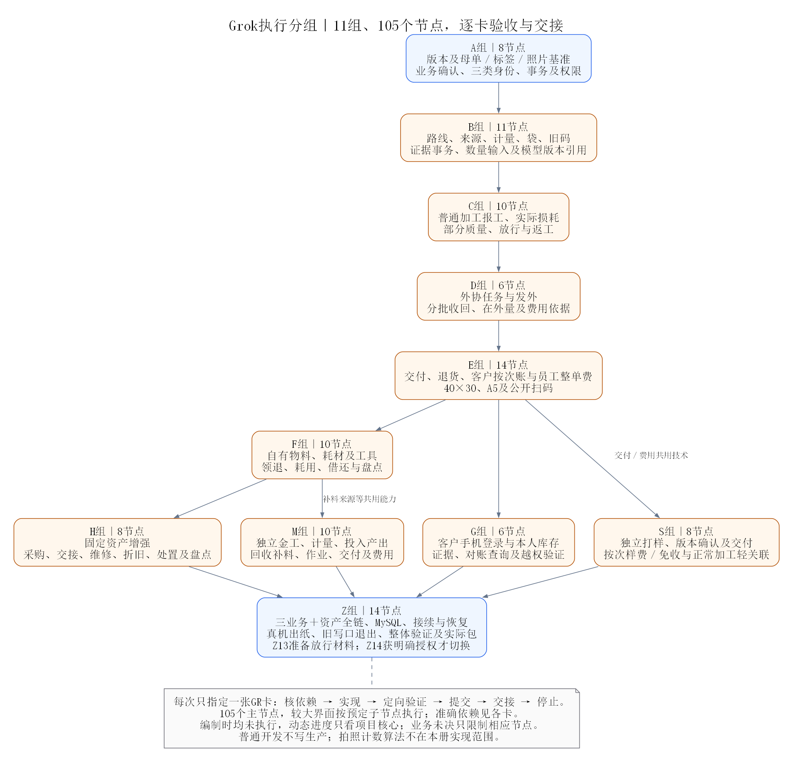

# Grok重构节点执行任务册

日期：2026-10-30。状态：已拆分任务，**全部节点尚未执行**。业务规则只有[完整总方案](../大版本整体重构方案.md)一份；本册负责把它拆成105个可独立交接的执行节点，包含本次新增纳入完整重构的固定资产增强、打样、金工。拍照计数仍只预留契约，识别算法另行开发。

## 使用方式

每次给Grok一张节点指令，例如：

```text
请在 F:\APPkaifa\zhubao-ERP 中执行 docs/重构执行/Grok节点执行任务册.md 的 GR-A01。
先读 AGENTS.md、docs/00_项目核心.md，以及本册“执行总则”和当前节点。
只读当前节点要求的总方案小节及实际调用链，检查前置条件，只完成这一个节点。
按本节点边界实现、做最小充分验证并提交；完成后报告实际变更、验证、提交号和下一节点条件，然后停止，不自动继续下一卡。
不得部署生产、迁移业务库、删除原件或顺带重构其他模块。只有GR-Z14在已获明确发布授权时可以执行实际切换。
```

后续只替换节点ID即可。没有指定节点且核心中没有在执行节点时，先从GR-A01开始；不得把整本任务册当作一次连续开发指令。阅读单卡可先用`rg -n '^### GR-'`定位，再读取该卡和共用总则，不默认通读所有任务。

<a id="execution-rules"></a>

## 执行总则

1. 用户最新要求、AGENTS及完整总方案优先。P/F/I/A/O/S/M为业务任务，`GR-`编号是本册执行节点；未决业务规则写在总方案确认矩阵，不能自行填默认算法、金额、精度或免收权限。
2. 当前服务器重要资产是母单、已印工单标签、照片及相关原收货来源。它们作为基准保护；其他数据先核对，不以未深用推定空库。正常加工、打样、金工保持独立身份和资格，复用共同库存、费用、证据与事务，不把后两者塞成普通加工节点或伪母单。
3. 默认按目录顺序串行执行。前置节点必须有真实产物及适用验证，不能仅看文件存在。业务条件尚未确认时，只停止对应写入或算法节点；其他无依赖工作可由用户另行指定继续。GR-A04的确认记录不是所有未决事项自动确认。
4. 只修改本卡目标直接需要的文件。允许范围中的拟新增模块／测试名是规划，不代表已经存在；先查现有消费者，名称按仓库惯例确定并在交接中记录。不要覆盖其他人的未提交改动，不重置、清库或顺手格式化全仓。
5. 以一个命令、查询、仓储或界面闭环为单位。通常控制在少量直接文件、数百行量级；文件数和行数仅作提醒，不是验收指标。发现本卡实际包含多个独立闭环时，先划出`GR-编号-a/b`子节点，当前只完成明确的一段；父卡所有必需子节点完成前不能称整卡完成，不因卡名大就批量扫库改接口。
6. 继续DDD四层、内存默认／JDBC切换、原构造器兼容惯例和BusinessWorkUnit／WorkSession。数量、金额、权限、版本及请求在相应边界检查，同次提交的仓储真正共用会话；不用单个@Transactional注解代替已有事务机制。正常请求失败不留半笔业务，原请求先回放，锁后重读限额。
7. 迁移只追加，执行时读取实际最高版本后使用下一个编号，不预占一大段、不改旧脚本。不得仅内存能跑而MySQL仍装配到内存；新仓储配置和持久化要有明确验证。H2通过不等于目标MySQL通过。
8. 当前开发期不接生产写入，首发以全部已确认范围完整集成为边界；代码小提交不等于不断往服务器投临时补丁。未完成页面／模块不得用空成功响应、假数据、TODO算法或随意放宽权限冒充可用。
9. 旧母单号、已印码和图片引用接入同一新模型。保留原标签外观及冻结原图；不重复收货、入库或记期初，不补造历史照片、工序和工资。原SampleLibraryWorkspace负责登记导入，不能因名字含Sample就当作打样生产或删除。
10. 三业务共用接口在GR-A03先明确业务引用及资格契约；各领域仍负责自己的状态、路线、完成与收费条件，不建通用流程引擎。实现了web端点再更新正式API文档，设计接口不写成现行可用接口。
11. 每卡按实际影响做最小充分验证；真实实现与关键失败路径优先，不在测试复制业务算法或用mock掩盖事务。文档只检查差异/链接；局部后端不联跑无关前端，反之亦然。完整测试/构建主要集中在GR-Z11，实际包门禁在GR-Z12，不对每卡机械套全仓测试、Docker或打包。
12. 表中的后端测试名／前端测试路径是本卡可复用或新增的验证入口建议。实现前核对名称，实际命令按真实落点替换；不存在的测试不能拿空选择结果当通过。MySQL、真机、实纸或实际快照缺失时明确记待核，不能伪造验收。
13. 有代码或记录变化时独立语义化提交，中文说明本卡范围和验证。只提交自己这张卡的改动，不因无关全量未运行阻止合适的提交；验证失败先修本卡，不借机扩大重构。纯验证复用已有代码提交，记录实际结果，不制造空改动凑提交。
14. 进度、当前节点、已完成区间、未关闭事项和验证摘要只更新docs/00_项目核心.md。本册保留静态任务定义，不另维护第二本进度账；详细旧过程可按项目规则留档，核心不逐条追加长日志。
15. 每卡结束报告下述交接并停止。普通开发节点没有生产发布、业务库试写、外部发消息或删除文件原件的权限；GR-Z13先准备具体放行材料，GR-Z14以真实用户授权为前提，已有明确授权不重复追问。
16. 用户已指定本轮复核的六项问题待整体功能重构完成后统一解决，清单与真实关闭状态只见[项目核心RF-01至RF-06](../00_项目核心.md#deferred-refactor-fixes)。按原节点继续，不为这六项立即插队修复；各业务开发完成后、Z组整版验收开始前安排逐项复验和小提交修复。后续实现已经覆盖的，以真实回归销项，不重复开发，也不因节点完成自动视为已修复。此安排只适用于已登记问题，不把其他验证失败统称可忽略。

后端业务卡的允许范围同时包含该卡**同一个命令／查询**所必需的web边界、请求／响应DTO、鉴权与接口测试；已有专门接口卡的C／D组按专门卡接线。不得把多个后续命令提前暴露，也不得只完成app层就宣称页面可用。前端卡只消费实际已实现接口，缺失时承接回对应后端卡，不能用临时假接口顶替。正式API文档随实际端点同步。

### 已知较大父卡的必拆子节点

105个编号是主节点，以下父卡已经包含多个独立界面闭环，**不得一次全部执行**。执行前先读父卡，再按下表子节点顺序，每次只点名一个；子节点继承父卡依赖、允许范围及相应验收，后一个还依赖前一个的真实产物。每个子节点分别验证、提交、交接并停止。全部子节点完成后才关闭父卡，不能用首个界面完成代表整组功能完成。

| 父节点 | 必拆子节点与单次范围 |
|---|---|
| GR-E09 | `GR-E09-a`本次客户账单与参数恢复；`GR-E09-b`整单员工核算界面。各自只验证对应资格及保存链路 |
| GR-E10 | `GR-E10-a`选袋、核对、确认及原请求恢复；`GR-E10-b`撤销／更正及退货办理 |
| GR-F10 | `GR-F10-a`库存查询及领退；`GR-F10-b`耗材实际耗用；`GR-F10-c`工具借还；`GR-F10-d`实盘和差异复核 |
| GR-H08 | `GR-H08-a`资产卡片查询及购置；`GR-H08-b`位置交接；`GR-H08-c`维修凭据；`GR-H08-d`折旧与处置；`GR-H08-e`逐件盘点。每段只接已实现的对应资产接口 |
| GR-S07 | `GR-S07-a`打样单查询／建单；`GR-S07-b`版本与客户确认；`GR-S07-c`材料与生产拍照；`GR-S07-d`分次交付及样费／免收 |
| GR-M09 | `GR-M09-a`金工单查询／建单及要求版本；`GR-M09-b`金料计量／投入产出；`GR-M09-c`回收补料；`GR-M09-d`生产报工与质量；`GR-M09-e`交付及核定费用 |

子节点也超出一个可核验闭环时，按执行总则继续细分并记录当前实际编号，不扩大本次修改范围。以上为预先划定的执行边界，不是已存在的页面或已通过的测试。

### 单卡完成与交接

完成必须包含本卡所列目标、相应仓储／装配及必要验证；发现环境或业务前提缺失时说清“已实现、待验证、未实现”，不能统一写完成。涉及公共契约变化，列受影响消费者及哪些已在本卡验证，不能擅自承诺后续卡已经接通。

```text
节点：GR-...
实际变更：文件／命令或查询／适用业务引用。
验证：实际命令及结果；尚待核的具体项与影响。
数据与兼容：原母单／码／照片／库存／账务是否受影响，迁移版本或无需迁移。
提交：真实提交号（纯验证说明复用的提交）。
下一节点：依赖是否满足、接口／类实际名称、剩余业务门槛；不自动继续执行。
```

### 路径简称

均相对项目根。不存在的SMP、GLD及新前端目录为**拟新增**；其余以实际调用链核对。

| 简称 | 路径／责任 |
|---|---|
| BIZ | backend/src/main/java/com/zhubao/erp/business；普通加工、母单及必要共用业务 |
| INV／FIN | 同级inventory／finance；唯一实物数量与费用资金 |
| DOC／SEC／WORK | 同级document／security／work；附件、权限与原工作单元 |
| SMP（拟新增） | 同级sampling，按domain/app/infra/web组织独立打样 |
| GLD（拟新增） | 同级goldwork，按domain/app/infra/web组织独立金工 |
| FE | frontend/src/features及实际services调用；新业务各用独立目录 |
| 迁移 | backend/src/main/resources/db/mysql；实施时分配下一实际版本 |
| 规则源 | docs/大版本整体重构方案.md对应锚点；当前实际状态仅项目核心 |

### 验证命令口径

后端节点优先真实目标测试，例如`powershell -ExecutionPolicy Bypass -File scripts/maven.ps1 -f backend/pom.xml "-Dtest=实际测试类" test`；前端节点用`pnpm --filter zhubao-erp-frontend exec vitest run 实际测试路径`，需要时补`pnpm --filter zhubao-erp-frontend exec vue-tsc --noEmit`。双端节点验证相应契约及两侧实际消费方。只读工具对本地导出或隔离库验证无业务写入。

GR-Z11正式整体验收按AGENTS运行本版实际全量测试与生产构建；GR-Z12对实际制作的包调用`verify-runtime-package.ps1 -PackagePath 实际路径`。这些命令不在文档制定阶段执行。

## 分组与依赖导航

以下105个节点全部待执行；按主表定位单卡。基础契约先定，后续实现按依赖推进；登记样本或某个客户尚未准备，不代表可以在没有目标数据的情况下宣称迁移已通过。

| 分组 | 节点 | 数量 | 交付边界 |
|---|---|---:|---|
| 基准、业务确认与共用边界 | [GR-A01](#gr-a01)—[GR-A08](#gr-a08) | 8 | 完成本组小闭环，不单独部署生产 |
| 统一路线、来源、袋及证据契约 | [GR-B01](#gr-b01)—[GR-B11](#gr-b11) | 11 | 完成本组小闭环，不单独部署生产 |
| 普通加工、质量和返工 | [GR-C01](#gr-c01)—[GR-C10](#gr-c10) | 10 | 完成本组小闭环，不单独部署生产 |
| 外协发外与收回 | [GR-D01](#gr-d01)—[GR-D06](#gr-d06) | 6 | 完成本组小闭环，不单独部署生产 |
| 交付、财务、打印和公开扫码 | [GR-E01](#gr-e01)—[GR-E14](#gr-e14) | 14 | 完成本组小闭环，不单独部署生产 |
| 本厂物料、耗材、工具和盘点 | [GR-F01](#gr-f01)—[GR-F10](#gr-f10) | 10 | 完成本组小闭环，不单独部署生产 |
| 客户手机只读入口 | [GR-G01](#gr-g01)—[GR-G06](#gr-g06) | 6 | 完成本组小闭环，不单独部署生产 |
| 固定资产增强 | [GR-H01](#gr-h01)—[GR-H08](#gr-h08) | 8 | 完成本组小闭环，不单独部署生产 |
| 独立打样业务 | [GR-S01](#gr-s01)—[GR-S08](#gr-s08) | 8 | 完成本组小闭环，不单独部署生产 |
| 独立金工业务 | [GR-M01](#gr-m01)—[GR-M10](#gr-m10) | 10 | 完成本组小闭环，不单独部署生产 |
| 全链验收、存量接续与授权切换 | [GR-Z01](#gr-z01)—[GR-Z14](#gr-z14) | 14 | 完成本组小闭环，不单独部署生产 |



## A组：基准、业务确认与共用边界

<a id="gr-a01"></a>

### GR-A01 工作区、版本与受保护资产基准

- **依赖**：无；先核对当前工作区及规则。
- **规则入口**：[总方案对应章节](../大版本整体重构方案.md#implementation-strategy)，只读相关小节及本卡实际调用链。
- **允许修改范围**：Git只读查询、docs/00_项目核心.md及基准说明；需要越界时先说明实际消费者和最小必要改动，不顺带重构。
- **本卡动作**：核对实际分支、已提交版本和三个既有CSS改动，列母单、原工单码、标签原图、照片及来源保护清单；仅安排独立开发分支，不混入用户改动。
- **业务门槛**：无新增未决条件；仍须核对总方案及前置节点实际结论。待核内容不得用假数据、硬编码金额／精度或空实现跳过。
- **验收结果**：保护范围可复现，工作区改动归属明确；不重置文件、不触达服务器写入。
- **最小验证**：只做文档差异、必要链接及格式检查；不运行业务测试、构建或打包。
- **禁止扩展及交接**：遵守执行总则，尤其母单／原码／照片保护、单节点、无生产写入（GR-Z14例外）；有变更独立提交，更新核心当前节点，报告真实验证和下一节点条件后停止。

<a id="gr-a02"></a>

### GR-A02 只读存量核对工具

- **依赖**：[GR-A01](#gr-a01)。
- **规则入口**：[总方案对应章节](../大版本整体重构方案.md#stock-adoption)，只读相关小节及本卡实际调用链。
- **允许修改范围**：scripts/下专用只读核对脚本及对应样本；需要越界时先说明实际消费者和最小必要改动，不顺带重构。
- **本卡动作**：对母单、必要子单、收货库存来源、标签实例、照片引用和少量下游生成只读清单；先在本地导出或隔离副本验证。
- **业务门槛**：无新增未决条件；仍须核对总方案及前置节点实际结论。待核内容不得用假数据、硬编码金额／精度或空实现跳过。
- **验收结果**：无DDL/DML、无原件修改；缺少实际快照时如实标待核，不能声称已完成线上盘点。
- **最小验证**：在本地样本／隔离副本验证只读、确定性和差异报告；禁止在业务库试写。记录实际工具命令与输入快照，不宣称未做的线上核对。
- **禁止扩展及交接**：遵守执行总则，尤其母单／原码／照片保护、单节点、无生产写入（GR-Z14例外）；有变更独立提交，更新核心当前节点，报告真实验证和下一节点条件后停止。

<a id="gr-a03"></a>

### GR-A03 三类业务与共用数据契约冻结

- **依赖**：[GR-A01](#gr-a01)。
- **规则入口**：[总方案对应章节](../大版本整体重构方案.md#business-contracts)，只读相关小节及本卡实际调用链。
- **允许修改范围**：总方案、实际字段设计；本节点不登记未实现API；需要越界时先说明实际消费者和最小必要改动，不顺带重构。
- **本卡动作**：明确普通加工、打样、金工独立身份与完成资格，共用业务引用、客户和物料权属、库存分配、费用和证据关系；核定跨业务汇总交付策略。
- **业务门槛**：无新增未决条件；仍须核对总方案及前置节点实际结论。待核内容不得用假数据、硬编码金额／精度或空实现跳过。
- **验收结果**：保留母单原号；不以伪造普通母单承载另两业务，不建立三套库存或应收账。
- **最小验证**：只做文档差异、必要链接及格式检查；不运行业务测试、构建或打包。
- **禁止扩展及交接**：遵守执行总则，尤其母单／原码／照片保护、单节点、无生产写入（GR-Z14例外）；有变更独立提交，更新核心当前节点，报告真实验证和下一节点条件后停止。

<a id="gr-a04"></a>

### GR-A04 本版关键业务规则确认单

- **依赖**：[GR-A03](#gr-a03)。
- **规则入口**：[总方案对应章节](../大版本整体重构方案.md#confirmation-matrix)，只读相关小节及本卡实际调用链。
- **允许修改范围**：总方案确认矩阵和项目核心；需要越界时先说明实际消费者和最小必要改动，不顺带重构。
- **本卡动作**：记录打样按次交付样费、免收、模型引用等已确认内容；收口金工计量/费用、资产处置折旧、返工计酬及交付混单规则，未决逐项列明。
- **业务门槛**：无新增未决条件；仍须核对总方案及前置节点实际结论。待核内容不得用假数据、硬编码金额／精度或空实现跳过。
- **验收结果**：输出已确认与待核边界；不把整张表待核变成全部任务停工，也不擅自填收费或精度默认值。
- **最小验证**：只做文档差异、必要链接及格式检查；不运行业务测试、构建或打包。
- **禁止扩展及交接**：遵守执行总则，尤其母单／原码／照片保护、单节点、无生产写入（GR-Z14例外）；有变更独立提交，更新核心当前节点，报告真实验证和下一节点条件后停止。

<a id="gr-a05"></a>

### GR-A05 母单、原码、照片和标签保护回归

- **依赖**：[GR-A01](#gr-a01)。
- **规则入口**：[总方案对应章节](../大版本整体重构方案.md#regression-matrix)，只读相关小节及本卡实际调用链。
- **允许修改范围**：既有母单、scan、document、label相关测试及隔离样本；需要越界时先说明实际消费者和最小必要改动，不顺带重构。
- **本卡动作**：补保留行为断言：原号可查、合法维护、照片原件和引用、原码及冻结标签；将P0漏查与重量问题单列已知故障。
- **业务门槛**：无新增未决条件；仍须核对总方案及前置节点实际结论。待核内容不得用假数据、硬编码金额／精度或空实现跳过。
- **验收结果**：真实实现的基准可重跑；不把已知错误记成通过，不改生产照片或标签模板。
- **最小验证**：后端相关测试建议：`powershell -ExecutionPolicy Bypass -File scripts/maven.ps1 -f backend/pom.xml "-Dtest=MotherOrderAdminServiceTest,LabelServiceTest,BusinessEvidenceServiceTest" test`。按实际实现复用或新增这些测试，必要时补直接仓储与授权用例。
- **禁止扩展及交接**：遵守执行总则，尤其母单／原码／照片保护、单节点、无生产写入（GR-Z14例外）；有变更独立提交，更新核心当前节点，报告真实验证和下一节点条件后停止。

<a id="gr-a06"></a>

### GR-A06 有限业务引用与编号契约实现

- **依赖**：[GR-A03](#gr-a03)。
- **规则入口**：[总方案对应章节](../大版本整体重构方案.md#business-contracts)，只读相关小节及本卡实际调用链。
- **允许修改范围**：共用引用值对象及business/domain；不得重写所有通用框架；需要越界时先说明实际消费者和最小必要改动，不顺带重构。
- **本卡动作**：实现三类实际业务引用、稳定身份和必要编号接口；明确原母单标识映射与各自新单号，验证类型、空值和未知来源边界。
- **业务门槛**：无新增未决条件；仍须核对总方案及前置节点实际结论。待核内容不得用假数据、硬编码金额／精度或空实现跳过。
- **验收结果**：来源可区分且可序列化；不会把打样/金工号误解析为普通母单。
- **最小验证**：后端相关测试建议：`powershell -ExecutionPolicy Bypass -File scripts/maven.ps1 -f backend/pom.xml "-Dtest=BusinessTargetReferenceTest" test`。按实际实现复用或新增这些测试，必要时补直接仓储与授权用例。
- **禁止扩展及交接**：遵守执行总则，尤其母单／原码／照片保护、单节点、无生产写入（GR-Z14例外）；有变更独立提交，更新核心当前节点，报告真实验证和下一节点条件后停止。

<a id="gr-a07"></a>

### GR-A07 新仓储工作单元接入基准

- **依赖**：[GR-A06](#gr-a06)。
- **规则入口**：[总方案对应章节](../大版本整体重构方案.md#data-transactions)，只读相关小节及本卡实际调用链。
- **允许修改范围**：work/app及新仓储所需最小接口；相关真实测试；需要越界时先说明实际消费者和最小必要改动，不顺带重构。
- **本卡动作**：为后续新仓储确定WorkSession传递、原请求回放、失败回滚和稳定锁顺序；只补本次确有需要的能力。
- **业务门槛**：无新增未决条件；仍须核对总方案及前置节点实际结论。待核内容不得用假数据、硬编码金额／精度或空实现跳过。
- **验收结果**：内存及JDBC同等语义；独立连接写入不能混入应当同事务的命令。
- **最小验证**：后端相关测试建议：`powershell -ExecutionPolicy Bypass -File scripts/maven.ps1 -f backend/pom.xml "-Dtest=BusinessWorkUnitTest" test`。按实际实现复用或新增这些测试，必要时补直接仓储与授权用例。
- **禁止扩展及交接**：遵守执行总则，尤其母单／原码／照片保护、单节点、无生产写入（GR-Z14例外）；有变更独立提交，更新核心当前节点，报告真实验证和下一节点条件后停止。

<a id="gr-a08"></a>

### GR-A08 三业务、资产与客户权限动作契约

- **依赖**：[GR-A03](#gr-a03)。
- **规则入口**：[总方案对应章节](../大版本整体重构方案.md#business-contracts)，只读相关小节及本卡实际调用链。
- **允许修改范围**：security/domain、PermissionGuard及对应授权测试；需要越界时先说明实际消费者和最小必要改动，不顺带重构。
- **本卡动作**：在现有角色/顶岗/客户范围上定义实际新增动作和查询范围，客户身份只读；为三业务和资产分别限定操作。
- **业务门槛**：无新增未决条件；仍须核对总方案及前置节点实际结论。待核内容不得用假数据、硬编码金额／精度或空实现跳过。
- **验收结果**：不重置账号，不扩大旧岗位全局权限；空客户绑定和无工种拒绝。
- **最小验证**：后端相关测试建议：`powershell -ExecutionPolicy Bypass -File scripts/maven.ps1 -f backend/pom.xml "-Dtest=RefactorPermissionContractTest" test`。按实际实现复用或新增这些测试，必要时补直接仓储与授权用例。
- **禁止扩展及交接**：遵守执行总则，尤其母单／原码／照片保护、单节点、无生产写入（GR-Z14例外）；有变更独立提交，更新核心当前节点，报告真实验证和下一节点条件后停止。

## B组：统一路线、来源、袋及证据契约

<a id="gr-b01"></a>

### GR-B01 工序字典与三业务路线快照

- **依赖**：[GR-A04](#gr-a04)、[GR-A06](#gr-a06)。
- **规则入口**：[总方案对应章节](../大版本整体重构方案.md#process-bags)，只读相关小节及本卡实际调用链。
- **允许修改范围**：business/domain、路线仓储及最小迁移；需要越界时先说明实际消费者和最小必要改动，不顺带重构。
- **本卡动作**：普通加工按材质给默认顺序，打样和金工分别保存自己的实际节点及版本；模板修改不改已确认路线。
- **业务门槛**：无新增未决条件；仍须核对总方案及前置节点实际结论。待核内容不得用假数据、硬编码金额／精度或空实现跳过。
- **验收结果**：抛光珠/金身份不同；独立业务不互为前置，旧母单身份保留。
- **最小验证**：后端相关测试建议：`powershell -ExecutionPolicy Bypass -File scripts/maven.ps1 -f backend/pom.xml "-Dtest=BusinessRouteSnapshotTest" test`。按实际实现复用或新增这些测试，必要时补直接仓储与授权用例。
- **禁止扩展及交接**：遵守执行总则，尤其母单／原码／照片保护、单节点、无生产写入（GR-Z14例外）；有变更独立提交，更新核心当前节点，报告真实验证和下一节点条件后停止。

<a id="gr-b02"></a>

### GR-B02 普通加工目标统一解析

- **依赖**：[GR-A05](#gr-a05)、[GR-A06](#gr-a06)。
- **规则入口**：[总方案对应章节](../大版本整体重构方案.md#process-bags)，只读相关小节及本卡实际调用链。
- **允许修改范围**：business/app、ScanContextService直接解析调用链；需要越界时先说明实际消费者和最小必要改动，不顺带重构。
- **本卡动作**：统一不拆母单和子单的目标解释，读取真实来源及已有状态；不再由每个入口猜执行号。
- **业务门槛**：无新增未决条件；仍须核对总方案及前置节点实际结论。待核内容不得用假数据、硬编码金额／精度或空实现跳过。
- **验收结果**：母单自身执行号与空执行号正确区分；P0样本可定位真实120颗而不改重量。
- **最小验证**：后端相关测试建议：`powershell -ExecutionPolicy Bypass -File scripts/maven.ps1 -f backend/pom.xml "-Dtest=ScanContextServiceTest,KeptMotherOperationContextTest" test`。按实际实现复用或新增这些测试，必要时补直接仓储与授权用例。
- **禁止扩展及交接**：遵守执行总则，尤其母单／原码／照片保护、单节点、无生产写入（GR-Z14例外）；有变更独立提交，更新核心当前节点，报告真实验证和下一节点条件后停止。

<a id="gr-b03"></a>

### GR-B03 权属、单位、称重与保管契约

- **依赖**：[GR-A04](#gr-a04)、[GR-A06](#gr-a06)。
- **规则入口**：[总方案对应章节](../大版本整体重构方案.md#data-transactions)，只读相关小节及本卡实际调用链。
- **允许修改范围**：inventory/domain及相关量值验证；新增迁移按需；需要越界时先说明实际消费者和最小必要改动，不顺带重构。
- **本卡动作**：定义三业务共享的物料来源、计量/精度、未知重量、原料及保管位置契约；解决金工精度与现有三位库存的冲突方案。
- **业务门槛**：金工计量和精度。待核内容不得用假数据、硬编码金额／精度或空实现跳过。
- **验收结果**：不混单位、不将未知记零；外协不改变所有权；不擅自截断金工精度。
- **最小验证**：后端相关测试建议：`powershell -ExecutionPolicy Bypass -File scripts/maven.ps1 -f backend/pom.xml "-Dtest=StockMeasurementContractTest" test`。按实际实现复用或新增这些测试，必要时补直接仓储与授权用例。
- **禁止扩展及交接**：遵守执行总则，尤其母单／原码／照片保护、单节点、无生产写入（GR-Z14例外）；有变更独立提交，更新核心当前节点，报告真实验证和下一节点条件后停止。

<a id="gr-b04"></a>

### GR-B04 袋及活动份额模型与内存仓储

- **依赖**：[GR-B02](#gr-b02)、[GR-B03](#gr-b03)。
- **规则入口**：[总方案对应章节](../大版本整体重构方案.md#process-bags)，只读相关小节及本卡实际调用链。
- **允许修改范围**：business/domain及袋内存仓储；需要越界时先说明实际消费者和最小必要改动，不顺带重构。
- **本卡动作**：实现单目标单主料/要求/来源袋、父子关系、版本和活动叶份额；仅内存模型，不办理真实入库。
- **业务门槛**：无新增未决条件；仍须核对总方案及前置节点实际结论。待核内容不得用假数据、硬编码金额／精度或空实现跳过。
- **验收结果**：父袋关闭后不参与可办理量；同袋状态一致，不创建第二本数量账。
- **最小验证**：后端相关测试建议：`powershell -ExecutionPolicy Bypass -File scripts/maven.ps1 -f backend/pom.xml "-Dtest=BagAllocationModelTest" test`。按实际实现复用或新增这些测试，必要时补直接仓储与授权用例。
- **禁止扩展及交接**：遵守执行总则，尤其母单／原码／照片保护、单节点、无生产写入（GR-Z14例外）；有变更独立提交，更新核心当前节点，报告真实验证和下一节点条件后停止。

<a id="gr-b05"></a>

### GR-B05 袋与份额JDBC仓储

- **依赖**：[GR-B04](#gr-b04)、[GR-A07](#gr-a07)。
- **规则入口**：[总方案对应章节](../大版本整体重构方案.md#data-transactions)，只读相关小节及本卡实际调用链。
- **允许修改范围**：袋infra仓储、配置及追加迁移；需要越界时先说明实际消费者和最小必要改动，不顺带重构。
- **本卡动作**：按B04契约实现JDBC读写、版本和锁定，接入WorkSession及MySQL装配；保留内存默认。
- **业务门槛**：无新增未决条件；仍须核对总方案及前置节点实际结论。待核内容不得用假数据、硬编码金额／精度或空实现跳过。
- **验收结果**：往返读取一致、失败回滚、版本冲突正确；不改旧SQL校验和。
- **最小验证**：后端相关测试建议：`powershell -ExecutionPolicy Bypass -File scripts/maven.ps1 -f backend/pom.xml "-Dtest=BagRepositoryTest" test`。按实际实现复用或新增这些测试，必要时补直接仓储与授权用例。
- **禁止扩展及交接**：遵守执行总则，尤其母单／原码／照片保护、单节点、无生产写入（GR-Z14例外）；有变更独立提交，更新核心当前节点，报告真实验证和下一节点条件后停止。

<a id="gr-b06"></a>

### GR-B06 原收货到初始目标和袋的分配

- **依赖**：[GR-B02](#gr-b02)、[GR-B03](#gr-b03)、[GR-B05](#gr-b05)。
- **规则入口**：[总方案对应章节](../大版本整体重构方案.md#stock-adoption)，只读相关小节及本卡实际调用链。
- **允许修改范围**：business/app、来源分配仓储及inventory直接接口；需要越界时先说明实际消费者和最小必要改动，不顺带重构。
- **本卡动作**：以已存在收货/库存为依据安排目标和初始袋，保存来源映射及分配上限，不新增第二笔收货。
- **业务门槛**：无新增未决条件；仍须核对总方案及前置节点实际结论。待核内容不得用假数据、硬编码金额／精度或空实现跳过。
- **验收结果**：重复安排不重复分配；多来源不能默认塞第一袋；映射本身不虚报开工。
- **最小验证**：后端相关测试建议：`powershell -ExecutionPolicy Bypass -File scripts/maven.ps1 -f backend/pom.xml "-Dtest=InitialBagAllocationTest" test`。按实际实现复用或新增这些测试，必要时补直接仓储与授权用例。
- **禁止扩展及交接**：遵守执行总则，尤其母单／原码／照片保护、单节点、无生产写入（GR-Z14例外）；有变更独立提交，更新核心当前节点，报告真实验证和下一节点条件后停止。

<a id="gr-b07"></a>

### GR-B07 同来源分袋原子命令

- **依赖**：[GR-B06](#gr-b06)。
- **规则入口**：[总方案对应章节](../大版本整体重构方案.md#process-bags)，只读相关小节及本卡实际调用链。
- **允许修改范围**：袋app服务、直接仓储及work边界；需要越界时先说明实际消费者和最小必要改动，不顺带重构。
- **本卡动作**：一次命令关闭父袋并建立互斥子份额，记录原因和原请求结果；仅本次分袋命令。
- **业务门槛**：无新增未决条件；仍须核对总方案及前置节点实际结论。待核内容不得用假数据、硬编码金额／精度或空实现跳过。
- **验收结果**：数量守恒、并发不重复分拆、原请求回放；打印失败不再分一次。
- **最小验证**：后端相关测试建议：`powershell -ExecutionPolicy Bypass -File scripts/maven.ps1 -f backend/pom.xml "-Dtest=BagSplitServiceTest" test`。按实际实现复用或新增这些测试，必要时补直接仓储与授权用例。
- **禁止扩展及交接**：遵守执行总则，尤其母单／原码／照片保护、单节点、无生产写入（GR-Z14例外）；有变更独立提交，更新核心当前节点，报告真实验证和下一节点条件后停止。

<a id="gr-b08"></a>

### GR-B08 旧工单码与新业务码读取适配

- **依赖**：[GR-B02](#gr-b02)、[GR-B07](#gr-b07)、[GR-A06](#gr-a06)。
- **规则入口**：[总方案对应章节](../大版本整体重构方案.md#shipping-printing)，只读相关小节及本卡实际调用链。
- **允许修改范围**：scan解析/查询、必要label引用；不改旧码原图；需要越界时先说明实际消费者和最小必要改动，不顺带重构。
- **本卡动作**：旧母单/子单码映射统一新目标，单袋直达、多袋选择、关闭父袋只读；增加三业务有限类型解析。
- **业务门槛**：无新增未决条件；仍须核对总方案及前置节点实际结论。待核内容不得用假数据、硬编码金额／精度或空实现跳过。
- **验收结果**：旧码不默认第一袋，不从设备/网络判断权限，不续跑旧固定工序算法。
- **最小验证**：后端相关测试建议：`powershell -ExecutionPolicy Bypass -File scripts/maven.ps1 -f backend/pom.xml "-Dtest=ScanContextServiceTest,BusinessCodeReferenceTest" test`。按实际实现复用或新增这些测试，必要时补直接仓储与授权用例。
- **禁止扩展及交接**：遵守执行总则，尤其母单／原码／照片保护、单节点、无生产写入（GR-Z14例外）；有变更独立提交，更新核心当前节点，报告真实验证和下一节点条件后停止。

<a id="gr-b09"></a>

### GR-B09 照片证据引用进入统一事务

- **依赖**：[GR-A07](#gr-a07)、[GR-A08](#gr-a08)。
- **规则入口**：[总方案对应章节](../大版本整体重构方案.md#reporting)，只读相关小节及本卡实际调用链。
- **允许修改范围**：document/domain/app/infra及证据测试；需要越界时先说明实际消费者和最小必要改动，不顺带重构。
- **本卡动作**：让报工、外协和新独立业务按真实对象校验已上传图片并在WorkSession内绑定；保留原母单照片读取。
- **业务门槛**：无新增未决条件；仍须核对总方案及前置节点实际结论。待核内容不得用假数据、硬编码金额／精度或空实现跳过。
- **验收结果**：业务失败不留虚假成功引用，跨单/跨客户拒绝；不改原件、不补造拍摄时间。
- **最小验证**：后端相关测试建议：`powershell -ExecutionPolicy Bypass -File scripts/maven.ps1 -f backend/pom.xml "-Dtest=BusinessEvidenceLinkRepositoryTest,BusinessEvidenceServiceTest" test`。按实际实现复用或新增这些测试，必要时补直接仓储与授权用例。
- **禁止扩展及交接**：遵守执行总则，尤其母单／原码／照片保护、单节点、无生产写入（GR-Z14例外）；有变更独立提交，更新核心当前节点，报告真实验证和下一节点条件后停止。

<a id="gr-b10"></a>

### GR-B10 手填与拍照计数预留契约

- **依赖**：[GR-B09](#gr-b09)、[GR-A06](#gr-a06)。
- **规则入口**：[总方案对应章节](../大版本整体重构方案.md#photo-count)，只读相关小节及本卡实际调用链。
- **允许修改范围**：数量输入DTO、草稿模型和相关验证；不实现识别算法；需要越界时先说明实际消费者和最小必要改动，不顺带重构。
- **本卡动作**：保留MANUAL/PHOTO_COUNT来源、可选结果引用、原识别数与确认数及上下文；当前未传来源按手填。
- **业务门槛**：无新增未决条件；仍须核对总方案及前置节点实际结论。待核内容不得用假数据、硬编码金额／精度或空实现跳过。
- **验收结果**：算法未接入照常手填；不部署空识别接口，不显示假可用按钮，不自动记损耗。
- **最小验证**：后端相关测试建议：`powershell -ExecutionPolicy Bypass -File scripts/maven.ps1 -f backend/pom.xml "-Dtest=QuantityInputContractTest" test`。按实际实现复用或新增这些测试，必要时补直接仓储与授权用例。
- **禁止扩展及交接**：遵守执行总则，尤其母单／原码／照片保护、单节点、无生产写入（GR-Z14例外）；有变更独立提交，更新核心当前节点，报告真实验证和下一节点条件后停止。

<a id="gr-b11"></a>

### GR-B11 模型版本引用与轻量确认凭据

- **依赖**：[GR-A04](#gr-a04)、[GR-A08](#gr-a08)、[GR-B09](#gr-b09)。
- **规则入口**：[总方案对应章节](../大版本整体重构方案.md#design-files)，只读相关小节及本卡实际调用链。
- **允许修改范围**：document引用模型及版本附件组件的最小扩展；需要越界时先说明实际消费者和最小必要改动，不顺带重构。
- **本卡动作**：保存模型文件名/格式/版本/外部存放说明和关键截图/PDF引用，默认不上传大型3D源文件；保留将来扩展边界。
- **业务门槛**：无新增未决条件；仍须核对总方案及前置节点实际结论。待核内容不得用假数据、硬编码金额／精度或空实现跳过。
- **验收结果**：原图稿与确认可追溯；不抓取任意URL、不读取任意本地路径，不新增3D编辑或在线渲染器。
- **最小验证**：后端相关测试建议：`powershell -ExecutionPolicy Bypass -File scripts/maven.ps1 -f backend/pom.xml "-Dtest=DesignArtifactReferenceTest" test`。按实际实现复用或新增这些测试，必要时补直接仓储与授权用例。
- **禁止扩展及交接**：遵守执行总则，尤其母单／原码／照片保护、单节点、无生产写入（GR-Z14例外）；有变更独立提交，更新核心当前节点，报告真实验证和下一节点条件后停止。

## C组：普通加工、质量和返工

<a id="gr-c01"></a>

### GR-C01 节点接收量与可办理查询

- **依赖**：[GR-B01](#gr-b01)、[GR-B02](#gr-b02)、[GR-B06](#gr-b06)。
- **规则入口**：[总方案对应章节](../大版本整体重构方案.md#reporting)，只读相关小节及本卡实际调用链。
- **允许修改范围**：business/app只读查询及共享动作结果；需要越界时先说明实际消费者和最小必要改动，不顺带重构。
- **本卡动作**：按实际已到份额、路线及有效权限给出当前可处理量、下一步与阻断原因。
- **业务门槛**：无新增未决条件；仍须核对总方案及前置节点实际结论。待核内容不得用假数据、硬编码金额／精度或空实现跳过。
- **验收结果**：上道未到不借原始量补齐；查询不写库存、工资或完成事实。
- **最小验证**：后端相关测试建议：`powershell -ExecutionPolicy Bypass -File scripts/maven.ps1 -f backend/pom.xml "-Dtest=ProcessAvailableQuantityTest" test`。按实际实现复用或新增这些测试，必要时补直接仓储与授权用例。
- **禁止扩展及交接**：遵守执行总则，尤其母单／原码／照片保护、单节点、无生产写入（GR-Z14例外）；有变更独立提交，更新核心当前节点，报告真实验证和下一节点条件后停止。

<a id="gr-c02"></a>

### GR-C02 正常整袋独立拍照报工

- **依赖**：[GR-C01](#gr-c01)、[GR-B09](#gr-b09)、[GR-B10](#gr-b10)。
- **规则入口**：[总方案对应章节](../大版本整体重构方案.md#reporting)，只读相关小节及本卡实际调用链。
- **允许修改范围**：ProcessStationService相关新命令及直接仓储；需要越界时先说明实际消费者和最小必要改动，不顺带重构。
- **本卡动作**：实现一次正常整袋报工、照片校验、数量和批次/原请求保存；进度百分比仍只是可选记录。
- **业务门槛**：无新增未决条件；仍须核对总方案及前置节点实际结论。待核内容不得用假数据、硬编码金额／精度或空实现跳过。
- **验收结果**：无有效照片拒绝；超时重试同批，不先记100%才能交工，不自动产生工资。
- **最小验证**：后端相关测试建议：`powershell -ExecutionPolicy Bypass -File scripts/maven.ps1 -f backend/pom.xml "-Dtest=ProcessStationServiceTest" test`。按实际实现复用或新增这些测试，必要时补直接仓储与授权用例。
- **禁止扩展及交接**：遵守执行总则，尤其母单／原码／照片保护、单节点、无生产写入（GR-Z14例外）；有变更独立提交，更新核心当前节点，报告真实验证和下一节点条件后停止。

<a id="gr-c03"></a>

### GR-C03 部分交工与损耗处置闭合

- **依赖**：[GR-C02](#gr-c02)、[GR-B07](#gr-b07)、[GR-B03](#gr-b03)。
- **规则入口**：[总方案对应章节](../大版本整体重构方案.md#reporting)，只读相关小节及本卡实际调用链。
- **允许修改范围**：报工数量处置命令、库存实际变动及相关仓储；需要越界时先说明实际消费者和最小必要改动，不顺带重构。
- **本卡动作**：接入部分交出/剩余、损耗/实物报废/退回/待核的互斥去向，按上道真正关闭和本节点闭合判完成。
- **业务门槛**：无新增未决条件；仍须核对总方案及前置节点实际结论。待核内容不得用假数据、硬编码金额／精度或空实现跳过。
- **验收结果**：500→480→470→465可流转；少量未到不提前关整道，待核不自动算损耗，全损不造正产出。
- **最小验证**：后端相关测试建议：`powershell -ExecutionPolicy Bypass -File scripts/maven.ps1 -f backend/pom.xml "-Dtest=ProcessQuantityDispositionTest" test`。按实际实现复用或新增这些测试，必要时补直接仓储与授权用例。
- **禁止扩展及交接**：遵守执行总则，尤其母单／原码／照片保护、单节点、无生产写入（GR-Z14例外）；有变更独立提交，更新核心当前节点，报告真实验证和下一节点条件后停止。

<a id="gr-c04"></a>

### GR-C04 实称重量、补录与待复称接续

- **依赖**：[GR-C03](#gr-c03)。
- **规则入口**：[总方案对应章节](../大版本整体重构方案.md#reporting)，只读相关小节及本卡实际调用链。
- **允许修改范围**：称重命令及库存/袋适用重量字段；需要越界时先说明实际消费者和最小必要改动，不顺带重构。
- **本卡动作**：补真实称重及零数量重量补录，实物减少后标待复称，确认所需实重再转移或发货。
- **业务门槛**：无新增未决条件；仍须核对总方案及前置节点实际结论。待核内容不得用假数据、硬编码金额／精度或空实现跳过。
- **验收结果**：不复制原整袋重量到所有子袋、不按颗数估克；补录不重复工序数量和工费。
- **最小验证**：后端相关测试建议：`powershell -ExecutionPolicy Bypass -File scripts/maven.ps1 -f backend/pom.xml "-Dtest=ProcessWeightReconciliationTest" test`。按实际实现复用或新增这些测试，必要时补直接仓储与授权用例。
- **禁止扩展及交接**：遵守执行总则，尤其母单／原码／照片保护、单节点、无生产写入（GR-Z14例外）；有变更独立提交，更新核心当前节点，报告真实验证和下一节点条件后停止。

<a id="gr-c05"></a>

### GR-C05 按份额录入质量检查

- **依赖**：[GR-B07](#gr-b07)、[GR-B09](#gr-b09)、[GR-B01](#gr-b01)。
- **规则入口**：[总方案对应章节](../大版本整体重构方案.md#quality)，只读相关小节及本卡实际调用链。
- **允许修改范围**：QualityRequirementService领域检查记录及直接仓储；需要越界时先说明实际消费者和最小必要改动，不顺带重构。
- **本卡动作**：记录实际检查范围、条款和互斥结果，支持合格/返工/报废/待核，保留要求版本。
- **业务门槛**：无新增未决条件；仍须核对总方案及前置节点实际结论。待核内容不得用假数据、硬编码金额／精度或空实现跳过。
- **验收结果**：同一颗多条不合格不重复计数；本次结论不覆盖其他袋。
- **最小验证**：后端相关测试建议：`powershell -ExecutionPolicy Bypass -File scripts/maven.ps1 -f backend/pom.xml "-Dtest=QualityPortionInspectionTest" test`。按实际实现复用或新增这些测试，必要时补直接仓储与授权用例。
- **禁止扩展及交接**：遵守执行总则，尤其母单／原码／照片保护、单节点、无生产写入（GR-Z14例外）；有变更独立提交，更新核心当前节点，报告真实验证和下一节点条件后停止。

<a id="gr-c06"></a>

### GR-C06 部分放行、冻结与可发条件

- **依赖**：[GR-C05](#gr-c05)、[GR-C04](#gr-c04)、[GR-A08](#gr-a08)。
- **规则入口**：[总方案对应章节](../大版本整体重构方案.md#quality)，只读相关小节及本卡实际调用链。
- **允许修改范围**：质量放行/冻结命令及共用可办理查询；需要越界时先说明实际消费者和最小必要改动，不顺带重构。
- **本卡动作**：对明确份额放行/冻结；可发同时检查必要工序、适用重量、数量及允许保管位置。
- **业务门槛**：无新增未决条件；仍须核对总方案及前置节点实际结论。待核内容不得用假数据、硬编码金额／精度或空实现跳过。
- **验收结果**：合格但穿串未完、外协未回或冻结份额不能当厂内可发；重复放行不双计。
- **最小验证**：后端相关测试建议：`powershell -ExecutionPolicy Bypass -File scripts/maven.ps1 -f backend/pom.xml "-Dtest=QualityDeliveryTest,QualityPortionReleaseTest" test`。按实际实现复用或新增这些测试，必要时补直接仓储与授权用例。
- **禁止扩展及交接**：遵守执行总则，尤其母单／原码／照片保护、单节点、无生产写入（GR-Z14例外）；有变更独立提交，更新核心当前节点，报告真实验证和下一节点条件后停止。

<a id="gr-c07"></a>

### GR-C07 返工任务及复检接续

- **依赖**：[GR-C06](#gr-c06)、[GR-C02](#gr-c02)。
- **规则入口**：[总方案对应章节](../大版本整体重构方案.md#quality)，只读相关小节及本卡实际调用链。
- **允许修改范围**：返工app及作业/质量来源；需要越界时先说明实际消费者和最小必要改动，不顺带重构。
- **本卡动作**：按原不合格份额开返工路线，复用真正报工和复检，保留原要求与轮次。
- **业务门槛**：无新增未决条件；仍须核对总方案及前置节点实际结论。待核内容不得用假数据、硬编码金额／精度或空实现跳过。
- **验收结果**：复检只作用于返工份额；不重建无来源母单、不自动决定返工额外计酬。
- **最小验证**：后端相关测试建议：`powershell -ExecutionPolicy Bypass -File scripts/maven.ps1 -f backend/pom.xml "-Dtest=ReworkPortionLifecycleTest" test`。按实际实现复用或新增这些测试，必要时补直接仓储与授权用例。
- **禁止扩展及交接**：遵守执行总则，尤其母单／原码／照片保护、单节点、无生产写入（GR-Z14例外）；有变更独立提交，更新核心当前节点，报告真实验证和下一节点条件后停止。

<a id="gr-c08"></a>

### GR-C08 加工质量HTTP契约与动作入口

- **依赖**：[GR-C03](#gr-c03)、[GR-C04](#gr-c04)、[GR-C07](#gr-c07)、[GR-A08](#gr-a08)。
- **规则入口**：[总方案对应章节](../大版本整体重构方案.md#data-transactions)，只读相关小节及本卡实际调用链。
- **允许修改范围**：business/web、相关Api DTO及正式API文档；需要越界时先说明实际消费者和最小必要改动，不顺带重构。
- **本卡动作**：接通已实现命令/查询和授权，返回统一阻断原因/版本/真实批次；不增第二套写服务。
- **业务门槛**：无新增未决条件；仍须核对总方案及前置节点实际结论。待核内容不得用假数据、硬编码金额／精度或空实现跳过。
- **验收结果**：跨客户、错袋/节点、过期版本拒绝；原请求先回放；API文档只登记已实现端点。
- **最小验证**：后端相关测试建议：`powershell -ExecutionPolicy Bypass -File scripts/maven.ps1 -f backend/pom.xml "-Dtest=ProductionQualityApiTest" test`。按实际实现复用或新增这些测试，必要时补直接仓储与授权用例。
- **禁止扩展及交接**：遵守执行总则，尤其母单／原码／照片保护、单节点、无生产写入（GR-Z14例外）；有变更独立提交，更新核心当前节点，报告真实验证和下一节点条件后停止。

<a id="gr-c09"></a>

### GR-C09 手机生产报工界面

- **依赖**：[GR-C08](#gr-c08)、[GR-B10](#gr-b10)。
- **规则入口**：[总方案对应章节](../大版本整体重构方案.md#reporting)，只读相关小节及本卡实际调用链。
- **允许修改范围**：FE/production、orders生产动作及服务调用；需要越界时先说明实际消费者和最小必要改动，不顺带重构。
- **本卡动作**：实现扫袋、拍照、核数、一次提交，异常去向按需展开；保留草稿、原请求和未上传照片。
- **业务门槛**：无新增未决条件；仍须核对总方案及前置节点实际结论。待核内容不得用假数据、硬编码金额／精度或空实现跳过。
- **验收结果**：弱网不清单另报、切目标不串值；不开放计数假按钮；不改母单标签样式。
- **最小验证**：前端相关测试建议：`pnpm --filter zhubao-erp-frontend exec vitest run src/features/orders/ProductionActionPane.test.ts`；涉及类型契约时补vue-tsc。先核对或新增真实测试路径。
- **禁止扩展及交接**：遵守执行总则，尤其母单／原码／照片保护、单节点、无生产写入（GR-Z14例外）；有变更独立提交，更新核心当前节点，报告真实验证和下一节点条件后停止。

<a id="gr-c10"></a>

### GR-C10 部分质检与返工办理界面

- **依赖**：[GR-C08](#gr-c08)。
- **规则入口**：[总方案对应章节](../大版本整体重构方案.md#quality)，只读相关小节及本卡实际调用链。
- **允许修改范围**：FE/quality、orders质量动作及服务调用；需要越界时先说明实际消费者和最小必要改动，不顺带重构。
- **本卡动作**：显示实际袋份额、条款、放行/冻结和返工去向，单次范围明确。
- **业务门槛**：无新增未决条件；仍须核对总方案及前置节点实际结论。待核内容不得用假数据、硬编码金额／精度或空实现跳过。
- **验收结果**：合格部分可继续、问题部分可追溯；缺条件显示具体原因，不靠前端百分比放行。
- **最小验证**：前端相关测试建议：`pnpm --filter zhubao-erp-frontend exec vitest run src/features/orders/QualityActionPane.test.ts`；涉及类型契约时补vue-tsc。先核对或新增真实测试路径。
- **禁止扩展及交接**：遵守执行总则，尤其母单／原码／照片保护、单节点、无生产写入（GR-Z14例外）；有变更独立提交，更新核心当前节点，报告真实验证和下一节点条件后停止。

## D组：外协发外与收回

<a id="gr-d01"></a>

### GR-D01 外协方与任务来源仓储

- **依赖**：[GR-B03](#gr-b03)、[GR-B05](#gr-b05)、[GR-A08](#gr-a08)。
- **规则入口**：[总方案对应章节](../大版本整体重构方案.md#outsourcing)，只读相关小节及本卡实际调用链。
- **允许修改范围**：business外协domain/app/infra及必要迁移；需要越界时先说明实际消费者和最小必要改动，不顺带重构。
- **本卡动作**：用最小外协方稳定身份、原目标/节点/所发袋建立任务，保留名称快照与权属。
- **业务门槛**：无新增未决条件；仍须核对总方案及前置节点实际结论。待核内容不得用假数据、硬编码金额／精度或空实现跳过。
- **验收结果**：不是供应商门户，不把外协方当客户或员工；内存/JDBC一致。
- **最小验证**：后端相关测试建议：`powershell -ExecutionPolicy Bypass -File scripts/maven.ps1 -f backend/pom.xml "-Dtest=OutsourcingTaskRepositoryTest" test`。按实际实现复用或新增这些测试，必要时补直接仓储与授权用例。
- **禁止扩展及交接**：遵守执行总则，尤其母单／原码／照片保护、单节点、无生产写入（GR-Z14例外）；有变更独立提交，更新核心当前节点，报告真实验证和下一节点条件后停止。

<a id="gr-d02"></a>

### GR-D02 部分发外与保管流转命令

- **依赖**：[GR-D01](#gr-d01)、[GR-B07](#gr-b07)、[GR-A07](#gr-a07)。
- **规则入口**：[总方案对应章节](../大版本整体重构方案.md#outsourcing)，只读相关小节及本卡实际调用链。
- **允许修改范围**：外协发外app、库存保管位置及原请求；需要越界时先说明实际消费者和最小必要改动，不顺带重构。
- **本卡动作**：确认所发份额并从本厂转外协保管；部分发外先分袋，来源不变。
- **业务门槛**：无新增未决条件；仍须核对总方案及前置节点实际结论。待核内容不得用假数据、硬编码金额／精度或空实现跳过。
- **验收结果**：不生成客户出货/应收/员工产量；并发与重试不超发、在外仍计受托总量。
- **最小验证**：后端相关测试建议：`powershell -ExecutionPolicy Bypass -File scripts/maven.ps1 -f backend/pom.xml "-Dtest=OutsourcingDispatchTest" test`。按实际实现复用或新增这些测试，必要时补直接仓储与授权用例。
- **禁止扩展及交接**：遵守执行总则，尤其母单／原码／照片保护、单节点、无生产写入（GR-Z14例外）；有变更独立提交，更新核心当前节点，报告真实验证和下一节点条件后停止。

<a id="gr-d03"></a>

### GR-D03 分批收回与差异待核

- **依赖**：[GR-D02](#gr-d02)、[GR-B03](#gr-b03)。
- **规则入口**：[总方案对应章节](../大版本整体重构方案.md#outsourcing)，只读相关小节及本卡实际调用链。
- **允许修改范围**：收回命令、原发外行及实物来源；需要越界时先说明实际消费者和最小必要改动，不顺带重构。
- **本卡动作**：按原发外行核对本次实收、实重、未加工退回与差异；保存剩余在外。
- **业务门槛**：无新增未决条件；仍须核对总方案及前置节点实际结论。待核内容不得用假数据、硬编码金额／精度或空实现跳过。
- **验收结果**：发200收150损5仍外45闭合；少回不自动清结，重复收回拒绝或回放。
- **最小验证**：后端相关测试建议：`powershell -ExecutionPolicy Bypass -File scripts/maven.ps1 -f backend/pom.xml "-Dtest=OutsourcingReturnTest" test`。按实际实现复用或新增这些测试，必要时补直接仓储与授权用例。
- **禁止扩展及交接**：遵守执行总则，尤其母单／原码／照片保护、单节点、无生产写入（GR-Z14例外）；有变更独立提交，更新核心当前节点，报告真实验证和下一节点条件后停止。

<a id="gr-d04"></a>

### GR-D04 外协作业回接与费用依据

- **依赖**：[GR-D03](#gr-d03)、[GR-C07](#gr-c07)。
- **规则入口**：[总方案对应章节](../大版本整体重构方案.md#outsourcing)，只读相关小节及本卡实际调用链。
- **允许修改范围**：外协作业确认与finance来源引用；需要越界时先说明实际消费者和最小必要改动，不顺带重构。
- **本卡动作**：按真实回收份额接原路线和质量条件，输出外协费用依据，不自动入客户账或内部工资。
- **业务门槛**：无新增未决条件；仍须核对总方案及前置节点实际结论。待核内容不得用假数据、硬编码金额／精度或空实现跳过。
- **验收结果**：收回不自动质量放行，未加工退回不写完工，外协完成量只记一次。
- **最小验证**：后端相关测试建议：`powershell -ExecutionPolicy Bypass -File scripts/maven.ps1 -f backend/pom.xml "-Dtest=OutsourcingCompletionSourceTest" test`。按实际实现复用或新增这些测试，必要时补直接仓储与授权用例。
- **禁止扩展及交接**：遵守执行总则，尤其母单／原码／照片保护、单节点、无生产写入（GR-Z14例外）；有变更独立提交，更新核心当前节点，报告真实验证和下一节点条件后停止。

<a id="gr-d05"></a>

### GR-D05 外协查询、授权与接口

- **依赖**：[GR-D04](#gr-d04)、[GR-A08](#gr-a08)。
- **规则入口**：[总方案对应章节](../大版本整体重构方案.md#outsourcing)，只读相关小节及本卡实际调用链。
- **允许修改范围**：外协web/查询及相关API文档；需要越界时先说明实际消费者和最小必要改动，不顺带重构。
- **本卡动作**：提供本厂/在外/待核/分次收回及来源明细，服务端统一客户范围与经办权限。
- **业务门槛**：无新增未决条件；仍须核对总方案及前置节点实际结论。待核内容不得用假数据、硬编码金额／精度或空实现跳过。
- **验收结果**：外协不冒充厂内现货；错客户/错发外行/未授权附件拒绝。
- **最小验证**：后端相关测试建议：`powershell -ExecutionPolicy Bypass -File scripts/maven.ps1 -f backend/pom.xml "-Dtest=OutsourcingApiTest" test`。按实际实现复用或新增这些测试，必要时补直接仓储与授权用例。
- **禁止扩展及交接**：遵守执行总则，尤其母单／原码／照片保护、单节点、无生产写入（GR-Z14例外）；有变更独立提交，更新核心当前节点，报告真实验证和下一节点条件后停止。

<a id="gr-d06"></a>

### GR-D06 外协发外收回界面

- **依赖**：[GR-D05](#gr-d05)。
- **规则入口**：[总方案对应章节](../大版本整体重构方案.md#outsourcing)，只读相关小节及本卡实际调用链。
- **允许修改范围**：FE/outsourcing拟新增及最小导航接入；需要越界时先说明实际消费者和最小必要改动，不顺带重构。
- **本卡动作**：在原单据上下文选袋发外、按原行分次收回，显示在外量和待核。
- **业务门槛**：无新增未决条件；仍须核对总方案及前置节点实际结论。待核内容不得用假数据、硬编码金额／精度或空实现跳过。
- **验收结果**：不重复录客户和主料来源；不新增外协账号平台，不擅自支持直发客户。
- **最小验证**：前端相关测试建议：`pnpm --filter zhubao-erp-frontend exec vitest run src/features/outsourcing/OutsourcingWorkspace.test.ts`；涉及类型契约时补vue-tsc。先核对或新增真实测试路径。
- **禁止扩展及交接**：遵守执行总则，尤其母单／原码／照片保护、单节点、无生产写入（GR-Z14例外）；有变更独立提交，更新核心当前节点，报告真实验证和下一节点条件后停止。

## E组：交付、财务、打印和公开扫码

<a id="gr-e01"></a>

### GR-E01 独立交付草稿与来源范围

- **依赖**：[GR-B07](#gr-b07)、[GR-C06](#gr-c06)、[GR-A06](#gr-a06)。
- **规则入口**：[总方案对应章节](../大版本整体重构方案.md#shipping-printing)，只读相关小节及本卡实际调用链。
- **允许修改范围**：business交付domain/app/infra及追加迁移；需要越界时先说明实际消费者和最小必要改动，不顺带重构。
- **本卡动作**：建立独立发货头/来源明细草稿，设计三业务类型解析；普通加工同客户多目标按已定规则汇总。
- **业务门槛**：跨业务交付混单规则。待核内容不得用假数据、硬编码金额／精度或空实现跳过。
- **验收结果**：草稿不扣库，不混客户；跨业务混单策略未定时不自行放开，也不伪造普通工单。
- **最小验证**：后端相关测试建议：`powershell -ExecutionPolicy Bypass -File scripts/maven.ps1 -f backend/pom.xml "-Dtest=DeliveryDraftTest" test`。按实际实现复用或新增这些测试，必要时补直接仓储与授权用例。
- **禁止扩展及交接**：遵守执行总则，尤其母单／原码／照片保护、单节点、无生产写入（GR-Z14例外）；有变更独立提交，更新核心当前节点，报告真实验证和下一节点条件后停止。

<a id="gr-e02"></a>

### GR-E02 多袋交付一次确认

- **依赖**：[GR-E01](#gr-e01)、[GR-A07](#gr-a07)。
- **规则入口**：[总方案对应章节](../大版本整体重构方案.md#shipping-printing)，只读相关小节及本卡实际调用链。
- **允许修改范围**：交付确认、库存、袋及命令结果仓储；需要越界时先说明实际消费者和最小必要改动，不顺带重构。
- **本卡动作**：同事务确认全部来源、逐份额出库、交付快照及原请求结果，历史出库作为来源读取。
- **业务门槛**：无新增未决条件；仍须核对总方案及前置节点实际结论。待核内容不得用假数据、硬编码金额／精度或空实现跳过。
- **验收结果**：任一明细失败全部回滚，两草稿竞争不能双发，汇总不额外再扣一次库。
- **最小验证**：后端相关测试建议：`powershell -ExecutionPolicy Bypass -File scripts/maven.ps1 -f backend/pom.xml "-Dtest=ShippingDeliveryTest,DeliveryConfirmationTest" test`。按实际实现复用或新增这些测试，必要时补直接仓储与授权用例。
- **禁止扩展及交接**：遵守执行总则，尤其母单／原码／照片保护、单节点、无生产写入（GR-Z14例外）；有变更独立提交，更新核心当前节点，报告真实验证和下一节点条件后停止。

<a id="gr-e03"></a>

### GR-E03 交付误录、取消与更正边界

- **依赖**：[GR-E02](#gr-e02)、[GR-A04](#gr-a04)。
- **规则入口**：[总方案对应章节](../大版本整体重构方案.md#exception-decisions)，只读相关小节及本卡实际调用链。
- **允许修改范围**：交付更正命令及影响查询；需要越界时先说明实际消费者和最小必要改动，不顺带重构。
- **本卡动作**：按已核定的尚未交接/已有下游等状态处理更正或取消，保留原事实与反向来源。
- **业务门槛**：交接与取消规则。待核内容不得用假数据、硬编码金额／精度或空实现跳过。
- **验收结果**：不直接覆盖已消费数量，不删除客户已确认费用或退款；不以取消重开抹平历史。
- **最小验证**：后端相关测试建议：`powershell -ExecutionPolicy Bypass -File scripts/maven.ps1 -f backend/pom.xml "-Dtest=DeliveryCorrectionTest" test`。按实际实现复用或新增这些测试，必要时补直接仓储与授权用例。
- **禁止扩展及交接**：遵守执行总则，尤其母单／原码／照片保护、单节点、无生产写入（GR-Z14例外）；有变更独立提交，更新核心当前节点，报告真实验证和下一节点条件后停止。

<a id="gr-e04"></a>

### GR-E04 客户退货与售后来源

- **依赖**：[GR-E02](#gr-e02)、[GR-C07](#gr-c07)、[GR-A04](#gr-a04)。
- **规则入口**：[总方案对应章节](../大版本整体重构方案.md#exception-decisions)，只读相关小节及本卡实际调用链。
- **允许修改范围**：退货/售后app及实际库存引用；需要越界时先说明实际消费者和最小必要改动，不顺带重构。
- **本卡动作**：关联原出货收回明确份额为待复核，输出返修/费用调整依据，不直接重开全部已结束目标。
- **业务门槛**：售后返修与计酬规则。待核内容不得用假数据、硬编码金额／精度或空实现跳过。
- **验收结果**：退回不自动合格或删账；不自动重复工资；数量不得超过有效原交付。
- **最小验证**：后端相关测试建议：`powershell -ExecutionPolicy Bypass -File scripts/maven.ps1 -f backend/pom.xml "-Dtest=CustomerReturnSourceTest" test`。按实际实现复用或新增这些测试，必要时补直接仓储与授权用例。
- **禁止扩展及交接**：遵守执行总则，尤其母单／原码／照片保护、单节点、无生产写入（GR-Z14例外）；有变更独立提交，更新核心当前节点，报告真实验证和下一节点条件后停止。

<a id="gr-e05"></a>

### GR-E05 有限计费方法和计算快照

- **依赖**：[GR-A04](#gr-a04)、[GR-A06](#gr-a06)。
- **规则入口**：[总方案对应章节](../大版本整体重构方案.md#finance)，只读相关小节及本卡实际调用链。
- **允许修改范围**：finance/domain计算与价格输入校验；需要越界时先说明实际消费者和最小必要改动，不顺带重构。
- **本卡动作**：实现数量单价、基数扣数量、议定金额与有依据调整，保存单位/精度/舍入/依据及原始覆盖。
- **业务门槛**：无新增未决条件；仍须核对总方案及前置节点实际结论。待核内容不得用假数据、硬编码金额／精度或空实现跳过。
- **验收结果**：462按实发收费不自动再减38；多收费项目不多算实发量；不建脚本引擎。
- **最小验证**：后端相关测试建议：`powershell -ExecutionPolicy Bypass -File scripts/maven.ps1 -f backend/pom.xml "-Dtest=CustomerChargeCalculationTest" test`。按实际实现复用或新增这些测试，必要时补直接仓储与授权用例。
- **禁止扩展及交接**：遵守执行总则，尤其母单／原码／照片保护、单节点、无生产写入（GR-Z14例外）；有变更独立提交，更新核心当前节点，报告真实验证和下一节点条件后停止。

<a id="gr-e06"></a>

### GR-E06 客户账单独立确认与差额调整

- **依赖**：[GR-E05](#gr-e05)、[GR-E02](#gr-e02)、[GR-A07](#gr-a07)。
- **规则入口**：[总方案对应章节](../大版本整体重构方案.md#finance)，只读相关小节及本卡实际调用链。
- **允许修改范围**：finance客户账单app/infra及AR来源；需要越界时先说明实际消费者和最小必要改动，不顺带重构。
- **本卡动作**：确认本次可计费交付覆盖并写应收，旧正式凭据若有先核覆盖，后续调整同根追加。
- **业务门槛**：无新增未决条件；仍须核对总方案及前置节点实际结论。待核内容不得用假数据、硬编码金额／精度或空实现跳过。
- **验收结果**：未交齐仍可出本次账；无工资权限仍可在授权范围出账；并发/重试不重复应收。
- **最小验证**：后端相关测试建议：`powershell -ExecutionPolicy Bypass -File scripts/maven.ps1 -f backend/pom.xml "-Dtest=CustomerDeliveryBillingTest" test`。按实际实现复用或新增这些测试，必要时补直接仓储与授权用例。
- **禁止扩展及交接**：遵守执行总则，尤其母单／原码／照片保护、单节点、无生产写入（GR-Z14例外）；有变更独立提交，更新核心当前节点，报告真实验证和下一节点条件后停止。

<a id="gr-e07"></a>

### GR-E07 员工整单核算与应付

- **依赖**：[GR-C07](#gr-c07)、[GR-E05](#gr-e05)、[GR-A04](#gr-a04)。
- **规则入口**：[总方案对应章节](../大版本整体重构方案.md#finance)，只读相关小节及本卡实际调用链。
- **允许修改范围**：finance员工核算app及工资/AP来源；需要越界时先说明实际消费者和最小必要改动，不顺带重构。
- **本卡动作**：按实际作业、计酬人员份额和目标整体闭合确认工费；为三业务保留各自完成资格适配。
- **业务门槛**：多人代报、返工及全损计酬。待核内容不得用假数据、硬编码金额／精度或空实现跳过。
- **验收结果**：不因客户收款或发一次货就再算工资；外协不算员工产量，费用和实物损耗不自动连扣。
- **最小验证**：后端相关测试建议：`powershell -ExecutionPolicy Bypass -File scripts/maven.ps1 -f backend/pom.xml "-Dtest=EmployeeTargetSettlementTest" test`。按实际实现复用或新增这些测试，必要时补直接仓储与授权用例。
- **禁止扩展及交接**：遵守执行总则，尤其母单／原码／照片保护、单节点、无生产写入（GR-Z14例外）；有变更独立提交，更新核心当前节点，报告真实验证和下一节点条件后停止。

<a id="gr-e08"></a>

### GR-E08 核销接续与财务待办读模型

- **依赖**：[GR-E06](#gr-e06)、[GR-E07](#gr-e07)。
- **规则入口**：[总方案对应章节](../大版本整体重构方案.md#finance)，只读相关小节及本卡实际调用链。
- **允许修改范围**：finance收款/付款读取和待办查询；需要越界时先说明实际消费者和最小必要改动，不顺带重构。
- **本卡动作**：复用收款/预收多分摊与员工应付余额，形成待客户出账/待员工核算/成本未齐。
- **业务门槛**：无新增未决条件；仍须核对总方案及前置节点实际结论。待核内容不得用假数据、硬编码金额／精度或空实现跳过。
- **验收结果**：已收不再计收入、付款不再计成本；负调整不截零、不自动假退款。
- **最小验证**：后端相关测试建议：`powershell -ExecutionPolicy Bypass -File scripts/maven.ps1 -f backend/pom.xml "-Dtest=FinanceAllocationContinuityTest" test`。按实际实现复用或新增这些测试，必要时补直接仓储与授权用例。
- **禁止扩展及交接**：遵守执行总则，尤其母单／原码／照片保护、单节点、无生产写入（GR-Z14例外）；有变更独立提交，更新核心当前节点，报告真实验证和下一节点条件后停止。

<a id="gr-e09"></a>

### GR-E09 客户账单和员工核算界面

- **依赖**：[GR-E08](#gr-e08)。
- **规则入口**：[总方案对应章节](../大版本整体重构方案.md#finance)，只读相关小节及本卡实际调用链。
- **允许修改范围**：FE/finance、现有FinanceWorkspace的直接消费；需要越界时先说明实际消费者和最小必要改动，不顺带重构。
- **本卡动作**：分别展示本次交付计费与整单员工核算，完整保存/恢复方法参数和版本，按业务类型清楚定位。
- **业务门槛**：无新增未决条件；仍须核对总方案及前置节点实际结论。待核内容不得用假数据、硬编码金额／精度或空实现跳过。
- **验收结果**：切单不串金额；报价空值不自动补0；内部工资不进入客户账单。
- **最小验证**：前端相关测试建议：`pnpm --filter zhubao-erp-frontend exec vitest run src/features/m1/FinanceWorkspace.test.ts`；涉及类型契约时补vue-tsc。先核对或新增真实测试路径。
- **禁止扩展及交接**：遵守执行总则，尤其母单／原码／照片保护、单节点、无生产写入（GR-Z14例外）；有变更独立提交，更新核心当前节点，报告真实验证和下一节点条件后停止。

<a id="gr-e10"></a>

### GR-E10 多来源发货与退货界面

- **依赖**：[GR-E02](#gr-e02)、[GR-E03](#gr-e03)、[GR-E04](#gr-e04)。
- **规则入口**：[总方案对应章节](../大版本整体重构方案.md#shipping-printing)，只读相关小节及本卡实际调用链。
- **允许修改范围**：FE/shipping、orders发货/售后动作及API；需要越界时先说明实际消费者和最小必要改动，不顺带重构。
- **本卡动作**：选择真实可发袋、核对、一次确认及原请求恢复，错误和退货按已实现命令办理。
- **业务门槛**：无新增未决条件；仍须核对总方案及前置节点实际结论。待核内容不得用假数据、硬编码金额／精度或空实现跳过。
- **验收结果**：不通过打印当出库；未确认不展示成功单号；不复制三套出货余额。
- **最小验证**：前端相关测试建议：`pnpm --filter zhubao-erp-frontend exec vitest run src/features/orders/ShippingActionHost.test.ts`；涉及类型契约时补vue-tsc。先核对或新增真实测试路径。
- **禁止扩展及交接**：遵守执行总则，尤其母单／原码／照片保护、单节点、无生产写入（GR-Z14例外）；有变更独立提交，更新核心当前节点，报告真实验证和下一节点条件后停止。

<a id="gr-e11"></a>

### GR-E11 新增40×30发货袋模板

- **依赖**：[GR-E02](#gr-e02)、[GR-B08](#gr-b08)。
- **规则入口**：[总方案对应章节](../大版本整体重构方案.md#shipping-printing)，只读相关小节及本卡实际调用链。
- **允许修改范围**：label领域及现有冻结PNG渲染的新增模板分支；需要越界时先说明实际消费者和最小必要改动，不顺带重构。
- **本卡动作**：从确认快照生成独立发货袋号/数量/摘要/码，处理长字段预览提示，保留原工单模板。
- **业务门槛**：无新增未决条件；仍须核对总方案及前置节点实际结论。待核内容不得用假数据、硬编码金额／精度或空实现跳过。
- **验收结果**：同环境旧工单原图不变，补打不出库；不缩小到不可读或改纸型。
- **最小验证**：后端`"-Dtest=LabelServiceTest"`定向验证；前端`pnpm --filter zhubao-erp-frontend exec vitest run src/features/m1/labelPrint.test.ts`。两侧实际契约均须核对，不自动扩大全量。
- **禁止扩展及交接**：遵守执行总则，尤其母单／原码／照片保护、单节点、无生产写入（GR-Z14例外）；有变更独立提交，更新核心当前节点，报告真实验证和下一节点条件后停止。

<a id="gr-e12"></a>

### GR-E12 独立A5汇总交付输出

- **依赖**：[GR-E02](#gr-e02)、[GR-E11](#gr-e11)。
- **规则入口**：[总方案对应章节](../大版本整体重构方案.md#shipping-printing)，只读相关小节及本卡实际调用链。
- **允许修改范围**：独立A5视图/导出及相应数据查询；需要越界时先说明实际消费者和最小必要改动，不顺带重构。
- **本卡动作**：用同一确认快照输出逐袋来源、单位合计和续页，选择办公打印机。
- **业务门槛**：无新增未决条件；仍须核对总方案及前置节点实际结论。待核内容不得用假数据、硬编码金额／精度或空实现跳过。
- **验收结果**：A5不入40×30队列，不改原标签代理，未定价不把费用补0。
- **最小验证**：前端相关测试建议：`pnpm --filter zhubao-erp-frontend exec vitest run src/features/shipping/DeliveryA5.test.ts`；涉及类型契约时补vue-tsc。先核对或新增真实测试路径。
- **禁止扩展及交接**：遵守执行总则，尤其母单／原码／照片保护、单节点、无生产写入（GR-Z14例外）；有变更独立提交，更新核心当前节点，报告真实验证和下一节点条件后停止。

<a id="gr-e13"></a>

### GR-E13 公开交付访问标识与白名单

- **依赖**：[GR-E02](#gr-e02)、[GR-B09](#gr-b09)、[GR-A08](#gr-a08)。
- **规则入口**：[总方案对应章节](../大版本整体重构方案.md#shipping-printing)，只读相关小节及本卡实际调用链。
- **允许修改范围**：scan/交付公开读取、证据对外授权；需要越界时先说明实际消费者和最小必要改动，不顺带重构。
- **本卡动作**：以不可枚举访问标识读取指定交付摘要及明确公开图片，支持停用引用。
- **业务门槛**：无新增未决条件；仍须核对总方案及前置节点实际结论。待核内容不得用假数据、硬编码金额／精度或空实现跳过。
- **验收结果**：公开页无工资/成本/欠款或内部原件地址；换编号和跨客户拒绝。
- **最小验证**：后端相关测试建议：`powershell -ExecutionPolicy Bypass -File scripts/maven.ps1 -f backend/pom.xml "-Dtest=PublicDeliveryAccessTest" test`。按实际实现复用或新增这些测试，必要时补直接仓储与授权用例。
- **禁止扩展及交接**：遵守执行总则，尤其母单／原码／照片保护、单节点、无生产写入（GR-Z14例外）；有变更独立提交，更新核心当前节点，报告真实验证和下一节点条件后停止。

<a id="gr-e14"></a>

### GR-E14 公开扫码页与内部跳转

- **依赖**：[GR-E13](#gr-e13)、[GR-E11](#gr-e11)、[GR-B08](#gr-b08)。
- **规则入口**：[总方案对应章节](../大版本整体重构方案.md#shipping-printing)，只读相关小节及本卡实际调用链。
- **允许修改范围**：FE公开交付页及扫码URL解析；需要越界时先说明实际消费者和最小必要改动，不顺带重构。
- **本卡动作**：外部看指定摘要，内部登录按角色追到原目标和允许的账务；保留旧JG码。
- **业务门槛**：无新增未决条件；仍须核对总方案及前置节点实际结论。待核内容不得用假数据、硬编码金额／精度或空实现跳过。
- **验收结果**：设备/网络位置不赋予权限，跳转不泄露会话，链接停用有明确状态。
- **最小验证**：前端相关测试建议：`pnpm --filter zhubao-erp-frontend exec vitest run src/features/shipping/PublicDelivery.test.ts`；涉及类型契约时补vue-tsc。先核对或新增真实测试路径。
- **禁止扩展及交接**：遵守执行总则，尤其母单／原码／照片保护、单节点、无生产写入（GR-Z14例外）；有变更独立提交，更新核心当前节点，报告真实验证和下一节点条件后停止。

## F组：本厂物料、耗材、工具和盘点

<a id="gr-f01"></a>

### GR-F01 物品规格和管理类别档案

- **依赖**：[GR-B03](#gr-b03)、[GR-A04](#gr-a04)。
- **规则入口**：[总方案对应章节](../大版本整体重构方案.md#factory-assets)，只读相关小节及本卡实际调用链。
- **允许修改范围**：inventory物品字典及直接主数据接口；需要越界时先说明实际消费者和最小必要改动，不顺带重构。
- **本卡动作**：明确珠料、配件、耗材、重复工具及单位/规格身份，记录选定计耗/逐件方式。
- **业务门槛**：实际物品规格与计耗清单。待核内容不得用假数据、硬编码金额／精度或空实现跳过。
- **验收结果**：同材质不同可独立领用规格不乱合并，不先建通用规格引擎。
- **最小验证**：后端相关测试建议：`powershell -ExecutionPolicy Bypass -File scripts/maven.ps1 -f backend/pom.xml "-Dtest=FactoryItemManagementPolicyTest" test`。按实际实现复用或新增这些测试，必要时补直接仓储与授权用例。
- **禁止扩展及交接**：遵守执行总则，尤其母单／原码／照片保护、单节点、无生产写入（GR-Z14例外）；有变更独立提交，更新核心当前节点，报告真实验证和下一节点条件后停止。

<a id="gr-f02"></a>

### GR-F02 公司材料入库与采购金额来源

- **依赖**：[GR-F01](#gr-f01)、[GR-E08](#gr-e08)、[GR-A07](#gr-a07)。
- **规则入口**：[总方案对应章节](../大版本整体重构方案.md#factory-assets)，只读相关小节及本卡实际调用链。
- **允许修改范围**：inventory公司入库及finance采购/AP来源；需要越界时先说明实际消费者和最小必要改动，不顺带重构。
- **本卡动作**：将实际公司料入库关联供应商/金额来源，保留原权属和批次，原期初与已有应付去重。
- **业务门槛**：无新增未决条件；仍须核对总方案及前置节点实际结论。待核内容不得用假数据、硬编码金额／精度或空实现跳过。
- **验收结果**：入库/应付同次或明确来源事务，不新增完整采购审批或自有产品销售。
- **最小验证**：后端相关测试建议：`powershell -ExecutionPolicy Bypass -File scripts/maven.ps1 -f backend/pom.xml "-Dtest=CompanyMaterialReceiptCostTest" test`。按实际实现复用或新增这些测试，必要时补直接仓储与授权用例。
- **禁止扩展及交接**：遵守执行总则，尤其母单／原码／照片保护、单节点、无生产写入（GR-Z14例外）；有变更独立提交，更新核心当前节点，报告真实验证和下一节点条件后停止。

<a id="gr-f03"></a>

### GR-F03 领用退回的原来源闭环

- **依赖**：[GR-F02](#gr-f02)、[GR-B03](#gr-b03)。
- **规则入口**：[总方案对应章节](../大版本整体重构方案.md#factory-assets)，只读相关小节及本卡实际调用链。
- **允许修改范围**：MaterialStockService直接领用/退回链路；需要越界时先说明实际消费者和最小必要改动，不顺带重构。
- **本卡动作**：按原批次领用到车间/业务目标，退回关联原领用行，仍是公司实物。
- **业务门槛**：无新增未决条件；仍须核对总方案及前置节点实际结论。待核内容不得用假数据、硬编码金额／精度或空实现跳过。
- **验收结果**：领用不全额耗用或计客户来料；退回不超过可退，单位来源不变。
- **最小验证**：后端相关测试建议：`powershell -ExecutionPolicy Bypass -File scripts/maven.ps1 -f backend/pom.xml "-Dtest=MaterialStockServiceTest,CompanyMaterialIssueReturnTest" test`。按实际实现复用或新增这些测试，必要时补直接仓储与授权用例。
- **禁止扩展及交接**：遵守执行总则，尤其母单／原码／照片保护、单节点、无生产写入（GR-Z14例外）；有变更独立提交，更新核心当前节点，报告真实验证和下一节点条件后停止。

<a id="gr-f04"></a>

### GR-F04 实际耗用、余量与废料成本

- **依赖**：[GR-F03](#gr-f03)、[GR-E05](#gr-e05)。
- **规则入口**：[总方案对应章节](../大版本整体重构方案.md#factory-assets)，只读相关小节及本卡实际调用链。
- **允许修改范围**：公司实际耗用命令、库存与成本来源；需要越界时先说明实际消费者和最小必要改动，不顺带重构。
- **本卡动作**：按实际70耗用/20退/10留等去向确认，费用关联目标但不自动变成客户收费。
- **业务门槛**：无新增未决条件；仍须核对总方案及前置节点实际结论。待核内容不得用假数据、硬编码金额／精度或空实现跳过。
- **验收结果**：100＝70＋20＋10，重复请求不二次计成本，未知金额标未齐不填0。
- **最小验证**：后端相关测试建议：`powershell -ExecutionPolicy Bypass -File scripts/maven.ps1 -f backend/pom.xml "-Dtest=CompanyMaterialConsumptionTest" test`。按实际实现复用或新增这些测试，必要时补直接仓储与授权用例。
- **禁止扩展及交接**：遵守执行总则，尤其母单／原码／照片保护、单节点、无生产写入（GR-Z14例外）；有变更独立提交，更新核心当前节点，报告真实验证和下一节点条件后停止。

<a id="gr-f05"></a>

### GR-F05 旧耗材数量与金额一次性接续

- **依赖**：[GR-F01](#gr-f01)、[GR-A02](#gr-a02)、[GR-A07](#gr-a07)。
- **规则入口**：[总方案对应章节](../大版本整体重构方案.md#stock-adoption)，只读相关小节及本卡实际调用链。
- **允许修改范围**：耗材结存接续工具及inventory/finance映射；需要越界时先说明实际消费者和最小必要改动，不顺带重构。
- **本卡动作**：核对实际旧耗材结存、已计成本和应付，生成唯一数量来源接续，关闭相应旧数量写通路。
- **业务门槛**：无新增未决条件；仍须核对总方案及前置节点实际结论。待核内容不得用假数据、硬编码金额／精度或空实现跳过。
- **验收结果**：重复演练不重复采购/应付/费用；来源不清列待核，不维持两本可改余额。
- **最小验证**：后端相关测试建议：`powershell -ExecutionPolicy Bypass -File scripts/maven.ps1 -f backend/pom.xml "-Dtest=ConsumableOpeningAdoptionTest" test`。按实际实现复用或新增这些测试，必要时补直接仓储与授权用例。
- **禁止扩展及交接**：遵守执行总则，尤其母单／原码／照片保护、单节点、无生产写入（GR-Z14例外）；有变更独立提交，更新核心当前节点，报告真实验证和下一节点条件后停止。

<a id="gr-f06"></a>

### GR-F06 耗材领退与选定计耗时点

- **依赖**：[GR-F05](#gr-f05)、[GR-F04](#gr-f04)、[GR-A04](#gr-a04)。
- **规则入口**：[总方案对应章节](../大版本整体重构方案.md#factory-assets)，只读相关小节及本卡实际调用链。
- **允许修改范围**：耗材领用/退回及成本来源；需要越界时先说明实际消费者和最小必要改动，不顺带重构。
- **本卡动作**：按物品已定规则选择领用即耗或车间转移后实耗，领退关联原行并追加金额调整。
- **业务门槛**：耗材计耗与车间余量。待核内容不得用假数据、硬编码金额／精度或空实现跳过。
- **验收结果**：同物只记一次费用；失败/并发不透支；不因采购付款再次计成本。
- **最小验证**：后端相关测试建议：`powershell -ExecutionPolicy Bypass -File scripts/maven.ps1 -f backend/pom.xml "-Dtest=ConsumableIssueReturnTest" test`。按实际实现复用或新增这些测试，必要时补直接仓储与授权用例。
- **禁止扩展及交接**：遵守执行总则，尤其母单／原码／照片保护、单节点、无生产写入（GR-Z14例外）；有变更独立提交，更新核心当前节点，报告真实验证和下一节点条件后停止。

<a id="gr-f07"></a>

### GR-F07 工具借出与持有人

- **依赖**：[GR-F01](#gr-f01)、[GR-B03](#gr-b03)。
- **规则入口**：[总方案对应章节](../大版本整体重构方案.md#factory-assets)，只读相关小节及本卡实际调用链。
- **允许修改范围**：工具数量/逐件保管模型及借出命令；需要越界时先说明实际消费者和最小必要改动，不顺带重构。
- **本卡动作**：以稳定人员和物品身份借出，保留位置及原来源，可按数量或已确认逐件管理。
- **业务门槛**：无新增未决条件；仍须核对总方案及前置节点实际结论。待核内容不得用假数据、硬编码金额／精度或空实现跳过。
- **验收结果**：借用不改所有权、不当耗用，不混同同名人员，无负库或双借。
- **最小验证**：后端相关测试建议：`powershell -ExecutionPolicy Bypass -File scripts/maven.ps1 -f backend/pom.xml "-Dtest=ToolIssueCustodyTest" test`。按实际实现复用或新增这些测试，必要时补直接仓储与授权用例。
- **禁止扩展及交接**：遵守执行总则，尤其母单／原码／照片保护、单节点、无生产写入（GR-Z14例外）；有变更独立提交，更新核心当前节点，报告真实验证和下一节点条件后停止。

<a id="gr-f08"></a>

### GR-F08 工具归还、损坏和报废记录

- **依赖**：[GR-F07](#gr-f07)、[GR-A04](#gr-a04)。
- **规则入口**：[总方案对应章节](../大版本整体重构方案.md#factory-assets)，只读相关小节及本卡实际调用链。
- **允许修改范围**：工具归还/异常及原借出明细；需要越界时先说明实际消费者和最小必要改动，不顺带重构。
- **本卡动作**：按原借出归还，损坏维修或报废留原因和持有人历史，明确数量去向。
- **业务门槛**：无新增未决条件；仍须核对总方案及前置节点实际结论。待核内容不得用假数据、硬编码金额／精度或空实现跳过。
- **验收结果**：10借6还4后库8未还2，不能直接改未还0；不自动扣工资。
- **最小验证**：后端相关测试建议：`powershell -ExecutionPolicy Bypass -File scripts/maven.ps1 -f backend/pom.xml "-Dtest=ToolReturnDispositionTest" test`。按实际实现复用或新增这些测试，必要时补直接仓储与授权用例。
- **禁止扩展及交接**：遵守执行总则，尤其母单／原码／照片保护、单节点、无生产写入（GR-Z14例外）；有变更独立提交，更新核心当前节点，报告真实验证和下一节点条件后停止。

<a id="gr-f09"></a>

### GR-F09 轻量物料盘点与差异确认

- **依赖**：[GR-F03](#gr-f03)、[GR-F06](#gr-f06)、[GR-F08](#gr-f08)、[GR-A04](#gr-a04)。
- **规则入口**：[总方案对应章节](../大版本整体重构方案.md#factory-assets)，只读相关小节及本卡实际调用链。
- **允许修改范围**：盘点快照、实盘及确认命令；需要越界时先说明实际消费者和最小必要改动，不顺带重构。
- **本卡动作**：按核定盘点时点与范围记录实物、快照后变动、差异及追加调整。
- **业务门槛**：盘点时点与差异职责。待核内容不得用假数据、硬编码金额／精度或空实现跳过。
- **验收结果**：不覆盖原余额，不双算在外或已发；重复确认不重复调整，差异权限有效。
- **最小验证**：后端相关测试建议：`powershell -ExecutionPolicy Bypass -File scripts/maven.ps1 -f backend/pom.xml "-Dtest=MaterialStocktakeAdjustmentTest" test`。按实际实现复用或新增这些测试，必要时补直接仓储与授权用例。
- **禁止扩展及交接**：遵守执行总则，尤其母单／原码／照片保护、单节点、无生产写入（GR-Z14例外）；有变更独立提交，更新核心当前节点，报告真实验证和下一节点条件后停止。

<a id="gr-f10"></a>

### GR-F10 内部物料工具查询和办理界面

- **依赖**：[GR-F09](#gr-f09)。
- **规则入口**：[总方案对应章节](../大版本整体重构方案.md#factory-assets)，只读相关小节及本卡实际调用链。
- **允许修改范围**：FE/inventory、PrepStockPanel直接消费及物品办理组件；需要越界时先说明实际消费者和最小必要改动，不顺带重构。
- **本卡动作**：分权属/单位/位置读同一账，收发领退耗用工具和盘点按已实现命令办理。
- **业务门槛**：无新增未决条件；仍须核对总方案及前置节点实际结论。待核内容不得用假数据、硬编码金额／精度或空实现跳过。
- **验收结果**：可用/在厂/在外/未还不混算，页面不维护可手改总余额，不做无关全局CSS重构。
- **最小验证**：前端相关测试建议：`pnpm --filter zhubao-erp-frontend exec vitest run src/features/m1/PrepStockPanel.test.ts`；涉及类型契约时补vue-tsc。先核对或新增真实测试路径。
- **禁止扩展及交接**：遵守执行总则，尤其母单／原码／照片保护、单节点、无生产写入（GR-Z14例外）；有变更独立提交，更新核心当前节点，报告真实验证和下一节点条件后停止。

## G组：客户手机只读入口

<a id="gr-g01"></a>

### GR-G01 受限客户身份和绑定

- **依赖**：[GR-A08](#gr-a08)、[GR-A06](#gr-a06)。
- **规则入口**：[总方案对应章节](../大版本整体重构方案.md#customer-stock)，只读相关小节及本卡实际调用链。
- **允许修改范围**：security账号/会话及客户绑定仓储；需要越界时先说明实际消费者和最小必要改动，不顺带重构。
- **本卡动作**：提供受限客户身份、绑定稳定客户主体和撤销会话；实际凭据流程按业务确认。
- **业务门槛**：客户多人、绑定与凭据方式。待核内容不得用假数据、硬编码金额／精度或空实现跳过。
- **验收结果**：客户不能借内部财务/库管权限，空绑定拒绝，停用后会话失效。
- **最小验证**：后端相关测试建议：`powershell -ExecutionPolicy Bypass -File scripts/maven.ps1 -f backend/pom.xml "-Dtest=CustomerPortalIdentityTest" test`。按实际实现复用或新增这些测试，必要时补直接仓储与授权用例。
- **禁止扩展及交接**：遵守执行总则，尤其母单／原码／照片保护、单节点、无生产写入（GR-Z14例外）；有变更独立提交，更新核心当前节点，报告真实验证和下一节点条件后停止。

<a id="gr-g02"></a>

### GR-G02 客户自有库存只读模型

- **依赖**：[GR-G01](#gr-g01)、[GR-B06](#gr-b06)、[GR-D05](#gr-d05)、[GR-E02](#gr-e02)、[GR-F04](#gr-f04)。
- **规则入口**：[总方案对应章节](../大版本整体重构方案.md#customer-stock)，只读相关小节及本卡实际调用链。
- **允许修改范围**：inventory客户只读查询及有限业务引用；需要越界时先说明实际消费者和最小必要改动，不顺带重构。
- **本卡动作**：按ownerType及ownerCustomerId汇总寄存/本厂/外协/质量/已发，各规格单位分开，读取三业务共用来源。
- **业务门槛**：无新增未决条件；仍须核对总方案及前置节点实际结论。待核内容不得用假数据、硬编码金额／精度或空实现跳过。
- **验收结果**：外协为其中项不重复求和，公司料关联客户不变其自有料；未知重量不装作零。
- **最小验证**：后端相关测试建议：`powershell -ExecutionPolicy Bypass -File scripts/maven.ps1 -f backend/pom.xml "-Dtest=CustomerOwnedStockQueryTest" test`。按实际实现复用或新增这些测试，必要时补直接仓储与授权用例。
- **禁止扩展及交接**：遵守执行总则，尤其母单／原码／照片保护、单节点、无生产写入（GR-Z14例外）；有变更独立提交，更新核心当前节点，报告真实验证和下一节点条件后停止。

<a id="gr-g03"></a>

### GR-G03 客户证据与下载授权

- **依赖**：[GR-G01](#gr-g01)、[GR-B09](#gr-b09)、[GR-B11](#gr-b11)。
- **规则入口**：[总方案对应章节](../大版本整体重构方案.md#customer-stock)，只读相关小节及本卡实际调用链。
- **允许修改范围**：document客户只读预览/下载及显式字段DTO；需要越界时先说明实际消费者和最小必要改动，不顺带重构。
- **本卡动作**：仅允许本客户获准图片/PDF/确认凭据，原件引用和导出统一鉴权，模型外部引用默认内部。
- **业务门槛**：对外照片和文件可见范围。待核内容不得用假数据、硬编码金额／精度或空实现跳过。
- **验收结果**：跨客户、改附件ID、绕过详情直下和工资/成本泄露均拒绝。
- **最小验证**：后端相关测试建议：`powershell -ExecutionPolicy Bypass -File scripts/maven.ps1 -f backend/pom.xml "-Dtest=CustomerEvidenceAccessTest" test`。按实际实现复用或新增这些测试，必要时补直接仓储与授权用例。
- **禁止扩展及交接**：遵守执行总则，尤其母单／原码／照片保护、单节点、无生产写入（GR-Z14例外）；有变更独立提交，更新核心当前节点，报告真实验证和下一节点条件后停止。

<a id="gr-g04"></a>

### GR-G04 客户手机库存页面

- **依赖**：[GR-G02](#gr-g02)、[GR-G03](#gr-g03)。
- **规则入口**：[总方案对应章节](../大版本整体重构方案.md#customer-stock)，只读相关小节及本卡实际调用链。
- **允许修改范围**：FE/customer-portal拟新增及独立登录入口；需要越界时先说明实际消费者和最小必要改动，不顺带重构。
- **本卡动作**：实现手机概览、筛选、来源详情、更新时间和明确空/错/待核状态，不加载整个内部后台再藏菜单。
- **业务门槛**：无新增未决条件；仍须核对总方案及前置节点实际结论。待核内容不得用假数据、硬编码金额／精度或空实现跳过。
- **验收结果**：本厂/外协和可交含义清楚，图片权限同明细，无虚假实时推送。
- **最小验证**：前端相关测试建议：`pnpm --filter zhubao-erp-frontend exec vitest run src/features/customer-portal/CustomerStock.test.ts`；涉及类型契约时补vue-tsc。先核对或新增真实测试路径。
- **禁止扩展及交接**：遵守执行总则，尤其母单／原码／照片保护、单节点、无生产写入（GR-Z14例外）；有变更独立提交，更新核心当前节点，报告真实验证和下一节点条件后停止。

<a id="gr-g05"></a>

### GR-G05 截止日对账与导出

- **依赖**：[GR-G02](#gr-g02)、[GR-E08](#gr-e08)、[GR-A04](#gr-a04)。
- **规则入口**：[总方案对应章节](../大版本整体重构方案.md#customer-stock)，只读相关小节及本卡实际调用链。
- **允许修改范围**：客户对账查询/导出及对应前端入口；需要越界时先说明实际消费者和最小必要改动，不顺带重构。
- **本卡动作**：按核定截止日与归属展示收料、在厂在外、出厂、损耗及待核；账单可见仅按已授权范围。
- **业务门槛**：截止日统计与客户账单可见范围。待核内容不得用假数据、硬编码金额／精度或空实现跳过。
- **验收结果**：导出与页面同范围，后续调整可解释；不通过对账自动出库或出账。
- **最小验证**：后端相关测试建议：`powershell -ExecutionPolicy Bypass -File scripts/maven.ps1 -f backend/pom.xml "-Dtest=CustomerStatementCutoffTest" test`。按实际实现复用或新增这些测试，必要时补直接仓储与授权用例。
- **禁止扩展及交接**：遵守执行总则，尤其母单／原码／照片保护、单节点、无生产写入（GR-Z14例外）；有变更独立提交，更新核心当前节点，报告真实验证和下一节点条件后停止。

<a id="gr-g06"></a>

### GR-G06 客户入口跨业务隔离验证

- **依赖**：[GR-G04](#gr-g04)、[GR-G05](#gr-g05)。
- **规则入口**：[总方案对应章节](../大版本整体重构方案.md#customer-stock)，只读相关小节及本卡实际调用链。
- **允许修改范围**：客户接口与前端的专属安全回归；需要越界时先说明实际消费者和最小必要改动，不顺带重构。
- **本卡动作**：用普通加工/打样/金工引用验证概览、详情、图片、下载、导出、停用及客户间隔离；未实现适配不能返回假空成功。
- **业务门槛**：无新增未决条件；仍须核对总方案及前置节点实际结论。待核内容不得用假数据、硬编码金额／精度或空实现跳过。
- **验收结果**：同客户可读获准范围，其他客户和公司成本工资不可读；不扩大内网/扫码权限。
- **最小验证**：后端`"-Dtest=CustomerPortalAuthorizationTest"`定向验证；前端`pnpm --filter zhubao-erp-frontend exec vitest run src/features/customer-portal/CustomerStock.test.ts`。两侧实际契约均须核对，不自动扩大全量。
- **禁止扩展及交接**：遵守执行总则，尤其母单／原码／照片保护、单节点、无生产写入（GR-Z14例外）；有变更独立提交，更新核心当前节点，报告真实验证和下一节点条件后停止。

## H组：固定资产增强

<a id="gr-h01"></a>

### GR-H01 固定资产实物字段与原卡片接续

- **依赖**：[GR-A06](#gr-a06)、[GR-A07](#gr-a07)、[GR-A08](#gr-a08)。
- **规则入口**：[总方案对应章节](../大版本整体重构方案.md#assets-enhancement)，只读相关小节及本卡实际调用链。
- **允许修改范围**：finance固定资产domain/infra及追加迁移，含本卡命令／查询必需的web边界、鉴权与接口测试；需要越界时先说明实际消费者和最小必要改动，不顺带重构。
- **本卡动作**：延用FIN-AST原编码和金额，补型号/序列、位置、保管、状态及版本，明确历史缺失字段。
- **业务门槛**：无新增未决条件；仍须核对总方案及前置节点实际结论。待核内容不得用假数据、硬编码金额／精度或空实现跳过。
- **验收结果**：原值不重复、旧卡不重建，缺位置待补不造历史；内存/JDBC同义。
- **最小验证**：后端相关测试建议：`powershell -ExecutionPolicy Bypass -File scripts/maven.ps1 -f backend/pom.xml "-Dtest=FixedAssetCardAdoptionTest" test`。按实际实现复用或新增这些测试，必要时补直接仓储与授权用例。
- **禁止扩展及交接**：遵守执行总则，尤其母单／原码／照片保护、单节点、无生产写入（GR-Z14例外）；有变更独立提交，更新核心当前节点，报告真实验证和下一节点条件后停止。

<a id="gr-h02"></a>

### GR-H02 资产购置接收与应付来源

- **依赖**：[GR-H01](#gr-h01)、[GR-E08](#gr-e08)、[GR-A04](#gr-a04)。
- **规则入口**：[总方案对应章节](../大版本整体重构方案.md#assets-enhancement)，只读相关小节及本卡实际调用链。
- **允许修改范围**：资产接收命令与finance采购/AP引用，含本卡命令／查询必需的web边界、鉴权与接口测试；需要越界时先说明实际消费者和最小必要改动，不顺带重构。
- **本卡动作**：记录实际购置来源、供应商/原值/日期及交接，关联应付付款，已有资产不自动补一笔采购。
- **业务门槛**：无新增未决条件；仍须核对总方案及前置节点实际结论。待核内容不得用假数据、硬编码金额／精度或空实现跳过。
- **验收结果**：付款不重复计成本或原值；原有应付覆盖去重；无付款凭据不假装已付。
- **最小验证**：后端相关测试建议：`powershell -ExecutionPolicy Bypass -File scripts/maven.ps1 -f backend/pom.xml "-Dtest=FixedAssetAcquisitionSourceTest" test`。按实际实现复用或新增这些测试，必要时补直接仓储与授权用例。
- **禁止扩展及交接**：遵守执行总则，尤其母单／原码／照片保护、单节点、无生产写入（GR-Z14例外）；有变更独立提交，更新核心当前节点，报告真实验证和下一节点条件后停止。

<a id="gr-h03"></a>

### GR-H03 资产位置及保管交接

- **依赖**：[GR-H01](#gr-h01)、[GR-A08](#gr-a08)。
- **规则入口**：[总方案对应章节](../大版本整体重构方案.md#assets-enhancement)，只读相关小节及本卡实际调用链。
- **允许修改范围**：资产变动app、直接仓储及经办授权，含本卡命令／查询必需的web边界、鉴权与接口测试；需要越界时先说明实际消费者和最小必要改动，不顺带重构。
- **本卡动作**：通过明确交接追加前后位置、保管人和状态，保存版本及原请求。
- **业务门槛**：无新增未决条件；仍须核对总方案及前置节点实际结论。待核内容不得用假数据、硬编码金额／精度或空实现跳过。
- **验收结果**：并发交接不覆盖，历史仍可查；交接不改变原值或再计折旧。
- **最小验证**：后端相关测试建议：`powershell -ExecutionPolicy Bypass -File scripts/maven.ps1 -f backend/pom.xml "-Dtest=FixedAssetCustodyTransferTest" test`。按实际实现复用或新增这些测试，必要时补直接仓储与授权用例。
- **禁止扩展及交接**：遵守执行总则，尤其母单／原码／照片保护、单节点、无生产写入（GR-Z14例外）；有变更独立提交，更新核心当前节点，报告真实验证和下一节点条件后停止。

<a id="gr-h04"></a>

### GR-H04 资产维修记录及费用关联

- **依赖**：[GR-H02](#gr-h02)、[GR-B09](#gr-b09)。
- **规则入口**：[总方案对应章节](../大版本整体重构方案.md#assets-enhancement)，只读相关小节及本卡实际调用链。
- **允许修改范围**：资产维修记录与finance成本/AP来源，含本卡命令／查询必需的web边界、鉴权与接口测试；需要越界时先说明实际消费者和最小必要改动，不顺带重构。
- **本卡动作**：记录维修对象、时间、交接和凭据，按明确确认动作关联维修费用，不建设预测维保平台。
- **业务门槛**：无新增未决条件；仍须核对总方案及前置节点实际结论。待核内容不得用假数据、硬编码金额／精度或空实现跳过。
- **验收结果**：维修中状态可解释，费用有唯一来源；付款不再记一份成本，不自动报废资产。
- **最小验证**：后端相关测试建议：`powershell -ExecutionPolicy Bypass -File scripts/maven.ps1 -f backend/pom.xml "-Dtest=FixedAssetRepairSourceTest" test`。按实际实现复用或新增这些测试，必要时补直接仓储与授权用例。
- **禁止扩展及交接**：遵守执行总则，尤其母单／原码／照片保护、单节点、无生产写入（GR-Z14例外）；有变更独立提交，更新核心当前节点，报告真实验证和下一节点条件后停止。

<a id="gr-h05"></a>

### GR-H05 折旧延续与追加调整契约

- **依赖**：[GR-H01](#gr-h01)、[GR-A04](#gr-a04)、[GR-A07](#gr-a07)。
- **规则入口**：[总方案对应章节](../大版本整体重构方案.md#assets-enhancement)，只读相关小节及本卡实际调用链。
- **允许修改范围**：FinanceCostService折旧能力及资产事件来源，含本卡命令／查询必需的web边界、鉴权与接口测试；需要越界时先说明实际消费者和最小必要改动，不顺带重构。
- **本卡动作**：保留已有原值残值与月折旧，按已确认管理规则处理后续事件生效月份，重复运行回放或拒重。
- **业务门槛**：折旧及停用处置生效规则。待核内容不得用假数据、硬编码金额／精度或空实现跳过。
- **验收结果**：一个资产同月不重复；末期尾差可复算；不覆盖已生成历史、不宣称满足全部税务会计。
- **最小验证**：后端相关测试建议：`powershell -ExecutionPolicy Bypass -File scripts/maven.ps1 -f backend/pom.xml "-Dtest=FixedAssetDepreciationContinuityTest" test`。按实际实现复用或新增这些测试，必要时补直接仓储与授权用例。
- **禁止扩展及交接**：遵守执行总则，尤其母单／原码／照片保护、单节点、无生产写入（GR-Z14例外）；有变更独立提交，更新核心当前节点，报告真实验证和下一节点条件后停止。

<a id="gr-h06"></a>

### GR-H06 资产停用、报废与处置

- **依赖**：[GR-H05](#gr-h05)、[GR-H04](#gr-h04)、[GR-A04](#gr-a04)。
- **规则入口**：[总方案对应章节](../大版本整体重构方案.md#assets-enhancement)，只读相关小节及本卡实际调用链。
- **允许修改范围**：资产处置命令及财务调整依据，含本卡命令／查询必需的web边界、鉴权与接口测试；需要越界时先说明实际消费者和最小必要改动，不顺带重构。
- **本卡动作**：记录实物停用/报废/处置及依据，按H05规则影响后续折旧，处置回款另有真实资金来源。
- **业务门槛**：资产处置、净值和费用归属。待核内容不得用假数据、硬编码金额／精度或空实现跳过。
- **验收结果**：不删原卡，不自动把报废当收款，不将剩余价值直接扣员工工资。
- **最小验证**：后端相关测试建议：`powershell -ExecutionPolicy Bypass -File scripts/maven.ps1 -f backend/pom.xml "-Dtest=FixedAssetDisposalTest" test`。按实际实现复用或新增这些测试，必要时补直接仓储与授权用例。
- **禁止扩展及交接**：遵守执行总则，尤其母单／原码／照片保护、单节点、无生产写入（GR-Z14例外）；有变更独立提交，更新核心当前节点，报告真实验证和下一节点条件后停止。

<a id="gr-h07"></a>

### GR-H07 资产逐件盘点与差异复核

- **依赖**：[GR-H03](#gr-h03)、[GR-H06](#gr-h06)、[GR-A04](#gr-a04)。
- **规则入口**：[总方案对应章节](../大版本整体重构方案.md#assets-enhancement)，只读相关小节及本卡实际调用链。
- **允许修改范围**：资产实盘快照及差异确认命令，含本卡命令／查询必需的web边界、鉴权与接口测试；需要越界时先说明实际消费者和最小必要改动，不顺带重构。
- **本卡动作**：按卡片记录在场/位置/保管/异常，核对时点后事件并追加经授权差异。
- **业务门槛**：无新增未决条件；仍须核对总方案及前置节点实际结论。待核内容不得用假数据、硬编码金额／精度或空实现跳过。
- **验收结果**：漏扫不自动报废或改原值，重复盘点确认不重写历史，差异职责有效。
- **最小验证**：后端相关测试建议：`powershell -ExecutionPolicy Bypass -File scripts/maven.ps1 -f backend/pom.xml "-Dtest=FixedAssetStocktakeTest" test`。按实际实现复用或新增这些测试，必要时补直接仓储与授权用例。
- **禁止扩展及交接**：遵守执行总则，尤其母单／原码／照片保护、单节点、无生产写入（GR-Z14例外）；有变更独立提交，更新核心当前节点，报告真实验证和下一节点条件后停止。

<a id="gr-h08"></a>

### GR-H08 固定资产全生命周期界面

- **依赖**：[GR-H07](#gr-h07)、[GR-H04](#gr-h04)、[GR-H06](#gr-h06)。
- **规则入口**：[总方案对应章节](../大版本整体重构方案.md#assets-enhancement)，只读相关小节及本卡实际调用链。
- **允许修改范围**：FE/assets拟新增及现有资产页直接入口；需要越界时先说明实际消费者和最小必要改动，不顺带重构。
- **本卡动作**：提供卡片、交接、维修、折旧、处置和盘点视图及已实现动作；内部扫码按授权定位，标签需求另据确认。
- **业务门槛**：无新增未决条件；仍须核对总方案及前置节点实际结论。待核内容不得用假数据、硬编码金额／精度或空实现跳过。
- **验收结果**：同一资产号贯穿实物和财务，工单标签不改；未核字段不造假；不把机器在线状态当保管状态。
- **最小验证**：前端相关测试建议：`pnpm --filter zhubao-erp-frontend exec vitest run src/features/assets/FixedAssetWorkspace.test.ts`；涉及类型契约时补vue-tsc。先核对或新增真实测试路径。
- **禁止扩展及交接**：遵守执行总则，尤其母单／原码／照片保护、单节点、无生产写入（GR-Z14例外）；有变更独立提交，更新核心当前节点，报告真实验证和下一节点条件后停止。

## S组：独立打样业务

<a id="gr-s01"></a>

### GR-S01 独立打样单与状态仓储

- **依赖**：[GR-A06](#gr-a06)、[GR-A08](#gr-a08)、[GR-A04](#gr-a04)。
- **规则入口**：[总方案对应章节](../大版本整体重构方案.md#sampling)，只读相关小节及本卡实际调用链。
- **允许修改范围**：SMP/domain/app/infra及独立单号，含本卡命令／查询必需的web边界、鉴权与接口测试；需要越界时先说明实际消费者和最小必要改动，不顺带重构。
- **本卡动作**：建立客户/来料或自备/样品要求/负责人/业务引用，独立状态不依赖普通加工母单。
- **业务门槛**：无新增未决条件；仍须核对总方案及前置节点实际结论。待核内容不得用假数据、硬编码金额／精度或空实现跳过。
- **验收结果**：普通加工、登记导入和打样身份不混；不用伪母单或SampleLibraryWorkspace替代。
- **最小验证**：后端相关测试建议：`powershell -ExecutionPolicy Bypass -File scripts/maven.ps1 -f backend/pom.xml "-Dtest=SamplingOrderTest" test`。按实际实现复用或新增这些测试，必要时补直接仓储与授权用例。
- **禁止扩展及交接**：遵守执行总则，尤其母单／原码／照片保护、单节点、无生产写入（GR-Z14例外）；有变更独立提交，更新核心当前节点，报告真实验证和下一节点条件后停止。

<a id="gr-s02"></a>

### GR-S02 图稿模型版本与客户确认

- **依赖**：[GR-S01](#gr-s01)、[GR-B11](#gr-b11)。
- **规则入口**：[总方案对应章节](../大版本整体重构方案.md#sampling)，只读相关小节及本卡实际调用链。
- **允许修改范围**：SMP版本/确认app和私有凭据引用，含本卡命令／查询必需的web边界、鉴权与接口测试；需要越界时先说明实际消费者和最小必要改动，不顺带重构。
- **本卡动作**：保存平设、模型、珠型版本、截图/参数及确认/驳回记录；新版本不覆盖已确认版本，模型原件默认不上传。
- **业务门槛**：无新增未决条件；仍须核对总方案及前置节点实际结论。待核内容不得用假数据、硬编码金额／精度或空实现跳过。
- **验收结果**：可查客户确认的准确版本；无大源文件也能办理，有引用不宣称备份了外部原件。
- **最小验证**：后端相关测试建议：`powershell -ExecutionPolicy Bypass -File scripts/maven.ps1 -f backend/pom.xml "-Dtest=SamplingVersionConfirmationTest" test`。按实际实现复用或新增这些测试，必要时补直接仓储与授权用例。
- **禁止扩展及交接**：遵守执行总则，尤其母单／原码／照片保护、单节点、无生产写入（GR-Z14例外）；有变更独立提交，更新核心当前节点，报告真实验证和下一节点条件后停止。

<a id="gr-s03"></a>

### GR-S03 打样来料及公司备料衔接

- **依赖**：[GR-S01](#gr-s01)、[GR-B03](#gr-b03)、[GR-F03](#gr-f03)。
- **规则入口**：[总方案对应章节](../大版本整体重构方案.md#sampling)，只读相关小节及本卡实际调用链。
- **允许修改范围**：SMP领退料适配及共用库存命令，含本卡命令／查询必需的web边界、鉴权与接口测试；需要越界时先说明实际消费者和最小必要改动，不顺带重构。
- **本卡动作**：客户来料/公司备料分别关联真实来源和权属，选料及退料有来源，记录样品实际投入。
- **业务门槛**：无新增未决条件；仍须核对总方案及前置节点实际结论。待核内容不得用假数据、硬编码金额／精度或空实现跳过。
- **验收结果**：不在打样库另记一套实物，不因样费收取改变物料权属，重复请求不双领。
- **最小验证**：后端相关测试建议：`powershell -ExecutionPolicy Bypass -File scripts/maven.ps1 -f backend/pom.xml "-Dtest=SamplingMaterialSourceTest" test`。按实际实现复用或新增这些测试，必要时补直接仓储与授权用例。
- **禁止扩展及交接**：遵守执行总则，尤其母单／原码／照片保护、单节点、无生产写入（GR-Z14例外）；有变更独立提交，更新核心当前节点，报告真实验证和下一节点条件后停止。

<a id="gr-s04"></a>

### GR-S04 打样独立生产节点报工

- **依赖**：[GR-S02](#gr-s02)、[GR-S03](#gr-s03)、[GR-C02](#gr-c02)、[GR-B09](#gr-b09)。
- **规则入口**：[总方案对应章节](../大版本整体重构方案.md#sampling)，只读相关小节及本卡实际调用链。
- **允许修改范围**：SMP实际路线及节点命令，复用必要共用事实，含本卡命令／查询必需的web边界、鉴权与接口测试；需要越界时先说明实际消费者和最小必要改动，不顺带重构。
- **本卡动作**：按已确认的平设/建模/珠型确认/选料加工等实际顺序记录交付所需状态与生产照片，雕刻/车型选项按已定规则。
- **业务门槛**：打样实际路线与生产选择。待核内容不得用假数据、硬编码金额／精度或空实现跳过。
- **验收结果**：不强制跑普通15道工序，也不自动推进相关大货；版本不符和无照片生产报工拒绝。
- **最小验证**：后端相关测试建议：`powershell -ExecutionPolicy Bypass -File scripts/maven.ps1 -f backend/pom.xml "-Dtest=SamplingOperationReportTest" test`。按实际实现复用或新增这些测试，必要时补直接仓储与授权用例。
- **禁止扩展及交接**：遵守执行总则，尤其母单／原码／照片保护、单节点、无生产写入（GR-Z14例外）；有变更独立提交，更新核心当前节点，报告真实验证和下一节点条件后停止。

<a id="gr-s05"></a>

### GR-S05 样品分次交付与确认

- **依赖**：[GR-S04](#gr-s04)、[GR-E02](#gr-e02)。
- **规则入口**：[总方案对应章节](../大版本整体重构方案.md#sampling)，只读相关小节及本卡实际调用链。
- **允许修改范围**：SMP交付资格/份额适配及共用交付引用，含本卡命令／查询必需的web边界、鉴权与接口测试；需要越界时先说明实际消费者和最小必要改动，不顺带重构。
- **本卡动作**：按样品版本和实际数量交付，保存客户确认/交付凭据与原业务来源。
- **业务门槛**：无新增未决条件；仍须核对总方案及前置节点实际结论。待核内容不得用假数据、硬编码金额／精度或空实现跳过。
- **验收结果**：部分交付不假装整单完成；不混入普通加工量，来源和版本不丢。
- **最小验证**：后端相关测试建议：`powershell -ExecutionPolicy Bypass -File scripts/maven.ps1 -f backend/pom.xml "-Dtest=SamplingDeliveryTest" test`。按实际实现复用或新增这些测试，必要时补直接仓储与授权用例。
- **禁止扩展及交接**：遵守执行总则，尤其母单／原码／照片保护、单节点、无生产写入（GR-Z14例外）；有变更独立提交，更新核心当前节点，报告真实验证和下一节点条件后停止。

<a id="gr-s06"></a>

### GR-S06 按次样费、明确免收与员工核算

- **依赖**：[GR-S05](#gr-s05)、[GR-E06](#gr-e06)、[GR-E07](#gr-e07)、[GR-A04](#gr-a04)。
- **规则入口**：[总方案对应章节](../大版本整体重构方案.md#sampling)，只读相关小节及本卡实际调用链。
- **允许修改范围**：SMP财务资格适配及finance实际确认，含本卡命令／查询必需的web边界、鉴权与接口测试；需要越界时先说明实际消费者和最小必要改动，不顺带重构。
- **本卡动作**：每次样品交付后独立确认议定/分项样费；明确免收需原因与授权；员工仍按已核定本业务完成资格核算。
- **业务门槛**：打样免收权限、计酬及抵扣是否需要。待核内容不得用假数据、硬编码金额／精度或空实现跳过。
- **验收结果**：样费按次，免收保留原因和覆盖且不虚增零元应收；不伪造普通发货，不重复AR/工资，不自行做样费抵大货。
- **最小验证**：后端相关测试建议：`powershell -ExecutionPolicy Bypass -File scripts/maven.ps1 -f backend/pom.xml "-Dtest=SamplingFeeSettlementTest" test`。按实际实现复用或新增这些测试，必要时补直接仓储与授权用例。
- **禁止扩展及交接**：遵守执行总则，尤其母单／原码／照片保护、单节点、无生产写入（GR-Z14例外）；有变更独立提交，更新核心当前节点，报告真实验证和下一节点条件后停止。

<a id="gr-s07"></a>

### GR-S07 打样操作与版本交付界面

- **依赖**：[GR-S02](#gr-s02)、[GR-S03](#gr-s03)、[GR-S06](#gr-s06)。
- **规则入口**：[总方案对应章节](../大版本整体重构方案.md#sampling)，只读相关小节及本卡实际调用链。
- **允许修改范围**：FE/sampling拟新增及独立业务入口；需要越界时先说明实际消费者和最小必要改动，不顺带重构。
- **本卡动作**：展示打样单、图稿/模型版本与客户确认、材料、生产、分次交付和费用办理，复用现有附件组件。
- **业务门槛**：无新增未决条件；仍须核对总方案及前置节点实际结论。待核内容不得用假数据、硬编码金额／精度或空实现跳过。
- **验收结果**：未确认版本显式提示；不大文件强制上传、不改登记导入页、不自动开普通工单。
- **最小验证**：前端相关测试建议：`pnpm --filter zhubao-erp-frontend exec vitest run src/features/sampling/SamplingWorkspace.test.ts`；涉及类型契约时补vue-tsc。先核对或新增真实测试路径。
- **禁止扩展及交接**：遵守执行总则，尤其母单／原码／照片保护、单节点、无生产写入（GR-Z14例外）；有变更独立提交，更新核心当前节点，报告真实验证和下一节点条件后停止。

<a id="gr-s08"></a>

### GR-S08 样品与普通加工轻关联

- **依赖**：[GR-S02](#gr-s02)、[GR-B02](#gr-b02)、[GR-A04](#gr-a04)。
- **规则入口**：[总方案对应章节](../大版本整体重构方案.md#sampling)，只读相关小节及本卡实际调用链。
- **允许修改范围**：SMP引用查询及普通母单可选样品版本字段，含本卡命令／查询必需的web边界、鉴权与接口测试；需要越界时先说明实际消费者和最小必要改动，不顺带重构。
- **本卡动作**：按明确操作将已确认样品版本引用到普通加工要求快照，保留原母单接口可选兼容，不自动建单/领料/收费。
- **业务门槛**：无新增未决条件；仍须核对总方案及前置节点实际结论。待核内容不得用假数据、硬编码金额／精度或空实现跳过。
- **验收结果**：样品后来改版不改已安排大货；取消关联不删除样品；旧母单无关联照常登记打印。
- **最小验证**：后端相关测试建议：`powershell -ExecutionPolicy Bypass -File scripts/maven.ps1 -f backend/pom.xml "-Dtest=SamplingProductionReferenceTest" test`。按实际实现复用或新增这些测试，必要时补直接仓储与授权用例。
- **禁止扩展及交接**：遵守执行总则，尤其母单／原码／照片保护、单节点、无生产写入（GR-Z14例外）；有变更独立提交，更新核心当前节点，报告真实验证和下一节点条件后停止。

## M组：独立金工业务

<a id="gr-m01"></a>

### GR-M01 独立金工单与路线仓储

- **依赖**：[GR-A06](#gr-a06)、[GR-A08](#gr-a08)、[GR-A04](#gr-a04)。
- **规则入口**：[总方案对应章节](../大版本整体重构方案.md#goldwork)，只读相关小节及本卡实际调用链。
- **允许修改范围**：GLD/domain/app/infra及独立业务单号，含本卡命令／查询必需的web边界、鉴权与接口测试；需要越界时先说明实际消费者和最小必要改动，不顺带重构。
- **本卡动作**：建立客户/材料来源/要求版本/平设建模倒模执模抛光金等实际路线，独立状态和领域资格。
- **业务门槛**：无新增未决条件；仍须核对总方案及前置节点实际结论。待核内容不得用假数据、硬编码金额／精度或空实现跳过。
- **验收结果**：金工抛光与珠料抛光不同；不强制与打样或普通加工绑定，不建伪母单。
- **最小验证**：后端相关测试建议：`powershell -ExecutionPolicy Bypass -File scripts/maven.ps1 -f backend/pom.xml "-Dtest=GoldworkOrderRouteTest" test`。按实际实现复用或新增这些测试，必要时补直接仓储与授权用例。
- **禁止扩展及交接**：遵守执行总则，尤其母单／原码／照片保护、单节点、无生产写入（GR-Z14例外）；有变更独立提交，更新核心当前节点，报告真实验证和下一节点条件后停止。

<a id="gr-m02"></a>

### GR-M02 金料接收、成色及计量来源

- **依赖**：[GR-M01](#gr-m01)、[GR-B03](#gr-b03)、[GR-A04](#gr-a04)。
- **规则入口**：[总方案对应章节](../大版本整体重构方案.md#goldwork)，只读相关小节及本卡实际调用链。
- **允许修改范围**：GLD金料明细及统一库存来源适配，含本卡命令／查询必需的web边界、鉴权与接口测试；需要越界时先说明实际消费者和最小必要改动，不顺带重构。
- **本卡动作**：按核定深度记录件数、适用净重/毛重、成色及精度，保留客户/公司权属和原来源。
- **业务门槛**：金工计量、成色及精度。待核内容不得用假数据、硬编码金额／精度或空实现跳过。
- **验收结果**：不能以未知为0或沿普通三位盲目截断；不同单位和成色不直接混算。
- **最小验证**：后端相关测试建议：`powershell -ExecutionPolicy Bypass -File scripts/maven.ps1 -f backend/pom.xml "-Dtest=GoldworkMaterialReceiptTest" test`。按实际实现复用或新增这些测试，必要时补直接仓储与授权用例。
- **禁止扩展及交接**：遵守执行总则，尤其母单／原码／照片保护、单节点、无生产写入（GR-Z14例外）；有变更独立提交，更新核心当前节点，报告真实验证和下一节点条件后停止。

<a id="gr-m03"></a>

### GR-M03 金工投入产出与倒模来源

- **依赖**：[GR-M02](#gr-m02)、[GR-C03](#gr-c03)、[GR-A04](#gr-a04)。
- **规则入口**：[总方案对应章节](../大版本整体重构方案.md#goldwork)，只读相关小节及本卡实际调用链。
- **允许修改范围**：GLD投入产出/转换事实及直接仓储，含本卡命令／查询必需的web边界、鉴权与接口测试；需要越界时先说明实际消费者和最小必要改动，不顺带重构。
- **本卡动作**：按批准的实际工序记投入、产出、在制和明确处置，发生配料/成色变化时用明确转换关系，不套同颗数守恒。
- **业务门槛**：金料转换和损耗核定。待核内容不得用假数据、硬编码金额／精度或空实现跳过。
- **验收结果**：不把镶石成品总重直接当金料净重；不自动以短重推定责任或赔偿。
- **最小验证**：后端相关测试建议：`powershell -ExecutionPolicy Bypass -File scripts/maven.ps1 -f backend/pom.xml "-Dtest=GoldworkTransformationTest" test`。按实际实现复用或新增这些测试，必要时补直接仓储与授权用例。
- **禁止扩展及交接**：遵守执行总则，尤其母单／原码／照片保护、单节点、无生产写入（GR-Z14例外）；有变更独立提交，更新核心当前节点，报告真实验证和下一节点条件后停止。

<a id="gr-m04"></a>

### GR-M04 回收料、余料和屑料去向

- **依赖**：[GR-M03](#gr-m03)、[GR-A04](#gr-a04)。
- **规则入口**：[总方案对应章节](../大版本整体重构方案.md#goldwork)，只读相关小节及本卡实际调用链。
- **允许修改范围**：GLD回收/退料与统一库存引用，含本卡命令／查询必需的web边界、鉴权与接口测试；需要越界时先说明实际消费者和最小必要改动，不顺带重构。
- **本卡动作**：区分成品、可回收金料、余料、实物报废和不可恢复损耗，回收仍保留权属/来源和实际称重。
- **业务门槛**：回收分类、称重及返还规则。待核内容不得用假数据、硬编码金额／精度或空实现跳过。
- **验收结果**：回收料不当损耗清零，不与成品重复相加，不自动折抵客户费用。
- **最小验证**：后端相关测试建议：`powershell -ExecutionPolicy Bypass -File scripts/maven.ps1 -f backend/pom.xml "-Dtest=GoldworkRecoverySourceTest" test`。按实际实现复用或新增这些测试，必要时补直接仓储与授权用例。
- **禁止扩展及交接**：遵守执行总则，尤其母单／原码／照片保护、单节点、无生产写入（GR-Z14例外）；有变更独立提交，更新核心当前节点，报告真实验证和下一节点条件后停止。

<a id="gr-m05"></a>

### GR-M05 金工补料与退补来源

- **依赖**：[GR-M02](#gr-m02)、[GR-F03](#gr-f03)、[GR-A04](#gr-a04)。
- **规则入口**：[总方案对应章节](../大版本整体重构方案.md#goldwork)，只读相关小节及本卡实际调用链。
- **允许修改范围**：GLD补料/退回命令及原来源映射，含本卡命令／查询必需的web边界、鉴权与接口测试；需要越界时先说明实际消费者和最小必要改动，不顺带重构。
- **本卡动作**：客户补料和公司补料分别记录独立来源、用途、实际计量及退回，费用另据约定确认。
- **业务门槛**：补料归属及是否另收费。待核内容不得用假数据、硬编码金额／精度或空实现跳过。
- **验收结果**：不覆盖最初来料、不静默改所有权、不在旧来源上直接加数。
- **最小验证**：后端相关测试建议：`powershell -ExecutionPolicy Bypass -File scripts/maven.ps1 -f backend/pom.xml "-Dtest=GoldworkSupplementMaterialTest" test`。按实际实现复用或新增这些测试，必要时补直接仓储与授权用例。
- **禁止扩展及交接**：遵守执行总则，尤其母单／原码／照片保护、单节点、无生产写入（GR-Z14例外）；有变更独立提交，更新核心当前节点，报告真实验证和下一节点条件后停止。

<a id="gr-m06"></a>

### GR-M06 金工独立工序拍照报工

- **依赖**：[GR-M03](#gr-m03)、[GR-M04](#gr-m04)、[GR-M05](#gr-m05)、[GR-C02](#gr-c02)。
- **规则入口**：[总方案对应章节](../大版本整体重构方案.md#goldwork)，只读相关小节及本卡实际调用链。
- **允许修改范围**：GLD节点作业及照片/实际份额引用，含本卡命令／查询必需的web边界、鉴权与接口测试；需要越界时先说明实际消费者和最小必要改动，不顺带重构。
- **本卡动作**：按金工实际节点保存操作、加工人、计量和本次照片，可分批处理并保持真实在制。
- **业务门槛**：无新增未决条件；仍须核对总方案及前置节点实际结论。待核内容不得用假数据、硬编码金额／精度或空实现跳过。
- **验收结果**：不产生普通加工工序或双份库存，不因报工自动生成工资/账单。
- **最小验证**：后端相关测试建议：`powershell -ExecutionPolicy Bypass -File scripts/maven.ps1 -f backend/pom.xml "-Dtest=GoldworkOperationReportTest" test`。按实际实现复用或新增这些测试，必要时补直接仓储与授权用例。
- **禁止扩展及交接**：遵守执行总则，尤其母单／原码／照片保护、单节点、无生产写入（GR-Z14例外）；有变更独立提交，更新核心当前节点，报告真实验证和下一节点条件后停止。

<a id="gr-m07"></a>

### GR-M07 金工质量、部分返工与放行

- **依赖**：[GR-M06](#gr-m06)、[GR-C07](#gr-c07)、[GR-A04](#gr-a04)。
- **规则入口**：[总方案对应章节](../大版本整体重构方案.md#goldwork)，只读相关小节及本卡实际调用链。
- **允许修改范围**：GLD质量适配与已实现共用份额事实，含本卡命令／查询必需的web边界、鉴权与接口测试；需要越界时先说明实际消费者和最小必要改动，不顺带重构。
- **本卡动作**：按金工要求版本和实际份额检查、放行/返工/待核，并保留原轮次与计量去向。
- **业务门槛**：无新增未决条件；仍须核对总方案及前置节点实际结论。待核内容不得用假数据、硬编码金额／精度或空实现跳过。
- **验收结果**：不复用珠料质检默认条件；返工只影响本份额，不自动改收费或成色。
- **最小验证**：后端相关测试建议：`powershell -ExecutionPolicy Bypass -File scripts/maven.ps1 -f backend/pom.xml "-Dtest=GoldworkQualityPortionTest" test`。按实际实现复用或新增这些测试，必要时补直接仓储与授权用例。
- **禁止扩展及交接**：遵守执行总则，尤其母单／原码／照片保护、单节点、无生产写入（GR-Z14例外）；有变更独立提交，更新核心当前节点，报告真实验证和下一节点条件后停止。

<a id="gr-m08"></a>

### GR-M08 金工交付与客户费用资格

- **依赖**：[GR-M07](#gr-m07)、[GR-E02](#gr-e02)、[GR-E06](#gr-e06)、[GR-A04](#gr-a04)。
- **规则入口**：[总方案对应章节](../大版本整体重构方案.md#goldwork)，只读相关小节及本卡实际调用链。
- **允许修改范围**：GLD交付/计费适配及共用账单来源，含本卡命令／查询必需的web边界、鉴权与接口测试；需要越界时先说明实际消费者和最小必要改动，不顺带重构。
- **本卡动作**：按核定交付和收费时点接统一交付及有限算法，明确加工费、材料补收/免计及调整依据，客户来料不自动计销售收入。
- **业务门槛**：金工收费时点、算法和材料费用。待核内容不得用假数据、硬编码金额／精度或空实现跳过。
- **验收结果**：不假定金工收费就是克数乘金价；费用与实物覆盖分开，不重复应收。
- **最小验证**：后端相关测试建议：`powershell -ExecutionPolicy Bypass -File scripts/maven.ps1 -f backend/pom.xml "-Dtest=GoldworkDeliveryBillingTest" test`。按实际实现复用或新增这些测试，必要时补直接仓储与授权用例。
- **禁止扩展及交接**：遵守执行总则，尤其母单／原码／照片保护、单节点、无生产写入（GR-Z14例外）；有变更独立提交，更新核心当前节点，报告真实验证和下一节点条件后停止。

<a id="gr-m09"></a>

### GR-M09 金工单、金料及作业界面

- **依赖**：[GR-M08](#gr-m08)、[GR-B11](#gr-b11)。
- **规则入口**：[总方案对应章节](../大版本整体重构方案.md#goldwork)，只读相关小节及本卡实际调用链。
- **允许修改范围**：FE/goldwork拟新增及独立入口；需要越界时先说明实际消费者和最小必要改动，不顺带重构。
- **本卡动作**：展示独立单、路线、版本/凭据、金料投入补料回收、质量及交付费用，按需展开字段。
- **业务门槛**：无新增未决条件；仍须核对总方案及前置节点实际结论。待核内容不得用假数据、硬编码金额／精度或空实现跳过。
- **验收结果**：件数与重量成色明确、不强制传大模型、不混普通加工袋或登记导入。
- **最小验证**：前端相关测试建议：`pnpm --filter zhubao-erp-frontend exec vitest run src/features/goldwork/GoldworkWorkspace.test.ts`；涉及类型契约时补vue-tsc。先核对或新增真实测试路径。
- **禁止扩展及交接**：遵守执行总则，尤其母单／原码／照片保护、单节点、无生产写入（GR-Z14例外）；有变更独立提交，更新核心当前节点，报告真实验证和下一节点条件后停止。

<a id="gr-m10"></a>

### GR-M10 金工整体闭合与工费成本核对

- **依赖**：[GR-M08](#gr-m08)、[GR-E07](#gr-e07)、[GR-A04](#gr-a04)。
- **规则入口**：[总方案对应章节](../大版本整体重构方案.md#goldwork)，只读相关小节及本卡实际调用链。
- **允许修改范围**：GLD完成资格和finance工费/成本来源，含本卡命令／查询必需的web边界、鉴权与接口测试；需要越界时先说明实际消费者和最小必要改动，不顺带重构。
- **本卡动作**：以全部金料/件数、质量/返工、交付和已核处置闭合决定本业务完结，接真实作业份额核工费。
- **业务门槛**：金工计酬、全损及成本归属。待核内容不得用假数据、硬编码金额／精度或空实现跳过。
- **验收结果**：未回收/待核不能悄悄结清；外协不算员工产量，材料和工资成本不重复。
- **最小验证**：后端相关测试建议：`powershell -ExecutionPolicy Bypass -File scripts/maven.ps1 -f backend/pom.xml "-Dtest=GoldworkCompletionSettlementTest" test`。按实际实现复用或新增这些测试，必要时补直接仓储与授权用例。
- **禁止扩展及交接**：遵守执行总则，尤其母单／原码／照片保护、单节点、无生产写入（GR-Z14例外）；有变更独立提交，更新核心当前节点，报告真实验证和下一节点条件后停止。

## Z组：全链验收、存量接续与授权切换

<a id="gr-z01"></a>

### GR-Z01 普通加工到费用全链验收

- **依赖**：[GR-C10](#gr-c10)、[GR-D06](#gr-d06)、[GR-E09](#gr-e09)、[GR-E10](#gr-e10)、[GR-E11](#gr-e11)、[GR-E12](#gr-e12)、[GR-E14](#gr-e14)、[GR-F10](#gr-f10)、[GR-G06](#gr-g06)。
- **规则入口**：[总方案对应章节](../大版本整体重构方案.md#acceptance)，只读相关小节及本卡实际调用链。
- **允许修改范围**：隔离端到端样本及所涉真实实现测试；需要越界时先说明实际消费者和最小必要改动，不顺带重构。
- **本卡动作**：贯通母单/分袋/拍照/损耗/部分质量/外协/分批交付/客户按次账/整单员工费及材料成本。
- **业务门槛**：无新增未决条件；仍须核对总方案及前置节点实际结论。待核内容不得用假数据、硬编码金额／精度或空实现跳过。
- **验收结果**：来源数量与各类费用闭合，正常失败和重复请求可观察；不在业务库制造试单。
- **最小验证**：后端相关测试建议：`powershell -ExecutionPolicy Bypass -File scripts/maven.ps1 -f backend/pom.xml "-Dtest=ProcessingFullLifecycleTest" test`。按实际实现复用或新增这些测试，必要时补直接仓储与授权用例。
- **禁止扩展及交接**：遵守执行总则，尤其母单／原码／照片保护、单节点、无生产写入（GR-Z14例外）；有变更独立提交，更新核心当前节点，报告真实验证和下一节点条件后停止。

<a id="gr-z02"></a>

### GR-Z02 打样独立闭环验收

- **依赖**：[GR-S07](#gr-s07)、[GR-S08](#gr-s08)、[GR-E11](#gr-e11)、[GR-E12](#gr-e12)、[GR-G06](#gr-g06)。
- **规则入口**：[总方案对应章节](../大版本整体重构方案.md#sampling)，只读相关小节及本卡实际调用链。
- **允许修改范围**：打样隔离端到端样本及专属回归；需要越界时先说明实际消费者和最小必要改动，不顺带重构。
- **本卡动作**：覆盖版本驳回/再确认、来料/自备、两次交付分别出账/明确免收、员工及大货轻关联。
- **业务门槛**：无新增未决条件；仍须核对总方案及前置节点实际结论。待核内容不得用假数据、硬编码金额／精度或空实现跳过。
- **验收结果**：打样可独立完成，样费/库存不重复，改样品不追改大货，原登记导入仍可用。
- **最小验证**：后端相关测试建议：`powershell -ExecutionPolicy Bypass -File scripts/maven.ps1 -f backend/pom.xml "-Dtest=SamplingFullLifecycleTest" test`。按实际实现复用或新增这些测试，必要时补直接仓储与授权用例。
- **禁止扩展及交接**：遵守执行总则，尤其母单／原码／照片保护、单节点、无生产写入（GR-Z14例外）；有变更独立提交，更新核心当前节点，报告真实验证和下一节点条件后停止。

<a id="gr-z03"></a>

### GR-Z03 金工独立闭环验收

- **依赖**：[GR-M09](#gr-m09)、[GR-M10](#gr-m10)、[GR-G06](#gr-g06)。
- **规则入口**：[总方案对应章节](../大版本整体重构方案.md#goldwork)，只读相关小节及本卡实际调用链。
- **允许修改范围**：金工隔离端到端样本及专属回归；需要越界时先说明实际消费者和最小必要改动，不顺带重构。
- **本卡动作**：按已确认计量和收费规则贯通来料、投入产出、补料回收、拍照/质量返工、交付、费用和工费。
- **业务门槛**：无新增未决条件；仍须核对总方案及前置节点实际结论。待核内容不得用假数据、硬编码金额／精度或空实现跳过。
- **验收结果**：同口径实物守恒，成色/重量不乱算，成本未齐不报最终利润，不虚造AR/工资。
- **最小验证**：后端相关测试建议：`powershell -ExecutionPolicy Bypass -File scripts/maven.ps1 -f backend/pom.xml "-Dtest=GoldworkFullLifecycleTest" test`。按实际实现复用或新增这些测试，必要时补直接仓储与授权用例。
- **禁止扩展及交接**：遵守执行总则，尤其母单／原码／照片保护、单节点、无生产写入（GR-Z14例外）；有变更独立提交，更新核心当前节点，报告真实验证和下一节点条件后停止。

<a id="gr-z04"></a>

### GR-Z04 固定资产实物财务闭环验收

- **依赖**：[GR-H08](#gr-h08)。
- **规则入口**：[总方案对应章节](../大版本整体重构方案.md#assets-enhancement)，只读相关小节及本卡实际调用链。
- **允许修改范围**：资产隔离端到端样本及专属回归；需要越界时先说明实际消费者和最小必要改动，不顺带重构。
- **本卡动作**：贯通原卡接续、购置、交接、维修、月折旧、处置和盘点差异，并检查重复及失败。
- **业务门槛**：无新增未决条件；仍须核对总方案及前置节点实际结论。待核内容不得用假数据、硬编码金额／精度或空实现跳过。
- **验收结果**：同资产号串联，历史原值/折旧不丢、费用不双计，位置与金额分别可核对。
- **最小验证**：后端相关测试建议：`powershell -ExecutionPolicy Bypass -File scripts/maven.ps1 -f backend/pom.xml "-Dtest=FixedAssetFullLifecycleTest" test`。按实际实现复用或新增这些测试，必要时补直接仓储与授权用例。
- **禁止扩展及交接**：遵守执行总则，尤其母单／原码／照片保护、单节点、无生产写入（GR-Z14例外）；有变更独立提交，更新核心当前节点，报告真实验证和下一节点条件后停止。

<a id="gr-z05"></a>

### GR-Z05 目标MySQL迁移、事务与并发核验

- **依赖**：[GR-Z01](#gr-z01)、[GR-Z02](#gr-z02)、[GR-Z03](#gr-z03)、[GR-Z04](#gr-z04)。
- **规则入口**：[总方案对应章节](../大版本整体重构方案.md#data-transactions)，只读相关小节及本卡实际调用链。
- **允许修改范围**：隔离MySQL及实际新仓储/迁移，不接业务库写入；需要越界时先说明实际消费者和最小必要改动，不顺带重构。
- **本卡动作**：验证全部新领域实际JDBC装配、追加迁移、锁后重读、跨仓储回滚、并发限额、重复确认及授权。
- **业务门槛**：无新增未决条件；仍须核对总方案及前置节点实际结论。待核内容不得用假数据、硬编码金额／精度或空实现跳过。
- **验收结果**：无负库存/重复费用/跨客户读取；H2或内存通过不代替MySQL，本卡无环境则待核不得称通过。
- **最小验证**：使用已指定的隔离目标环境运行本卡验收；记录实际数据库／版本／快照与结果。缺环境时本项待核，不用内存或模拟代替。
- **禁止扩展及交接**：遵守执行总则，尤其母单／原码／照片保护、单节点、无生产写入（GR-Z14例外）；有变更独立提交，更新核心当前节点，报告真实验证和下一节点条件后停止。

<a id="gr-z06"></a>

### GR-Z06 存量接续只读预演与差异清单

- **依赖**：[GR-A02](#gr-a02)、[GR-B06](#gr-b06)、[GR-S08](#gr-s08)。
- **规则入口**：[总方案对应章节](../大版本整体重构方案.md#stock-adoption)，只读相关小节及本卡实际调用链。
- **允许修改范围**：只读导出/映射预演工具及隔离真实快照；需要越界时先说明实际消费者和最小必要改动，不顺带重构。
- **本卡动作**：对原母单号、必要子单、原码、标签、照片和库存/少量下游生成接续计划与差异，不写事实。
- **业务门槛**：无新增未决条件；仍须核对总方案及前置节点实际结论。待核内容不得用假数据、硬编码金额／精度或空实现跳过。
- **验收结果**：缺来源/重量/身份列待核，不自动补零或删记录；预演不改变快照。
- **最小验证**：在本地样本／隔离副本验证只读、确定性和差异报告；禁止在业务库试写。记录实际工具命令与输入快照，不宣称未做的线上核对。
- **禁止扩展及交接**：遵守执行总则，尤其母单／原码／照片保护、单节点、无生产写入（GR-Z14例外）；有变更独立提交，更新核心当前节点，报告真实验证和下一节点条件后停止。

<a id="gr-z07"></a>

### GR-Z07 存量接续应用与幂等验证

- **依赖**：[GR-Z06](#gr-z06)、[GR-Z05](#gr-z05)。
- **规则入口**：[总方案对应章节](../大版本整体重构方案.md#stock-adoption)，只读相关小节及本卡实际调用链。
- **允许修改范围**：一次性接续命令、映射仓储及隔离执行脚本；需要越界时先说明实际消费者和最小必要改动，不顺带重构。
- **本卡动作**：按核准预演在隔离库应用映射，保留原号原码原照和原收货，记录接续批次及失败回滚。
- **业务门槛**：无新增未决条件；仍须核对总方案及前置节点实际结论。待核内容不得用假数据、硬编码金额／精度或空实现跳过。
- **验收结果**：重跑不重复建单/袋/入库/费用，迁移不虚报开工，不丢原图与下载授权。
- **最小验证**：后端相关测试建议：`powershell -ExecutionPolicy Bypass -File scripts/maven.ps1 -f backend/pom.xml "-Dtest=ExistingMotherAdoptionTest" test`。按实际实现复用或新增这些测试，必要时补直接仓储与授权用例。
- **禁止扩展及交接**：遵守执行总则，尤其母单／原码／照片保护、单节点、无生产写入（GR-Z14例外）；有变更独立提交，更新核心当前节点，报告真实验证和下一节点条件后停止。

<a id="gr-z08"></a>

### GR-Z08 成套备份与隔离恢复演练

- **依赖**：[GR-Z07](#gr-z07)。
- **规则入口**：[总方案对应章节](../大版本整体重构方案.md#history)，只读相关小节及本卡实际调用链。
- **允许修改范围**：已有备份恢复工具的实际包、数据库、附件及必要配置；需要越界时先说明实际消费者和最小必要改动，不顺带重构。
- **本卡动作**：用本版数据与文件验证成套恢复、启动、原码和照片读取及追加迁移，保护密钥不写日志。
- **业务门槛**：无新增未决条件；仍须核对总方案及前置节点实际结论。待核内容不得用假数据、硬编码金额／精度或空实现跳过。
- **验收结果**：恢复可用有真实证据；外部模型引用未上传原件不宣称已备份；不覆盖业务库。
- **最小验证**：使用已指定的隔离目标环境运行本卡验收；记录实际数据库／版本／快照与结果。缺环境时本项待核，不用内存或模拟代替。
- **禁止扩展及交接**：遵守执行总则，尤其母单／原码／照片保护、单节点、无生产写入（GR-Z14例外）；有变更独立提交，更新核心当前节点，报告真实验证和下一节点条件后停止。

<a id="gr-z09"></a>

### GR-Z09 真实手机、弱网与实纸验收

- **依赖**：[GR-Z01](#gr-z01)、[GR-Z02](#gr-z02)、[GR-Z03](#gr-z03)、[GR-Z04](#gr-z04)、[GR-E11](#gr-e11)、[GR-E12](#gr-e12)。
- **规则入口**：[总方案对应章节](../大版本整体重构方案.md#regression-matrix)，只读相关小节及本卡实际调用链。
- **允许修改范围**：真实手机/工位/隔离服务及打印原图；需要越界时先说明实际消费者和最小必要改动，不顺带重构。
- **本卡动作**：验证拍照上传、超时原请求、草稿恢复、旧码新模型、原工单40×30、新发货40×30和A5；测试三业务界面。
- **业务门槛**：无新增未决条件；仍须核对总方案及前置节点实际结论。待核内容不得用假数据、硬编码金额／精度或空实现跳过。
- **验收结果**：实纸四边可读且码可扫，图片/实例一致；仅模拟或SPOOLED不能写成实体出纸通过。
- **最小验证**：记录真实设备、照片／原图、纸型和实际操作证据；能够在隔离服务验证的先隔离验证。预览、模拟或SPOOLED不等于真实验收。
- **禁止扩展及交接**：遵守执行总则，尤其母单／原码／照片保护、单节点、无生产写入（GR-Z14例外）；有变更独立提交，更新核心当前节点，报告真实验证和下一节点条件后停止。

<a id="gr-z10"></a>

### GR-Z10 退出旧写入口与失效装配清理

- **依赖**：[GR-Z05](#gr-z05)、[GR-Z07](#gr-z07)。
- **规则入口**：[总方案对应章节](../大版本整体重构方案.md#preservation)，只读相关小节及本卡实际调用链。
- **允许修改范围**：本版已替换服务/web/前端入口及其实际消费者；需要越界时先说明实际消费者和最小必要改动，不顺带重构。
- **本卡动作**：按运行、类型、测试、脚本和条件装配查清退出的旧报工/质量/双费用等写路径，成组移除或停止装配，保留历史读取和必要映射。
- **业务门槛**：无新增未决条件；仍须核对总方案及前置节点实际结论。待核内容不得用假数据、硬编码金额／精度或空实现跳过。
- **验收结果**：无旧写口仍接新业务；不按无菜单/m1/sample名称删除，不删历史SQL表或母单证据。
- **最小验证**：后端相关测试建议：`powershell -ExecutionPolicy Bypass -File scripts/maven.ps1 -f backend/pom.xml "-Dtest=按实际清理消费者选择旧新相关回归" test`。按实际实现复用或新增这些测试，必要时补直接仓储与授权用例。
- **禁止扩展及交接**：遵守执行总则，尤其母单／原码／照片保护、单节点、无生产写入（GR-Z14例外）；有变更独立提交，更新核心当前节点，报告真实验证和下一节点条件后停止。

<a id="gr-z11"></a>

### GR-Z11 本版完整回归与编译验证

- **依赖**：[GR-Z10](#gr-z10)、[GR-Z09](#gr-z09)。
- **规则入口**：[总方案对应章节](../大版本整体重构方案.md#regression-matrix)，只读相关小节及本卡实际调用链。
- **允许修改范围**：本版实际前后端及所有新增模块的发布验收；需要越界时先说明实际消费者和最小必要改动，不顺带重构。
- **本卡动作**：对本版跨模块广泛变更做相应全量前后端测试、类型检查及生产编译，复用已验证事实并检查真正变更的共享调用链。
- **业务门槛**：无新增未决条件；仍须核对总方案及前置节点实际结论。待核内容不得用假数据、硬编码金额／精度或空实现跳过。
- **验收结果**：三业务、资产、母单/照片/标签保护和权限全部满足；未通过现场项不冒充自动绿灯。
- **最小验证**：正式发布前执行本版所涉完整前后端测试、类型检查和生产编译；按真实变更组织，不在本卡擅自修无关问题。
- **禁止扩展及交接**：遵守执行总则，尤其母单／原码／照片保护、单节点、无生产写入（GR-Z14例外）；有变更独立提交，更新核心当前节点，报告真实验证和下一节点条件后停止。

<a id="gr-z12"></a>

### GR-Z12 预发布包与升级装配核对

- **依赖**：[GR-Z11](#gr-z11)、[GR-Z08](#gr-z08)。
- **规则入口**：[总方案对应章节](../大版本整体重构方案.md#history)，只读相关小节及本卡实际调用链。
- **允许修改范围**：实际运行包/镜像/配置和现有verify-runtime-package.ps1；需要越界时先说明实际消费者和最小必要改动，不顺带重构。
- **本卡动作**：按本次真实产物准备版本清单、追加迁移及装配，使用实际包路径做门禁，不重复无变化测试。
- **业务门槛**：无新增未决条件；仍须核对总方案及前置节点实际结论。待核内容不得用假数据、硬编码金额／精度或空实现跳过。
- **验收结果**：包中版本/依赖/迁移与验证提交一致，保护原件和密钥；包校验不等于生产已部署。
- **最小验证**：对实际产物调用现有包门禁，核对版本、SQL、配置及真实包路径；复用同一代码已通过测试，包校验与部署分别记录。
- **禁止扩展及交接**：遵守执行总则，尤其母单／原码／照片保护、单节点、无生产写入（GR-Z14例外）；有变更独立提交，更新核心当前节点，报告真实验证和下一节点条件后停止。

<a id="gr-z13"></a>

### GR-Z13 整体切换预检与放行材料

- **依赖**：[GR-Z12](#gr-z12)。
- **规则入口**：[总方案对应章节](../大版本整体重构方案.md#history)，只读相关小节及本卡实际调用链。
- **允许修改范围**：部署方案、只读核对、维护窗口和回退材料；需要越界时先说明实际消费者和最小必要改动，不顺带重构。
- **本卡动作**：明确实际提交、版本、备份、接续命令/核对、未决现场项、旧页面/打印任务处置及新写入前后回退边界。
- **业务门槛**：无新增未决条件；仍须核对总方案及前置节点实际结论。待核内容不得用假数据、硬编码金额／精度或空实现跳过。
- **验收结果**：形成具体可审查结果；本卡不迁移生产、不自动取得发布许可，未决必须如实列明。
- **最小验证**：只做文档差异、必要链接及格式检查；不运行业务测试、构建或打包。
- **禁止扩展及交接**：遵守执行总则，尤其母单／原码／照片保护、单节点、无生产写入（GR-Z14例外）；有变更独立提交，更新核心当前节点，报告真实验证和下一节点条件后停止。

<a id="gr-z14"></a>

### GR-Z14 授权后的整版切换与核对

- **依赖**：[GR-Z13](#gr-z13)。
- **规则入口**：[总方案对应章节](../大版本整体重构方案.md#history)，只读相关小节及本卡实际调用链。
- **允许修改范围**：获用户明确授权的服务器维护范围和实际发布工具；需要越界时先说明实际消费者和最小必要改动，不顺带重构。
- **本卡动作**：按核准维护窗口最终备份、接续核对、统一上线，检查原母单号/旧码/照片及新业务和回退条件；真实业务由经办人办理。
- **业务门槛**：明确发布授权与维护窗口。待核内容不得用假数据、硬编码金额／精度或空实现跳过。
- **验收结果**：有明确发布授权及前置验收；原数据不重建/不重复入账，新写后不用旧备份覆盖后续事实。
- **最小验证**：只有用户已明确授权本次发布且前置验收满足时执行；按具体批准窗口、备份、命令及核对步骤操作，未获授权停在放行材料。
- **禁止扩展及交接**：遵守执行总则，尤其母单／原码／照片保护、单节点、无生产写入（GR-Z14例外）；有变更独立提交，更新核心当前节点，报告真实验证和下一节点条件后停止。

## 后续分支：C1拍照计数算法

GR-B10只预留数量来源与识别结果引用，主线继续手填。实际识别算法、任务服务和回填接口在用户后续要求时再按同样规则拆成小卡，不列入本105节点的实现或整版发布阻塞条件；不能据接口预留声称算法已完成。

## 与原业务任务对应

P0—P2主要由A/B及Z组承接，P3—P4由C组，O1由D组，P5—P8及F1—F6由E组，I0—I5由A/B/F/G/Z组，A1由H组，S1由S组，M1由M组，P9由Z组承接。原业务任务不另派一轮重复开发；判定完成以实际子节点及总方案验收为准。

上一轮代码量估算尚未包含完整资产增强、打样及金工，不能继续当本105节点的固定预算。先以GR-A03/A04明确的数据和业务契约评估，节点数量、文件数及行数都不代替真实工作量或验收。
